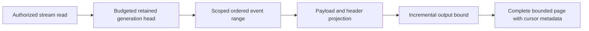
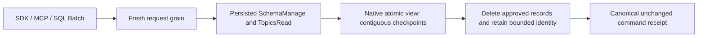
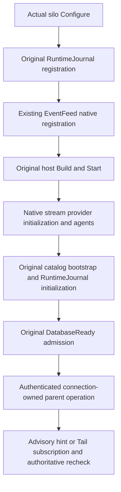

# EventStreams

Status: bounded read repair accepted; implementation/CI pending.
[ADR-035](../ADR/ADR-035-memory-performance.md) and AC-MP-005/012 apply.

| Requirement | Acceptance | Tests |
|---|---|---|
| REQ-EVENT-001: one raw work/deadline/cancellation budget covers stream head and event range | AC-MP-005 | Real-store bounded ranges, point/scan work, cancellation and subsequent store health |
| REQ-EVENT-002: projected complete StreamPage fits the result limit including head/cut/HasMore | AC-MP-005 | Exact positive/empty/edge response and over-budget event/protocol metadata cases |
| REQ-EVENT-003: preserve revisions, generation/retention failures and payload/header policy | AC-MP-005/012 | Existing event/processing recovery and new real persisted-policy redaction cases |

Owning slice: Core/Features/EventStreams/ helpers and UnitTests/Features/EventStreams/.
Existing Events.cs is ADR-032 migration debt; append/dedup/persistence are outside
this bounded-read task. Request DTO/wire and schema remain unchanged. Public SDK
and HTTP are entry points; UI N/A. Lead owns shared budget and endpoint forwarding.

TASK-MP-007A owns only ReadStream plus new event helpers/tests. Tests use the actual
ZoneTree engine and persisted policies, no doubles. GitHub executes TUnit and
related recovery/RF3 checks after strict build; source is not qualified delivery.

## Повний контракт Event Store

Актори: producer append, authorized reader/replay consumer та subscription worker. Entry points: `AppendEvents` у [public contracts](../../src/KeyLoad.Abstractions/Contracts.cs), `CommitAsync`/`ReadStreamAsync` у [SDK](../../src/KeyLoad.Client/KeyLoadClient.cs), [HTTP operations](../../src/KeyLoad.Server/ApiEndpoints.cs). Source: [Events.cs](../../src/KeyLoad.Core/Features/EventStreams/Execution/Events.cs); source є, але нові shared changes ще не GitHub-qualified.

| Вимога | Observable acceptance / flows | Test mapping |
|---|---|---|
| REQ-EVENT-004: append batch має expected-revision precondition та atomic domain authority | AC-EVENT-004: valid append послідовно змінює head/events у тому самому command commit; stale revision/NoStream або wrong domain відхиляє весь batch без часткових document/queue effects | Existing `DocumentEventAndQueueCommitTogetherAndCommandRetryDoesNotRepeatEffects`, `UniqueConflictRollsBackDocumentIndexEventAndEnqueue` у [TransactionTests](../../tests/KeyLoad.UnitTests/TransactionTests.cs); додаткові isolated OCC boundaries PLANNED |
| REQ-EVENT-005: EventId dedup належить stream generation і зберігає content identity | AC-EVENT-005: same ID/content retry не створює другий event; different content дає Conflict; інший stream generation має власну identity; restart не втрачає dedup | Existing `EventIdsAreScopedToTheStreamGenerationAndStreamsCanBeSubscribed`, `RetainedEventIdRejectsDifferentContentAndPreservesDedupForTheInitialStoreFormat` у [SubscriptionTests](../../tests/KeyLoad.UnitTests/SubscriptionTests.cs); recovery expansion PLANNED |
| REQ-EVENT-006: read/replay має ordered revisions, retained generation та bounded safe page | AC-EVENT-006: page/cursor продовжує retained stream без дубля/skip; empty tail валідний; invalid generation/history loss — typed failure; current payload/header policies застосовані | Existing [StreamReadResourceTests](../../tests/KeyLoad.UnitTests/Features/EventStreams/Cases/StreamReadResourceTests.cs), `FromNowAndTailCursorIncludeEveryLaterAppend` у SubscriptionTests; AC-MP-005/012 збережені |
| REQ-EVENT-007: compatible snapshot and complete same-cut tail reproduce an aggregate | AC-EVENT-007: reference equals snapshot+tail reduction; exact reducer/state schema enforced; explicit full replay requires complete history; wrong generation, erased/missing history and invalid identity fail explicitly | ADR-075; AggregateReplay real ZoneTree, pure worker, process recovery and actual RF3 SDK/MCP tests; runtime pending |
| REQ-EVENT-008: one bounded snapshot slot has atomic CAS and stable retry | AC-EVENT-008: absent-slot version zero, exact prior version, nondecreasing source revision and tail/floor bounds hold; retry never advances twice; unknown format/checksum corruption fail closed; reopen preserves exact state | ADR-075; AggregateSnapshot CAS/native/reopen/recovery tests; runtime pending |
| REQ-EVENT-009: aggregate state requires fully authorized workers | AC-EVENT-009: persisted EventsRead plus EventsReplay or EventsSnapshotsManage and every payload/header raw-read/raw-use grant are checked before bodies; tenant/resource denial and revocation disclose no protected state/events | ADR-075; persisted-policy real-store and official-client RF3 tests; runtime pending |
| REQ-EVENT-010: replay is bounded and produces no external effects | AC-EVENT-010: complete tail fits MaximumEvents and shared raw/result/deadline/cancel bounds or fails whole; one cut and one exact current event schema feed a deterministic pure worker; schema mismatch fails before callbacks; no append/enqueue/ack/subscription redrive occurs | ADR-075; AggregateReplay bounds/source invariance and pure SDK worker tests; runtime pending |

Повна resource identity включає tenant/database/atomic partition/stream set/stream/generation. Domain events є public history; CDC/outbox, consensus WAL та queue state мають власні authority/retention за [ADR-023](../ADR/ADR-023-journal-authority.md). Feed positions і revision — [ADR-025](../ADR/ADR-025-event-revision-feed-positions.md), atomic binding — [ADR-024](../ADR/ADR-024-transaction-domain-binding.md), privacy — [ADR-029](../ADR/ADR-029-event-message-classification.md), restore/retention — [ADR-030](../ADR/ADR-030-retention-paused-restore.md).

Topics/group delivery належать [Messaging](Messaging.md), CDC/system projections — [ChangeFeeds](ChangeFeeds.md), uploaded user bytes — [BlobStorage](BlobStorage.md). External effects і cross-partition atomic commits не обіцяються. Target map: Abstractions/Core/Client/Server/tests `Features/EventStreams/`; shared transport/host composition мають свої owners. UI N/A, це programmable Event Store. Нові runtime tasks починаються зі своїх ADR contracts; tests тільки real GitHub TUnit/recovery/RF3 SDK/MCP. Наявні test methods — source evidence, а не passing run.

## Current replay and event identity contract

Under ADR-075, `AggregateReplayReduction.Reduce` accepts the complete current
page, exact reducer, validated `IOptions<AggregateReplayWorkerLimits>` and
cancellation. Every event must match the reducer's current event schema exactly.
Validate the complete stream/generation/head/floor/tail/order/identity, original
payload/header JSON and combined input limits before invoking any reducer. Pass
the original immutable event to the reducer; validate each resulting state and
check cancellation at every existing boundary. There is no schema conversion
callback, registry, path resolver or associated configuration/message surface.
Snapshot and full-history replay must yield the same independently expected
state; wrong schema, invalid JSON, incomplete tail or exhausted budget must fail
without reducer effects. A subsequent healthy replay must still succeed.

AC-EVENT-005 uses only the current stream-and-generation EventId key. Real
append/retry/different-content/reopen cases retain exact head, revision, sequence,
receipt and content checks. Remove the alternate resource-wide key lookup.
Current whole-operation dedup tests remain required.

TASK-EVENT-CURRENT-028 freezes Client EventStreams reduction/validation/options/
messages, the two exclusive conversion files, Core Events append lookup and the
three existing worker case files plus test support as one guarded private scope.
It also ports only the EventId dedup case in Messaging's
`SubscriptionRecoveryAndPolicyTests.cs` to real current-key append/retry,
different-content rejection, reopen and independent stream/topic operations;
all other subscription, policy and inbox flows remain unchanged.
The worker removes conversion-only cases and ports current schema, bounds,
cancellation and positive reduction flows; root reviews every change, joins
shared docs and runs enabled build/format plus actual Aspire normal/scalar and
current event recovery/RF3 gates. Current native IDs/aliases, exact canonical
event content, persisted authorization and atomic/RF3 authority do not change.
Rollback restores a coherent source checkpoint with the current format.

TASK-MCP-EVENT-PARITY adds actual Docker RF3 .NET/official MCP evidence for
REQ-EVENT-004/005/006 and AC-EVENT-004/005/006 under ADR-039: identical bounded
page content and exclusive-revision replay, stable append retry with no duplicate event,
empty tail, persisted stream-set authority, cross-tenant denial, invalid limit and
stale generation. New tests are owned by
`tests/KeyLoad.IntegrationTests/Features/EventStreams/Cases/McpEventStreamTests.cs` and
cohesive scenario/tokens/assertion helpers in the same slice. Source-only status
remains pending until the full exact-SHA GitHub RF3 suite passes. Every actual read
cut must cover the append receipt and sequential cuts remain monotonic; independent
cuts may advance because five-second persisted Orleans heartbeats share the physical
store. No public pin-to-cut input exists, so byte parity applies to the exact event
records while each returned cut is checked independently.

TASK-RUNTIME-EVENT-FIXTURE-W preserves REQ-EVENT-004/006, AC-EVENT-004/006 and
AC-MP-005/012 after six exact candidate6949fa0 / run37005805424 tests fail during
setup. StreamReadResourceFixture creates different IDs for the CommandRequest
and replicated envelope; production correctly rejects that mismatch. The worker
owns only UnitTests/Features/EventStreams/StreamReadResourceFixture.cs and NEW
StreamCommandIdentityTests.cs. Derive the batch envelope ID from its existing
CommandRequest; other fixture commands retain fresh IDs. The new actual-store
negative regression must prove mismatched IDs return Validation without stream
effects, while matched ID append succeeds and retains its receipt identity/replay.
Preserve all existing range/policy/budget/cancellation and fixture lifetime cases.
This is test-only input repair: ADR-035/041/039 and the canonical batch contract
are sufficient, with no product/API/data boundary change or separate ADR. Lead
reviews/builds/formats and qualifies complete exact-SHA GitHub unit/RF3 suites.

TASK-AD-E2 preserves REQ/AC-EVENT-004/005/006 and AC-MCP-002/005/007 after
run37032546228 at exactb533c80 fails three RF3 cases at byte-exact EventData
expectations. The existing production contract canonicalizes JSON payload/header
property order; SDK/MCP bytes already agree, while the fixture expects unsorted
producer bytes. One worker owns only IntegrationTests/Features/EventStreams/
McpEventStreamScenario.cs and McpEventStreamTokens.cs. Keep unsorted InputEvents
for actual append and handcrafted independent canonical ExpectedEvents for the
unchanged exact equality, identity, sequence, paging, retry and security assertions.
Do not compute expectations through production normalization or weaken comparisons.
ADR-035/039 remain sufficient for this test-only oracle correction; no product,
schema, authority or transport contract changes. Lead owns integration/delivery
and exact-SHA GitHub qualification; local tests remain prohibited.

## TASK-EVENT-QUEUE-WHOLEFLOW-001 — bounded native operation regression proposal

This source-only regression batch preserves the existing ADR-002/024/026/028
contracts and REQ/AC-EVENT-004/005 plus REQ/AC-MSG-001/002/005. Its original
architecture task subset is KL-083 (append OCC/content identity), KL-087 (lost
claim/ACK reply recovery) and KL-091 (same-domain batch precondition rollback).
It does not close those tasks or qualify the full EventStreams/Messaging feature.

The owning unit cases are
[EventAppendWholeFlowTests](../../tests/KeyLoad.UnitTests/Features/EventStreams/Cases/EventAppendWholeFlowTests.cs)
(two concurrent Exact append instances and four rejection instances),
[QueueLostResponseWholeFlowTests](../../tests/KeyLoad.UnitTests/Features/Messaging/Cases/QueueLostResponseWholeFlowTests.cs)
(one claim/ACK retry workflow with real ZoneTree reopen), and
[QueueAdmissionCancellationWholeFlowTests](../../tests/KeyLoad.UnitTests/Features/Messaging/Cases/QueueAdmissionCancellationWholeFlowTests.cs)
(two pre-admission cancellation instances). They use actual native storage,
joined workers, literal complete results, persisted-state assertions, stable
receipt replay and a healthy follow-up. Failed commands may retain authorized
outcome/clock records; rejection tests assert complete affected domain-family
state rather than falsely requiring no committed failure outcome. Pre-admission
cancellation asserts the entire store and position remain unchanged and checks
the original token. It does not claim cancellation after commit undoes effects.

The exact proposed native inventory is nine. Current normal/scalar execution,
seeded process-crash criteria and real RF3 SDK/MCP qualification remain required;
source review is not execution evidence. Original historical passing cases and
retained global failures remain separate from this proposal.

## TASK-EVENT-APPEND-SEEDED-CRASH-001

REQ-EVENT-004/005 and AC-EVENT-004/005, REQ-MSG-005/AC-MSG-005 and REQ-STORAGE-006/007/AC-STORAGE-006/007 refine original KL083/KL091 seeded DURING append acceptance. Existing local R334/R335 full unit2876/2876 and R330 recovery236/236 are retained as baseline, not proof of this new flow or Linux acceptance. ADR002's private amendment freezes implementation before code.

AC-EVENT-CRASH-001: a real CrashHost seeds canonical resources and stream revision1, freezes one original typed command containing PutDocument, AppendEvents Exact1 and EnqueueMessage, then arms only its next native commit. Parent observes the existing exact crash marker at HeaderWritten, PayloadWritten, JournalFlushed, MutationApplied0/3/6 or ApplyCompleted, kills only its owned child and joins actual original exit and both bounded readers. Reopen native ZoneTree only after native handle/lock release. The retained outcome determines one complete recovered prefix: document/event/head/EventId identity/queue/outbox/receipt and store position must all match independent literal expectations. JournalFlushed and later cuts must recover committed; pre-flush cuts may expose either complete valid prefix, never partial state.

AC-EVENT-CRASH-002: applying the exact original principal/CommandId/payload/time on the recovered store yields one successful canonical effect, retains the original complete result on matching retry without position/byte changes, rejects changed content as exact Conflict, and leaves a matching healthy retry valid. A fresh bounded document/event/queue follow-up must advance stream revision3 and publish complete literal state. No sidecar may define recovered truth: sidecars hold only frozen caller input and seed coordinates; all canonical recovery comes from actual store.

Ownership map: CrashHost/EventStreams/Contracts and Helpers own immutable scenario/data plus existing CrashHostApplication mode dispatch; RecoveryTests/EventStreams/Cases, Processes and Assertions own seven real process cases, original child lifetime and independent state/replay oracle. Reuse CanonicalCrashBoundary, CommandIdempotencyProcessChild, existing native90second run/30second cleanup bounds, StorageTrialLease and current serializer/provider/options. No production storage/provider seam, format/namespace/serializer change, client retry, new deadline, multi-lane expansion or process-kill power-loss claim. Failures preserve primary plus child/readers/disposal errors and retained root; successful cleanup occurs only after original child and reopened store/locks settle. Root alone guarded-joins, formats/builds, discovers exact seven instances and runs full native recovery followed by original required normal/scalar/RF3/Linux/coverage gates. Rollback removes only this additive mode/cases and contract; all prior modes and failures stay intact.

### TASK-BACKUP-EVENTING-CUT-001 (KL-098 local capability-state proof)

Freeze before code under REQ/AC-BACKUP-001/002/003/004, REQ/AC-EVENT-004/005/006 and REQ/AC-MSG-003/005/006: seed actual native resources, three canonical source events, two independent subscription groups, an out-of-order completion gap, one persisted subscription-processing inbox with document+queue effects, and a real leased queue message. Capture the native backup cut, pack/unpack the genuine current-format artifact, restore into a clean target and reopen real ZoneTree. Independently require stable positions/content/generation, literal group checkpoint/issued/gap state, exact document/message state and byte-identical retained event/subscription/inbox/queue/outbox records. Manifest/source cut and single restore-authority position increment are exact; archive bytes remain unchanged.

Before explicit operator resume, fresh subscription and queue receive must fail exactly DispatchPaused and old source cursor/delivery tokens and pre-restore original command outcomes must fail exactly TokenInvalidated without effects. Persisted narrow principal denial remains enforced. Failed owned Apply outcomes commit exactly once and same-ID failed replay preserves complete result and store position. Old stored outcomes are retained; no old incarnation receipt is fabricated as current success.

Reconcile through existing public native operations only: explicitly seek the restored group from retained beginning to a new subscription generation, clear that group's explicit pause, explicitly set dispatch running as administrator, and obtain genuine new-incarnation claims. Reprocess the already completed source position using the same handler scope/execution generation: the persisted inbox returns AlreadyProcessed with original effects token and no second document/enqueue. Close contiguous gaps with actual acknowledgements. A new bounded producer/claim/ack and final close/reopen prove healthy continuation and all canonical state. Use no sleeps, fake providers, raw system-key resume or implementation-only migration APIs.

This closes only the missing local eventing artifact-state regression. KL-098 consumer/rebuild/transfer retention pins, event/topic purge/receipt horizon, history-loss reconciliation, remote-transfer KL094 and cluster-wide per-partition backup cut remain distinct open criteria. Current public event/topic APIs expose caps, reads and subscription seek, but no event/topic purge/pin implementation; the test must not synthesize history loss by deleting canonical keys or advertise local backup as a cluster cut. Existing outbox purge/pin and remote-transfer suites remain mandatory.

Ownership: UnitTests BackupRestore Cases/Fixtures/Assertions/Helpers; native artifacts and ZoneTree product APIs unchanged. Ordered join: contract, test-only implementation, root format/build and full normal/scalar native execution with exact original source/DLL identities; Linux recovery/RF3/global gates unchanged. No coverage inventory edit or status closure. Failure retains owned source/backup/target root and original primary plus joined disposal errors. No product seam, format/serializer/public contract change. Rollback removes this task and its test-only flow; no old report is rewritten.

## TASK-KL098-TOPIC-RETENTION-001 — bounded native topic purge

REQ-EVENT-RETENTION-001: `PurgeTopic(Topic, ThroughPosition, Generation)` is an inclusive same-partition Batch mutation through SDK CommitAsync, existing official MCP documents_commit and shared SQL CALL documents_commit decoder/request grain. Persisted SchemaManage AND TopicsRead are required before cached outcome replay. No new transport, provider or physical owner.

REQ-EVENT-RETENTION-002: delete only retained positions FirstAvailablePosition..ThroughPosition inclusive; reject nonpositive, beyond-tail or already-retained-away cuts, stale generation and scan/byte exhaustion. Every persisted same-source/generation group's contiguous Checkpoint pins all positions greater than Checkpoint, including paused/parked groups; IssuedPosition/ACK gaps do not release pins. Therefore requested cut must be <= every Checkpoint. Refusal is ResourceExhausted and cannot alter topic/group/inbox/queue state.

Every original native observer charges one examined record plus bytes before decoding, including range lookahead and missing point lookup; callbacks never escape native read ownership. All PurgeTopic effects in one owned ApplyMutations batch share one monotonically charged MaxScanRecords/MaxBatchBytes ledger; no reset per mutation. Native atomic write cancellation/admission remains owned by the original apply gate; this adds no separate token or deadline.

REQ-EVENT-RETENTION-003: atomically advance FirstAvailablePosition to cut+1 and subtract exact native serialized source bytes; preserve TailPosition, partition event sequence, generation, group/inbox/queue state, incarnation and backup identity. Retain only generated native typed event-ID digest/original position/generation in existing topic-event-id family. No bodies, fallback, migration or receipt pruning. Fresh identical event reuse remains DuplicateEventId; conflicting content remains Conflict; same immutable original command ID returns byte-identical receipt after purge.

AC-EVENT-RETENTION-001: genuine ZoneTree seeded three-event/two-group operation refuses unread and paused pins, releases only by existing exact ACK/explicit seek; bounded approved purge leaves literal event3 at original position/sequence3 and unchanged other model bytes, old read yields exact HistoryUnavailable; same-ID purge replay retains complete receipt and stable store cut.
AC-EVENT-RETENTION-002: post-purge original publish replay returns exact original receipt, fresh identical/conflicting event commands preserve exact distinct errors; denied caller cannot purge or replay privileged receipt, stale generation/cut/record/byte budget failures retain complete logical state and stable same-ID rejected outcomes; healthy next publish is position/sequence4.
AC-EVENT-RETENTION-003: native store reopen retains exact head, digest identities, group/checkpoint/inbox/queue state and receipts; shared real SQL compiler/decoder admits same Batch mutation; root must run native unit/scalar/recovery and genuine RF3 SDK/MCP before qualification. Automated owning cases: TopicRetentionOperationTests, TopicRetentionBoundaryTests; no source-only proof.

Implementation order: this contract first; Abstractions/EventStreams Contracts + generated native alias; Core/EventStreams Commands and Messaging publisher identity; existing Batch validation/auth/apply joins; UnitTests/EventStreams native operation fixtures/cases. Roll out only as a homogeneous freshly built native server cohort; do not downgrade a store whose journals/records retain the new generated aliases. Existing formats/aliases/field IDs are unchanged, with no mixed-version fallback. Historical digest count and receipt-horizon-wide storage bounds remain unqualified; active MaxEvents/MaxBytes is not reinterpreted as a lifetime-ID limit. Rollback source before qualification; persisted purge is deliberate irreversible data removal and has no migration rollback. Rebuild/transfer pins, receipt-horizon pruning, remote KL094 and complete KL098 closure remain explicitly incomplete.

### TASK-KL098-TOPIC-PURGE-CRASH-001: native admitted purge cuts

REQ-EVENT-RETENTION-004 / AC-EVENT-RETENTION-004: the real CrashHost first acknowledges purge through source position1, then arms the existing native CanonicalCrashBoundary for exactly the next Store.Commit position of immutable purge-through2. Two seeds admit either success (paused checkpoint3) or exact ResourceExhausted rejection (paused checkpoint1). Kill only the owned original process after its native phase marker; join original exit and both bounded readers, prove exclusive native locks, reopen actual ZoneTree. HeaderWritten/PayloadWritten are pre-flush boundaries; JournalFlushed is AFTER native durable flush returns and BEFORE native apply, not inside an OS flush syscall. MutationApplied0 and ApplyCompleted are actual native apply cuts. Pre-flush may recover old or whole new cut; post-flush must recover complete success/rejected receipt, never partial model changes.

The independent oracle requires literal head/events/source positions/digests/doc/queue/paused checkpoint plus original acknowledged seed receipt, canonical command fingerprint/receipt, exact committed clock and stable same-ID replay with full-store byte equality. Fresh identical/conflicting EventID errors remain distinct. Follow with actual append/read/queue claim and final native reopen. No new product seam/provider/journal/format/whitelist, sleeps, wider deadlines or retry-to-green. Root native discovery/build/recovery execution and exact source/DLL/PDB receipts are pending; process kill is not power-loss proof. Historical identity-population/horizon/rebuild/transfer/remote retention and full KL098 gates remain open.

Ownership: CrashHost EventStreams Contracts/Helpers, existing CrashHostApplication mode join; RecoveryTests EventStreams Cases/Processes/Assertions. Contracts join after TASK-KL098-TOPIC-RETENTION-001, then child/oracle; existing original process/readers/cleanup helpers are reused unchanged. Rollback removes this scenario/tests only, preserving product retention contract and immutable historical results.

### TASK-KL098-TOPIC-RETENTION-CORRUPTION-001

REQ-EVENT-RETENTION-005 / AC-EVENT-RETENTION-005: before an actual purge uses a persisted subscription pin, require its exact native canonical group key, positive subscription generation/ownership epoch, native definition/policy bounds and 0<=Checkpoint<=IssuedPosition<=the current source tail. GroupState has no source identity fields; source identity/generation comes from the canonical prefix, and subscription generation MUST NOT equal source generation by assumption. Paused/parked pins remain authoritative. Wrong native alias, extra key suffix and impossible persisted shape return exact Corruption, never silently pin/unpin. Reuse current native identifier/policy constants; no repository-wide group behavior change.

A retained-ID digest must be exactly 64 lowercase hexadecimal characters, with generation equal source generation and position within the actually purged prefix. A canonical active event and preexisting digest at the same ID is Corruption; purge must never overwrite it. Native wrong aliases remain Corruption with the retained-history detail, not DuplicateEventId/Conflict. Corruption is an existing fatal command-compilation boundary: exact KeyLoadException/Corruption escapes before canonical outcome or redo commit, so neither first call nor identical original-ID repeat advances position, clock, dedup or any canonical byte. It must not be normalized into an OperationResult or stored rejected receipt. Require the exact retained-history detail and whole-store byte equality for both actual throws while corruption remains. Explicitly restore the original native state; the same original purge ID then commits its literal two-record effect and exact success receipt once, followed by stable receipt replay. A same original publish ID that previously threw on corrupt retained digest is freshly evaluated after repair: valid retained identity yields exact DuplicateEventId, persisted once and replayed unchanged. Healthy new append remains required. No receipt is invented for the fatal attempt. No fallback, fake storage, authorization bypass, generation clamp, policy quota relaxation or product test hook. Existing valid fresh identical IDs remain DuplicateEventId, changed content Conflict, original command replay immutable.

Owning paths: Core EventStreams Validation/Commands and Messaging TopicPublishReads retained-ID branch; UnitTests EventStreams Cases over actual TopicRetentionFixture. Join after purgeR1 and crash follow-on docs, preserve both immutable packets. Root format/build/native normal/scalar/recovery/RF3 discovery/execution pending. This precise corruption follow-on does not close KL098 broader gates.

Shared-ledger boundary: each first purge-through1 completes exactly two observed group reads plus source body, active-ID pointer and missing retained-digest probe (five). The next effect observes both original persisted groups, reaching seven before another body read. Fixture cap6 proves second-effect rollback under one shared ledger; original cap4 remains an explicit first-effect rejection control. Production limits are unchanged; both require the same exact scan-budget ResourceExhausted outcome and full rollback.

Stage XI native analyzer correction retains the existing REQ/AC contracts: the ephemeral native gate snapshot is exposed as `GateDiagnostics`, and the one-command purge ledger snapshots and validates the existing centrally bound `OperationLimitsOptions`. Limits, observer ordering, byte/scan accounting and authorization remain unchanged. Lowercase digest validation uses the same exact ASCII alphabet through native span classification. Original failed build diagnostics are retained; compilation and whole-operation regressions remain mandatory.

R441 actual native correction, TASK-KL098-TOPIC-RETENTION-CORRUPTION-001 / REQ/AC-EVENT-RETENTION-005 and AC-EVENT-RETENTION-002: original twelve Corruption failures and one nonadvancing policy-epoch failure remain retained. DatabaseEngine.ExecuteAndBuildOutcome excludes Corruption from stored domain outcomes. The genuine manager revocation advances persisted epoch1 to2 before replay denial; original success receipt and complete native bytes remain immutable after denied repeat. No product exception normalization, authorization weakening or new recovery claim. Root owns fresh native build/census/whole-operation re-execution; this source correction is not PASS evidence.

## TASK-EVENT-APPEND-RF3-001 — original KL083 public whole flow

REQ-EVENT-004/005 and AC-EVENT-004/005 retain the current expected-revision,
stream-generation EventId identity and same-command replay contracts. The new
AC-EVENT-APPEND-RF3-001 requires one actual Aspire RF3 flow through the .NET SDK
and official MCP SDK: the existing literal three-event NoStream seed; exact
NoStream refusal, same-command changed-content Conflict, changed EventId Conflict,
partial-duplicate DuplicateEventId and stale append-generation TokenInvalidated
with full canonical stream invariance;
persisted EventsRead-only append/retained-command refusal with safe problems;
two joined Exact3 producers with exactly one complete winner and one immutable
RevisionConflict; unchanged full successful/failed replay; a fresh Any append
and the complete independent five-event literal stream, head, revision, sequence,
metadata and receipt oracle. Each page independently covers the actual receipt
cut; running-cluster physical positions may advance and are not domain-effect
oracles. Original event RecordedAt values are retained across refusal/replay.

`EventAppendRf3WholeFlowTests.AcEvent004005PublicConcurrentExactDedupDeniedReplayAndHealthyAnyAppend`
owns this additive public operation flow. Existing EventAppendWholeFlowTests
retain isolated local OCC/full mixed rollback controls and the seven original
EventAppendProcessRecoveryTests retain genuine seeded kill/join/reopen and
full receipt/dedup/healthy proof. Shared RF3 resources are never stopped by the
new case. Native ConnectionGrain call-local execution, fresh persisted policy,
existing caller deadline and full joined SDK/MCP/fixture cleanup remain unchanged.
No new product format, alias, field ID, capability, quota, dependency or timeout.
Root owns integration and exact-source Linux normal/scalar/process/RF3 discovery,
execution and provenance; source presence is not qualification or task closure.
Broader ADR002 leader-change, full feature/coverage/endurance and power-loss gates
remain mandatory and explicitly unqualified by this source-only packet.

The final fresh Any append uses the previously rolled-back new EventId from the
partial-duplicate batch under a fresh CommandId and literal new payload. A leaked
dedup reservation must fail this healthy operation; it cannot hide behind page
invariance. The original rejected command retains its failed outcome unchanged.

After that fresh append, the same failed partial batch must replay its exact
original DuplicateEventId problem. Re-evaluation would now encounter changed
content at the formerly rolled-back ID and cannot substitute a different error.
The original NoStream successful command must still replay its original receipt
at the later head; full canonical events/head remain unchanged.

### TASK-KL084-STABLE-STREAM-STAGE-A-001 — current product implementation contract

REQ-EVENT-READ-DIRECTION-001 / AC-EVENT-READ-DIRECTION-001 requires complete independent forward/backward retained-event pages, exclusive bounds, current field/header redaction, byte refusal without partial publication, cancellation/refusal followed by a healthy operation. REQ-EVENT-READ-CUT-001 / AC-EVENT-READ-CUT-001 freezes original traversal tail/floor and snapshot cut, with subsequent append excluded until a new traversal; current CutPosition remains actual same-view position. Original generation/history, signed source feed and every global gate remain mandatory.

ReadStreamRequest IDs0..2 remain unchanged; Direction3 (Forward0/Backward1), MaxBytes4 (0 means original centrally validated MaxBatchBytes), Cursor5 are additive current contracts. StreamPage0..4 remain unchanged; Cursor5 and SnapshotCutPosition6 are appended. Head is the captured immutable traversal head; fresh current head separately proves original range remains available. Complete native result, including cursor/head metadata, must fit the original constrained result budget. Over-budget produces a closed refusal, not a partial page. Native reverse VisitReverseRange retains exclusive LOWER afterKey and exclusive UPPER untilKey, with original counting/cancellation reader. The new undelivered traversal cursor field6 SchemaVersion uses the actual ResourceDefinition.SchemaVersion long type without narrowing; existing alias, field IDs, constructor shape and authorization comparisons remain fixed.

The generated native stream-traversal cursor alias is keyload.core.stream-traversal-cursor.v1: 0Version,1Purpose,2Incarnation,3Stream,4PrincipalId,5PolicyEpoch,6SchemaVersion,7PlacementEpoch,8Direction,9CapturedTailRevision,10CapturedFirstAvailableRevision,11SnapshotCutPosition,12NextExclusiveRevision,13ExpiresAt,14LogicalPlacementRevision,15DirectoryFence. Fields7/14/15 are actual AtomicPartitionPlacementResolution PlacementEpoch/Revision/DirectoryRevision; no scalar reinterpretation. Original owning signer and EventSourceExecutionOptions.CursorLifetime supply MAC/expiry; continuation does not renew original expiry.

Core authenticates current persisted principal and EventsRead before token decode or event payload. On that SAME bounded native view, actual catalog and registered owner/directory/logical placement resolve and verify exact borrowed configured PhysicalShardRecord (including ordered voters), store incarnation, and current selected owner. Original ConnectionReadCapabilities supplies only its existing DI PhysicalShardRecord to the Stream branch. Core verifies the tuple; it grants no caller roles. Public Core request/scalar paths acquire native default catalog authority and refuse if it is not this store; nondefault owner paths must provide genuine configured authority which is revalidated. No administrator-read workaround, fabricated default epoch or parallel dispatcher.

Ownership/mapping: Abstractions EventStreams DTO/enum; Core EventStreams Contracts/Queries/Execution; existing Orleans GrainCoreReadCapabilities + ConnectionReadCapabilities only Stream dispatch; Client current ReadStreamAsync request transport unchanged; existing SDK/MCP/Q1 same public request and complete schema/result controls; Unit native real-store controls and RF3 same-root cold traversal. All original reader/producer cleanup and failure trees remain. Native source preview precedes root join, actual strict fresh metadata and Linux normal/scalar/process/RF3 evidence follow. Stage A does not implement vector-map admission or live registration/backpressure Stage B/C and cannot close KL084. No migration/fallback, policy/deadline/limit change or runtime PASS is asserted.

Stage A boundary details: negative or above-captured-bound AfterRevision and invalid Direction/MaxBytes are Validation, as frozen in the approved traversal proposal; original Limit<1/>MaxResults remains BudgetExceeded. Cursor requests use AfterRevision=0 rather than a second competing boundary. Exhausted traversal returns Cursor=null. The existing scalar Core signature delegates to this one current reader; no retained legacy reader is introduced. UTC expiry control in native Unit tests borrows the original timer/monotonic owner and exact same EventSourceExecutionOptions instance; it is a supporting expiry operation, not natural RF3 time qualification.

## TASK-KL084-PUBLIC-CATCHUP-COLD-001

REQ/AC-EVENT-006 and architecture38.3/KL084: existing forward ReadStream numeric exclusive-revision continuation must not lose an append at an observed empty tail. Freeze one real original stream/generation and append receipt, read its complete three-event catch-up, then start an empty-tail read concurrently with one exact3 append. The race page is validated against its actual committed cut: complete empty old head3 or complete one-event new head4 only. After both original operations settle, consume the original after3 continuation through SDK/official MCP and both Q1 routes, exact independently authored event4/full record/page, empty continuation and immutable original append receipt replay. Current wrong-generation denial on all routes precedes healthy continuation. Dispose original caller owners, kill/restart the same Aspire-owned RF3 resources with original clocks/deadline/roots and native readiness, reconnect fresh clients with same persisted credential, assert unchanged node/incarnation/voters and nondecreasing actual generation, and require the same original continuation and full four-event history/receipt.

This finite test does not claim notification registration, backward read, signed stream cut/cursor, vector cursor/discovery-map or >RAM qualification. Current DTO IDs0Stream/1AfterRevision/2Limit and forward same-cut native operation remain unchanged. Architecture38.3 still requires backward, maxBytes, vector cursor and catch-up/register race; ADR025 explicitly has no chosen vector wire yet. Those are real remaining implementation gates, not replaced by this test or by document CDC cursors. No clock/limit/retry/provider/topology/schema/auth modification; no new operational option. Existing Unit range/work/result/privacy/cancellation/retention tests and process/restore/movement scopes remain mandatory. Exact-source Linux native discovery/source+PE/PDB, normal/scalar original outcomes and joined resources/reader cleanup required. Docs precede source; rollback removes these fixture-only files and appendage coherently.

The existing ReadEventSource stream path already supplies a signed scalar SourceCursor with incarnation, exact source, persisted principal/policy/schema and expiry, plus stable per-atomic EventSequence. This is preserved and exercised: retain its original caught-up cursor before append, consume the identical cursor through all four routes before/after cold, verify complete independent event4 and empty continuation. No claim that this existing scalar token is a vector cursor or stable historical ReadStream cut.

## TASK-KL084-OPERATION-KIND-RESERVATION-001

REQ-EVENT-READ-CUT-001 / AC-EVENT-READ-CUT-001 and the pending KL084 Stage B/C control-map admission reserve the exact native operation values EventFeedControl=36 and EventFeedSourcePhase=37; target-only CommitInbox retains its already frozen value38. These are consecutive distinct operation discriminants, never flags or combinations. The reservation does not implement or qualify Stage B/C.

Before the verified control/source implementation is joined, both reserved operations must remain unavailable: the existing generic CreateNativeOperation factory refuses them with UnsupportedCapability, public JSON normalization records the existing unsupported refusal, and no public endpoint, MCP operation tool or native payload decoder is added by this reservation. Stage B/C must independently authorize actual control36 admission and private source37 execution through the owning trusted receiver; it cannot enable either via the generic public factory. Existing operation identities, aliases, field IDs and receipts are unchanged.

Implementation ownership: Abstractions/Contracts.cs only for these exact enum values, under EventStreams/ADR025 traceability; root composes the declarations after this contract and retains the existing closed factory/normalization branches. The Stage B/C agent rebases its shared declarations rather than duplicating them. Root verifies full build and affected native operation/refusal regressions, then exact-source Linux normal/scalar/process/RF3 complete Stage B/C flows before acceptance. Rollback of this undelivered reservation must remove the related undelivered consumers together; no persisted migration, fallback or legacy path is authorized. Runtime qualification and KL084 closure remain pending.

### Native cold caller phase ownership clarification 2026-10-10

Existing StreamTraversal and StreamCatchup cold cases close each actual SDK/official MCP caller phase before the same-root Aspire restart, then own a new caller phase for the unchanged full receipt, cursor, history and healthy continuation assertions. The native caller helper joins the operation before disposal, preserves every original operation and disposal failure through the existing ServerFailureObserver, and rethrows the actual original failure or ordered aggregate. No timeout, cancellation, identity, replay oracle, public contract or topology changes. ADR-025 and the existing cold/recovery acceptance flows remain the implementation contract; exact-source Linux outcomes are still required.

## KL-085 AC-EVENT-009 authorized recovery continuation (2026-10-10)

The existing `AcEvent009RevocationReauthorizesReplayAndDurableSnapshotRetry` and
`AcEvent009PersistedRawGrantsAuthorizeExactInputsAndRevocationDeniesBothClients`
cases continue the original protected aggregate operation after persisted
revocation. They retain the original snapshot command, complete receipt and
complete snapshot/tail page; revocation refuses private reads and original-command
retry, then a strictly higher persisted policy epoch restores the same principal
and exact original grants. The repaired caller must receive the independently
expected snapshot state, complete ordered event data/headers and pure reducer
result, and the complete original full snapshot receipt remains an immutable local native authority oracle.
The original command stays PermissionDenied after an epoch-changing grant repair;
current authorization does not erase its captured policy-epoch fence. A NEW
authorized snapshot CAS command uses the actual existing source revision and
state, advances snapshot version exactly once and yields its independently
expected current-epoch receipt. That new command alone may success-replay.

Unit ownership reopens the same native store. RF3 ownership closes the original
SDK/MCP connections, restarts all three existing Aspire-owned nodes on the same
root, and acquires fresh SDK/official MCP callers. Direct SDK, official MCP, Q1
SDK and Q1 MCP must each return complete protected replay data and the NEW current-epoch
receipt before and after cold restart; the OLD epoch command remains denied
without protected output or aggregate effects on every route. Each observed owner retains NodeId and
incarnation, while read generation and applied authority may advance; every
new replay page acquires its own current cut, which must not precede the retained
original page. Full page equality excludes only that independently checked cut.
No old cursor, connection or captured authority is reused after restart.

This extends REQ-EVENT-007/008/009/010 and AC-EVENT-007/008/009/010 under TASK-085
and ADR-075. Snapshot CAS/source revision, original JSON/checksum, persisted raw
grants, strict stored outcome policy-epoch equality and pure bounded worker behavior
remain unchanged. Refusal creates no aggregate input/snapshot effects; authority
and command bookkeeping are not asserted to have an invariant physical cut.
There is no application schema transformation, internal-format fallback, clock,
quota, deadline, transport, serializer or product API change. Normal/scalar Unit,
real process recovery and RF3 caller qualification remain authentic runtime gates.

Ordered source ownership and join: (1) append this contract before source;
(2) preserve both existing case declarations and their original deadline/fixture
ownership; (3) retain original protected input, snapshot command/receipt/page;
(4) exercise persisted revoke and all public refusal routes; (5) repair the same
persisted principal at a higher epoch, require the OLD command denied and complete
all four fresh reads plus NEW current-epoch snapshot CAS/receipt retry routes;
(6) join old callers, capture actual owner statuses, restart the existing RF3
resources, acquire fresh callers, repeat complete results and compare native
owner identities. Root joins/tests this guarded proposal; rollback is source
rollback only and introduces no persistent format change.

Exact owning source map: Unit `Cases/AggregateReplayAuthorityTests.cs` and
`Helpers/AggregateReplayAuthorizationContinuation.cs`; Integration
`Cases/AggregateReplayRf3Tests.cs`, `Helpers/AggregateReplayRf3Scenario.cs`,
`Helpers/AggregateReplayAuthorizationContinuation.cs`,
`Contracts/AggregateReplayAuthorizationOriginal.cs` and
`Assertions/AggregateReplayAuthorizationRoutes.cs`, all within their existing
`Features/EventStreams` slices. The original process suite and independent
schema/history/concurrency/cancel cases remain required; this additive flow
closes no application schema transformation or endurance gate by source presence.

R2 native source correction: `DatabaseEngine.ValidateCachedResult` in
`CommandOutcomes.cs` rejects `previous.PolicyEpoch != principal.PolicyEpoch`.
`SaveAggregateSnapshot` admits equal existing SourceRevision with the exact
current ExpectedSnapshotVersion. This continuation preserves those production
fences unchanged. Unit captures the actual original StoredOutcome native row
bytes before revocation and checks them unchanged after repair, new CAS and
reopen; RF3 retains the full original receipt as evidence without treating a
reserialization as a persisted-node witness. The immutable R1 proposal is
unqualified and superseded for join; no original execution failure is rewritten.

## TASK-KL098-MIXED-RETAINED-ARCHIVE-001 traceability join

REQ/AC-BACKUP-003/004 and REQ/AC-EVENT-RETENTION-001–005 map to the exact current-format mixed-cut operation, ordering, native source owners, higher-epoch privacy repair and remaining qualification in [BackupRestore](BackupRestore.md#task-kl098-mixed-retained-archive-001--current-format-common-eventing-cut). Existing original local artifact, Phase1 queue backup, target-inbox cold/process and topic purge/process cases remain unchanged. The proposed new Unit case creates real original subscription gap/inbox, pending/parked/leased queue, target inbox/effects and separately purged source under ONE original native archive cut; no empty-family count or fake rows. Both actual atomic partitions, immutable outcomes and complete source/archive bytes stay exact. Paused new-incarnation restore, original authority refusal, explicit authorized continuation, current persisted privacy/revoke/repair and joined same-root cold/healthy follow.

Ordered join is this docs contract before new Unit BackupRestore Cases/Contracts/Models/Helpers/Assertions, then root native preview/build/normal+scalar discovery and original Linux source/DLL/PDB/images. No product/schema/public/family/option/default/timeout/clock change. Rollback removes this test-only addition and append, preserving original source/history. Actual 67 inventory and one source declaration are not native UIDs/PASS. Mixed six-owner SDK/official MCP/both Q1/process gates, queued Phase2 order, reviewed B/C source pins, receipt horizon/rebuild/transfer/remote KL094 and physical-erasure/endurance/power-loss requirements remain OPEN.

### TASK-KL084-NATIVE-READ-TRANCHE-001

REQ-EVENTS-VECTOR-PRIVATE-READ-001 maps to AC-EVENTS-VECTOR-PRIVATE-READ-001: purpose-only native EventVectorCoverage69, EventVectorOriginalOutcome70 and EventVectorSources71 run through the current ConnectionReadExecution owner. Generic public read construction refuses these kinds; no public HTTP/MCP/Q1 decoder or tool is added. Existing QueueTransferCoordination72 and every previous ordinal remain unchanged. Current persisted subject authorization, original expiry/cancellation, configured physical owner and same-view catalog/registered placement precede protected native reads. Coverage contains the complete bounded roster/origin/resource/head facts; an actual absent empty-topic head never creates a generation or pin. Source pages preserve all canonical events/cursors/read cuts. Original outcome observation returns actual retained raw native bytes after identity/fingerprint/retained-scope checks and cannot renew or resend a phase.

This source prerequisite implements the three bounded readers and their R7–R21 typed schema/identity/validation dependencies. It does not activate control/source commands36/37, R22 first-issuance state, public vector control/tail tools, remote endpoint or stream provider registration. Those remain required in the complete guarded B/C stage. No new policy values, default authority, migration, fallback or history-release claim. Abstractions owns request shapes; Core EventStreams owns bounded query/validation/identity/serialization; Orleans EventStreams owns signed internal read codec and closed purpose admission, with four additive ClusterRouting joins.

Acceptance is still OPEN: root canonical compiler/analyzers and genuine denied purpose/owner/current-policy/cancel/budget → unchanged full image/cut → fresh healthy complete native coverage/source/outcome operations; cold unknown outcomes must remain observed without resend. Full B/C SDK/official MCP/Q1, source-pin/partial-refresh/release/first-issuance/provider/callback/recovery gates remain mandatory. Native source preview and declared cases do not close any criterion.

### TASK-KL084-NATIVE-READ-CONTRACT-COMPILATION-002

REQ/AC-EVENTS-VECTOR-PRIVATE-READ-001 retains the exact native read ordinals, closed purpose admission, current persisted authorization, bounded same-view reads and original expiry/cancellation. Complete the existing public shape's XML descriptions without changing any field, alias or identity. Keep EventVectorReadEnvelope in the owning EventStreams Serialization role: it validates the same actual read kind before observing the same TimeProvider, uses existing RemoteRead lifetime/incarnation/payload constraints, then applies the original source purpose. The existing GrainRequestCodec method still signs that exact envelope once. Extract only this cohesive construction to keep the aggregate codec within its existing 200-code-line bound; no dispatch, authority, timing, signature, quotas or generated contracts change.

Root integrates these documentation and envelope-construction edits before a fresh native/compiler/formatter stage. Original generic public refusals and all Unit/process/Aspire RF3 source/image/UID gates remain required; source correction alone closes no criterion. Rollback removes only this helper and restores the same body and property documentation coherently. Full B/C remains OPEN.

### TASK-KL084-NATIVE-READ-CURRENT-POLICY-002

REQ/AC-EVENTS-VECTOR-PRIVATE-READ-001 retain the same actual DatabaseEngine.Authorization IAuthorizationPolicy throughout ParentOutcomeRead → ParentObservationRead → ParentLookup → ParentScopes. Active and terminal retained source scopes require current persisted SubscriptionsManage and EventsRead/TopicsRead before protected phase decoding. Cleanup phase validation borrows the same policy instance; it creates no policy, default authority or caller role. The control-partition grant uses the actual requested resource (Scope.Resource, topic or streamSet), preserving the native wildcard-or-exact resource matching API.

The finite Core correction also moves the two local coverage CancellationToken parameters last with all original calls, and names the existing zero values for empty identity text and equal scope ordering. No field, alias, ordinal, receipt, expiry, arithmetic bound or validation sequence changes. Current source gates still require canonical compiler/analyzers and full authorization/refusal/cold/healthy operations; this correction adds no execution or acceptance claim. Docs precede the guarded Core postimages; root alone integrates and verifies.

## TASK-KL084-BOUNDED-NATIVE-PROVIDER-OPERATION-030

REQ-EVENTFEED-PUBSUB-001: the disposable EventFeed native `IGrainStorage` provider must own keyed state, detached values, ETag CAS and joined cleanup through the actual Orleans `GrainId` and registered serializers. Charge encoded key, state name, ETag and value against the same configured `MaxResults` and `MaxQueryReadBytes`; each entry must also fit `min(MaxBatchBytes, MaxQueryReadBytes)`. Cancellation, stale ETag, foreign state, exhausted byte/entry budget and disposal must refuse without replacing existing state.

AC-EVENTFEED-PUBSUB-001: both existing `EventFeedPubSubStorageTests` whole operations must write/read the complete original value and ETag, reject stale CAS and the actual configured quota/cancellation/foreign-state/disposed-owner cases with unchanged state, then clear or replace through the actual native provider and verify a fresh complete healthy value. Preserve original owner cleanup and every failure. These are disposable provider operations; canonical ZoneTree state, durable delivery, public registration, restart and RF3 acceptance require their independent mapped gates. ADR-025 and the existing native-provider implementation contract remain sufficient; no additional public or persisted contract is introduced by this traceability clarification.

REQ/AC scope: approved KL084 B/C advisory-provider admission and disposable native pubsub resource ownership. The purpose-owned EventFeed provider borrows the actual pinned Orleans10.4 MemoryAdapterFactory, native IQueueAdapter/cache, and registered Serializer<MemoryMessageBody>; Microsoft.Orleans.Streaming is explicitly centrally pinned at the SAME10.4 version to expose those native APIs. There is no replacement/copied provider. Queue slots, cache batch slots, and encoded fixed-hint bytes remain distinct; MaxAddCount is not a memory bound.

Native keyed EventFeedPubSubStorage uses actual public IGrainStorage/GrainId/registered serializers, exact encoded key/state-name/ETag/value charges, SAME configured MaxResults and MaxQueryReadBytes, per-entry min(MaxBatchBytes,MaxQueryReadBytes), ETag CAS, detached state and joined original owner cleanup. The two complete EventFeedPubSubStorageTests operations exercise original complete value+ETag, stale/no-effect quota/cancellation/foreign-state refusal, actual clear/replacement, encoded-byte refusal, disposal refusal and fresh disposable state. This stage does not activate public feed control, qualify native callback subscription/loss/drain, durable pins, RF3 or process recovery, or claim a durable memory provider. Those whole KL084 B/C gates remain mandatory and OPEN.

Verification: private isolated source/build/output lane only; original build/test reports and exact source/compiled-image receipts are required. Local results qualify only these supporting native resource operations, never delivered Linux acceptance. Root integrates the reviewed source and reruns all affected mandatory gates.

### TASK-KL084-NATIVE-PUBSUB-EMISSION-032

The same registered serializer measures and admits the complete native row before allocation. Native buffer size hints are not emitted byte counts: `SerializeToArray` supplies the original native allocation protocol, followed by exact admitted-versus-emitted length verification. Only the owned counting writer actual byte-admission refusal maps to ResourceExhausted with its full original cause; serializer errors remain untouched. The full native CAS/quota/cancellation/disposal/refusal→unchanged state→healthy replacement/restart operations are required; capacities and default provider semantics are unchanged. The isolated native macOS development normal/scalar controls passed both cases after original failures; Linux integrated, provider callback/tail, process-kill recovery and RF3 qualification remain open.

### TASK-EVENT-VECTOR-CODEC-RESPONSIBILITY-033

The bounded event-vector phase additions retain the original GrainRequestCodec API. Its exact native payload verification responsibility moves to feature-local `ClusterRouting/Serialization/GrainRequestPayloadVerification`; the façade borrows the same codec, engine and captured maximum token length. Evaluation remains token-length → native signature verification → original scope validation → configured MaxBatchBytes → native payload validation → DecodedGrainRequest. No new authority, configuration capture, allocation, alias, field ID, fallback or exception order is introduced. Existing signed-request negative/healthy operation tests remain the verification gate; source extraction and private compilation are not Linux/RF3 qualification.

## TASK-KL084-RESERVED-LOCAL-PROFILE-001

Traceability: existing REQ-EVENTS-FIRST-OPEN-ORDERED-001 / AC-EVENTS-FIRST-OPEN-ORDERED-001 and TASK-EVENTFEED-FIRST-RESERVED-OWNER-001, plus the R22 immutable failed-replay/abandonment/cleanup chain.

The fixture-only EventVector reserved-phase enrollment explicitly selects the genuine two-RF3 protected query profile under a validated local image. It preserves the independent NativeDiscoveryOmission branch and ordinary local-profile refusal. The existing signed first-dispatch reserved barrier, original expiry, all six source/image/StartedAt identities and joined all18 locks remain required. R104 was a pre-operation profile rejection; profile admission, compilation and native provider Unit controls do not qualify FirstOpen or Linux RF3 acceptance. See the finite EventVectorReservedProbeProfile owner and original EventFeedFirstOpenRf3Tests whole-operation gate.

# KL084 complete ACK/Release public operations — private contract

REQ-EVENTS-VECTOR-ACK-001 / AC-EVENTS-VECTOR-ACK-001: an exact original Offer may be acknowledged only by the same current persisted principal/control scope after current all-source authorization. The real parent uses the existing ConnectionGrain call-local owner, native Leader source-admission proof, ordered Advance, authenticated original outcomes and terminal PublishAcknowledgement. Every source must settle; partial/unknown source effects remain charged and observable, never implicit resend or false rollback. Full original public result/receipt/cursor replay remains immutable after later append, ACK, source policy change/repair and same-root cold.

REQ-EVENTS-VECTOR-RELEASE-001 / AC-EVENTS-VECTOR-RELEASE-001: ordinary map Release uses the same owners and genuine current retained Pin frontier; it preserves original first-Pin identity/body/expiry and settles each exact Release outcome before terminal CompleteRelease. Retained unknown tombstones keep map/source charges. First-issuance abandonment cleanup remains its distinct R22 path and cannot fall through ordinary map release. No new quota, TTL, retry, schema field or public authority is added.

Public traceability: typed SDK AcknowledgeEventFeedAsync and ReleaseEventFeedAsync reuse EventFeedControlRequest and EventFeedControlResult, existing native HTTP signer/connection transport, and commandId. Exact routes /v1/event-feeds/acknowledge and /v1/event-feeds/release; official MCP tools keyload_acknowledge_event_feed and keyload_release_event_feed use the same full native generated schema/strict public JSON decoder and exact SubscriptionsManage capability/effect contracts. Q1 routes bind the same request/action through the canonical operation gateway. Existing request IDs0..12 and result IDs0..10 are unchanged. Generic factories36/37 remain closed. Current main activation is unchanged; only a complete guarded candidate can expose these operations after genuine owner proof.

Runtime controls: fresh actual complete Offer→ACK→late append/new Offer→Release, concurrent same-public-ID no second SourceEffect, caller cancel/expired/wrong-purpose/changed payload/policy/owner/budget refusals with original effects accurately retained, known original exact replay, cold unknown no-resend, source-only revoke→refusal before protected decode→actual repair→exact original full replay. Every test keeps full independent page/header/reference/revision/vector/source-cut/receipt/counter/state and original task/reader/HTTP/AppHost cleanup. SDK/official MCP/both Q1, normal/scalar/process/six-owner RF3 and Linux gates remain OPEN until executed; declaration/compile is not acceptance.

Join: approved BC/read106/R22/current authority prerequisites, first-Admit/complete-FirstOpen and Offer, source-Admit wrapper and same-view settlement/source-reply ownership, complete typed routes/catalogs plus independent complete catalog/family oracles, then actual owning build and original operations. Rollback removes only this undelivered coherent candidate; no migration/fallback or current persisted format support branch. Root alone joins main.

Exact names follow the already delivered EventFeedOfferProtocol route/tool naming convention; original contract artifact remains immutable.

# Native responsibility extraction

Actual isolated R80 KLD0032 measured the existing McpToolDescriptions.For switch at66 executable lines after the four event-feed operation bindings. Move only those exact four lookup arms into the feature-owned executable McpEventFeedDescriptions.Find helper; the existing switch delegates by null-coalescing and retains every prior arm/error/message. No public contract, hints, identity, visibility or analyzer limit changes. Native codefix returned NotFound for the private document. Compile and complete existing independent catalog test remain mandatory.

## KL084 ordered first-Admit producer and original cleanup result successor

# KL084 fresh first-Open ordered producer correction

REQ-EVENTS-FIRST-OPEN-ORDERED-001 / AC-EVENTS-FIRST-OPEN-ORDERED-001: a genuinely new authenticated public Open reaches the existing native Leader Admit owner. Strict private70 FirstIssuanceLookup remains observation of an already issued original operation, never proof of first absence. Its genuine missing-Admit RecoveryRequired refusal must not be misused as a prerequisite that prevents all new Open operations.

Source proof: EventVectorFirstAdmitParent currently invokes ParentFirstObservation before CaptureAndOpen; FirstIssuanceLookup.Read invokes FirstAdmitOutcome.Observe and unconditionally throws RecoveryRequired for a null actual original Admit outcome. Remove only that incorrect pre-Admit strict lookup call. Retain the complete terminal original outcome/current-source authorization lookup first. The read-only current configured coverage capture creates only a candidate AdmitFirstIntent, not the retained first Open or any source effect. Existing authenticated rounds plus SAME ProtocolGate current outcome/owner/grant check and bounded raw unapplied suffix probe alone distinguish genuine first append from known/pending/cold/unknown.

Only the actual successful fresh Leader append after joined quorum/apply returns FirstAdmitAppendResult bound to original server RequestId, operation and real index/term. FreshOpenCompletion validates that wrapper before any CaptureFirstOpen/ReserveFirstOpen/Open/Pin/ACK/PublishOpen effect. Original domain failures return unchanged; known success without fresh wrapper is observation-only UnknownWriteOutcome, pending/suffix exhaustion/cancel cannot append or dispatch. The candidate coverage read does not alter or recapture an already retained first phase, renew its expiry or authorize a source effect. Generic36/37, strict lookup schema/aliases/Ids and original first identity/deadline remain unchanged.

Tests: the existing genuine six-owner public SDK/official MCP/Q1 case executes fresh Open, complete data Offer, ACK, Release and original same-root cold replay with complete result/receipt/vector/page literals. Genuine Leader known/pending/exhausted/cancel/current-revoke controls and current/source-only policy repair are required separately; source presence or compile is not runtime proof. Root remains sole main integrator, isolated development evidence is not Linux delivery.

Join/rollback: exact owning parent call removal after dependency-complete BC/current authority successor; preserve all preceding terminal/Offer/ordinary settlement routing and failure/cleanup owners. No new API/storage fields/quota, duplicate dispatcher, absence cache or compatibility branch. This corrects an undelivered candidate only.

# KL084 R22 public first-issuance cleanup result and immutable failed replay

Source gap: ordinary map ACK/Release now has full parent/source-admission implementation. A distinct Release selecting Request.Id12 is not an ordinary map release. Existing first-issuance Abandon/Cleanup returns EventVectorFirstIssuanceResult (native alias keyload.core.event-vector-first-issuance-result.v1, exact IDs0 Version/1 NativeCommandId/2 Issuance/3 Receipt), and currently has no retained complete public DTO or public-parent terminal pointer. Routing this request through fresh Open or ordinary map settlement is forbidden. Main remains disconnected.

Freeze one append-only private Id4 OriginalPublicResultBytes on that existing result, canonical Empty for Admit/Capture/Reserve, required only for actual authenticated public Abandon/Cleanup. Public EventFeedControlResult0..10 is unchanged: actual public command ID, original target MapId, Revision/Coverage0, Pages empty, OfferDigest/Cursor null, actual native terminal receipt, Released iff actual first issuance Released, otherwise Retained. Mint/encode once in the SAME original ordered apply view/transaction; measure/cap before allocation, charge every byte to existing encoded row/result/outcome/history limits. No JSON fallback, second public DTO or new family/quota.

Use existing event-vector-parent-outcome-v1 family/ParentOutcomeIndex alias0..11 for the fresh cleanup PUBLIC ID. Stage exact original cleanup phase bytes/native ID/fingerprint, source scopes, original retained first-Open phase/native ID (canonical empty only when genuinely never captured) with the corresponding actual native StoredOutcome in the SAME transaction. Fresh lookup requires current control/source authorization, actual current configured physical owner and original first-issuance/target binding before protected decode; read only the known original pointer/outcome. Specialized first-issuance result validation preserves actual raw/public bytes, original receipt/expiry and Released/Retained without treating a first-issuance result as a map/token authority.

The original premature Cleanup failure must remain failed after expiry under the SAME public ID. Therefore the owning outer Reset/fallback hook needs a separate narrow successfully authenticated FIRST-CLEANUP eligibility, distinct from R21 first-Open eligibility. Capture it only after current persisted control and all retained source grants, actual configured owner, exact Request12/phase15/original target/charged row and full existing action-specific carrier validation. Retain exact phase bytes/ID/digest/scopes across real Reset; re-stage the failure pointer beside the ACTUAL fallback StoredOutcome in its SAME commit. Pre-auth/foreign/malformed/ineligible failures get no locator. If locator plus genuine failure cannot fit, abort rather than acknowledge an unreplayable result. No fake outcome, implicit retry, renewed old Pin/first expiry, released history charge or eligibility based on caller data.

Existing original first expiry stays immutable; a genuinely fresh Release has its own actual signed expiry. Abandon creates the real charged barrier. Cleanup requires actual owning clock past original first expiry and actual row/previous dispositions; known terminal cleanup is observation-only. Unknown first or pending ownership cannot be deleted; a published map refuses this branch and must use ordinary map release. New healthy repair/cleanup uses a DISTINCT public ID and genuine fresh authority.

Required whole controls: real reserved original first→fresh Abandon barrier→late original Open refusal/no effects; premature Cleanup actual failed outcome and exact same-ID failed replay after real expiry; new-ID authorized post-expiry cleanup→cold terminal exact replay; wrong target/owner/principal/body/current source revoke/corrupt pointer/missing outcome refusal before protected decode→exact fixture repair→original replay, then fresh healthy Open/data/Offer/ACK/Release. Reuse same genuine six-owner AppHost and existing owning clocks/tasks/readers; no deadline increase, timer proof, synthetic pin, new dispatcher or fake RF3. All compile/runtime/Linux gates remain open. Root approved this exact private implementation on 2026-10-10; runtime gates remain open.

# KL084 reserved original expiry observation schema

TASK-EVENTFEED-FIRST-RESERVED-OWNER-001 / REQ-EVENTFEED-FIRST-ISSUANCE / the existing R22 abandonment, immutable failed replay and fresh cleanup acceptance chain.

The actual audited GrainRequestPhase ordinals 0..19 remain unchanged; EventVectorFirstDispatchReserved appends 20. The actual server RequestCqrsProbePhase ordinals 0..25 remain unchanged; the same named phase appends 26. This is a private profile-only Hold arm with nonempty original public CommandId and no ReadKind, partition, target, adjunct or source RequestId. The callback borrows the original ConnectionGrain IGrainContext after actual Reserve outcome validation and before original Open submission. No new dispatcher, authority, receipt or scheduling decision.

A separate private JSON record RequestCqrsEventVectorExpiryRecord has exactly Version (existing protocol version), RequestId, CommandId, OriginalExpiresAt. All four fields required; unknown/duplicate/escaped fields reject through the existing bounded strict shape reader. OriginalExpiresAt is the actual signed original envelope expiry, UTC offset zero; no configured-duration reconstruction. This record has no alias or durable native fields because it is fixture-owned disposable diagnostic JSON. The filename event-vector-expiry-{original RequestId:N}.json lives only inside the same validated profile root, owner file, original file lock and immutable-control ledger. MaximumRecordBytes, MaximumFiles and MaximumAggregateBytes remain the same existing validated bounds. Publication requires the same active arm and original marker/claim identities; inventory rejects foreign or changed identities, missing immutable files or modified bytes. Snapshot readers and joined fixture cleanup include it. No body, principal, role, secret, payload, outcome or fabricated authority in the record.

GrainRequestProbeIdentity receives an internal OriginalExpiresAt init property populated only by From(actual envelope). Existing constructor fields and all old marker schemas stay unchanged. Default null observer allocates no record or observer state. Only the selected new profile arm writes the record; its original ProducerDisposed marker remains the actual existing producer lifecycle, not the reservation callback.

Required operation evidence remains full genuine reserved Open -> fresh Abandon -> late original refusal -> premature Cleanup immutable failure -> distinct post-original-expiry Cleanup -> same-root cold exact terminal replay -> fresh Open/data/Offer/ACK/Release, plus malformed/foreign/revoked/cancelled cleanup and every initiating/disposal failure. Compile and source are separate from native RF3 qualification.

## Native source audit refinements before fixture admission

Traceability uses existing REQ-EVENTS-FIRST-OPEN-ORDERED-001 / AC-EVENTS-FIRST-OPEN-ORDERED-001 plus the already frozen R22 cleanup contract; TASK-EVENTFEED-FIRST-RESERVED-OWNER-001 adds the genuine reserved-owner operation oracle. The initial shorthand REQ-EVENTFEED-FIRST-ISSUANCE was not a new canonical requirement identifier.

OriginalExpiresAt is populated only for the actual EventFeedControl parent purpose; every prior probe identity remains canonical default in this added property. This preserves existing native manual canonical/job probe identities. Fixture node selection derives from the actual immutable owner record Voter, not URI-as-resource-name. The expiry file publishes before the Observed marker; the brief same active Hold-arm interval is explicitly unqualified, and the observed marker therefore guarantees the complete bounded record is already available. Existing owner/path/immutable/count/byte validation and cleanup own both records.

# KL084 genuine public FirstOpen local-image selector

TASK-EVENTFEED-FIRST-RESERVED-OWNER-001 and existing REQ/AC-EVENT-006/R22 first-issuance operation require the actual complete EventFeedFirstOpenRf3Tests case through the canonical Aspire-owned test entry. C# LocalRf3ImageSelection already admits the exact filter /*/*/EventFeedFirstOpenRf3Tests/ActualSixOwnerFirstOpenPinsReplaySourceRevocationRepairAndSameRootCold; the JavaScript entry does not. Add only that exact closed local filter, retain every current canonical selector, all inherited-image/GitHub identity refusals, native50, original case deadline, full runner/TestSession/AppHost image/source receipt and cleanup. No filter UID is invented and no new generic wildcard, topology, endpoint, timeout or quota is introduced. This enables candidate preparation only; actual native six-owner/full operation remains required and unqualified. Ordered join: R98 complete candidate + this script/docs successor, then fresh isolated source/image census/build if producer drift, canonical normal and scalar operation after heavy1 settlement. Main remains root-only and public gate OFF.

## TASK-EVENTFEED-TAIL-OWNER-001 — receiving-only native Tail owner

REQ-EVENTS-TAIL-OWNER-001: Tail observes only original persisted Offer outcomes through the authenticated existing ConnectionGrain CQRS stream, with register-before-recheck, current persisted control and every-source authorization, original fixed map/principal/control incarnation/policy/coverage/source digest/expiry fences, actual current owner and scoped read view. It creates no Offer/ACK/Refresh/Release or source dispatch. Only this observational path permits current revision >= the exact original signed admitted revision; every effect CAS remains strict. Every delivery verifies its own genuine current terminal phase/StoredOutcome and preserves complete original payload/token/receipt. Refresh or changed fixed fences refuses; absent/corrupt referenced outcome is RecoveryRequired.

REQ-EVENTS-TAIL-OWNER-002: original native provider subscriptions/callbacks/reads/enqueue/notification/CQRS writers are bounded call-local owners. Subscribe settles before authoritative recheck; hints coalesce and confer no data authority. Provider loss/error permits one authoritative recheck then terminates with original provider and cleanup failures retained. Original expiry/cancellation and native execution lifetime remain unchanged; no timer/polling/retry/copied provider or durable wakeup promise. All native producers/callbacks/Unsubscribe and readers join before connection release.

AC-EVENTS-TAIL-OWNER-001: genuine public SDK native CQRS SSE and official MCP native progress execute Open→Offer→Tail first complete original delivery→external ACK→new Offer→second independent complete delivery→bounded terminal LAST original evidence. Check whole events/revisions/source cuts/cursors/map/receipt/token, fixed fences, backpressure and joined cleanup. Terminal is evidence, not another delivery/Tail receipt. Source-only revoke→refusal before protected decode/no redispatch→policy repair→exact original replay and cold continuation preserve canonical whole images/charges.

AC-EVENTS-TAIL-OWNER-002: actual register/recheck race, duplicate hints, native provider pressure/loss/error, true caller cancellation vs original expiry, missing/corrupt original outcome→exact fault repair→healthy are whole operations under the original native owners. Unit callback field tests/provider direct storage controls cannot substitute for this gate. Required normal/scalar/process/Linux RF3 evidence is OPEN.

Schema/ownership: private70 receiving EventVectorOutcomeReadRequest retains0..5, adds6TailObservation=false; true requires exclusive authenticated control Tail/no source or first-issuance branch. Existing server ParentLookupCall retains0..3, adds4TailObservation=false under SAME MAC/pins/replay/owner verification. Unchanged ParentObservation carries actual offered original PublicCommandId/phase/outcome, or both-empty authorized current no-offer (never issuance/absence permission). Native progress Id5 references generated keyload.event-feed-tail-progress.v1 fields0Version/1OriginalOfferResult. Public progress belongs canonical Abstractions EventStreams contracts; SSE uses pinned Communication10.3.4 native server/client APIs, MCP uses official2.2.0 NotifyProgressAsync/CallToolAsync native progress. Original DTOs/aliases/Ids/families unchanged. No generic36/37 opening.

ADR: ADR-025 implementation contract below. R108 private Core/Orleans/Server builds are supporting compilation only; full public transport and whole-operation cases remain source/runtime development, no acceptance or main activation claim.

## Verified native progress admission
NativeCqrsStreamAdmission currently admits more than the fixed Started/terminal pair only for text maintenance; Tail progress would therefore be refused. The same NativeCqrsStreamPurpose may enable Tail only from the verified ParentPurpose/command36 and its actual public Action Tail. Generic/private36 cannot enable it. Reuse MaximumTotalFrames, MaximumStartedBytes and MaximumAggregateBytes with no new defaults. Started remains empty including Tail Id5. Tail progress carries exactly the original RequestId and only the Tail payload, version1, same MapId/coverage, nonempty actual public/terminal identities, monotonic actual receipt positions and at most original Limit offers. Completed requires a prior actual delivered offer; failed/cancelled/provider paths remain failures with original joins. Instantiate Tail shape only after verified Tail progress; ordinary paths allocate no Tail observer/shape.

Tail-only progress retains a complete original result and is measured against the existing MaximumCompletedBytes, while Started/text phase frames keep MaximumStartedBytes. MaximumTotalFrames/MaximumAggregateBytes and database read/result grants stay unchanged; complete deliveries plus final original evidence must all fit. Public JSON/framing is measured separately and never inferred from native encoded size.

### TASK-EVENTFEED-TAIL-PUBLIC-002 — native client transport policy
The SDK adds a constructor accepting the same central IOptions<CqrsStreamClientOptions> and TailEventFeedAsync yielding native CQRS chunks. Existing constructors/terminal operations are unchanged. AddKeyLoadClientStreamingOptions binds KeyLoad:ClientStreaming and validates an explicit positive total stream byte limit plus native frame/failure ceilings and failed-chunk/terminal enforcement; absent configured streaming policy refuses before HTTP. Public JSON options are fixed to KeyLoad JsonDefaults, while every native quota value is retained. Native HTTP parser/message/response owners remain borrowed/owned as documented, no framing duplication. Required full SDK/MCP operation and cancellation/denial/healthy/cold tests remain OPEN.

SDK size audit: the business Tail operation is EventFeedTailClientExtensions.TailEventFeedAsync over the existing assembly-internal shared transport, matching BlobClientExtensions responsibility. The additive policy constructor remains on KeyLoadClient; no aggregate type-size waiver or public transport/authority is added.

### Owning validated-progress transport join
The shared native GrainRequestStreamConsumer adds an internal awaited progress callback overload over its existing NativeCqrsStreamLifetime validation/enumeration; original terminal overloads delegate with no callback. OrleansNodeRequestExecutor reuses the same readiness/cohort/catalog, original deadline/caller/shutdown token and same ConnectionGrain for this overload. Gateway Tail uses only verified parent-purpose/control36/Tail as read intent; effect actions stay writes. Callback completes before the next native chunk, and failure/disconnect closes and joins the original enumeration before terminal. No second dispatcher or materialized list.

The common signing/preparation is extracted to CanonicalOperationRequestPreparation with the exact original cancellation -> middleware principal -> credential wrappers -> server RequestId/codec signing -> headers/dispatch diagnostic ordering. Its call-local Prepared value carries only the same original principal/signed request and server intent; no new authority/persistence/API. This keeps the original gateway method within64 without a formatting/partial-size waiver. Tail-specific verified read intent is the only behavior change.

The Tail transport borrows a call-local native request target from the same Node owner; existing ordinary and startup admission intent, catalog reads and producer lifetimes remain unchanged.

REQ-EVENTS-TAIL-TRANSPORT-001 / AC-EVENTS-TAIL-TRANSPORT-001: exact public route /v1/event-feeds/tail and tool keyload_tail_event_feed consume the same original ConnectionGrain CQRS enumeration. Native SSE/SDK chunks and actual awaited official MCP progress carry complete original EventFeedTailProgress; one original terminal result remains distinct from delivery. McpCatalogTests includes the independent87-tool literal tuple and strict native public Tail decode/unknown authority denial→healthy. EventFeedFirstOpenRf3Flow exercises actual SDK progress and official MCP progress plus full original terminal equality both before and after same-root cold, preserving its original independent source-page/receipt oracle and Offer replay. Receiving cancellation, multi-offer wakeup, stale/policy refusal, bounded pressure and real RF3 execution remain required open gates, not source-completed claims.

### KL084 Tail current source authorization controls
The existing whole FirstOpen RF3 case exercises the same admitted original Offer through SDK SSE and official MCP progress while the actual remote source principal is revoked. Every refusal must retain PermissionDenied, emit zero protected progress/success payloads, and preserve the original immutable Offer for an exact full-result continuation after actual persisted policy repair. This uses the existing source-only revoke/repair owner, original deadline, native client enumeration and joined official notification owner; no additional source effect or Tail receipt is admitted. Warm and same-root cold positive deliveries remain required. These new assertions are source-only until the exact candidate RF3 image executes.

### KL084 original caller cancellation after actual Tail delivery
The same whole RF3 operation cancels SDK SSE and official MCP Tail only after one actual complete original Offer delivery. Limit2 leaves the original receiving operation open without ACK/new Offer or a timer. Each caller owns one linked original CTS, observes the real native first delivery, cancels that operation, and joins the original enumeration/CallTool task and caller disposal. It then verifies exact full original Offer via SDK/MCP/Q1 and continues healthy Tail. No new source effect, receipt, expiry or provider outcome is inferred from caller cancellation; server callback/producer cleanup remains the native owner contract and the full joined RF3 fixture gate. Runtime evidence remains open until executed on the exact candidate.

The official cancellation control observes the SAME actual native CallTool operation alongside its bounded first notification. If that original operation settles before notification, its actual error/terminal is observed immediately and retained; the test does not wait for an impossible notification until the original deadline. Native ValueTask.AsTask is invoked once to retain that actual operation for race observation and final joining, not to create a dispatcher or fabricate settlement.

## TASK-EVENTFEED-TAIL-JSON-TERMINAL-001

REQ-EVENTS-TAIL-TRANSPORT-001 / AC-EVENTS-TAIL-TRANSPORT-001 require reservation of one failure terminal inside the existing centrally configured Tail JSON aggregate and frame grants before starting the original producer. Measure the complete static ResourceExhausted chunk with the largest admitted native sequence; measure every actual emitted chunk again. Progress consumes only the remaining grant, and the original terminal consumes the reservation. These are JSON-body bytes, not SSE physical-wire bytes. No new limit/default or provider implementation is introduced.

On an owning JSON/frame admission refusal, cancel, dispose and join the SAME original enumeration before emitting the typed failed terminal. Retain original and cleanup failures in order; cancellation/fatal/mixed cleanup failures are not quota. A grant unable to hold the failure terminal refuses before original producer execution. Native capacity-one backpressure remains unchanged. Focused genuine producer quota→settlement→typed refusal→healthy continuation and cancellation controls are supporting evidence; full public SDK/official MCP, original result replay and cold RF3 gates remain required and OPEN.

## TASK-EVENTFEED-TAIL-TWO-OFFERS-001

AC-EVENTS-TAIL-OWNER-001/002 and AC-EVENTS-TAIL-TRANSPORT-001 additionally require two distinct actual original Offer results through one admitted Tail, first via real SDK SSE and then via official MCP awaited progress. Use the genuine existing ACK operation between offers; its unchanged coverage/source manifest and increased map revision are the existing monotonic Tail observation contract, not relaxed effect CAS. Publish the next literal source event through its original authorized remote owner; full independent source pages, exact actual terminal receipts/tokens, original replay and final true same-root cold remain required. No public API, quota/default, timer, dispatcher or authority changes. Original single-delivery/cancellation/source-revocation/refusal→repair/cold flows remain. The same existing six-owner whole case owns every producer and cleanup. Private source/compile are supporting only; authentic public RF3 execution remains OPEN.

## TASK-KL084-CODEC-CURRENT-SCOPE-001

The complete current-main B/C/Tail union reached a genuine aggregate GrainRequestCodec KLD0031 limit (201/200). Preserve every existing API, signed envelope purpose, alias, field ID and native payload byte. Extract only the existing current-scope validation body to ClusterRouting/Serialization/GrainRequestCurrentScopeValidation: read the same borrowed database incarnation, then the same original clock UTC and centrally validated MaximumFuture, construct the same GrainRequestScopeCut, and invoke the same GrainRequestPurposeObservation.Validate with the original observer. The codec delegates with those original owners; no new policy, lock, token lifetime, dispatcher, authorization or public seam. The original Verify/token/payload order and all effect admission remain unchanged. Related existing KL084 signed-owner/first-issuance/receiving-only Tail requirements and whole FirstOpen SDK/MCP/cold case remain open until executed; owning build and focused controls are supporting gates. Root integrates only an exact guarded coherent successor.

## TASK-KL084-OFFER-ORIGINAL-SOURCE-ORACLE-001

Existing AC-EVENTS-TAIL-OWNER-001 and full Offer source-page acceptance require the actual page identity to equal the independently constructed original authorized source request, including partition, resource, kind, stream ID and native generation. EventFeedOfferRf3Flow.SourceAsync compares the complete EventSourceRef returned by the real SDK with that exact original request before it becomes the expected source for the Offer oracle. Preserve every existing literal event/head/source-position/read-cut/cursor/receipt and SDK/MCP/Q1 replay/cold assertion. This is an existing acceptance-oracle repair, with no product contract, alias, field ID, generation, quota, deadline or caller authority change. Private source/native preview and compiler evidence are distinct from still-required authentic six-owner RF3 execution.

## TASK-KL084-CONCURRENT-ORIGINAL-FIRSTOPEN-001

Existing REQ/AC-EVENTS-FIRST-OPEN-ORDERED-001 requires the actual same public CommandId to remain observation-only when its original authenticated owner already reserved first dispatch. In the existing six-owner first-cleanup operation, after the genuine EventVectorFirstDispatchReserved marker and original expiry are validated, keep that same original SDK producer held and issue one fresh authenticated SDK invocation of the exact same public request through its existing caller. The second invocation must return the existing UnknownWriteOutcome and must not settle the held original producer. Its known original Admit outcome has no fresh append wrapper and cannot authorize Capture/Reserve/Open/source effects. Then retain the original Abandon, late original refusal, native ProducerDisposed/join, immutable premature failed replay after original expiry, distinct cleanup, cold exact replay and healthy FirstOpen/Offer/ACK/Release operations. No new public case, authority, quota, deadline, phase, alias or field is added. This control exercises concurrent distinct server-generated request identities for the same public operation; identical authenticated native RequestId admission and measured journal suffix exhaustion remain distinct required Leader gates, not inferred from this control. Private source/build and real RF3 execution are separate evidence.

### TASK-KL084-CONDITIONAL-JOURNAL-STARTUP-001

The Stage53 aggregate OrleansNode plus complete KL084 Tail exceeds the unchanged 200-line type bound. Move only the existing Local-or-RemoteDocumentReads journal-startup selection into RuntimeJournalStartup.InitializeConfiguredAsync. Pass the same IServiceProvider, PartitionHost, actual catalog administrator, NodeOptions, ServerRuntimeOptions and original cancellation token. Preserve catalog publication and initialization before journal selection, and original PublishAndAttachAuthority after joined journal startup. The false branch returns the existing completed Task without accessing a provider; the true branch calls the unchanged InitializeAsync. No authority, readiness, scheduling, alias, field ID, quota or public API changes.

REQ/AC: existing KL084 public connection-owner and joined lifecycle acceptance remains unchanged; this is responsibility extraction needed to compile the complete implementation under KLD0031. Verification requires actual owning Release build and existing full-operation normal/scalar controls; RF3 remains separate and open. Rollback is the exact original conditional block and helper removal. Root integration is guarded; this private candidate does not mutate main.

### TASK-KL084-PARENT-TERMINAL-RESPONSIBILITY-001

Canonical formatting exposed KLD0032 in EventVectorParentCommit.Write. Extract only its existing terminal locator construction and write into a private WriteTerminal responsibility, called at the identical terminal branch in the same ordered transaction. Preserve all aliases, IDs, original phase/result bytes, authorization, native operation fingerprint, charges, mutation ordering and errors. This implements the existing first-parent outcome requirements; no new product contract, compatibility reader or acceptance claim. Verify owning Core compilation and existing complete first-issuance/cleanup/public operation gates.

### Current native Tail JSON admission contributor enrollment

Under ADR117 and REQ/AC-EVENTS-TAIL-TRANSPORT-001, enroll the three actual `EventFeedTailJsonAdmissionTests` native instances: a genuine native producer settles before typed quota refusal and healthy continuation; an insufficient terminal grant refuses before producer execution then an adequate grant is healthy; original caller cancellation joins the producer without a quota frame then healthy work continues. These are complete native CQRS transport operations. Preserve all original functional and required noncontributor identities and all five canonical groups, use actual native source spans and independent compiled PE/PDB/source binding, and run the unchanged strict census validator. Supporting JSON admission evidence does not close actual SDK/official MCP RF3, Linux or numerical coverage gates.

## TASK-KL084-LOCAL-PROFILE-NEGATIVE-002

REQ-EVENTS-FIRST-OPEN-ORDERED-001 / AC-EVENTS-FIRST-OPEN-ORDERED-001, TASK-KL084-RESERVED-LOCAL-PROFILE-001: the existing EventVectorReservedLocalProfileTests complete original foreign-enrollment refusal keeps exact protected error and full owned bytes/modes. Only Registration=false removes its three dependent remote/query/protected selectors so strict base membership validation succeeds before the intended protected EventVector guard. EventVector=true stays selected; product validation order and every other negative/repair remain unchanged. Original Stage54 normal/scalar setup failures retained; configuration proof does not qualify RF3 FirstOpen/coverage or Linux acceptance.

### TASK-KL084-NATIVE-PENDING-FRONTIER-001: original prepared parent observation

REQ/AC-EVENTS-FIRST-OPEN-ORDERED-001 and the existing first-dispatch/replay acceptance retain the actual authenticated parent and ordered Leader append as the only effect authority. Fixture-only CapturesReady and AdmitPrepared phases observe settled authentic captures and verified native operation preparation before the original issued Admit. A closed SourceArmId/SourceRequestId pair may hold a distinct second server RequestId only after the first arm has a genuine observed marker. This marker supplies correlation only; it cannot authorize an append, quorum, receipt or replay. Single-arm early claim, existing sample/receiver pairs, producer cancellation/disposal joins and all original bounds remain unchanged. Genuine public concurrency, pending suffix, exhausted suffix, cold unknown/no-send and fresh healthy acceptance remain open until their real six-owner operations execute. No public API, serializer IDs, trusted flags, retries, expiry renewal or quota change.

The already authored ReplicaAdmittedJournalReadTests supporting operations are enrolled in this isolated tranche: a real exhausted original ReadExecutionBudget refuses native retained row admission before copy/decode; an actual missing persisted entry charges its real key before Corruption, then exact fault-owned row repair returns the original complete native entry/bytes. ReplicaLifecycleFixture exposes only its SAME already-owned replica store for this exact row fault; its direct original disposal remains unchanged. These two raw-reader operations are explicitly not authenticated first-Admit Leader, suffix-absence, six-owner RF3 or firstOpen qualification. They use original native limits and original owners/cut; no doubles or fabricated journal authority.

Their functional-inventory mapping is the existing REQ-STORAGE-001/007 and AC-MP-002/AC-STORAGE-007: admission before owned copies and strict current native record integrity with an exact repair and healthy continuation. This supporting mapping does not credit RF3, process durability or the complete first-Admit acceptance criteria.

Marker placement refinement: an arm is broadcast identically to the three original A voters, but an actual Observed marker is written only by its producing voter. Structural pair/source-arm/session/principal/command validation therefore remains in bounded inventory validation; the exact local marker and original SourceRequestId are required only before claiming a matching Prepared arm. Missing, duplicate or foreign local markers reject the matching attempted claim before any hold or effect. Unrelated voters/readers do not invent or replicate marker evidence. The primary original RequestId never claims its adjunct. The existing lifecycle lock rejects a second claim for the same arm, including a third concurrently prepared request. This adds no lock, ordinal reinterpretation, receipt or effect authority.

## TASK-KL084-TAIL-SLOW-CONSUMER-001

The existing two-offer SDK Tail operation pauses its actual consumer after the first complete original delivery, validates the genuine next persisted offer while no second delivery has been consumed, then resumes and checks the complete second progress and terminal. Same original cancellation and joined enumeration ownership apply; this is a source-level whole-operation regression, with Linux/RF3 qualification still open. Native channel bounds do not assert socket or physical-wire memory bounds.

Traceability: REQ-EVENTS-TAIL-OWNER-001/002 → AC-EVENTS-TAIL-OWNER-001/002 and AC-EVENTS-TAIL-TRANSPORT-001 → TASK-KL084-TAIL-SLOW-CONSUMER-001 → existing ActualSixOwnerFirstOpenPinsReplaySourceRevocationRepairAndSameRootCold. The slow-consumer assertion strengthens that whole case; actual provider loss/pressure and expiry-versus-caller controls remain separate open gates.

## TASK-KL084-REFERENCED-OUTCOME-RECOVERY-001

REQ-EVENTS-TAIL-OWNER-001/002 and AC-EVENTS-TAIL-OWNER-001/002 require RecoveryRequired when a genuinely referenced original native outcome is missing or its scoped locator is inconsistent. EventVectorParentOutcome performs the narrow owning selection: only a typed Corruption from the existing scoped selection becomes RecoveryRequired with the original exception retained as cause. Generic CommandOutcomeKeyResolver keeps its existing Corruption contract. Authorization, owner, budget, cancellation and fatal failures are not translated; existing aliases, IDs, identities, outcomes and receipts remain unchanged.

The existing six-owner FirstOpen whole case supplies a genuinely committed Offer and its actual terminal index/outcome. After original AppHost disposal and all eighteen native locks have joined, a fixture-owned stopped-store operation deletes only that exact required outcome, separately truncates its native encoded suffix, then separately corrupts only its exact locator. Each fault commits through the native storage owner with an actual +1 store position; it is not a no-effect database operation. The owning read must refuse with RecoveryRequired retaining the actual Corruption cause, while the complete faulted raw image and store position remain unchanged. Exact original bytes are restored in a real native commit, full original rows return with the independently expected +1 repair position, then same-root six-owner cold startup and complete original SDK/MCP/Q1 Offer and Tail replay continue. This offline owning read is a supporting operation, not public negative RF3 evidence or power-loss qualification. No online raw mutation, synthetic outcome, fault endpoint, authority bypass or replacement reader is introduced.

Traceability: TASK-KL084-REFERENCED-OUTCOME-RECOVERY-001 → ActualSixOwnerFirstOpenPinsReplaySourceRevocationRepairAndSameRootCold → EventFeedReferencedOutcomeRf3Flow. Source and private compile remain separate from required current-source Linux RF3 execution.

## TASK-KL084-SETTLEMENT-CURRENT-SOURCE-AUTHORITY-001

Existing R22/current-source authorization and REQ/AC-EVENTS-TAIL-OWNER-001/002 distinguish original Pin identity from current authorization. A new source Release after source-only revoke/repair must use the actual current policy epoch from the already authenticated, Core-validated fresh source capture, while preserving original Pin bytes/ID/epoch/first expiry/outcome and every original owner/schema/placement fence. Existing settlement incorrectly inherits its epoch from the original Pin body, which native current-principal apply correctly rejects. Retain bounded per-source current policy values separately in call-local prepared settlement; never adopt a new data cut/page or caller scalar. All source epochs for Advance must equal the retained pins before any phase admission; a changed fence refuses instead of partially advancing the first source. Same-epoch effects remain unchanged.

The existing six-owner flow retains the source-only denial, actual policy repair and exact old terminal replay. A changed-policy old ACK refuses before source admission; actual new authorized Release cleans only its original known pins, with complete result/receipt and cold replay. A distinct fresh public Open/MapId admits current-policy pins and runs the complete independently authored late-append/two-delivery/ACK/Release/cold flow. Original issued requests/outcomes never become new success, replay never recaptures/resends, and no alias/Id/public schema/quota/deadline/generic factory changes. Private source/build and supporting operations do not close required Linux SDK/official MCP/Q1 RF3 gates.

Traceability: REQ/AC-EVENTS-VECTOR-ACK-001 and REQ/AC-EVENTS-VECTOR-RELEASE-001 own the current-policy settlement repair; REQ/AC-EVENTS-TAIL-OWNER-001/002 own immutable old result and genuine new-map Tail/cold continuation. The existing ActualSixOwnerFirstOpenPinsReplaySourceRevocationRepairAndSameRootCold case executes all three public caller surfaces. Its authentic RF3 gate remains OPEN.

### TASK-KL084-PUBLIC-REFRESH-001

# KL084 public Refresh — finite implementation contract R154

Source prerequisite: immutable R153, manifest 9a973e2391f2777fe4cd21faf82f656f31fe12dc8aa2a3a0bd1703526d60d0e4. Main integration order remains Stage55 -> R150 -> R153; this successor is private and unqualified.

## Proven missing operation
Native EventVectorFirstAdmitParent.ExecuteAdmitAsync branches for Offer, Acknowledge and Release, then invokes CaptureAndOpenAsync for Refresh3. Existing Core PublishRefresh6, EventVectorControlRefreshAdmission and EventVectorRefreshSettlement are implemented, but no complete public Refresh parent/protocol flow uses them. This is a source counterexample, not a historical RF3 failure diagnosis.

## Required contract
REQ-EVENTS-VECTOR-REFRESH-001 / AC-EVENTS-VECTOR-REFRESH-001: the same authenticated ConnectionGrain call-local parent may refresh a current Active map only with exact current revision/coverage, original admitted principal/control owner/resource/scope, fresh persisted control and every-source grants, valid existing map token and no unacknowledged Offer or pending child. Refusal occurs before child admission/effects. Replayed terminal parents return only their original retained outcome after current authority checks.

Obtain complete actual configured roster/resource/head captures through existing EventVectorCurrentSourceRound/receiver/native reads, with original parent expiry and original task joins. A genuine absent empty-topic head produces no source generation/pin; a later actual Publish supplies its persisted head to a distinct Refresh. Coverage capture is not a page or source-position authority.

Core prepares candidate entries in one bounded owning read using EventVectorRefreshEntries: retained entries preserve acknowledged positions/sequence, current capture cuts cannot rewind, required retention floors must remain available, and all original owner/incarnation/placement/principal/policy/schema/directory fences remain exact. R153 policy repair does not authorize old-pin Advance or relax Refresh epochs; such old maps need current Release followed by a distinct Open.

Retained sources use genuine next-coverage Advance, newly discovered sources genuine Pin, removed sources original-coverage Release. Every intended phase is charged and admitted by the existing ordered control transaction and genuine fresh Leader append witness tied to the exact authenticated parent RequestId/phase/body. Known/pending/unknown/cold results only reconcile original outcomes; never resend, recapture or renew. Partial failure retains actual candidate proof/pins and charges; original R21 authenticated cleanup union remains required, with no false cross-partition rollback.

PublishRefresh6 runs only after all genuine original source dispositions validate under EventVectorRefreshSettlement; same native transaction retains actual terminal StoredOutcome, parent locator, public complete result and receipt. Original replay never recaptures current coverage/pages or rewrites receipt IDs/cuts. Native aliases/Ids/public request fields and all current limits remain unchanged. Generic36/37 remains closed.

## Ownership and ordered implementation
1. Feature EventStreams and ADR025 append this contract before source.
2. Core EventStreams Execution/Lifecycle: prepared Refresh owner with bounded exact retained bytes and same-view current auth/placement; reuse existing admission, RefreshEntries and pin validation.
3. Server EventStreams Execution: Refresh parent + completion through original ConnectionGrain/Leader/current source round, joined cleanup ledger; add explicit Refresh branch preserving R147 observations and existing branches.
4. Abstractions/Client/Server public transport/MCP/Q1: complete declared Refresh protocol and typed existing request/result schema; independent complete catalog/hint/decoder oracles, no partial endpoint or parallel dispatcher.
5. Existing six-owner whole operation: genuine empty Topic Open -> actual Publish -> new Refresh -> Offer/ACK, complete independent pages/coverage/receipt; original Refresh replay after later Publish and same-root cold. Negative unacked-offer, stale revision/coverage, source-only revoke/fence/retention/cancellation/budget before-effects and fresh repair healthy continuation. Partial/unknown source original outcomes remain charged and genuine cleanup is separately validated.

All authored changes privately guarded against native fresh bodies, exact shared hunk composition; no main writes, no Docker before fresh source/image handoff. Private owning builds and supporting normal/scalar operations are distinct from Linux RF3 acceptance. No source declaration closes an AC.

### TASK-KL084-PUBLIC-REFRESH-PROTOCOL-001

# R154 exact additive public Refresh transport

REQ/AC-EVENTS-VECTOR-REFRESH-001 uses existing EventFeedControlRequest IDs0..12, EventFeedControlResult IDs0..10 and EventFeedControlAction.Refresh3 unchanged. No serializer alias or native private field changes. Complete typed SDK method RefreshEventFeedAsync requires that exact action and original CommandId; HTTP route /v1/event-feeds/refresh invokes the existing EventFeedParentApi and authenticated current ConnectionGrain parent owner. Official MCP/Q1 identity keyload_refresh_event_feed registers the SAME typed complete request/result and EventFeedParentArguments.Refresh, existing command36 parent purpose and existing command effect hints (readOnly=false, idempotent=false, destructive=true). Guidance: Refresh complete authorized source coverage only after every original source Pin, Advance and Release disposition settles, preserving acknowledged positions and the original terminal result.

No stage-only endpoint, generic36/37 factory, public child payload or new transport owner. Existing current authorization, native signed context, original expiry, scoped work/bounds and original cleanup ledger remain. SDK/official MCP/Q1 successful full result and refusal -> healthy/cold replay are required; catalog/decoder controls are supporting, never proof of effects. Independent literal schema/route/tool/effect oracles must include the complete original public request and result; add only this exact tuple to the existing full catalog inventory without production-derived expected count or deleting prior tuples.

## TASK-KL084-TAIL-REFRESH-FENCE-001

# TASK-KL084-TAIL-REFRESH-FENCE-001 — private R155

Prerequisite is immutable R154 manifest cb54458dfd0a4d2f32e7e272186cdbb885547517d70d57a7558b7233bb11eef4. This is one test-only whole-operation successor under existing REQ/AC-EVENTS-TAIL-OWNER-001/002 and REQ/AC-EVENTS-VECTOR-REFRESH-001; no product/API/schema/limit change.

Native DatabaseEngine.RequireEventVectorTailCursor permits monotonic map revision only while admitted coverage, source digest, principal/control policy/incarnation and original expiry remain exact. A genuine successful public Refresh changes coverage and digest, so the original admitted Tail must terminate TokenInvalidated even when the historical original Offer still legally replays unchanged under fresh authorization. Do not replace this terminal with PermissionDenied merely because the existing source-revoke helper hardcodes it.

Extend the existing typed refusal helper through an internal expected-code overload; its original entry delegates PermissionDenied unchanged. SDK enumeration must produce exactly one Failed terminal, no progress and exact typed safe error/status, awaiting original enumeration disposal/join. Official MCP must return the same original terminal error with absent awaited progress. Use the original signed request/token and same current map/owner/credential, fresh source/control auth, existing current stream options and original cancellation/deadline.

In the EXISTING genuine six-owner operation, invoke this refusal after next Refresh before new Offer/Release; then actual newly admitted Offer with acknowledged empty pages runs existing full SDK+official MCP Tail assertions before ACK. Preserve all original result/token/receipt identities and native page/head/read-cut assertions. No new case/profile/deadline/quota, mock, callback authority or Docker launch before root handoff. Q1 remains terminal-only and is not streaming proof.

Docs/ADR append before source; exact native guarded edits, isolated owning build and supporting controls. Genuine Linux RF3 old-Tail refusal/new-Tail healthy/cleanup/cold gate remains OPEN until original execution. No source declaration or catalog control is a PASS for it.

### TASK-KL084-TAIL-CANCELLATION-HEALTHY-001

The existing full Tail operation first cancels and joins its original SDK and official MCP enumerations, verifies exact original Offer replay, and then executes fresh complete SDK/MCP progress and terminal results on that unchanged Offer. REQ/AC-EVENTS-TAIL-OWNER-001/002 retain all current authorization, token, read-cut, resource and cold assertions. No new case, profile, deadline or product contract. Source/build evidence remains distinct from genuine six-owner runtime qualification.

### TASK-KL084-TAIL-RELEASED-MAP-001

The genuine complete Release deletes settled current map admission rows and frees their exact native capacity while retaining immutable original outcomes/indexes. Existing Tail requires a current header and therefore refuses a deleted map with RecoveryRequired before protected Offer decode; this is distinct from TokenInvalidated for a still-present map with changed coverage. In the same six-owner flow, verify exact original successful Offer SDK/MCP/Q1 replay and then SDK/official MCP Tail refusal with zero progress after genuine Released=true and late Publish, both before and after the existing joined same-root cold. No production classification or corruption policy changes. REQ/AC-EVENTS-TAIL-OWNER-001/002 remain runtime-open until actual execution.

## TASK-KL084-PRIVATE-SOURCE-ROUTE-UNIQUENESS-001

REQ-EVENTS-VECTOR-PRIVATE-ROUTE-001 / AC-EVENTS-VECTOR-PRIVATE-ROUTE-001 require exactly one canonical POST EventVectorRemoteProtocol.Path registration in each actual server. ServerConfiguration.Build owns EventVectorEndpoints.Map; RemoteDocumentEndpoints.Map owns only its existing DocumentStorage route. The R158 original six-owner normal log retained the real duplicate-source-route AmbiguousMatchException; native reference/body review identified the obsolete cross-feature mapper call. Removing that call preserves every original receiver readiness503, raw-byte bound, MAC/pin/replay-before-decode, persisted authorization, source/phase identity, deadline/cancellation and joined work contract. No mapper cache, alternate route, router workaround or fallback is introduced.

Ordered implementation/join: preserve original failure and settlement proof; append this feature/ADR contract; native guarded removal at src/KeyLoad.Server/Features/DocumentStorage/Transport/RemoteDocumentEndpoints.cs; scoped owning Server compilation; root coherent union/build; unchanged ActualSixOwnerFirstOpenPinsReplaySourceRevocationRepairAndSameRootCold through six actual RF3 owners and SDK/official MCP/Q1 including original replay, cancellation/refusal, source-only revoke/repair and same-root cold. Public Open/Offer/Refresh/ACK/Release/Tail mappings, aliases/IDs, fresh current authority and all limits are unchanged. Rollback is exact source rollback with no persisted-format change; its prior duplicate registration remains a known failure. Private compile/source review does not close the Linux/runtime gate.

## Native Server original lifetime compiler closure (R61)

REQ/AC-SESSIONREAD-002..004 and the existing bounded native model contract retain the original memoized ReplicaDiscoveryLifetime.StopAsync: original stopping cancellation, joined active operations, then idempotently guarded admission/replay/CTS cleanup. Explicit DisposeAsync awaits the same lifetime and exposes direct owned disposal without a second shutdown task. Every cleanup failure remains retained and later owned resources still close. Event-vector disposal preserves replay/callerMac/localMac order and endpoint reset; document runtime preserves receiver/client/work/endpoint shutdown order and complete actual task faults/cancellation. Immediate receiver admission is the existing zero-millisecond admission via native WaitAsync with the original caller token, with unchanged configured limits and original expiry. Native model wire/service visibility is internal; generated aliases, version, request IDs0..11, reply IDs0..5 and channel0/1 are unchanged. Named constants and LoggerMessage preserve original values, Error/default EventId/content-free diagnostic and exact uncertainty bool. Null error Signature remains refused. Existing original MAC mutation/roundtrip and full receiving operation controls remain mandatory. This is source-only compiler repair, not native/runtime/Linux qualification or a change to effects/Unknown classification; external effect-boundary work is a separate coherent union.

## TASK-KL098-VECTOR-PURGE-RF3-001 — original native pins and purge

REQ-EVENT-RETENTION-001..003 / AC-EVENT-RETENTION-001..003 and
REQ-EVENTS-VECTOR-RELEASE-001 / AC-EVENTS-VECTOR-RELEASE-001 require the
combined public operation. This is an acceptance-code gap, not a new product
bug: the existing subscription purge and six-owner event-vector cases remain
unchanged. One actual Aspire-owned two-RF3 wave creates two independent topic
sources and document/queue siblings through persisted credentials and actual
.NET/official MCP clients. Original FromBeginning Open owns both native pins.
Actual per-source purge commands refuse ResourceExhausted; retain each exact
failed command and protected source/sibling state. Fresh current native owners,
joined six resources and eighteen released locks precede every stopped read.

Repeat only the SAME refused commands after the first cold. Compare complete
canonical AND admitted native journal images, permitting only genuine membership
or exact catalogued Batch receipt/error replay. Every unrelated row remains
byte-exact; missing/covered/oversize journal evidence refuses. The stopped
comparison requires one explicit bridge restart before live Release. This is
three actual restarts for two independently compared cold phases, not an
invented third qualification result, new timer, retry or altered quota.

Release uses the actual parent with original map/cursor/coverage/revision and
awaits its SDK/MCP terminal receipts. NEW purge IDs then commit once; failed IDs
never become successes. Require literal retained event3, HistoryUnavailable for
the old read, byte-exact full original document and message inspections through BOTH public clients, and a healthy event4. Retain original
publish/purge/healthy receipts across the second compared cold phase and finish
with the actual wave stopped, final cleanup joining and deleting its owned roots.
No direct pin mutation, live file read, expected ACK reconstruction, fallback or
new product/transport/fixture flag is introduced.

Source map: Integration EventStreams Cases/EventVectorTopicRetentionRf3Tests;
Helpers/EventVectorTopicRetentionRf3{Seed,Routes,Flow};
Assertions/EventVectorTopicRetentionRf3{Assertions,ColdAssertions,ReplayProof}.
Reuse existing NativeRemoteGraphRf3Cuts verified full-owner capture and its
unmodified native budget, current-owner directory verification and full journal
authority. These cross-feature helpers are the already-owned diagnostic cut ABI,
not a graph workload or Blob observer profile. Source preview does not qualify
KL098: compiler, Linux, current-image SDK/MCP/Aspire RF3 and complete retention,
backup, restore, horizon/transfer/endurance gates remain OPEN.

```mermaid
flowchart LR
  Seed[Persisted six-owner sources] --> Open[Original native vector pins]
  Open --> Refuse[SDK and MCP purge refusal]
  Refuse --> Cold1[Full canonical and journal cold comparison]
  Cold1 --> Bridge[Joined bridge restart]
  Bridge --> Release[Actual parent Release]
  Release --> Purge[NEW purge IDs and healthy append]
  Purge --> Cold2[Original receipt replay and second full cold comparison]
```

### Persisted append-sequence authority (KL083/KL084)

REQ-EVENT-004/006 and AC-EVENT-004/006 require the partition event sequence read
by Append to be at least the existing stream tail before publishing any record.
An absent empty stream retains its valid zero sequence. A seeded tail1 with a
persisted sequence -1 or 0 is Corruption, before document, queue, event-feed,
stream-head or command-outcome writes; it must not overwrite the existing feed
entry or issue a zero global sequence. This is a lower-bound authority guard,
not an all-stream inventory proof or a new serialized contract.

EventAppendSequenceAuthorityTests exercises both literal corruptions through the
real ZoneTree atomic producer. Repeat the original GUID twice, require the exact
Corruption/no-effect full raw image and absent document/message, restore the
original sequence bytes, and accept that same GUID. Independently require the
ordered full document/enqueue/append mutation receipts and complete initial,
repaired and healthy event records. Preserve both original accepted outcomes and
full raw images across warm replay and two actual same-root cold reopen owners.
Keep original expected revisions, generation, authenticated principal, event
schemas, limits and clock. Cold resource disposal retains initiating and cleanup
failures. This Unit flow is functional source preparation; actual native census,
current-image execution, Linux, RF3 and fault qualification remain required.

### Complete retained traversal authority (KL084; R39 successor)

REQ-EVENT-006 / AC-EVENT-006 bind the actual native event range key to its stored
stream/generation/revision and require contiguous revisions within the selected
captured tail/floor. Reject key-correct skipped first/middle/final rows before a
page can claim complete history. A bounded page may stop at its existing limit;
its original signed continuation must then require the next exact revision.
When native HasMore is false, an unread retained prefix/suffix is Corruption.
Use the existing traversal Corruption detail. No extra scan, resource grant,
retry, schema/public format, authorization or clock change is admitted.

The coherent StreamRecordKeyAuthorityTests successor retains its original two
miskeyed revision inputs and adds literal missing-row inputs1,2,3. Both complete
directions and original cursor scopes require exact typed failures/full canonical
no-effects. An original forward cursor already past missing1 legitimately reads
2,3; an original backward cursor already past missing3 legitimately reads2,1.
An empty read strictly after tail3 remains valid and empty. Existing real-store
StreamTraversalNativeTests and StreamReadResourceTests preserve retained floor,
original cursor invalidation, policy/owner/expiry, raw/result byte bounds,
pre-cancel and subsequent healthy operations; these controls are not replaced.
Restore exact original bytes, preserve full retained append outcome during the
fault and after repair, publish literal healthy4, then require independent full
four-event pages, original captured three-event cursors and original receipts
through two actual cold owners with joined primary/cleanup ledgers.
This combines the immutable row-key predecessor with the related gap authority
repair. Native source preview is not compiler/runtime/Linux/RF3 qualification.

## TASK-KL084-NATIVE-PROVIDER-HOST-001 — production advisory-provider reachability

REQ-EVENTFEED-PROVIDER-HOST-001: the actual OrleansSiloConfiguration.Configure must register the existing EventFeedNativeProviderRegistration once for each native silo, immediately after the existing NativeRuntimeJournalRegistration call. Reuse the unchanged named `keyload-event-feed-advisory-v1` provider, keyed EventFeedPubSubStorage, native memory adapter, bounded cache/hint admission and registered serializers. Preserve every original option, native lifecycle default, membership/directory/repartitioning registration and RuntimeJournal registration order. Do not add another provider, dispatcher, fallback, timeout or synthetic readiness.

AC-EVENTFEED-PROVIDER-HOST-001: the existing `EventFeedFirstOpenRf3Tests.ActualSixOwnerFirstOpenPinsReplaySourceRevocationRepairAndSameRootCold` must execute its complete genuine six-owner SDK/official MCP/Q1 Open → Offer → receiving-only Tail, current source/control refusal and repair, original outcome replay, three original distinct same-root restart stages, including referenced-outcome fault repair and healthy continuation. Keep all original events, receipts, hidden references, authorization, resource charges, cancellation, deadlines and joined caller/fixture cleanup oracles. The existing whole EventFeedPubSubStorageTests remain supporting native storage/CAS/quota/disposal evidence; they cannot substitute for actual silo provider activation, callback/loss/drain or RF3 execution.

The current parent path resolves this provider both for Tail subscription and for an advisory notification after a successful non-Tail parent outcome with the original matching map ID. A missing registration can therefore fail after the canonical parent operation has already produced its outcome. Register the owning native helper; do not suppress that lookup/publication failure, recreate the operation or replace its original outcome. Earlier native-read and standalone pubsub-storage stages explicitly left production registration inactive; their original evidence does not prove a past runtime failure or qualify this host integration.

The pinned Microsoft.Orleans.Streaming 10.4.0 package identifies upstream commit `d114d7522a53b8cce4c6b97d44293e5c7273d766`. Its [native configurator](https://github.com/dotnet/orleans/blob/d114d7522a53b8cce4c6b97d44293e5c7273d766/src/Orleans.Streaming/SiloPersistentStreamConfigurator.cs) supplies provider lifecycle participation and validates keyed pubsub storage. The original stream lifecycle initializes at ApplicationServices and starts at Active within native host startup. Existing adapter and pubsub construction do not request the later catalog administrator or RuntimeJournal admission. Preserve that ordering and the original database readiness checks; source inspection establishes no explicit bootstrap dependency cycle and supplies no runtime startup witness.

ZoneTree records, original persisted outcomes, source pins and RF3 RuntimeJournal remain authoritative. The memory provider is a disposable advisory transport; hints confer no authorization, delivery durability or canonical read-cut authority. Preserve ADR125's actual connection grain, separate signed operation GUIDs, fresh persisted permissions, bounded CQRS progress/results and original cancellation/Unsubscribe cleanup. Activation movement never moves node-local storage handles.

REQ/AC-EVENTFEED-PROVIDER-HOST-001 supports REQ/AC-EVENTS-TAIL-OWNER-001/002 and ADR025 without closing them. Compiler/analyzer/format, successful semantic caller evidence, actual native startup and provider resolution, complete original RF3 clients, native provider pressure/loss/cancellation and exact-source Linux qualification remain required. In particular, the pinned [native provider shutdown](https://github.com/dotnet/orleans/blob/d114d7522a53b8cce4c6b97d44293e5c7273d766/src/Orleans.Streaming/PersistentStreams/PersistentStreamProvider.cs) can stop waiting when its lifecycle token cancels while pulling-manager cleanup continues. Registration or host/provider disposal alone is not proof that the original native agents, callbacks and producers joined. No native defect, runtime pass, durable memory provider or full shutdown acceptance is claimed by this wiring correction.
