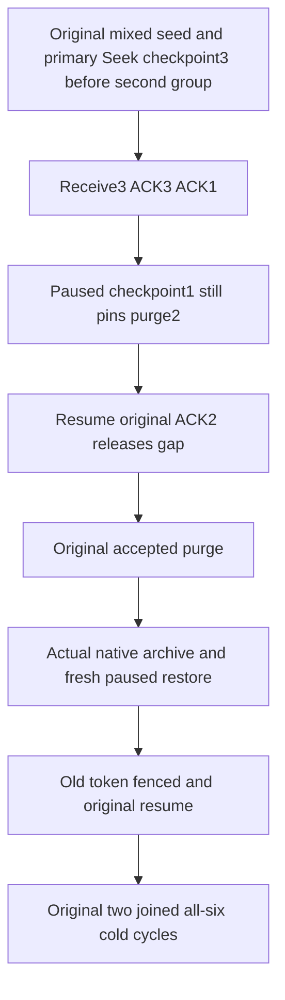

# KL098 contiguous ACK pins through native archive restoration

Applicable native lifecycle/authority: [ADR-030 retention and paused restore](../../ADR/ADR-030-retention-paused-restore.md), [ADR-046 native storage ownership](../../ADR/ADR-046-storage-private-owners.md), [ADR-048 bounded metadata](../../ADR/ADR-048-bounded-storage-metadata.md), [ADR-117 native TUnit](../../ADR/ADR-117-native-tunit-ci-entry.md), [ADR-125 connection-owned execution](../../ADR/ADR-125-connection-owned-execution.md).

Canonical slice EventStreams, linked to [EventStreams](../EventStreams.md) REQ/AC-EVENT-RETENTION-001..005 and [BackupRestore](../BackupRestore.md) REQ/AC-BACKUP-003/004. Source candidate is a missing complete acceptance flow, not a confirmed product defect. New childspec target docs/Features/EventStreams/AcknowledgedRetentionArchivePublic.md.

## Current source evidence and ownership

Actual TopicRetentionRf3Tests and ClusterRestoreMixedRetentionRf3PurgeTopic release their single retained pin using public Seek(FromNow). Native TopicRetentionOperationTests covers genuine ACK closure only before native reopen; it does not execute public SDK/official MCP archive/restore. SAME existing MixedRetainedStateRestoresPausedThenCurrentAuthorizationContinuesAndAllSixOwnersReopenCold(route) retains all four original Arguments, full original scenario, native archive, source/target authority, model oracles and two joined cold cycles. Feature-local new EventStreams roles extend only the current existing mixed purge seed/restored/cold composition; no global selector/fixture/API changes.

## Measurable requirements

REQ-KL098-ACK-ARCHIVE-001 / AC-KL098-ACK-ARCHIVE-001: configure a genuine second subscription on the EXISTING purged topic and SAME persisted principal. Preserve original primary Seek/assertion FIRST (checkpoint3), then receive original three events with their independent full EventData, source positions and complete logical receipt scope. ACK3 then ACK1 leaves contiguous checkpoint1, issued3 and source tail3. A public pause does not release this native pin. Both SDK and official MCP must retain exact ResourceExhausted on purge through2; every response immediately observes complete source/head, both groups, sibling models, outbox and placement. Original failed GUID never becomes success.

REQ-KL098-ACK-ARCHIVE-002 / AC-KL098-ACK-ARCHIVE-002: public resume and original exact ACK2 advances second checkpoint3 without changing source generation; preserve original first group's existing Seek(FromNow) generation2 and all existing purge assertions. NEW purge ID removes only events1/2, leaving independent event3/head and native original identity; retain full original publication, failure, pause/resume, delivery and purge results for current-policy-valid replay with immediate full current brackets.

REQ-KL098-ACK-ARCHIVE-003 / AC-KL098-ACK-ARCHIVE-003: SAME existing native archive captures second group's complete settled state and original source outcomes. Genuine restore yields fresh native incarnation and paused dispatch; exact old signed delivery scope is fenced before effects, never reconstructed/resigned. Existing authorized resume and model/token/error oracles stay intact. Observe retained event3/history-unavailable plus complete paused group/current authority using SDK and official MCP, then genuine current-authority continuation where permitted by the exact owner.

REQ-KL098-ACK-ARCHIVE-004 / AC-KL098-ACK-ARCHIVE-004: both EXISTING all-six-owner cold cycles use fresh owning callers with every previous original task/client joined; preserve original archive/source full cut and independent current restored model checks. No extra cold cycle, timer/deadline/cap/format/credential/grant/role, storage key seed, compatibility/fallback/library or transport changes. Case/UID remains unchanged. Raw journal equality is asserted only by existing actual stopped owner image oracles, never inferred from public failed outcomes.

Implementation is gated by exact current restore/state/cold and native pin owner bodies. No guessed restored ownership epoch or Problem literal. Compiler, original deadline fit, RF3/runtime/Linux and full retention fault/endurance/horizon gates remain OPEN. Frontend/new public API/new persisted format/provider/benchmark are N/A.

## Implemented binding boundaries

The additional state is captured in the original mixed source partition before its native archive; no storage representation is added. The original primary group's Seek generation2 is untouched. The second group is left generation1/ownership1/checkpoint3/issued3/tail3/pausedtrue before archive. The existing complete literal restore observer proves group records are preserved; restored dispatch/incarnation changes are represented by genuine mapped placement and native old-token/old-command refusals. Authorized original resume is completed before the new group's current public unpause/empty Receive. Each cold hook uses already-owned fresh original callers; it adds no restart or escaped client.

First source publication rows are independently checked against the original literal three-event corpus. Their admitted canonical EventSequence/RecordedAt are retained as original producer observations, not guessed clock/sequence values. Subsequent full event rows preserve those exact bytes; only genuine opaque current page Cursor/CutPosition is allowed to differ, with positive cut, and is never compared to logical receipt Position. Full GroupInfo, own original queue models, public outbox and placement are checked after every added SDK/MCP refusal/replay. Legitimate operations capture their new public outbox baseline. This does not claim raw journal invariance.

Native pin owner now proves cut>contiguous checkpoint ResourceExhausted and exact PinnedTopicHistory detail. SDK compares the full native Problem; official MCP uses closed ResourceExhausted capacity safe detail plus its exact ErrorAsync envelope/dispatch identity. Source ACKs return independently ordered one-element Ack/resource/position/leaseVersion1 mutation receipts. Restored old operations use the preserved existing typed TokenInvalidated producer helper and whole current observer, without inventing a signature-stage detail. Compiler/API/static ownership review, native NF/N/creation, exact runtime/Linux and original deadline fit remain OPEN.

Self-review corrected the insertion to AFTER original primary Seek/assertion and BEFORE the original accepted purge. Primary checkpoint3 is independently checked before every new refusal, so it cannot mask a missing second-group checkpoint pin. The paused checkpoint1 is isolated; ACK2 removes it with no source generation change. Native RequestCqrsRf3Callers belongs to ClusterRouting; all new caller-role imports explicitly bind that existing namespace. Restore current-control resumes and source Configure status replays retain full original results with immediate current checks.

### Original restored queue phase is preserved

The added current observer uses the complete existing InitialAsync queue oracle only before original continuation (source and paused restore). Once original.Continued is true, it invokes the actual read-only ClusterRestoreMixedRetentionRf3Queue.HealthyAsync: complete TerminalAsync plus independently literal healthy Acked message attempt1/state3/ready4/leaseVersion1, absent body. The original Queue.Continue cancels parked, parks/redrives/ACKs pending and publishes/ACKs healthy BEFORE this added phase. Initial dead-letter states are not expected after legitimate original effects. No queue field/result is skipped or copied from output, no producer runs inside current observation, and the immediate full current bracket remains.
