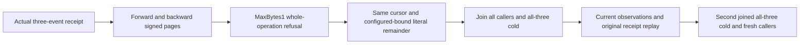

# EventStreams — caller byte-bound traversal continuation

Current acceptance code is authored; compiler, runtime and Linux qualification remain pending. Owning requirements are REQ/AC-EVENT-002/006, ADR035/039/117/125. Existing StreamTraversalCold covers count-bound direction/snapshot one-cold, McpEventStreamTests count parity/stale generation and StreamReadResourceTests configured kernel bounds; none covers current public caller MaxBytes complete-event refusal followed by the same signed cursor through both official routes and two owned cold cycles. The selective EventsRead policy-revocation flow is separate.

| Requirement | Acceptance | Map |
|---|---|---|
| REQ-EVENT-BYTE-PUBLIC-001 whole projected events respect caller byte bound | AC-EVENT-BYTE-PUBLIC-001 valid MaxBytes1 with Limit1 forward/backward refuses complete BudgetExceeded/no Value, exact native shared result-counter detail; after EACH SDK/MCP refusal full independent current three-event/head/placement/outbox controls remain unchanged, default configured-bound reads still return literal complete events | Refusals, Current, Expected |
| REQ-EVENT-BYTE-PUBLIC-002 signed continuation is not consumed by refusal | AC-EVENT-BYTE-PUBLIC-002 retain independent actual SDK/MCP first-page forward/backward cursors; same cursor with MaxBytes1 refuses and immediately observes current; same original cursor with MaxBytes0 returns literal ordered remainder and same captured head/snapshot cut without duplicates/skips or renewed cursor expiry | Calls, Flow, Expected |
| REQ-EVENT-BYTE-PUBLIC-003 receipts and read controls survive owned restart | AC-EVENT-BYTE-PUBLIC-003 join original admin/reader caller scopes, actual all-three same-root cold twice with fresh original credentials; each phase repeats first-page and original cursor refusal/healthy continuation and full original SDK/MCP command receipt replay, separately followed by current controls | Seed, Flow, existing FeedLiveRf3Cold |

Canonical Case EventByteBoundPublicTests.OneByteWholeEventRefusalPreservesSignedTraversalAndOriginalReceiptsAcrossTwoColdOwners; eight executable role files in IntegrationTests Features/EventStreams Cases/Models/Helpers/Assertions, this owning subdoc. Backend/public contracts/SDK/MCP/UI N/A: acceptance-only existing operations; no API/library/provider/format/schema/deadline/clock/quota changes. One noArgs case; its native UID is not asserted.

Source contract: outer ReadStreamTraversal validates MaxBytes>=0 and <=configured maximum,0 chooses configured maximum; constrains original result budget. ReadTraversalEvents first calls ReadExecutionBudget.MeasureResult on each complete projected EventRecord. MeasureResult serializes public JSON into the original bounded ResultByteCounterStream. For MaxBytes1 this counter rejects the first full event with BudgetExceeded and exact detail "The read result byte budget is exceeded." before the later range accumulated-byte comparison can run. The later range detail is not the expected first-event refusal. This is a whole-operation refusal, not a byte-prefix page. Complete StreamPage receives original result check too. Cursor stores principal/policy/schema/placement/tail/floor/snapshot/expiry and next revision but no byte bound; every continuation independently chooses caller result bound. No continuation renews expiry. The chosen literal1 is a positive admission boundary smaller than any complete typed projected EventRecord; this is not an exact serialized-size threshold or quota relaxation.

Golden RecordedAt fields are retained from the original actual acknowledged append and compared completely across routes/cold; all event data, stream identity/generation, revisions1/2/3, sequences1/2/3, head3/1/1 and mutation tail3 are independently literal. Native traversal CutPosition is the positive node-local Store.Position; CommitReceipt.Token.Position belongs to atomic-partition receipt authority. This case does not compare those different domains or qualify routed read-cut/receipt correlation. Fresh snapshot cut equals its own actual local cut; resumed snapshot cut equals its original signed capture. The independently validated complete receipt and its original replay remain separate controls. Separate authorized current model/outbox/placement observations do not establish an atomic raw image/journal cut. No server-private metadata is decoded or trusted by the caller. Errors use independent full SDK Errors.Problem and official complete dispatched BudgetExceeded; public safe detail need not equal native detail. No arbitrary payload/credential diagnostic output.

Healthy EventsRead is authorized to return the exact canonical private-canary payload because this stream has no sensitive FieldPolicies. The complete literal body remains mandatory; only the reader credential is forbidden in successful MCP replies. Actual error replies additionally forbid the payload canary. A payload label alone is not an authorization policy.
