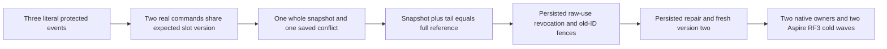

# Concurrent aggregate snapshot ownership (KL-085)

Source prepared; semantic compilation, native Unit/process-recovery, Aspire Docker RF3 and exact-source Linux acceptance remain OPEN. The complete image and native identity/position checks execute as independent observed responsibilities, including after a prior image assertion fails. [ADR-075](../../ADR/ADR-075-bounded-aggregate-snapshot-replay.md) and [EventStreams](../EventStreams.md) REQ/AC-EVENT-007..010 govern this operation. No Core change is proposed: full current writer/codec/reader/worker inspection found existing stream, generation, key, head, source, retention, reducer/schema, checksum and raw-grant checks. The withdrawn null Stream/Data/Snapshot hypothesis is not a defect: strict native graph validation rejects those records before persistence/read.

## Confirmed acceptance gap

Canonical KL-085 explicitly includes projection concurrency. Existing AggregateSnapshotTests exercise CAS sequentially; existing native/public aggregate flows did not submit two distinct real snapshot commands against the same expected slot version concurrently. The new whole native and public flows close that source coverage gap without inventing a storage defect or changing contracts.

One real initial append creates three exact protected payload/header events with increments 1, 2 and 3. Two separately identified producers race ExpectedSnapshotVersion=0: one stores source revision1 with exact whitespace-preserving count1, the other source revision2/count3. Native tasks synchronize on a genuine start gate and both original tasks settle independently; public .NET SDK and official MCP commands start before either is awaited and both original tasks are always joined. Exactly one complete snapshot success and one durably saved RevisionConflict are required. The winner is selected only by its actual command receipt, then compared against independently authored command/state/receipt expectations. A valid winner snapshot plus complete tail and a full original-history replay must both reduce to independently literal count6. An exact current-event-schema mismatch is refused before any reducer callback; no conversion/fallback, handler, ACK, publish or external output runs.

Native winner position must be exactly the first commit after the frozen baseline, with the saved losing command occupying the second. Native receipt proof includes all fields/full token and the actual hidden CompositionReferences field. Original seed result/receipt, all event records and original saved outcome bytes remain immutable. Replay compares native operation-result values, not independently reserialized Orleans alias graphs. Complete whole-store images, exact positions and all nine native storage identity fields including signing-key content guard every read/replay/refusal operation.

The full current persisted principal retains both capabilities and all payload/header raw grants initially. Removing only payload raw-use at policy epoch2 denies replay before body disclosure while current command retry authority fences both original producer IDs. Persisted repair at epoch3 restores read/reduction. Both original IDs remain fenced by the changed-policy result; their original stored winner/failure bytes remain unchanged. A fresh command with ExpectedSnapshotVersion=1 stores source3/count6 at snapshot version2, succeeds once and replays its complete original receipt. Both same-root native cold owners and both Aspire-owned RF3 cold waves are always attempted through retained failure ledgers, including after an earlier assertion fails. Each rechecks original identity/source/state/outcomes, old-ID authority and fresh healthy receipt replay. Every caller, native store and owned restart task settles before teardown or the next wave.

## Public evidence boundary

Real .NET SDK and official MCP callers use the same server-persisted credential and no trusted caller roles. All four observable mutation receipt fields and complete token fields are checked; the JsonIgnore fifth native field is proved only from real native results. Public SDK errors compare complete independently authored native Problems; official MCP compares its exact safe generic/scope Problem and payload/header privacy. Metadata policies and parameters retain the existing normal production limits.

Public event clocks are captured only after the initial whole producer result and independently checking each stream/revision/sequence/body/header/schema field and one consistent positive original timestamp. Later waves conserve those original records exactly. Initial server time is not advertised as an independently predicted clock. Node-local public read cuts are opaque positive values and are normalized only for logical data comparison; no ordering against a logical commit receipt or another node's cut is inferred. Exact public owning-node cut correlation remains OPEN. Native exact cut/image proof is independent and retained.

The root-owned ClusterFixture/Aspire AppHost owns all three actual Docker resources and discovered endpoints. The private cold owner uses the existing canonical per-fixture unique owned-scenario allocator and canonical CreateNew receipt writer. It retains every successful bounded original path/length/SHA256 before stream disposal or aggregate throw, then independently rereads all originals after every later cold wave and final failure aggregation; no fixed shared receipt filename is overwritten. Cold waves kill all three, start all three before readiness checks, join restart/readiness errors and preserve the same root. Public status witnesses bind all three distinct node IDs, persisted incarnations, RF3 voter counts, durability, routing readiness and monotone same-node recovery state. This is development source, not executed recovery or durability proof.

## Existing gates retained

The adjacent source census selects complete existing snapshot/native-contract/aggregate authority/sequence/bounds/current-schema/worker-parity classes, original process recovery and RF3 leader-loss/public authorization classes alongside the two new whole cases. Every parameterized case remains selected; actual native UID/count values are UNKNOWN until Root fresh discovery. The existing tests remain responsible for erased/missing history, malformed native scalar/key/checksum/format records, exact event schema before callbacks, server/worker bounds and cancellation, snapshot CAS edge versions, elected-leader loss and genuine process recovery. No syntax-only or helper round-trip test replaces these operations. UI is N/A because this is a programmable database worker operation. Exact-source Linux/endurance/fault gates, SIMD normal execution and no power-loss/production-readiness claims remain mandatory.

