# Current EventStreams read authority public flow

Current acceptance code is authored. Existing REQ-EVENT-003/006, AC-EVENT-006 and REQ/AC-EVENT-READ-CUT-001 are the owning contracts. Compiler, runtime and Linux qualification remain pending. No schema, capability, dependency, timeout, signer or API changes are proposed.

REQ-EVENT-CURRENT-READ-001: current persisted EventsRead is required before original bounded traversal continuation can disclose retained events, including after same-root restart. AC-EVENT-CURRENT-READ-001: epoch1 captures a one-event bounded page and its original signed continuation; remove only EventsRead while preserving the original nonrevoked credential and other original grants. SDK and official MCP each refuse captured and fresh reads with the exact source-confirmed problem. After every response administrator full canonical records, complete head and outbox remain at the declared public baseline. First joined all-three cold repeats the same denial with fresh callers.

REQ-EVENT-CURRENT-READ-002: grant repair cannot renew an original captured traversal or change retained successful producer receipts. AC-EVENT-CURRENT-READ-002: restore original grant at a strictly higher returned policy epoch, require exact CursorExpired for the native old policy-epoch cursor fence, then complete independently literal fresh bounded pages and empty tail; a genuine new append and every original successful producer receipt replay are bracketed individually by complete current public observations. The second joined all-three cold repeats literal pages, retained metadata and exact original receipts under fresh owned callers.

Nonduplication source proof: StreamTraversalColdClusterFlow is an administrator captured traversal followed by a later append and one cold restart; it has no selective EventsRead capability change. EventMessageSensitivePublicTrial covers receive/subscription field-policy controls and one repaired cold, without captured ReadStream cursor revocation. These existing flows remain unchanged.

The native traversal requires EventsRead authorization before resource/cursor verification, EventsAppend retained at epoch2, and policy-epoch mismatch in ReadStreamTraversalCursor throws CursorExpired. EventRecord has exactly Stream/Revision/EventSequence/Data/RecordedAt and StreamHead has exactly TailRevision/FirstAvailableRevision/Generation. Head/snapshot captured at3 remains3 across append4; current full head is4 and empty AfterRevision4 has no events.

The authorization path is DatabaseEngine.Authorization → IAuthorizationPolicy → KeyLoad.Security.AuthorizationPolicy.Require. Removing EventsRead while retaining EventsAppend fails with complete Errors.Problem(PermissionDenied, "The principal cannot perform this operation in this scope."). Repaired old-epoch cursor produces complete Errors.Problem(CursorExpired, "The stream traversal cursor expired or changed scope."). Both SDK failure records and null success values are checked exactly; official MCP retains its original complete dispatched error assertion and safe transport detail contract.

The cold lifecycle joins all three owned resources; no inherited cursor expiry is renewed. Compiler, runtime and Linux qualification remain pending.

Every individual SDK and official MCP success/refusal/retained producer replay is followed immediately by full administrator public stream/head, unchanged original event metadata and outbox observations. A later successful response cannot hide an earlier regression. Legitimate policy and append effects establish new declared baselines before read-only comparisons; no configuration write occurs inside a no-effects callback. Original opaque cursor expiry is never renewed.

Canonical roles: EventStreams Cases/EventCurrentReadAuthorityClusterTests; Models/EventCurrentReadAuthorityClusterState; Helpers/EventCurrentReadAuthorityCluster{Seed,Policy,Calls,Flow}; Assertions/EventCurrentReadAuthorityCluster{Expected,Current,Refusals}. Existing ClusterFixture, McpCallerDeadline, RequestCqrsClusterCallers and ChangeFeeds FeedLiveClusterCold remain the sole reused topology/caller/cold owners. One noArgs case; its native UID is not asserted. UI N/A. Runtime, Linux, fault and endurance gates OPEN.

```mermaid
flowchart LR
  Seed[Original real append and literal bounded page] --> Revoke[Remove only EventsRead]
  Revoke --> Deny[Each SDK and MCP read refused with public baseline]
  Deny --> Cold1[Owned callers close and all three cold restart]
  Cold1 --> Repair[Persist original grant at higher epoch]
  Repair --> Fence[Old cursor refused and fresh literal pages]
  Fence --> Append[Fresh append and each original receipt replay]
  Append --> Cold2[Owned callers close and second all three cold]
```

## Executable declaration and proof boundary

One noArgs case: EventCurrentReadAuthorityClusterTests.OnlyEventsReadRevocationFencesCapturedTraversalAcrossColdThenRepairKeepsLiteralSnapshotAndOriginalReceipts. Native UID is unknown. Its deadline is the existing test-owned McpCallerDeadline and its full owning helper closes callers before each existing FeedLiveClusterCold restart. Old cursor lifetime is never renewed; failure to resume within original lifetime remains a genuine failure. Administrator full public records/head/outbox are independently observed after every SDK/MCP response and retained receipt replay; no raw image/journal or cross-owner cut correlation is claimed. Complete original producer receipt equality is preserved; complete initial/fourth authority and all mutation fields are independently validated by the existing native-supported SdkProblemBudgetPublicAssertions.ReceiptAsync. Token position remains positive and fourth position greater than seed; no raw physical commit-position equality is advertised. Current code is authored; compiler, runtime and Linux qualification remain pending.

## Opaque local read cut and logical receipt authority

REQ-EVENT-CURRENT-READ-003: traversal CutPosition is a positive opaque local-store cut; logical atomic-partition receipt position is a separate authority domain. AC-EVENT-CURRENT-READ-003: every literal page requires a positive local CutPosition and exact original signed SnapshotCutPosition equality for captured continuation. No numeric comparison between local cut and CommitReceipt.Token.Position is allowed. Complete initial/fourth receipt validation and exact retained receipt replay remain unchanged; their logical positions retain their same-domain ordering assertion. All literal events, heads, per-response public no-effects observations, revocation/repair, empty tail and two joined all-three cold cycles remain mandatory.

The acceptance code keeps local read-cut and logical receipt authority separate. Compiler, runtime and Linux qualification remain pending.
