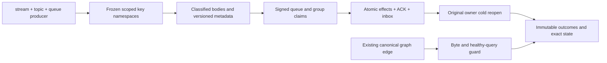

# Event/queue keyspace and state envelopes

Status: additive acceptance implementation; no current compiler, runtime, process, cluster or Linux qualification. This child refines the [EventStreams](../EventStreams.md) and [Messaging](../Messaging.md) contracts. ADR-023/024/025/026/029/030/035 and the existing serialization contracts remain authoritative. No public operation, persisted alias/field ID, format, provider, dispatcher, migration, index repair API or compatibility fallback changes.

| Requirement | Acceptance | Evidence |
|---|---|---|
| REQ-EVENT-KEYSPACE-001: preserve canonical feature namespaces and scalar key encoding | AC-EVENT-KEYSPACE-001: nineteen independent literal V1 byte goldens and component/roundtrip/order assertions cover stream/topic, queue body/metadata/ready/scheduled/lease/dead-letter, group/window/completion, inbox and existing graph edge keys. Tenant/database/domain/key changes produce distinct keys without creating another routing corpus. | New EventQueueStateEnvelopeWholeFlowTests; original KeyCodec golden/mixed/culture/input/malformed/ownership suites remain mandatory. |
| REQ-EVENT-KEYSPACE-002: current state envelopes retain every classified field and immutable committed body | AC-EVENT-KEYSPACE-002: actual producer creates classified stream and topic records plus ready/scheduled queue bodies. Literal full heads, event identity/sequence/time, metadata versions/generation/attempts/lease fields, persisted classification policies and canonical bodies are checked. Caller-owned body buffers can be mutated without changing point bytes or the full store image. Original event/source/catalog bytes are frozen before lifecycle work and checked afterward. | New complete whole flow and original body/accounting/policy/source suites. |
| REQ-EVENT-KEYSPACE-003: metadata and ready/scheduled/lease references follow one validated state | AC-EVENT-KEYSPACE-003: Receive, exact-deadline scheduled promotion, Processing+ACK and ACK leave literal complete metadata, body/counter values, exact index keys/values and no extra index rows. Signed claims, original request IDs and independently predicted preapply commit tokens/complete receipts are preserved. | New complete flow plus original queue lease/ready/deadline/lifecycle authority suites. |
| REQ-EVENT-KEYSPACE-004: group/inbox and unrelated graph history survive retry and reopen | AC-EVENT-KEYSPACE-004: real group claim/completion and queue processing inbox retain literal full state. Same-input fresh command releases the original inbox receipt without another model effect. Original raw outcome/locator/inbox bytes remain unchanged; consumed receives refuse StaleLease while their stored results remain intact. Original cached queue/group receives are replayed after the first cold open while both signed claims are still active; settled receives later refuse stale claims. Two same-root cold opens preserve the complete nine-field identity, position and raw image. Canonical graph edge bytes and a full healthy traversal remain unchanged at every phase. | New whole flow, unchanged process-recovery and actual SDK/official MCP cluster inventories below. |

## Frozen family map

The architecture's SH/EV/ED/EF/ES describe the current `stream-head`, `event`, `event-id`, `event-feed`, `event-sequence` families; topic equivalents are `topic-head`, `topic-event`, `topic-event-id`. QB/QM/QR/QS/QL/QD map to `message-body`, `message-meta`, `ready`, `scheduled`, `lease`, `dead-letter`. The current group definition/checkpoint envelope is one `subscription` GroupState; issued deliveries and settled receipts use `subscription-window` and `subscription-completion`. Handler receipts use `inbox` or the existing `subscription-inbox`. These are descriptions of actual frozen families, not permission to rename them to architecture shorthand. The existing graph edge family remains `edge`; its bytes are guarded against event namespace collision.

All ordinary model keys include the complete tenant/database/transaction-domain/literal-key prefix. The test uses the actual original store identity for cold proof. General bounded scalar decoding, UTF-8 escaping, numeric tags and malformed-input limits stay in the existing canonical KeyCodec suites; no forced scalar execution or SIMD disable profile is added.

## Index validation and recovery recipe

A queue body contains immutable normalized input and fingerprint; MessageMetadata owns state, StateVersion, Attempts, immutable delivery generation and current lease/order fields. For Ready, the exact ready sequence/message key must point to the same ID; Scheduled requires its exact NotBefore/message key; Leased requires its exact LeaseUntil/message key and matching signed scope/version. The body, counters and any strict-order/dead-letter references must satisfy their validators before transition effects. Ordinary admission retains resource/status/authorization/expiry/corruption/quota precedence. Complete transitions atomically remove the old exact reference and publish the new metadata/reference/body/counters through the existing node-local commit/WAL path.

The executable positive flow checks full pages with HasMore=false and literal keys/values; original corruption suites continue to require fail-closed Corruption and no effects when references disagree. Recovery replays the original verified committed mutation envelope or opens the supported restored image; it does not infer sequence numbers, recreate missing canonical rows from guesses, reset counters, or silently scan-rebuild indexes. This task introduces no public queue-index rebuild operation. The recipe and source review alone do not qualify recovery.

## Preserved mapped gates

General Unit: KeyCodecTests, KeyCodecGoldenContractTests, KeyCodecMixedCorpusTests, KeyCodecCultureContractTests, KeyCodecInputContractTests, KeyCodecMalformedContractTests, KeyCodecEnvelopeOwnershipTests, StorageRecordContractTests, CanonicalKeyContractTests. Feature Unit: TransactionTests, QueueBodyAccountingTests, ReadyQueueRangeTests, QueueLeaseAuthorityWholeFlowTests, SubscriptionTests, SubscriptionRecoveryAndPolicyTests, SubscriptionLeaseAuthorityTests, SubscriptionDeliveryAuthorityTests and the current source/metadata authority cases remain mandatory.

Process: EventAppendProcessRecoveryTests, QueueEnqueueProcessRecoveryTests, QueueClaimAckProcessRecoveryTests, QueueLeaseAuthorityProcessRecoveryTests, QueueLifecycleProcessRecoveryTests, QueueDeadlineProcessRecoveryTests, LocalInboxProcessingProcessRecoveryTests and SubscriptionRecoveryTests retain their actual process-kill/claim/cold/cleanup boundaries. Process kill is not power-loss evidence.

Public: existing EventAppendClusterWholeFlowTests, McpEventStreamTests, StreamTraversalColdClusterTests, actual queue enqueue/claim/ACK/lifecycle/deadline and subscription group SDK/official MCP cluster cases remain required through their existing fixture-owned Aspire topology. No raw-storage admin hook or substitute transport is introduced to expose key goldens publicly. The new key test supplements these actual public operations; it does not replace them or claim they ran.

Acceptance requires compiled discovery, full solution/analyzer execution, the complete Unit/process/Aspire cluster lanes and exact-source Linux evidence; source-only preparation and bounded preflight close no acceptance gate. UI/site N/A: no visible capability or performance claim changes.
