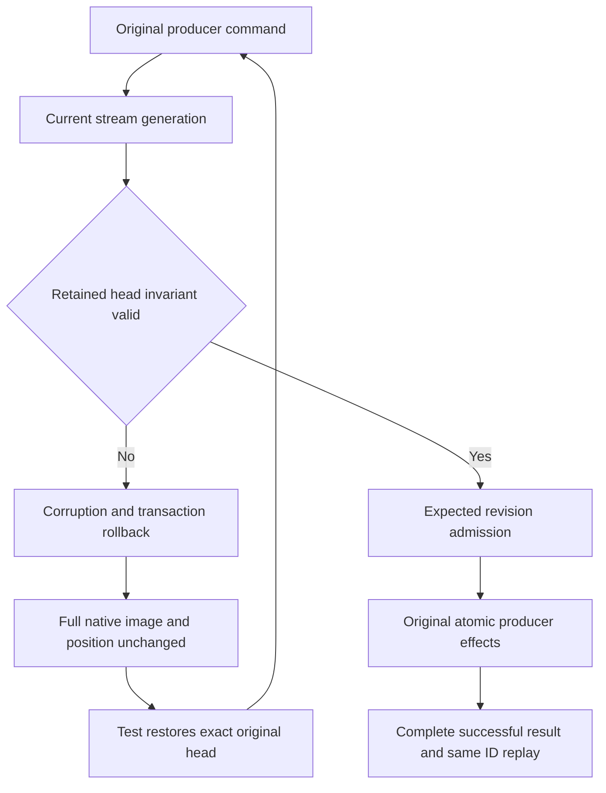

# Native append head admission

REQ-EVENT-APPEND-HEAD-001: canonical Append must validate the actual retained native StreamHead after current generation admission and before expected revision/effect application. A negative tail, nonpositive first retained revision or first retained revision beyond tail+1 is Corruption. Preserve existing current-generation error precedence; do not overflow when testing tail+1 at long.MaxValue. The guard cannot repair or reconstruct persisted bytes.

AC-EVENT-APPEND-HEAD-001: EventAppendCorruptHeadTests uses the unchanged actual native ZoneTree EventAppendWholeFlowFixture. A bounded native transaction alters only its original StreamHead into each of three invalid shapes. The real producer command (document, queue and AppendEvents) must throw literal Corruption with fixed safe detail twice, preserve the complete all-row native image and position, and store no producer effects or synthetic failed outcome. Restore the exact original head bytes; the SAME original command must succeed and its complete successful result must replay with unchanged native image/position. A fresh Exact2 producer must produce literal revision3 event/document/queue state.

REQ-EVENT-APPEND-HEAD-002: the test owns the original fixture, primary failure, corrupt-row restoration and disposal. Restoration and cleanup errors must aggregate with the original error. No fake storage, roles, context, network or acknowledgment may replace the original operation.

AC-EVENT-APPEND-HEAD-002: both new test roles use the original fixture/store/Submit and native record APIs, capture native state before alteration, restore even on assertion failure, and preserve primary+restore+fixture disposal failures. This is genuine canonical-kernel operation coverage. Compiler/native TUnit identity/runtime execution, Docker/Aspire cluster SDK/MCP, process recovery and durability gates remain OPEN; these tests do not qualify them.

Source map: src/KeyLoad.Core/EventStreams/Execution/Events.cs (Append only); tests/KeyLoad.UnitTests/EventStreams/Cases/Event/EventAppendCorruptHeadTests.cs; tests/KeyLoad.UnitTests/EventStreams/Scenarios/Appending/EventAppendCorruptHeadFlow.cs. Both acceptance criteria map to the three literal Arguments of the new source-defined test method. No public/generated aliases, field IDs, policy, replay/snapshot contracts, original UIDs or selector counts change. PubSubStorage and CountingWriter remain outside this scope.

Frozen fixed append-specific Corruption detail before implementation: `The persisted stream head is invalid.` Existing NewStreamTraversal supplies the three actual head invariant checks; its cursor creation/authorization contract does not fit a pure append helper and will not be called or changed. Tail=long.MaxValue is not newly rejected; existing checked append overflow semantics remain unchanged.

## Actual corruption boundary before sealing

Fresh ExecuteAndBuildOutcome excludes Corruption from its persisted terminal-result catch. Accordingly, each original/repeated corrupt-head command must throw exact Corruption and leave the COMPLETE all-row store image and position unchanged, with no synthesized/stored result. Restoring the exact original head permits the SAME original command to succeed; its genuine complete successful receipt must then replay unchanged with no effects. A fresh Exact2 producer follows with literal revision3 state. This preserves the existing canonical corruption contract; no catch/error classification is broadened and no fake acknowledgment is introduced. The original native TestDatabase fixture explicitly uses default nativeReplicaAdmission=false: these are canonical ZoneTree kernel operation tests, not replicated-cluster execution.

## Native append admission flow

