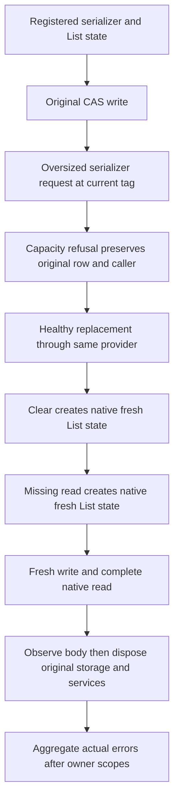

# Native PubSub constructible CAS test state

REQ-EVENT-PUBSUB-CAS-STATE-001: the original native registered-serializer CAS/scratch refusal test must use a state which the pinned Orleans registered IActivatorProvider can construct on clear/missing reads. List<string> carries the unchanged original scalar payloads. Product activation behavior, codec registration and sealed Source3 writer remain unchanged; no null/default/reflection/custom activator fallback is permitted.

AC-EVENT-PUBSUB-CAS-STATE-001: preserve real scratch overflow and original BudgetExceeded cause, exact prior row/ETag and refused caller metadata, healthy replacement, real native clear/absent read and fresh write/read. Full list contents must equal the literal original/healthy singleton; clear and absent read must produce actual empty fresh lists with null ETag and RecordExists=false. Both direct buffer/cancellation/disposal cases are unchanged.

REQ-EVENT-PUBSUB-CAS-STATE-002: compose the single test successor after immutable scratch Source3 and native fresh-state Source4. No product/public codec/aliases/IDs or native activator are modified.

AC-EVENT-PUBSUB-CAS-STATE-002: exact predecessor hash guards the replacement test; the actual current test type must remain native NotFound at authoring. Private patch check/apply and posthash receipts are source evidence only. Actual compiler, TUnit, native UID, Linux, cluster and recovery gates remain OPEN.

Source map: tests/KeyLoad.UnitTests/EventStreams/Cases/Event/EventFeedPubSubScratchFailureTests.cs. Requirements map to ActualRegisteredSerializerScratchRefusalKeepsCompleteCasStateAndHealthyReplacement, with unchanged direct writer cases. The disposable provider proof is independent of canonical persisted EventStreams/cluster durability.

REQ-EVENT-PUBSUB-CAS-STATE-003: actual registered provider and storage cleanup must preserve original test/body and every real constructor/disposal failure, including genuine fatal failures; no cleanup can replace the initiating failure.

AC-EVENT-PUBSUB-CAS-STATE-003: native ObserveAsync records body before directly visible using/awaitusing disposal, complementary native filters retain real cleanup failures and ThrowIfAny executes after each scope. Same serializer, state payload, CAS/scratch/clear/missing/healthy assertions and direct writer cases remain exact. Compiler/native runtime gates remain OPEN; no artificial disposal failure or synthetic ownership proof.

## Constructible native state flow

