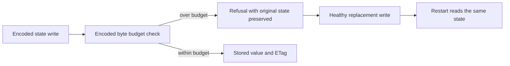

# Constructible state for the encoded-byte refusal control

This EventStreams correction preserves the original ActualPubSubEncodedByteRefusalPreservesOriginalStateThenHealthyReplacementAndRestart case. Its canonical source is tests/KeyLoad.FunctionalTests/EventStreams/Cases/Event/EventFeedPubSubStorageTests.cs. The disposable advisory provider remains src/KeyLoad.Clustering/EventStreams/Streaming/EventFeedPubSubStorage.cs. Public SDK/MCP/aliases/persistence formats and UI are N/A; no new test declaration is introduced.

## Source-proven cause and bounded contract

The original a2 Linux CI log SHA4567c89af60f77562771306b51afcca513227cd32ab1c13d1b2e92860f3cd4d1 lines5315–5328 reports the string activator failure at the restarted provider's absent read. Current source still uses GrainState<string> for this healthy/refusal/restart flow. Registered fresh-state construction intentionally refuses string and is separately required by PubSubActivationFailureTests. The accepted PubSubFreshState and PubSubConstructibleState contracts require constructible registered state for successful absent/clear flows and forbid production fallbacks.

REQ-EVENT-PUBSUB-ENCODED-STATE-001: Use the registered List<string> state for this original encoded-byte control, carrying the unchanged literal original and healthy strings. AC-EVENT-PUBSUB-ENCODED-STATE-001: Preserve the original case name/declaration, IDs, serializer/service registration, grain identity, routing, both provider owner scopes and complete operation order. Exact sequence equality checks every prior/healthy/fresh singleton string.

REQ-EVENT-PUBSUB-ENCODED-STATE-002: Preserve the original exact-fit byte-bound construction using genuine serialization of the actual healthy state. AC-EVENT-PUBSUB-ENCODED-STATE-002: Derive legalBytes from EventFeedPubSubRowEncoding.Create using the healthy List<string>, then set the provider's only row ceiling, `GrainRoutingOptions.MaximumReplyBytes`, to checked((int)legalBytes); the provider has no entry-count or total-byte quota ([ADR-149](../../ADR/ADR-149-no-operation-limits.md)). This includes the actual container/type encoding overhead through the same original producer. Do not use scalar-state encoding as a list-state bound, tune a numeric cap, select a synthetic byte size or replace the original serializer.

REQ-EVENT-PUBSUB-ENCODED-STATE-003: The original oversize write keeps its ResourceExhausted refusal and complete previous row/CAS metadata. AC-EVENT-PUBSUB-ENCODED-STATE-003: Preserve the original oversized x payload of checked((int)legalBytes) characters, exact original Code check, stored full original singleton/tag/existence and successful healthy replacement. Additionally assert the refused caller's complete singleton and true RecordExists alongside its unchanged original tag. No broad error acceptance is permitted.

REQ-EVENT-PUBSUB-ENCODED-STATE-004: Restarting this disposable provider creates absent state before a healthy fresh write/read. AC-EVENT-PUBSUB-ENCODED-STATE-004: The real restarted owner produces an empty list with null ETag and RecordExists=false. Original fresh write/read then returns the complete healthy singleton and new tag/existence. The original case contains no clear operation; clear behavior remains covered by its existing separate cases. This advisory restart does not qualify canonical database persistence, cluster or power-loss durability.

REQ-EVENT-PUBSUB-ENCODED-STATE-005: Preserve strict activation failure and ownership. AC-EVENT-PUBSUB-ENCODED-STATE-005: EventFeedPubSubStorage, its IActivatorProvider path, separate ActivationFailure cases and the adjacent CAS/oversized-entry/cancellation/dispose case remain unchanged. No default/null/reflection/custom activator, substituted codec, new fixture, new Case/UID, timeout or cleanup path is introduced.

## Admission and execution evidence

Current source cause is proven by actual original responses20–22 at PID59070, Ready27/27, SHA83949ab86e166646acbb2347d2fcbad9d2a3aec3ffb10f5ffcdb9b419127b276. This source stage does not execute the compiler or runtime. The coordinator must obtain checkOnly admission for the guarded original source hunk and full docs-first patch, then qualify the unchanged generated UID through the shared build/analyzer/format/TUnit entry point. Retain adjacent original registered fresh-state and activation-failure cases. Current-head runtime/Linux and repository-wide recovery/cluster gates remain OPEN until their original evidence is retained.

APIs: https://github.com/dotnet/orleans/blob/v10.4.0/src/Orleans.Serialization/Activators/DefaultActivator.cs and https://github.com/dotnet/orleans/blob/v10.4.0/src/Orleans.Persistence.Memory/Storage/MemoryStorage.cs.

