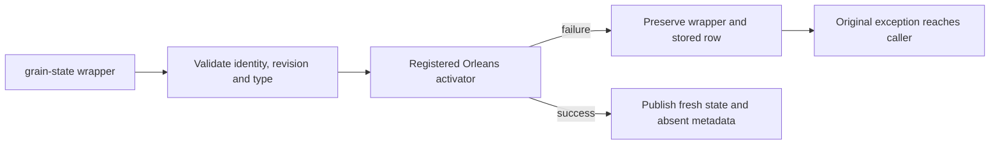

# PubSub fresh state after absence and clearing

This bounded corrective stage belongs to `EventStreams`: product ownership is `src/KeyLoad.Clustering/EventStreams/Streaming/EventFeedPubSubStorage.cs`; genuine provider TUnit cases belong to `tests/KeyLoad.FunctionalTests/EventStreams/Cases/RuntimeEvent/EventFeedPubSubFreshStateTests.cs`, with their real serializer/activator/provider owner in `Fixtures/EventFeedPubSubFreshStateFixture.cs`. Public SDK/MCP schemas, canonical event storage, frontend and persistence formats are N/A because this provider holds disposable Orleans advisory subscriptions only.

## Confirmed source defect and contract

The original missing-row read and clear operations reset `ETag` and `RecordExists` while retaining the caller's previous `State`. A reused grain-state wrapper can therefore carry cleared subscription state into the next operation. The centrally pinned Orleans 10.4.0 [MemoryGrainStorage](https://github.com/dotnet/orleans/blob/v10.4.0/src/Orleans.Persistence.Memory/Storage/MemoryStorage.cs) creates new state on both operations with its execution `IActivatorProvider.GetActivator<T>().Create()`; the [StateStorageBridge](https://github.com/dotnet/orleans/blob/v10.4.0/src/Orleans.Runtime/Storage/StateStorageBridge.cs) delegates state reads and clears to the selected provider. The KeyLoad provider must follow that state contract without a custom constructor, null/default fallback or reflection.

## Requirements and acceptance criteria

- REQ-FEED-STATE-001: A successful read of an absent PubSub row replaces previous state with a new instance from the registered Orleans activator before publishing absent metadata. AC-FEED-STATE-001: Write a real registered-serializer list, clear its row through a separate wrapper, then read absence into the original retained wrapper. Assert the replacement matches a activated empty list, is a distinct reference, has null ETag and false RecordExists, and leaves the former list unchanged; writing and reading new state through that wrapper succeeds.
- REQ-FEED-STATE-002: A successful clear of an existing or already absent row replaces state with a fresh instance. AC-FEED-STATE-002: Clear an actual CAS-owned row, clear it again, and assert both replacements are distinct empty lists and absent metadata. A subsequent real write/read contains only new state. A retained earlier ETag cannot clear the new row; the complete current state and ETag remain unchanged.
- REQ-FEED-STATE-003: Revision, state-type, cancellation, closed-provider and activation failures do not publish a replacement state or partially clear the stored row. Preserve the original validation order and bounded gate. AC-FEED-STATE-003: A stale revision, wrong actual state type, or pre-cancelled read/clear leaves caller state identity/metadata and the current serialized row unchanged; the exact error/token is retained. An uncancelled operation remains healthy. A closed provider refuses a non-cancelled read without mutating the wrapper. `EventFeedPubSubActivationFailureTests` compares the actual registered string activator failure with both a missing-row read and an existing-row clear: the same exception type/message, original wrapper reference/metadata and existing serialized row are retained, and a genuine write/read remains healthy. This invokes the registered activator, without an injected failure or fallback.
- REQ-FEED-STATE-004: This correction must preserve identity admission, registered serializer/activator ownership, byte/count budgets, CAS semantics and advisory lifetime. AC-FEED-STATE-004: Use genuine `GrainState<T>`, registered Orleans serializer and activator services, valid PubSub identities and original resource options. No mock, fake provider, codec, request context or durable event/cluster claim is permitted. Existing scratch/CAS regressions remain required.
- REQ-FEED-STATE-005: A regression owner retains actual body and joined cleanup failures, including genuine fatal exceptions, without replacing their identities or skipping another owned resource. AC-FEED-STATE-005: All FreshState and ActivationFailure declarations use `EventFeedPubSubFreshStateFixture.RunAsync`; the existing failure observer records the body, visible ownership disposes the fixture, and both actual storage and service-provider cleanup are joined. Aggregation runs after the ownership scope; no exception is thrown from a finally clause. These source checks accompany actual TUnit execution and do not fabricate a cleanup fault.

## Qualification boundary

The activation-failure cases first create and validate an actual empty list through the same registered provider. A missing activator service cannot become a matching expected failure on both baseline and product paths. The subsequent string activation refusal comes from Orleans; no test double supplies it.

The tests are ordinary TUnit functional cases executed through ADR-117's actual test entry point; fixtures continue to own Aspire infrastructure where required. This private source stage does not execute the shared compiler or runtime. Exact-source build/analyzer, operation execution, Linux GitHub and complete cluster/recovery gates remain OPEN until the integration owner retains their original evidence. No original test UID, selector or retirement inventory changes are part of this stage.
