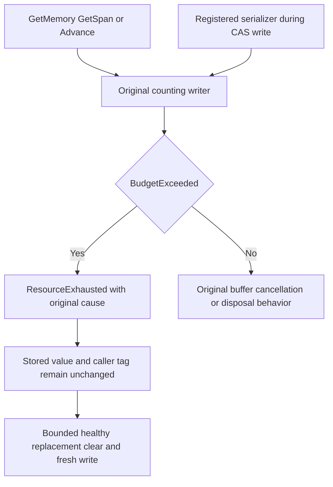

# advisory PubSub scratch refusal

This is the disposable PubSubStore operation behind the advisory event provider. The canonical event database, durable feed delivery and original cluster acceptance remain independent. No provider substitution, new public transport, wire alias or persisted format is introduced.

REQ-EVENTFEED-SCRATCH-001: all three original IBufferWriter entry points (GetMemory, GetSpan, Advance) must translate only the original counting writer's BudgetExceeded into ResourceExhausted with the existing fixed EventFeedPubSubProtocol.Capacity detail and original exception retained. Original size checks, scratch limits and buffering remain unchanged.

AC-EVENTFEED-SCRATCH-001: genuine GetMemory/GetSpan bounds refuse before advancing Length, retain the original BudgetExceeded cause, and leave a following bounded original write healthy. Original cancellation and disposed-owner failures keep their types; they must not become capacity refusals.

REQ-EVENTFEED-SCRATCH-002: an original IGrainStorage write whose registered Orleans serializer exceeds scratch capacity must leave the entire stored value, ETag, existence and caller state unchanged. Same-owner healthy replacement, clear and fresh write must work after refusal.

AC-EVENTFEED-SCRATCH-002: EventFeedPubSubScratchFailureTests uses actual ServiceCollection registered serializers and the original EventFeedPubSubStorage, exact grain identity and valid immutable options. It writes/reads the complete original string, submits a bounded oversized serializer value at its real CAS tag, checks the fixed refusal and unchanged original value/tag/existence/caller tag, then performs genuine replacement, clear and fresh write/read. No fake IGrainStorage, RPC, context, callback or acknowledgment is used.

Source map: src/KeyLoad.Clustering/EventStreams/Serialization/EventFeedPubSubCountingWriter.cs; tests/KeyLoad.FunctionalTests/EventStreams/Cases/Event/EventFeedPubSubScratchFailureTests.cs. Both AC criteria map to that new TUnit source type. Actual generated UID and compile/runtime admission remain pending. disposable provider operation tests do not qualify callback subscription/loss/drain, durable pins, cluster, process recovery or performance. Existing original case UIDs are retained.

## scratch boundary flow

