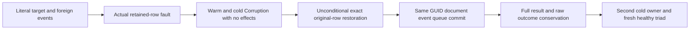

# Retained append identity authority

Source prepared; semantic compilation, TUnit, process recovery, Aspire cluster and exact-source Linux acceptance remain OPEN. This is the append OCC/dedup slice of [EventStreams](../EventStreams.md), specifically REQ/AC-EVENT-004 and 005. No performance, power-loss or production-readiness qualification follows from source review.

## Required behavior

The current stream/generation/EventId key must identify that same stream and generation, a positive retained revision no later than the append head, and a canonical EventRecord with that exact full StreamRef, revision and EventId. Existing authorization and incoming-content validation precede this retained-row check. A missing canonical row keeps its original Corruption detail. Valid same-content duplicate IDs keep DuplicateEventId, changed content keeps Conflict, and stale Exact/NoStream commands keep RevisionConflict. Original successful and rejected command outcomes remain immutable.

`Events.AppendEvent` currently follows an unbound EventIdentity; a genuine foreign-stream locator with the same retained EventId/content can be misclassified as a normal duplicate. A mismatched canonical row can likewise masquerade as duplicate or conflicting content. Bind the retained locator and record before the unchanged content fingerprint. This changes no aliases, field IDs, bytes, digest, library, protocol, retention format or storage provider. Stream identity remains distinct from business topic retained-ID history.

`AtomicCommandCommit.ExecuteAndBuildOutcome` excludes Corruption from saved domain failures. The real fault must therefore throw without outcome, locator, clock or other byte changes. After exact row repair, the SAME original GUID is freshly evaluated and may succeed. This differs from a durably saved normal DuplicateEventId/Conflict result: its GUID remains rejected after later healthy work.

## Whole operation proof

`RetainedAppendIdentityWholeFlowTests` runs four genuine fault cases: foreign stream locator, foreign full record identity, incorrect canonical revision, and different canonical EventId. One literal initial batch produces target initial revision1/sequence1 and a foreign candidate revision1/sequence2. The frozen producer command first stages a document and queue message before append discovers the damaged retained row. Two warm refusals and another refusal after same-root cold reopen require exact Corruption, no saved outcome, complete original faulted image, position and all nine storage identity fields including signing-key content.

Repair unconditionally attempts restoration of the actual original event row bytes and deletion of the originally absent candidate-ID row, independently of primary assertions. The full restored image and exact damage-plus-repair position delta two are checked before the SAME command commits its document/event/queue triad once. Full independently authored receipt, hidden composition-reference field, target and foreign pages, all message metadata, document, every outbox field and row count/byte accounting participate. Replays compare full operation-result values and already recorded on-disk outcome bytes; they do not compare independently reserialized Orleans object graphs. A second same-root cold owner conserves the captured full image/identity/position, replays original successes, then commits and replays another literal healthy triad. Both cold attempts and all owned cleanup errors are joined.

The original `EventAppendClusterWholeFlowTests` remains the real .NET SDK/official MCP expected-revision, competing append, partial-batch duplicate, changed-content, original-failed-GUID replay and healthy follow-up flow. Both original concurrently started tasks are always joined. SDK errors preserve complete Problems; MCP compares the complete independently authored official safe Problem. Public node-local read cuts are opaque positive values; their order is not inferred from logical replication receipts or another node's cut. Same-page snapshot identity and every event/head/content/privacy assertion remain required. Logical receipt-to-receipt ordering within the same atomic partition remains intact.

The original `EventSelectiveAppendAuthorityClusterTests` supplies fresh persisted append revocation, old-receipt fencing, read preservation, persisted policy repair, fresh healthy append/replay and two genuine Aspire-owned cold waves through both clients. A corruption seam is not exposed over HTTP. Public mutation receipt proof covers all four observable fields/full CommitToken; the fifth JsonIgnore composition-reference field is checked only from genuine results/records.

## Qualification and ownership

Core owns only the retained branch in `Features/EventStreams/Execution/Events.cs`. Eight new sources own their Cases/Fixtures/Assertions/Helpers responsibilities. Three existing public helpers retain original cases, lifetimes, deadlines, arguments and scenarios. UI is N/A because this is a programmable database operation. Existing process crash, atomicity, tenant, generation, quota, cancellation, header/body authorization and delivery gates are mandatory alongside this case, not replaced by it.

Fresh discovery must select entire classes, retain all parameterized instances and record actual UIDs/counts from current assemblies. Counts and UIDs are unknown until actual discovery. Execute all selected Unit, process-recovery and Docker/Aspire cluster flows using the canonical test entry, then exact-source Linux gates. No helper-only or subset passing result qualifies the whole scope.

