# EventStreams — resource schema fence for signed traversal

Current acceptance code is authored; compiler, runtime and Linux qualification remain pending. Owning requirements are REQ-EVENT-003/006 and AC-EVENT-006. Existing StreamTraversalCold covers count/direction/snapshot one-cold; EventMessageSensitivePublicTrial covers source/queue receive field policies with one cold, not signed ReadStream resource-schema fencing. The selective EventsRead principal-epoch flow and caller MaxBytes flow are separate.

| Requirement | Acceptance | Canonical roles |
|---|---|---|
| REQ-EVENT-SCHEMA-CURSOR-001 current resource policy CAS fences historical signed traversal | AC-EVENT-SCHEMA-CURSOR-001 capture actual independent SDK/MCP forward/backward schema1 cursors; explicit replacement HeaderPolicies /source and SchemaVersion2 with ExpectedSchemaVersion1 succeeds with complete independent ResourceDefinition. Unchanged EventsRead credential remains authorized. Each old cursor independently returns complete SDK CursorExpired Problem/nullValue and official dispatched error, immediately followed by complete current reader/admin event pages, head and outbox | Seed, Policy, Refusals, Current |
| REQ-EVENT-SCHEMA-CURSOR-002 repaired policy never restores historical cursor scope | AC-EVENT-SCHEMA-CURSOR-002 schema2 fresh pages and original same-schema continuations return exact headers {sequence:1/2/3}; after first joined all-three cold, fresh identical-definition configuration verifies complete persisted schema2 as a real write with its own GUID/result/replay. Explicit HeaderPolicies removal/schema3 Expected2 restores literal original headers; schema1 AND schema2 cursors remain expired. Fresh schema3 cursors/remainders are exact | Expected, Calls, Flow |
| REQ-EVENT-SCHEMA-CURSOR-003 retained outcomes cannot rewrite current policy or data | AC-EVENT-SCHEMA-CURSOR-003 preserve complete original append receipt and each original configure GUID/request/result. SDK and official MCP replay separately follow full current controls after EACH result; historical schema1/2 configure replies must not alter current schema3 literal reader state. Join original callers before second actual all-three cold, verify persisted schema3 with fresh genuine identical configuration, repeat old refusals/current continuation/full outcome replay | Calls, Policy, Flow, existing FeedLiveClusterCold |

Canonical noArgs Case EventSchemaCursorPublicTests.PersistedHeaderPolicySchemaFencesOldSignedCursorsAndRepairPreservesOriginalReceiptsAcrossTwoColdOwners. Nine C# roles under IntegrationTests Features/EventStreams Cases/Models/Helpers/Assertions and this owning subdoc. Backend/SDK/MCP/UI N/A for new implementation: existing public operations only. Its native UID is not asserted. No library, provider, schema format, API, quota, timeout, clock or retry changes.

Native ResourcePolicyUpdates requires exactly previous+1 and a supported policy-only change. The actual SDK ConfigureResourceAsync directly sends its request and does NOT increment it. Both full replacement version and ExpectedSchemaVersion are explicit independent literals. ResourceDefinition begins at schema1. ProjectEvent applies HeaderPolicies to HeadersJson; current Authorization.Project removes /source when unchanged narrow reader lacks its RawReadGrant. Independent projected headers are {"sequence":1}, {"sequence":2}, {"sequence":3}; all payloads and other EventData fields remain exact. The private payload canary is deliberately authorized here because no FieldPolicies change; successful MCP replies exclude credentials, not authorized data. Error replies exclude both credential and canary.

ReadStreamTraversal authorizes EventsRead before cursor validation. Its signed cursor freezes resource SchemaVersion; mismatch returns CursorExpired with exact native detail before history validation. Removing a policy at schema3 does not revive a schema1/2 cursor. This case observes the public error, not a private rejection predicate or decrypted token. Principal records/grants/epoch are never changed after reader creation; no claim of isolated runtime guard attribution is made. Configuration is a real effect with original GUID and full result, never advertised as a read-only policy snapshot.

Full native traversal CutPosition is an opaque positive local Store.Position. It is not compared with logical CommitReceipt.Token.Position. Fresh SnapshotCut equals its own cut; resumed SnapshotCut equals its original actual capture. Golden RecordedAt is retained from the acknowledged original append only after all independent literal Data/stream/revision/sequence/head assertions. Complete typed pages/receipts plus independent outbox observations are public observations, not a raw atomic image/journal or routed-cut qualification.

```mermaid
flowchart LR
 seed[Schema1 full events and four cursors] --> policy[Supported schema2 header policy CAS]
 policy --> denied[Each old cursor expires and current headers redact]
 denied --> cold1[Join callers and all-three cold with persisted schema2]
 cold1 --> repair[Explicit schema3 policy removal]
 repair --> fence[Both old schema scopes stay expired]
 fence --> replay[Each original receipt and configuration replay bracket]
 replay --> cold2[Second joined all-three cold and full schema3 controls]
```

The SDK old-cursor refusal compares the complete native CursorExpired Problem. The official MCP refusal separately compares its exact closed safe detail `The database operation could not be completed.` with the original code/status/dispatched identity. The original append oracle validates every complete receipt field and mutation output; original replay retains the entire result.
