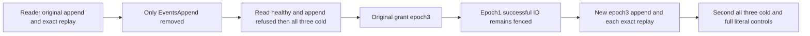

# Selective persisted EventStreams append capability

SOURCE_N only. REQ-EVENT-003/006 and AC-EVENT-006 remain owning contracts. This flow is distinct from warm reader-only EventAppendRf3Authorization and selective EventsRead current-traversal revocation: its original successful append belongs to the SAME persisted reader whose EventsAppend is subsequently removed.

REQ-EVENT-SELECTIVE-APPEND-001: current persisted EventsAppend is required for fresh append and retained successful append submission, while EventsRead independently remains usable. AC-EVENT-SELECTIVE-APPEND-001: epoch1 reader-owned original literal three-event append returns independently validated complete receipt and exact replay. Remove ONLY EventsAppend at epoch2, retaining EventsRead and the same nonrevoked key; SDK/MCP each fresh append and original successful-ID submission fails with complete PermissionDenied scope problem. Each response is immediately followed by full literal current stream/head/original recorded metadata/placement/outbox controls. First joined all-three cold repeats current reads and both refusals with fresh owned callers.

REQ-EVENT-SELECTIVE-APPEND-002: repair cannot renew an earlier policy-epoch successful outcome. AC-EVENT-SELECTIVE-APPEND-002: restore EventsAppend at returned epoch3. Original epoch1 successful command remains PermissionDenied with exact changed-policy detail. A NEW epoch3 command appends independent literal event4 at exact expected revision3; full logical authority receipt is checked and each SDK/MCP exact original epoch3 replay preserves all4 literal events and metadata. Second joined all-three cold repeats old-ID refusal, fresh current pages/empty tail and exact new receipt replay. No retry of an earlier denied command is advertised.

Native proof: BatchMutationCapability maps AppendEvents to EventsAppend; RequireBatchMutationCapabilities calls current Authorization.Require before effects. ReadValidatedSubmissionOutcome reloads persisted principal and AuthorizeOperation before retained outcome validation; ValidateSubmissionOutcomeIdentity rejects changed policy epoch. Exact details are native scope denial and changed-principal-policy constants, not inferred from transport status. Local CutPosition is positive opaque; no logical receipt/local cut numeric comparison. Complete independent receipt authority and retained receipt binary equality are separate.

Public full records/head/placement/outbox observations are not raw storage/journal cuts. Configuration is a legitimate effect, followed by a new declared baseline. Every SDK/MCP read/refusal/replay is individually bracketed; callbacks perform no append/replay or configuration. No new deadline, clock, provider, library or schema. Two genuine FeedLiveRf3Cold restarts occur only after all owned callers join. Compiler/native UID/runtime/Linux remain OPEN.

Canonical roles: EventStreams Cases/EventSelectiveAppendAuthorityRf3Tests; Models/EventSelectiveAppendAuthorityRf3State; Helpers/EventSelectiveAppendAuthorityRf3{Seed,Policy,Calls,Flow}; Assertions/EventSelectiveAppendAuthorityRf3{Expected,Current,Refusals}. Existing ClusterFixture/McpCallerDeadline/RequestCqrsRf3Callers/FeedLiveRf3Cold remain original owners. One future noArgs case; native UID unknown. UI N/A.

