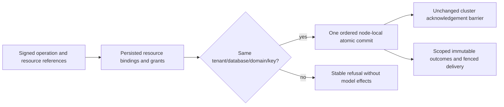

# Shared TransactionDomain

Status: reviewed implementation; no current compiled discovery, runtime or cluster acceptance.
Owner: companion2 root. Canonical feature: [EventStreams](../EventStreams.md).

A persisted resource definition supplies its transaction domain. Tenant, database,
domain and literal key together identify the atomic partition. Multiple resources
may share that identity; a physical ZoneTree owner may host multiple distinct
identities. Resource policy updates do not rebind an existing resource's domain.

| Requirement | Acceptance | Original operation proof |
|---|---|---|
| REQ-SHARED-DOMAIN-001: resolve every referenced resource through the current persisted catalog | AC-SHARED-DOMAIN-001: two active domains on the same owner, same literal key and same command/entity/event/message IDs retain distinct records, immutable receipts, native outcome rows and signed claims | SharedDomainWholeFlowTests; SharedDomainProcessRecoveryTests; SharedDomainPublicClusterTests |
| REQ-SHARED-DOMAIN-002: one producer/consumer request affects only its authorized full atomic scope | AC-SHARED-DOMAIN-002: real document+event+queue producer and processing effects+ACK commit together; late foreign-domain producer/consumer effects refuse with Conflict and leave both domains' model bytes intact | Same native workflow and real process cuts; public .NET and official MCP flows |
| REQ-SHARED-DOMAIN-003: preserve the prior isolated resource-domain contract | AC-SHARED-DOMAIN-003: collection, StreamSet and queue each bind to their own resource-name domain; the SAME command GUID succeeds independently in all three scopes, while a mixed legacy-resource batch is refused | Same five-scope corpus; no legacy parser, lookup fallback or data conversion |
| REQ-SHARED-DOMAIN-004: retain current authority and binding after retry/restart | AC-SHARED-DOMAIN-004: denied historical replay discloses no receipt, restored grants retain the historical policy-epoch fence and permit fresh healthy IDs; original outcome bytes remain unchanged; domain rebinding refuses UnsupportedCapability; two cold owners retain exact identity, native history, content and healthy continuation | Native raw-history/policy and Docker SDK/MCP same-volume cold phases |

The shared test corpus has FIVE active scopes and NINE actual resources: two
three-resource shared domains and three previous isolated resource-name domains.
The same literal partition key and original command GUID are deliberately reused
in all five; resource names remain unique within the actual database catalog.
The corpus uses distinct literal payloads so accidental scope aliasing is visible.

The versioned event contract remains NoStream / Exact / Any over one stream
generation, with ordered revisions and per-atomic event sequence. RevisionConflict,
DuplicateEventId, Conflict, TokenInvalidated, PermissionDenied and bounded resource
errors preserve their existing feature-specific meanings. Queue delivery is fenced
at least once; database processing effects and ACK share one atomic commit/inbox.
External delivery is outside that transaction. Original receipt retry does not
extend message expiry, signed cursor lifetime or configured retention horizons;
history loss remains explicit. No horizon is widened by this task. Existing event,
queue, retention, lease, transfer and policy suites remain mandatory.

Applies with ADR-023/024/025/026/028/029/030/035/117/125. UI and website N/A: no UI
capability or performance claim is introduced. SQL uses the existing authorized
model operations; complete SQL/protocol qualification is a separate existing gate.
Unit uses genuine ZoneTree and current native APIs. Process cases kill only the
owned child after native boundaries and join exit/readers/locks; they do not prove
power-loss durability. Public cases require fixture-owned Aspire Docker cluster,
actual .NET SDK and official MCP clients, unchanged persisted identity, discovery
and connection-owned Orleans execution. Native discovery supplies real test UIDs;
source declarations and prepared-source previews are not execution receipts.

Join order: this contract, shared immutable corpus, native operations/oracles,
process child and recovery oracle, actual public client flow, reviewed ordinary
CrashHost dispatch addition, then sole main coordinator formatting/build/full
required unit/recovery/cluster checks. No product change is presently justified by a
confirmed defect. The implementation remains unadoptable until the complete packet and peers
are ready; rollback removes additive test/contract source only, never data.

The public flow submits all five original producers through one actual SDK object
and independently replays them through the official MCP client. This does not infer
transport activation counts; ADR-125's existing native connection probes qualify
that separate lifecycle contract. It verifies all
three native replica identities and distinct atomic identities, then kills/joins/restarts every original node twice through ClusterFixture.
Original credentials and volumes are retained; each cold phase creates real fresh
client connections and rechecks original receipts, models and event history.

Event RecordedAt is independently expected from the captured committed native
clock in the Unit/process corpus. The public API does not expose that clock: its
first observed non-default timestamp is an immutable witness checked against both
clients and every later replay/reopen, while stream identity, complete event data,
ordered revisions/sequence, head, generation and bounded cuts have independent
literal expectations. Public read cuts may advance independently and must cover
acknowledged writes; cross-node equal cut numbers are not asserted.

| Boundary | Stable existing result | Required observation |
|---|---|---|
| Resource from another persisted domain in a producer/processing batch | Conflict: The resource belongs to a different transaction domain. | No document/event/message/ACK effect from the refused batch. |
| Original A signed delivery submitted to a correctly authorized B lane | TokenInvalidated: The delivery token scope is invalid. | Both active domains remain unchanged; no caller-supplied identity is trusted. |
| Existing resource domain rebinding | UnsupportedCapability: The requested resource definition change is unsupported. | Original native catalog bytes and all models remain intact. |
| Receipt replay after actual principal grant revocation | PermissionDenied | No historical receipt release or model mutation. |
| Original successful receipt after grants restored at a newer persisted epoch | PermissionDenied: The principal policy changed since this command was evaluated. | Historical epoch remains fenced, fresh IDs can make healthy progress. |
| Consumed native queue receive replay | StaleLease: The delivery lease is stale. | Original stored outcome and scoped locator bytes remain immutable. |

No compatibility path, persisted alias/field ID, credential format, retention
policy, delivery generation or deduplication horizon changes. The initial public
producer, genuine claimed Processing+effects+ACK, policy revoke/restore, fresh
healthy producer and second cold continuation belong to one complete cluster flow.
