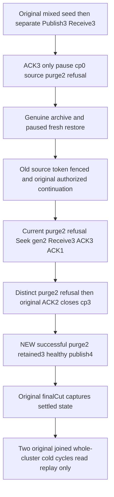

# Unacked paused retention pins across genuine archive restoration

Canonical slice EventStreams; [EventStreams](../EventStreams.md) REQ/AC-EVENT-RETENTION-001..005 and [BackupRestore](../BackupRestore.md) REQ/AC-BACKUP-003/004. Applicable [ADR-030](../../ADR/ADR-030-retention-paused-restore.md), [ADR-046](../../ADR/ADR-046-storage-private-owners.md), [ADR-048](../../ADR/ADR-048-bounded-storage-metadata.md), [ADR-117](../../ADR/ADR-117-tunit-ci-entry.md), [ADR-125](../../ADR/ADR-125-connection-owned-execution.md).

## Evidence and nonduplicate scope

Current full FilteredTopic loc8–89 archives paused checkpoint0/issued4 after ACK3, but has no purge while that gap remains. Its unchanged restore continuation Seek-resets and ACKs all matching events before cold. Prior AcknowledgedRetentionArchivePublic instead releases ACK-gap before archive and stores checkpoint3. This distinct acceptance stores checkpoint0/issued3/pausedtrue and original ACK3 gap in the genuine archive and demonstrates current purge refusal after restore before ACK repair. It does not identify a product defect.

SAME MixedRetainedStateRestoresPausedThenCurrentAuthorizationContinuesAndAllSixOwnersReopenCold(route), four original SDK/MCP/SQL route Arguments, UID/deadline/topology/credentials/grants and every original assertion remain. One separate topic/group is configured with existing public operations using the SAME original persisted ClusterAdministrator principal. Original filtered/purged/topic/queue/inbox/doc models are not changed. Existing acknowledged archive roles are physically present; this packet binds complete current STANDARD_READONLY parent images.

## Measurable requirements and acceptance

REQ-EVENT-UNACKED-PIN-001 / AC-EVENT-UNACKED-PIN-001: source Publish three independently literal Created events pin-event1..3 with JSON n=1..3. Complete publication mutation is publishTopic/topic/pin-event3/tail3, full CommandId/token partition/incarnation/ownership/durability. Configure group g1/owner1, Receive3 with full original SourceEventRecords/delivery attempts1/leaseVersions1/token scope, ACK3 only leaves checkpoint0/issued3/tail3; pause does not release pin. Original source S purge2 yields exact ResourceExhausted/pinned checkpoint SDK Problem and official MCP capacity-safe detail. Each original effect is followed by its full current matrix before another effect; each SDK/MCP replay/refusal is individually bracketed. Initial event page validates independent literal data before retaining opaque sequence/time. Legitimate-effect outbox snapshots are frozen and reused on refusals/replays; they are not an independent serialized byte-delta oracle.

REQ-EVENT-UNACKED-PIN-002 / AC-EVENT-UNACKED-PIN-002: original source capture/archive/restore retains complete paused group and all three event records/outcomes. Source successful publish is fenced by full TokenInvalidated/earlier-incarnation Problem from current applied-submission outcome validation; old delivery token is fenced by full TokenInvalidated/signed-token-invalid Problem after fresh restored signing identity. Official MCP uses the fixed GenericFailure detail for both. Source failed S is replayed only in current source incarnation; its cross-incarnation stage is not guessed. Archive/full source images remain covered by original cut oracles.

REQ-EVENT-UNACKED-PIN-003 / AC-EVENT-UNACKED-PIN-003: after original global dispatch resume and original unrelated continuation, new current C purge2 remains ResourceExhausted at checkpoint0. Genuine SeekFromBeginning ExpectedGeneration1 clears old window, yields generation2/ownership2/checkpoint0/issued0/pausedtrue. Public unpause/new Receive3 then ACK3→checkpoint0, ACK1→checkpoint1; distinct D purge2 remains ResourceExhausted. Exact ACK2 closes checkpoint3, without source generation change. NEW E purge2 succeeds with full independent one-mutation purgeTopic/topic/"2"/2; head tail3/first3/generation1 and complete original event3 remain. Prefix read yields HistoryUnavailable individually through SDK/MCP with immediate complete current brackets.

REQ-EVENT-UNACKED-PIN-004 / AC-EVENT-UNACKED-PIN-004: healthy pin-event4 Created JSON n=4 gives full publishTopic/topic/pin-event4/tail4 receipt, retained full rows3/4/head4/3/1. Every eligible original current result/receipt and failed C/D replay remains original after repair/healthy publication. Cached Receive is replayed successfully immediately before ACK; after complete contiguous settlement the SAME request correctly refuses full StaleLease because cached lease authority is revalidated. It is never asserted successful after ACK. Receipt assertions are independent of the result and never derive expected scope from it. Opaque page cut is positive and cursor nonempty; neither is compared with logical receipt Position. Outbox changes are captured after legitimate effects; refusals/replays compare complete stable current outbox.

REQ-EVENT-UNACKED-PIN-005 / AC-EVENT-UNACKED-PIN-005: every added SDK/MCP response is independently current-bracketed by full topic/group plus complete original sibling model/queue golden, and both outbox routes. All effects settle BEFORE original Verification captures finalCut. Both original whole-cluster cold cycles use existing fresh owned callers and replay/observe only, preserving original exact target-cut equality. No new cold/time/cap/lease provider/API/library/format/network/token forging. The unacked gap itself is proved in archive and restored warm state, not falsely claimed across first cold.

Frontend/new public API/new persistence format/provider/benchmark N/A. Compiler/runtime/Linux/original deadline fit OPEN; code review and source preview do not qualify runtime. New role imports/ownership and admission remain explicitly bounded. No raw journal no-effect claim follows from failed commands, which may legitimately persist failure outcomes/clock. Original archive/source/target exact-cut oracles remain unchanged.

## Current-source carry and qualification

This current successor uses semantic UnacknowledgedArchive roles with multiline properties/blocks and named domain constants. Current CommandOutcomes revalidates each cached receive lease: settled receive success from the old draft was invalid; the new exact StaleLease oracle follows the current producer without changing product authority. Original successful receive is retained in state and compared in full before settlement. No new Case, route argument, timeout, cold restart or public API is introduced.

The raw-corruption purge/window differential is separate, unexecuted investigation and contributes no acceptance claim here. Execution/compiler/runtime/Linux and original deadline fit remain OPEN. No active source or documentation is written by this prepared packet.

Exact official MCP Problem shape is independently compared in full through the actual Errors.Problem serialization used by McpReplyWriter, with its closed SafeDetail literal. Initial resource response equals the complete independently constructed ResourceDefinition. Healthy event4 first-page checks Source/head/cursor/positive cut/HasMore and complete retained3 plus independent event4 data before storing only opaque sequence/time.

Initial resource setup now asserts the complete independent ResourceDefinition, then the outbox baseline and full original models plus independent empty source head0/first1/generation1/rows[] before Publish3. This uses current ReadTopicHead default source law, not a fabricated head. The inherited source pages/opaque values are never compared with logical ACK counter positions.

Settled receive refusal is asserted only when Checkpoint==Issued>0, after ACK removed the first original delivery row. An ACK3-only source gap still contains earlier live leases, so its cached receive is not assigned a guessed universal StaleLease precedence over lease expiry. Source first receive success/replay and complete immutable result remain retained; no lease/deadline/policy change.
