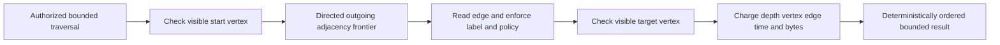

# GraphTraversal

Status: bounded same-partition graph mutation and traversal are present in Core source; broader graph/search integration and GitHub qualification remain pending. Unweighted shortest paths and frontiers, with shared SQL/SDK/MCP execution, are specified in [ShortestPath](GraphTraversal/ShortestPath.md) and [ADR-098](../ADR/ADR-098-bounded-graph-paths.md); cross-partition edges in [CrossPartitionEdges](GraphTraversal/CrossPartitionEdges.md).

## Purpose, actors, and entry points

GraphTraversal owns graph edge records, adjacency maintenance, and authorized bounded directed traversal over document vertices. Actors are database clients and authorized query/search operators. Current writes are `UpsertEdge`/`DeleteEdge` mutations handled by `DatabaseEngine`; current reads call `DatabaseEngine.Traverse` with a `TraverseRequest`. Contracts are in `src/KeyLoad.Abstractions/Contracts.cs` and `Queries.cs`; implementation is in `src/KeyLoad.Core/GraphAndSeries.cs`.

## Canonical slice map and boundaries

| Surface | Current source | Target owner |
|---|---|---|
| Contracts | `src/KeyLoad.Abstractions/Contracts.cs`, `Queries.cs` | `src/KeyLoad.Abstractions/GraphTraversal/` |
| Backend | `src/KeyLoad.Core/GraphAndSeries.cs`, mutation dispatch/authorization in `DatabaseEngine.cs` and `MutationAuthorization.cs` | `src/KeyLoad.Core/GraphTraversal/` |
| Tests | `tests/KeyLoad.UnitTests/GraphAndSearchTests.cs`, `ReadExecutionTests.cs`, `HttpAdmissionTests.cs` | `tests/KeyLoad.UnitTests/GraphTraversal/` |
| Durable specification | This file | `docs/Features/GraphTraversal.md` |
| HTTP | `src/KeyLoad/ApiEndpoints.cs`: `POST /v1/graph/traverse`; edge mutations enter through shared `POST /v1/commands` | Shared HTTP transport belongs to `src/KeyLoad/ClientApi/`; graph semantics belong to `src/KeyLoad.Core/GraphTraversal/` |
| .NET SDK | `src/KeyLoad.Client/GraphTraversal/Transport/KeyLoadClient.cs`: `TraverseAsync`; `DatabaseComposition/Commands/KeyLoadClient.cs`: atomic graph mutations | Shared client transport belongs to ClientApi; typed graph traversal belongs to GraphTraversal |
| Official MCP | The authenticated official C# SDK exposes `keyload_graph_incoming` and shortest-path tools through the shared ClientApi gateway/catalog | Real cluster schema oracles preserve exact properties/required fields and hints; nested `PartitionRef` includes computed `atomicPartitionId` as an optional property |
| UI | No dedicated graph-management or traversal frontend is specified | N/A: graph traversal is a database/API query capability, not a separate frontend surface |
| External graph provider | None is selected or implemented for canonical edge ownership | N/A: provider-backed/ranked graph retrieval is separate planned search work |

GraphTraversal does not own document CRUD, query ranking, or vector/text providers. Graph vertices are references to visible collection documents; graph and vertex permissions remain distinct checks.

## Resource repair

[ADR-035](../ADR/ADR-035-memory-performance.md) adds REQ-GRAPH-005, mapped to
AC-GRAPH-002/003/004 and AC-MP-005/006/012: reuse vertex visibility and collection
authorization inside one read cut without retaining full vertex documents.
Cache only boolean visibility by complete EntityRef and authorized/unavailable
collection decisions by complete partition plus collection; never a cross-request
or payload cache. A denied/hidden target stays excluded and cannot be expanded.
The start's existing visible/permission errors still propagate.

Start one cancellation/operation-clock budget before the gate. Visit adjacency
records directly without a raw page, charge every candidate before label/visibility
filtering, and retain the existing global maxEdges overflow error and deterministic
BFS/output order. Project edge attributes under the graph's persisted field policy.
Bound incremental standalone vertices/edges before retention, then measure the
exact complete GraphTraversal. Cycles/self-loops terminate as before.

Tests first: real converging/repeated large visible and hidden target rows must
succeed under a byte cap permitting one target lookup but not repeated payload
reads; hidden downstream paths remain excluded. Cover cycle/label/global edge
count, exact envelope/output overflow, cancellation/unchanged position and a healthy
following call. Preserve existing assertions; no doubles/local test run. GitHub
TUnit then cluster SDK/MCP and node resource artifacts own qualification.

## Independent reachability oracle stage

REQ-GRAPH-006 / AC-GRAPH-005: compare the current directed traversal with an
independent test-owned graph model backed by genuine `TestDatabase`/ZoneTree
fixtures. Compute minimum hop distances independently from the production
reader, native keys and returned result; compare complete vertex/edge membership
and ordinal public order for directed cycles, converging equal-depth paths,
shorter direct paths, shuffled insertion and hidden intermediate vertices.
For each requested depth, expand only visible permitted targets and prove that
vertices beyond that depth are absent. Depth is a successful bounded query
boundary; a shallower depth must not be reclassified as a budget error.
An exact distinct-visible-vertex or examined-edge cap succeeds, while one less
than the required count returns `BudgetExceeded` without a partial result.
Count outgoing candidates before label/visibility filtering. Preserve the
existing cancellation/deadline and healthy-follow-up cases.

## Current source behavior

`UpsertEdge` validates identifiers and graph resource, requires both endpoints in the same atomic partition, verifies both referenced documents are visible, checks graph field-write policy and expected revision, then updates the edge plus outgoing/incoming adjacency records in the command transaction. Deleting an edge removes both adjacency entries and its canonical edge record. Cross-partition edge writes currently fail with `UnsupportedCapability`.

`Traverse` starts from a visible vertex and performs directed outgoing breadth-first traversal. Optional labels filter edges; hidden/missing target vertices are not returned or expanded. A visited-vertex set terminates cycles. The current hard limits are max depth 16, max vertices 10,000 and max edges 50,000; request defaults are depth 3, 1,000 vertices, and 5,000 edges. Shared work/deadline/read/result budgets can reject rather than return an unmarked partial traversal. Returned edge attributes are projected using persisted field policies; output order is deterministic by vertex and edge identifiers.

The source does not establish incoming traversal, shortest-path results, cross-partition edges, async reverse-adjacency repair, ranked graph retrieval, or a partial-result opt-in. Product-design suggested defaults and future algorithms are not current guarantees.

## Requirements and acceptance

| Requirement | Measurable acceptance | Existing TUnit evidence or planned test |
|---|---|---|
| REQ-GRAPH-001: keep edge and adjacency mutations atomic and partition-scoped | AC-GRAPH-001 passes when create/update/delete leaves edge and both adjacency directions consistent; stale revision, hidden/missing endpoint, or endpoint in another partition rejects without partial writes. | Planned `GraphEdgeMutationRevisionAndPartitionCases`; current transaction rollback tests establish shared mutation atomicity but do not constitute a full edge index matrix. |
| REQ-GRAPH-002: traverse only authorized visible graph/document data | AC-GRAPH-002 passes when a hidden/missing intermediate vertex and its downstream path are excluded, denied graph access fails, and disallowed edge attributes are projected. | `TraversalStopsAtHiddenIntermediateVerticesAndHandlesCycles`, `FilteredOrHiddenGraphEdgesCountAgainstTheGlobalVisitBudget`. |
| REQ-GRAPH-003: bound traversal depth, visits, time, and result | AC-GRAPH-003 passes when cycles terminate, each invalid/exhausted bound returns a visible budget error without an implicit partial result, and cancellation/deadline is honored. | `FilteredOrHiddenGraphEdgesCountAgainstTheGlobalVisitBudget`, `SearchAndGraphResultBudgetsIncludeProtocolMetadata`, `QuerySearchAndGraphRequestsShareOneWorkingSetReservationBudget`; planned adversarial max-depth/max-vertex/max-edge boundary matrix. |
| REQ-GRAPH-004: keep graph traversal stable under shared read accounting | AC-GRAPH-004 passes when point reads, adjacency scans, edge/vertex dereferences, and response metadata are charged to the operation budget and a subsequent healthy operation remains usable after rejection/cancellation. | `GraphEdgeAndVertexDereferencesConsumeTheReadByteBudget`, `OneReadDeadlineCoversSubsequentPointAndScanWork`, `CancelledReadsStopBeforeTouchingCanonicalState`. |

## Flows and failure behavior

Positive: an authorized edge write binds both visible document endpoints to the same partition and stores edge/adjacency state atomically; traversal expands only allowed outgoing edges within supplied limits. Negative: foreign partition endpoint, stale revision, denied resource/row/field access, or malformed identifiers reject. Edge: self-loops and cycles terminate through visited tracking; hidden targets do not expose their outgoing neighborhood; an exact limit boundary succeeds only if no additional work exceeds it. Exhaustion is an explicit budget error, not a silently truncated result.

## Decisions and verification

Related decisions: [ADR-001](../ADR/ADR-001-partition-identity-affinity.md), [ADR-004](../ADR/ADR-004-committed-read-views.md), [ADR-005](../ADR/ADR-005-canonical-keyspace-codec.md), [ADR-010](../ADR/ADR-010-query-budgets-security.md), [ADR-014](../ADR/ADR-014-principals-rbac-row-policy.md), and [ADR-136](../ADR/ADR-136-native-orleans-partition-ownership.md). Cross-partition edges follow [CrossPartitionEdges](GraphTraversal/CrossPartitionEdges.md) and [ADR-102](../ADR/ADR-102-cross-partition-graph-edges.md); they do not change the current same-partition write contract.

## Graph shortest path observed cancellation

REQ-GRAPH-003/004, AC-GRAPH-003/004 retain original cancellation semantics. Replace exclusive polling/thread helpers with an owning operation TimeProvider which synchronously cancels the original token only after both charged bytes exceed the actual empty-adjacency probe and native same-store RangeExaminedBytes increases. Native storage/read-cut and budget are real. Require exact original-token cancellation, no partial result, full storage bytes/cut unchanged, then the identical busy-source request returns the complete literal no-path result and identical store/cut. No corpus/budget/timeout increase or permitted-success branch. Authored source requires original native normal/scalar and Linux reruns; preserve original failure receipt.

## Incoming projection negative to cold healthy flow

REQ/AC-GRAPH-002/004 and REQ/AC-AUTH-005/007 map to the unchanged HiddenSourceEndpointIsOmittedFromIncomingProjection and HiddenTargetEndpointIsNotFoundWithoutReturningProjectionRows. The latter original source has no owner: genuine healthy continuation repairs its owner as well as the hidden target, rather than trusting a caller role. Full literal edge, delivered revision, projection and call-current cut follow row/grant repair; grant refusal and revocation preserve the full bounded canonical image. Same-root native close/open preserves node/incarnation and original outcomes; original row-repair command replay returns each complete receipt without a second document revision. Original declarations, limits and initial assertions remain.

## Canonical outgoing identity before filtering

REQ-GRAPH-ADJACENCY-001 maps to AC-GRAPH-ADJACENCY-001/002: every examined outgoing
record must reference its canonical edge under the same graph/source partition,
with the complete current source EntityRef, valid native identifiers, positive
revision and canonical bounded attributes. Missing/invalid rows return Corruption
without a partial result or changed full native image/cut, including when a label
filter would otherwise exclude them. Independent whole-operation tests seed a
healthy first candidate and damage only the second candidate; repeat the original
request after a joined cold open, repair only the owned row, replay the original
seed receipt, then perform fresh graph work and a second cold.

REQ-GRAPH-ADJACENCY-002 maps to AC-GRAPH-ADJACENCY-003: preserve valid canonical
source edges which reference another atomic partition (ADR-102).
Those visible endpoints remain full EntityRef results; they are not expanded as
frontiers in this partition-scoped traversal. A foreign vertex whose textual
collection/ID collides with a local vertex must not expand the local vertex's
edges or inherit another partition's graph authority. This does not introduce
cross-partition traversal or alter reverse delivery contracts.

## Shortest path canonical edge integrity

REQ-GRAPH-PATH-INTEGRITY-001 maps to AC-GRAPH-PATH-INTEGRITY-001: actual native seed with healthy first candidate and damaged second canonical edge, noncanonical attributes/nonpositive revision × filtered/unfiltered reads, Corruption without partial result or complete image/cut change. Repeated actual refusal across joined same-root cold, only original owned edge-row bytes restored, same request healthy with independently constructed full path/cut, seed receipt immutable replay, distinct healthy graph command and path, second cold complete image/cut/path/receipt stability. Original native baseline failures and repaired runtime are mandatory; source review alone does not close the criterion. Production owners: existing GraphShortestPathValidation, GraphShortestPathReader, GraphShortestPathResultProjector; additive Unit Cases/Assertions only using existing native fixture/input oracles. Linux/cluster/resource/performance gates remain open.

## Selected path identity and native value refusals

REQ-GRAPH-PATH-IDENTITY-001 maps to AC-GRAPH-PATH-IDENTITY-001: nine native selected-row contradictions (missing canonical edge, foreign edge identity, foreign source, adjacency value pointing to the genuine healthy edge under the damaged edge key, empty label, empty target identity, null target, malformed adjacency bytes and wrong native adjacency type) each run through the real shortest-path operation both with and without an excluding label filter. Every operation has an actual valid first adjacency candidate, the selected second damaged candidate, exact `Corruption`, no partial path and unchanged full bounded canonical image and read cut. Repeat the same refusal, join same-root cold reopen and repeat it again; restore only the captured original owned row; require the exact original healthy complete image at one repair commit later. Retry the unchanged request with complete independently constructed path fields, replay the original complete seed receipt without a second effect, execute a new genuine graph command and read its complete path, replay that command, then join a second cold reopen and require exact image/cut, original and fresh path results and both complete receipt replays. Reads and replays retain their original effect-free checks.
