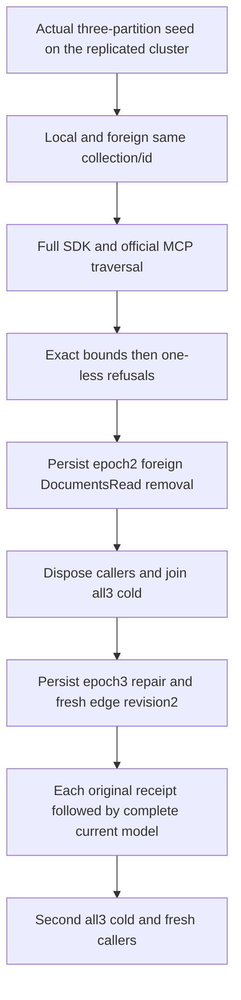

# Public cross-partition traversal authority and frontier boundary

SOURCE-N only. Canonical GraphTraversal slice, REQ-GRAPH-002/003/004/005/006 and AC-GRAPH-002/003/004/005; GraphTraversal adjacency REQ-GRAPH-ADJACENCY-002 / AC-GRAPH-ADJACENCY-003 and ADR-004/010/014/102. No public API or persistence change.

REQ-GRAPH-CROSS-AUTH-001: A visible foreign EntityRef (another partition) remains a full qualified traversal endpoint but never expands the local adjacency whose collection/id collide. A genuine local collision document and outgoing edge must remain outside the start result. Current foreign DocumentsRead removal omits only that endpoint/edge; later persisted repair restores it using the same credential.
AC-GRAPH-CROSS-AUTH-001: Preserve original CanonicalVerticesKeepAtomicRebindDeleteReplayAndBothAdjacencyDirectionsAcrossTwoClusterColdCuts call byte-exact first, then add this independent continuation. Full literal ordered GraphTraversal vertices/edges, documents, and public outbox values must match through SDK/official MCP at each healthy/refused/replayed response. Literal edges a-foreign, b-local and collision-only are independently constructed, never copied from observed result.

REQ-GRAPH-CROSS-AUTH-002: Every examined adjacency counts before labels and visibility; exact maxEdges2 succeeds, maxEdges1 rejects without a partial GraphTraversal even when the second candidate is filtered. Exact maxVertices3 succeeds while one-less2 rejects for the unfiltered visible model. Policy-denied foreign endpoint still charges its examined candidate.
AC-GRAPH-CROSS-AUTH-002: Require exact BudgetExceeded/no SDK value, official dispatched error/no protected partial page; immediately observe full current literal healthy result plus administrator complete related documents/graph/outbox. Repeat after epoch2 omission, epoch3 repair and both owned cold cycles. No global journal/position invariance claim; administrative policy writes have legitimate outcomes/clock effects.

REQ-GRAPH-CROSS-AUTH-003: Original genuine administrator mixed-document/edge command full receipt remains immutable on exact replay; fresh edge revision2 is not rolled back by historical replay. Independently bind complete receipt mutations and durability.
AC-GRAPH-CROSS-AUTH-003: Each SDK and official original receipt replay is immediately bracketed by full current model/outbox. Dispose caller scopes before each actual all-three Kill/BeginRestart/Restart/readiness join, reopen fresh administrator/reader clients, and retain primary plus cleanup failures through existing RunOwned/Cold owners. Same principal epoch1→2 foreign document grant removal→3 original repair, no role elevation. A fresh legitimate b-local revision2 mutation follows first cold and retains original receipt separately.

Owners: existing GraphVertex case only type-body addition; new GraphTraversal Models/Helpers/Assertions roles. Docs GraphTraversal/CrossAuthorityPublic.md. Frontend N/A. Original Test/name/noArgs/deadline/original flow retained. UID UNKNOWN until actual census. Compiler/current image/runtime/Linux/cluster/resources OPEN. No scalar/performance/power-loss claims.
