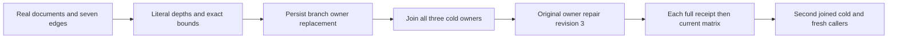

# GraphTraversal — public cyclic frontier and visibility lifecycle

Maps existing REQ-GRAPH-002/003/004/006 to AC-GRAPH-002/003/004/005 under ADR-004/005/010/014/102. No API, format, scheduling, dependency or deadline changes.

REQ-GRAPH-CYCLE-PUBLIC-001 / AC-GRAPH-CYCLE-PUBLIC-001: genuine same-partition self-loop, branches, convergence and back edges produce independent complete literal depth1 (3 vertices/3 edges), depth2 (4/6), depth3 (4/7). Depth is a successful boundary; exact distinct vertex/examined candidate caps succeed and one fewer returns dispatched BudgetExceeded with no partial value. Both SDK and official MCP are checked separately against the full current public graph/documents/outbox after each response.

REQ-GRAPH-CYCLE-PUBLIC-002 / AC-GRAPH-CYCLE-PUBLIC-002: same persisted reader and key, fixed grants and row-owner restriction; administrator replaces only branch document access at revision2. Hidden branch is neither returned nor expanded. Visible depth3 requires 3 vertices/5 examined candidates, returns 4 edges. Incoming adjacency independently omits hidden sources while retaining self/cycle edges; hidden incoming target returns NotFound. First genuine all-three cold is joined in the hidden state. Repair same document access at revision3 restores full cycle and reverse rows; second genuine all-three cold preserves that state.

REQ-GRAPH-CYCLE-PUBLIC-003 / AC-GRAPH-CYCLE-PUBLIC-003: retain full original server receipts; independent command IDs, mutation tuples and ProcessDurable. After EACH SDK/MCP replay, observe full current public state before another replay. Original seed/hide/repair receipts cannot conceal a rollback. No public observation is labelled raw canonical or journal invariance. Local opaque incoming cuts only nonnegative/positive, never equated to replica positions.

Canonical Case: GraphCycleFrontierPublicTests.CyclesConvergingFrontiersAndDepthBoundsStayLiteralAcrossVisibilityRepairAndTwoClusterColdCuts(), no Arguments, native UID UNKNOWN. Existing GraphVertexPublicFlow depth1 rebind case and foreign-frontier acceptance remain separate. Unit reference BFS is an independent local oracle, not public cluster qualification.

Roles: Integration Features/GraphTraversal Cases, Models, Helpers, Assertions; owning new docs/Features/GraphTraversal/CycleFrontierPublic.md. Borrow existing GraphIncomingClusterScenario, RequestCqrsClusterCallers.RunOwnedAsync, GraphIncomingPublicCold and McpCallerDeadline. All caller scopes dispose/join before cold; original failure ledger retained. No synthetic membership, clock, policy authority or transport.

Authored code; compilation, native census/UID, original-deadline runtime, exact-source Linux cluster, fault and resource qualification remain pending. The same-partition edge writer requires both visible endpoints and source partition identity, performs expected-revision admission, and permits a genuine self-loop through the canonical edge/owner/intent path. Incoming rows require current target visibility and source DocumentsRead/current row visibility, use exact local DeliveredRevision=0, and retain all projected edge fields. Full incoming order is source partition tuple, collection, vertex ID, then edge ID; this fixture uses one actual partition, so collection/vertex/edge order is exact. Page.Version=1, Projection and opaque positive CutPosition are independently observed; no row revision is called SourceCut and no page cut is equated to replica position. These source contracts do not qualify execution.
