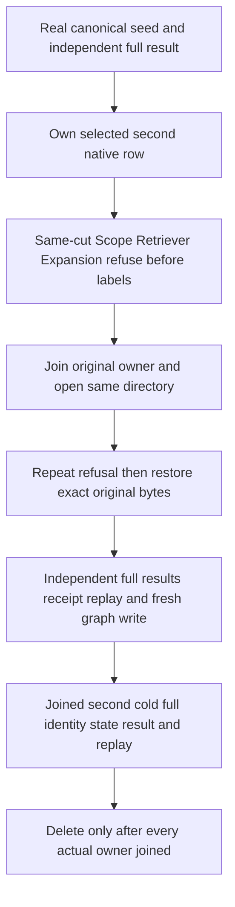

# Canonical graph-search adjacency before filters

KL-055 / REQ-GSEARCH-002/003/005 and AC-GSEARCH-002/003/005, under [GraphRetrieval](../Search/GraphRetrieval.md) and [ADR-090](../../ADR/ADR-090-graph-search.md), require the same-cut graph scope, retriever and expansion to propagate canonical graph corruption rather than hide or substitute it. Original KL-022/023 acceptance remains DONE with its original evidence; this repairs their current canonical-edge dependency inside OPEN KL-055.

The current GraphSearchReachabilityReader discards the native visited adjacency key and omits existing canonical EdgeRecord validation. A selected adjacency can therefore point at a different genuine same-source edge, and a nonpositive revision or noncanonical attributes can pass or be hidden by labels. Preserve the original budget charge and decode; reuse GraphCrossPartitionValidation.ValidateEdge before any label/visibility filter, and require the exact visited outgoing key, decoded edge ID, source and same-partition target. No independent cut, extra traversal, raw document retention, public shape, format, authority, ranking, clock, provider or timeout is added.

REQ-GSEARCH-INTEGRITY-001 / AC-GSEARCH-INTEGRITY-001 maps to GraphSearchCanonicalAdjacencyWholeFlowTests.CanonicalGraphOperatorsRejectDamagedAdjacencyBeforeFilteringThenRepairReplayHealthyAndTwoCold. Three native owned-row contradictions (redirected adjacency, noncanonical attributes, nonpositive revision), with and without an excluding label, each exercise Scope, Retriever and Expansion through the real SearchEngine.GraphSearchAsync and its existing authorized single-cut operation. The existing graph integrity fixture supplies a valid first edge and selected second edge. No AST/SQL-only test or synthetic provider is used.

Require exact Corruption and its independently named safe detail, no partial GraphSearchResult and complete original key/value image and physical cut conservation for repeated refusals and after joined same-directory cold open. Restore only the captured original selected bytes; the complete original healthy image returns at exactly one repair commit. Independently construct complete ranked documents/JSON/redaction/score and context/hop/completeness, including the excluding-label result. Compare the complete original seed receipt and hidden native mutation references; exact raw persisted outcome and complete image remain unchanged on replay. A distinct real document-plus-edge command gets an independent full receipt and complete ranked/context result, followed by replay and a second joined cold owner with all nine original typed StoreIdentity fields including signing bytes, full state/cut/results and both exact outcome replays.

The original TestDatabase join must return successfully before cold open. Each actual cold owner uses lexical disposal with independently retained body and disposal failures. A failed/unknown original or cold close stops the next cold and retains the directory; only confirmed joins permit final root deletion. No simulated disposal fault or retry-as-proof is introduced. These are embedded real-ZoneTree operation controls, not RF3 ACK or public-client qualification.

Source-only: original failing baseline execution, integrated compiler/analyzers, native whole operations and exact-source Linux gates remain OPEN. Existing GraphSearchOperatorTests, GraphSearchAuthorizationTests, GraphSearchExpansionTests, GraphSearchBudgetTests, GraphSearchReadCutTests and GraphSearchLineageWholeFlowTests remain unchanged. Required genuine RF3 GraphSearchRf3Tests/GraphSearchRf3LeaderLossTests and direct SDK/official MCP/SQL parity remain separate mandatory KL-055 qualification; this packet does not close the task. No QueryExecution/ScriptDom, hosting or lifecycle product path changes. Rollback removes the sole reader correction and additive test/doc roles before release without rewriting data.
