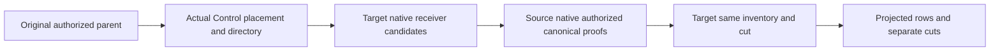

# KL-038 incoming reads and control routing

Private future source, unapplied, unbuilt and unrun. Existing GraphTraversal source/receiver contracts, native read scope and parent runtime are prerequisites.

- REQ-KL038-INCOMING-001: source proof uses current persisted GraphRead and source document row visibility in one bounded native view. It validates canonical owner revision and immutable delivered intent before projecting source graph fields. A superseded/deleted/moved edge produces an explicit absent row with a real source cut; a denied source is omitted only after a genuine authenticated native refusal.
- REQ-KL038-INCOMING-002: target candidates cover the complete bounded native receiver range with validated key, intent, receiver revision and actual target receipt. Finalization compares the same complete inventory and actual target cut under fresh current authorization; a changed cut or state fails with Conflict, and budget exhaustion never returns a truncated page.
- REQ-KL038-INCOMING-003: public rows contain source-projected attributes filtered again by current target graph field policy. The response carries separate authentic source and target cuts and the eventual projection marker, with no atomic cross-owner promise.
- REQ-KL038-ROUTING-001: public graph parent routing executes only on the actual configured Control role. Its bounded current-authorized Core read uses the existing canonical published placement resolver and validated directory, with exact configured control identity. It does not use another owner's absent partition rows as authority, select an arbitrary other group, or change the administrator placement API.
- REQ-KL038-ROUTING-002: the initial command parent signs source effects only on its actual locally owned source partition; a foreign source placement is an explicit refusal. Broader foreign-source effect coordination remains an open capability and is not claimed by these initial RF3 tests. Incoming reads route the actual target owner from the authoritative control placement map and revalidate the target at its native owner.
- AC-KL038-INCOMING-001 (REQ-INCOMING-001/002/003): real SDK and official MCP read an incoming edge across two genuine RF3 groups, compare separate actual owner cuts, hide revoked source rows and projected fields, observe later source move/update/delete without stale results, and repeat after both full cold restores.
- AC-KL038-INCOMING-002 (REQ-INCOMING-002): actual original read limits and current target inventory/cut changes fail before public rows; a subsequent healthy request succeeds. Missing/duplicate/mismatched proofs and malformed committed receiver records fail closed.
- AC-KL038-ROUTING-001 (REQ-ROUTING-001/002): actual published target placement and full registered owner are selected, current source permission and control identity are checked, foreign-source/wrong-role requests refuse, and native target preparation verifies its actual partition epoch independently of group baseline epoch.

Core GraphTraversal/Queries owns reads and routing; feature-local Validation owns current intent/receiver/proof checks; Models owns the runtime routing result. Server parent validates its actual configured role and uses the original native clients. Tests are Queue's actual six-owner SDK/MCP scenario lane. Frontend N/A. Compiler, actual runtime, fault, recovery and exact-source Linux RF3 gates are OPEN.
