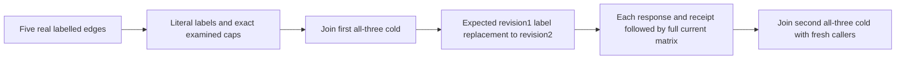

# GraphTraversal — public label frontier lifecycle

**Authored code; compilation, native census/UID, original-deadline runtime and exact-source Linux RF3 qualification pending.** Foreign-authority and cyclic-frontier acceptance remain separate. No library, API, format, topology, provider, fallback, deadline or clock change.

Maps existing REQ-GRAPH-002/003/004 and AC-GRAPH-002/003/004. Canonical slice is IntegrationTests Features/GraphTraversal with responsibility-local roles and an owning GraphTraversal subdoc; noArgs Case `GraphLabelFrontierPublicTests.OrdinalLabelsChargeExcludedCandidatesAndRetainRevisionReplacementAcrossTwoRf3ColdCuts`; native UID remains UNKNOWN.

REQ-GRAPH-LABEL-PUBLIC-001 / AC-GRAPH-LABEL-PUBLIC-001: real same-partition S,A,B,T documents plus five independently specified edges. Initial edge0 S→A has blocked label; edge1 S→B, edge2 A→T and edge3 B→T have keep label; edge4 T→S has blocked label. All initial edge revisions1, document revisions1 and attributes/JSON literal `{}`. Filter keep returns complete literal depth1 S,B / edge1; depth2 and3 S,B,T / edge1,edge3. Examined candidate caps are independently2,3,4 despite returned edge counts1,2,2. Matching labels do not expand through the excluded S→A branch.

REQ-GRAPH-LABEL-PUBLIC-002 / AC-GRAPH-LABEL-PUBLIC-002: null and empty labels mean native unfiltered traversal, not empty results. Full depth1 A,B,S / edges0,1; depth2 and3 A,B,S,T / edges0..3 then0..4. Duplicate keep labels form the same ordinal membership set and return the identical complete keep matrix. Unknown and ordinal-case-mismatching label controls keep only start S, return no edges, and still examine two seed candidates at every requested depth. Each result is independently full typed EntityRef/EdgeRecord values; expected values are never formed by filtering an observed result. Actual nullable ImmutableArray labels and minimum vertices/edges=1 are bound to native originals.

REQ-GRAPH-LABEL-PUBLIC-003 / AC-GRAPH-LABEL-PUBLIC-003: exact examined-edge and distinct-vertex caps independently succeed. One fewer examined-edge cap yields exact dispatched BudgetExceeded without partial value even for the zero-result-edge filter; one fewer distinct-vertex cap refuses when a matching visible vertex must enter the frontier. Do not equate result edge count with examined work. SDK full Errors.Problem edge/vertex literal and official MCP dispatched BudgetExceeded plus native safe capacity detail are separately bound; no subset-only or output-derived detail. EACH refusal is immediately followed by the full healthy matrix and current documents/graph/outbox before any later response can hide a change.

REQ-GRAPH-LABEL-PUBLIC-004 / AC-GRAPH-LABEL-PUBLIC-004: first all-three RF3 cold cut retains initial labels. A genuine expected-revision1 UpsertEdge changes only edge0 label to keep at revision2. Complete keep traversal then includes A and both converging T edges; depth3 charges five candidates while returning edges0..3. Replaying original seed and replacement receipts individually cannot restore blocked label or regress revision2. After EACH SDK/MCP result/refusal/replay, read independently full current documents, all five admin edges (including blocked back edge), bounded metadata and the separately retained full administrator outbox observation. Old returned receipt and current edge state are separate assertions. Second genuinely joined all-three cold cut has fresh caller scopes and preserves replacement labels, original complete receipts and current full matrix.

REQ-GRAPH-LABEL-PUBLIC-005 / AC-GRAPH-LABEL-PUBLIC-005: command input GUIDs and mutation tuples are independent test-owned data. Capture authentic full placement through administrator SDK and official MCP before publication. Require exact commandId/partition/incarnation/ownership epoch/positive admitted position/QuorumProcessDurable plus all literal mutation revisions. Retain complete original receipts for exact replay, with current persisted authorization. No creator elevation, cross-caller borrowed handle or raw canonical/journal/no-append claim. Original failure and every owned caller/cold cleanup failure join through existing native RunOwned and original all-three restart seams before terminal reporting.

Native basis: GraphTraversalReader creates an ordinal HashSet only for nonempty labels; charges examinedEdges before membership test; skips target visibility/enqueue on mismatch; sorts complete output edge IDs and EntityRef collection/ID. Source facts do not qualify this runtime. Existing FilteredOrHiddenGraphEdgesCountAgainstTheGlobalVisitBudget is native local control; existing shortest-path RF3 classes use another operator. Complete current Parity/Authorization/LeaderLoss Case and delegated helper bodies show only shortest-path; LeaderLoss restarts one node. Existing foreign-authority and fixed-label cycle flows do not replace labels or exercise null/empty/duplicate/ordinal candidate-cap matrix. Compilation, exact census/UID, original-deadline runtime and Linux RF3 remain pending. One noArgs Case declared. Fifteen healthy depth/profile cells per stage (all/keep/blocked/unknown at depths1..3; empty/duplicate/case mismatch at depth3), each on SDK and MCP; each response receives full admin current observation. No new dependency.
