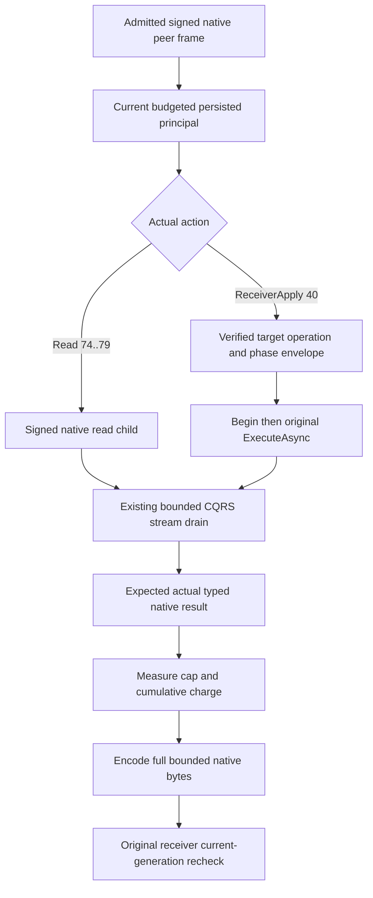
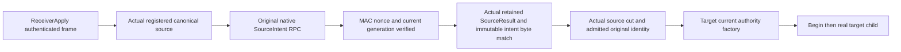

# Native remote graph receiver action dispatch (KL-038)

PRIVATE FUTURE: source-only, unapplied, unbuilt and unrun. No new qualified UID or RF3 acceptance.

REQ-DISPATCH-001: Only actions 0..6 route to the existing signed native CQRS child: read capabilities 74..79 or ReceiverApply phase 40. The existing OrleansNodeRequestExecutor drains the original native ConnectionGrain stream under unchanged framing, cancellation and admission. No direct read invocation, replacement dispatcher or transport.

REQ-DISPATCH-002: Resolve the current persisted principal through the actual budgeted canonical view. Bind the genuine child request and stable command to the existing server-owned native connection identity. Original admitted peer runtime verifies exact configured physical owner tuples and both-group current full generations before dispatch and after the returned result. No caller role or connection ID becomes authority.

REQ-DISPATCH-003: For ReceiverApply, the actual target builder freshly verifies and issues the full native operation; codec signs its phase envelope and native RequestContext is established before effects. Check work/token, then Begin(token) immediately before directly awaiting the original node.ExecuteAsync. Reads never begin effects. Original native errors keep their code/detail locally; the admitted effect boundary owns UnknownWriteOutcome normalization after invocation.

REQ-DISPATCH-004: Decode only the expected generated typed native result. ReceiverApply and ReceiverReceipt return the genuine private RemoteGraphReceiverResultV1, including its unchanged originally admitted mutation and receipt. The public parent exposes only Receipt. Missing receiver result throws RecoveryRequired through its owning reader, never a serialized null. Bound the received native payload before decoding. Measure actual immutable typed output with the original generated serializer; enforce the unchanged result/MaxBatch ceilings and cumulative SAME operation byte budget BEFORE allocating the complete encoded buffer. Verify measured and encoded lengths. These are logical native serialization/work bytes, not process RSS or a speed claim.

REQ-DISPATCH-005: Await the original child task and restore actual RequestContext exactly once. Native ServerFailureObserver retains initiating/fatal and actual context-disposal failures in order; throw only after the owning cleanup region. Runtime and receiver/client shutdown remain separately joined original owners.

AC-DISPATCH-001 (REQ-001/002): Real configured Aspire native six-silo SDK and official MCP operations prove correct action/purpose/typed payload, current authority, original owners and full native generations. Envelope kernel cases are independent and do not qualify this gate.
AC-DISPATCH-002 (REQ-003/004): Genuine preparation/read/receive/refusal/replay flows prove exact typed results and full no-effects cuts for read/refusal, original post-invocation uncertainty, same-ID reconciliation and both original cold phases. No fabricated successful result or acknowledgement supplies an oracle.
AC-DISPATCH-003 (REQ-004/005): Genuine bounded native framing/cancellation/owner shutdown retains the original task terminal and failure identity; result allocations respect actual unchanged ceilings and all original operations join before host/storage cleanup.

Canonical source map:
- Server/Features/GraphTraversal/Execution/RemoteGraphNativeDispatch.cs: exact feature action routing and verified receiving phase construction.
- Server/Features/GraphTraversal/Execution/RemoteGraphNativeChild.cs: genuine signed child execution, actual identity scope and native terminal/type checks.
- Server/Features/GraphTraversal/Serialization/RemoteGraphNativeResultEncoding.cs: original native measurement/admission/encoding.
- Existing OrleansNodeRequestExecutor, GrainRequestStreamConsumer and admitted RemoteGraphNativeRuntime remain the transport, stream and physical-owner lifecycle owners.
- Abstractions/Client public contracts and Ann Core/read/parent implementation are external frozen dependencies; there is no duplicate public API or generic dispatcher.

All compiler, Linux, native process, current-authority, public SDK, official MCP, Docker/Aspire RF3, cold, framing, disposal and failure acceptance gates remain OPEN. Source checks alone establish none of them.

REQ-FRESH-001: Before target receiving factory/effect admission, independently call the existing captured native graph client with SourceIntent and a fresh outer request GUID, original expiry/current principal and SAME operation budget. Resolve the canonical source from actual validated local native owner registration. Do not equate canonical source with the authenticated parent-coordinator RPC sender.
REQ-FRESH-002: The original client verifies source reply full MAC, nonce, configured tuple and current full generation. Bound the authentic payload before decode. Require the returned source request and actual retained source result immutable original identity/receipt to match. Select exactly one byte-identical requested intent from authentic OriginalOutcome.Result.Get<RemoteGraphSourceResultV1>().Intents; no caller-generated intent/cut or local foreign-placement fallback supplies proof.
REQ-FRESH-003: Rebuild receiving SourceProof from that ACTUAL retained intent, actual returned cut, fresh authenticated principal and actual admitted original source identity. The target factory separately verifies registered source tuple, real source placement/commit and current local target ownership/policy. Only then sign phase 40 and Begin immediately before actual target ExecuteAsync.
REQ-FRESH-004: No native RPC await occurs under either store gate. Source directory reads, authenticated decoding, immutable native comparisons and result encoding share unchanged cumulative bounds. Clear only newly owned transient request/reply/comparison buffers after the original native task joins. SourceIntent is a read, not a recursive receiver effect; existing fail-fast native admission remains unchanged.
AC-FRESH-001 (REQ-FRESH-001/002): Actual configured source/target six-silo SDK/MCP cases prove coordinator/source-owner distinction, revoked current source policy, missing retained outcome and changed immutable intent refuse before target effects; complete original images/positions remain unchanged for the rejected operation. OPEN.
AC-FRESH-002 (REQ-FRESH-003/004): Genuine source success, target receiving full result, same-ID reconciliation, original cancellation/joined shutdown and two complete cold phases prove receipts, current full generations and full no-effects/refusal images. Kernel envelope or source review is not this acceptance. OPEN.

Canonical additional role: Server/Features/GraphTraversal/Execution/RemoteGraphFreshSourceObservation.cs owns only authenticated fresh source RPC, exact retained intent selection and native proof reconstruction. Ann Core owns current target receiving authority; Root owns captured client/runtime lifetime. SourceProof.Original is appended native field Id4; no public result exposes it or its token.

REQ-KL038-DISPATCH-INCOMING-001: after actual target inventory validation, directly await Root fresh incoming source observations outside the target read gate, then issue original signed native read79 with those actual proofs. Parent-supplied proofs are never authority. AC maps to the genuine incoming privacy/integrity/independent-cut RF3 scenarios; compiler and runtime remain OPEN. Parent8 original child consumer is the same owning pipeline, not a parallel dispatcher.
