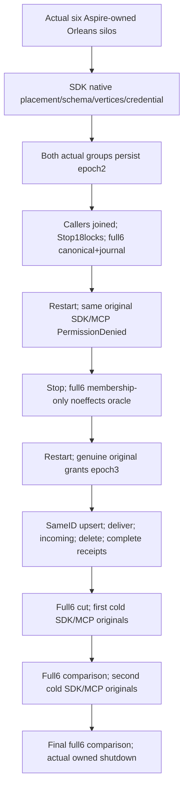

# KL038 genuine six-owner public flow

REQ-KL038-RF3-001: Existing NativeCanonicalModelCutWaveStartup owns the genuine six Aspire Orleans silos, physical parameters, readiness and retained same-volume restart. No queue arm/cut claim is used. Persist Graph/Collection schemas on BOTH real groups, bind initially empty destination atomic partition to ACTUAL configured B on both native placement directories through SDK, then persist genuine document vertices and nonadmin GraphRead/GraphWrite/DocumentsRead principal+hashed credential on both groups. Atomic partitions remain distinct from physical placement.

REQ-KL038-RF3-002: Publish epoch2 without GraphWrite on both groups; close all real clients, capture full stopped all-six canonical/journal native cuts only after original StopForDirectoryRead plus eighteen actual locks. Restart, submit identical original Upsert through SDK/official MCP and require current PermissionDenied; no retained failed outcome is inferred. Complete no-effects comparison permits ONLY original native membership/noop changes independently admitted from real retained journal entries. Restore original grants at epoch3, SAME pre-effect refused original command succeeds/replays; successful outcomes are never expected across later epoch changes.

REQ-KL038-RF3-003: Actual public Upsert, explicit Deliver, incoming projection and Delete require full receipt/payload replay, exact vertices/revision/deletion and independently scoped source/target/completion receipts. Incoming owner cuts are each real owner metadata, never a global simultaneous snapshot. Replay all successful originals through SDK+official MCP after TWO actual same-volume cold reopens, full canonical and original journal comparison after each; no third restart. Original seed document receipts/content remain exact.

REQ-KL038-RF3-004: All callers are owned by original RunOwnedAsync and disposed before stop. Actual wave cleanup uses original ServerFailureObserver primary/cleanup ledger; policy restoration on failed intermediate authorization phase uses that same ledger. Full reader reuses actual NativeBlobWholeRows/Journal/OwnerCut/ColdAssertions and SAME C1 inspection budget 8192 per observed record/32768 cumulative owner, complete finite record count, admitted journal verification and snapshot/missing/oversize refusal. These inherited small inspection limits MAY refuse the actual workload; no quota override/truncation or source-only fit claim is made.

AC-KL038-RF3-001 maps REQ001/002 to real seeded case and epoch2 denial/full6 cut/current restored same-ID retry. AC-KL038-RF3-002 maps REQ003/004 to exact public receipts/pages/documents, native all6 retained journal/physical identity and TWO cold comparisons plus joined cleanup. Genuine TUnit case invokes wholeflow with TestContext original token. Compiler/Linux/Aspire/runtime/all-store size/current policy/cold gates OPEN. Parent/Completion/current incoming Core/native dispatcher and public Source12+authorization Source3 are exact prerequisite source packets, not delivered runtime evidence.

Native typed correction: PartitionRef.PartitionKey selects a new logical partition; AtomicPartitionId remains the original derived read-only hash. Policy restoration consumes only actual returned denied-principal receipts; no fabricated denied record is treated as persisted authority. Failed/ambiguous administration remains the original failure and cannot qualify the scenario; cleanup restores the successfully observed nodes then joins original owned Wave.

REQ-KL038-COLD-001/002 and AC-KL038-COLD-001: cold replay really appends retained same-ID source39/receive40/complete41 plus original seed Batch entries. The graph-specific oracle binds ONLY actual first successful receipts and original native stored outcomes/immutable command identities. Source preparation tokens and receiver observation cuts can legitimately be freshly authenticated; their immutable original identities/intent/receipt must match the original retained full result. All unrelated commands, altered fingerprints, outcome/model rows, old journal bytes and missing/covered native history refuse. Membership and noop entries retain the original complete native membership oracle. Authorization denial still uses the stricter membership-only oracle. Compiler/runtime fit and TWO-cold acceptance remain OPEN.

REQ-KL038-COLD-003/AC-KL038-COLD-002: seed retains only ACTUAL successful RestoreWrite returned principal records, separately for source/target groups. Every graph replay retained PolicyEpoch equals that independent owning restore receipt; original epoch1 seed or retained row itself never supplies expected current policy.
