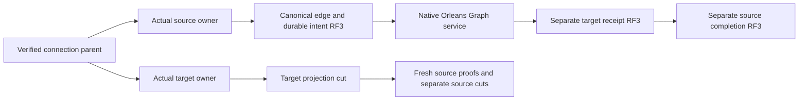

# Native remote graph owner integration

This GraphTraversal supplement complements RemotePhysicalOwners.md and ADR-102. The existing same-owner graph contract remains exact. New public remote parents compose independently authorized RF3 phases and explicit per-owner cuts.

| Requirement | Acceptance | Source |
|---|---|---|
| REQ-GRAPH-SHARED-001 | AC-GRAPH-SHARED-001: existing enum numbers/aliases remain exact; wrong-purpose graph envelopes refuse before effects. | RemoteGraphRequestScope, RemoteGraphRequestEnvelopes; native scope regression pending |
| REQ-GRAPH-SHARED-002 | AC-GRAPH-SHARED-002: both graph directions use exact configured registered owners and actual authenticated current SiloAddress generations, matching request/nonce/discovery contracts/MAC. | RemoteGraphNativeClient, RemoteGraphNativeIdentity, RemoteGraphNativeReplyVerification; genuine six-node failure flows pending |
| REQ-GRAPH-SHARED-003 | AC-GRAPH-SHARED-003: copy work is charged first, original expiry constrains work, dispatched mutating uncertainty remains explicit and every original RPC settles before lifetime release. | Existing ReadExecutionBudget and ReplicaDiscoveryLifetime, graph client; cancellation/resource/runtime gates pending |
| REQ-GRAPH-SHARED-004 | AC-GRAPH-SHARED-004: original singleton client/receiver captured before native Start, attached once after Start and joined before silo/partition disposal, including failed startup. | OrleansNode.RemoteGraph, original startup/shutdown, RemoteGraphNativeHosting; actual lifecycle gates pending |
| REQ-GRAPH-SHARED-005 | AC-GRAPH-SHARED-005: all four new versioned families are included in complete atomic-partition movement inventory. | PartitionRecordFamilies + RemoteGraphProtocol; genuine transfer/recovery proof pending |

Native RPC sender and recipient describe the actual call, including target-to-source calls. Canonical graph source and destination are separately validated inside the payload. Existing movement RequireCallerAsync intentionally accepts only Control; graph authenticates each participant through the existing general owner ResolveAsync and full generation equality. No HTTP peer listener, separate membership system or role-bearing caller identity is introduced.

The existing bounded database/native envelope limits and SDK request lifetime remain authoritative. ReadExecutionBudget counts logical copied payload bytes before allocation; this is not a claim that all Orleans runtime allocations, serialized frame metadata, physical I/O or RSS are bounded by that counter. Native MAC reuses the existing configured key owner and original hashing implementation with distinct graph purpose domains.

Canonical source map: Abstractions existing OperationKind; Orleans/Features/GraphTraversal/Identity, Serialization and Execution; Server/Features/GraphTraversal/Contracts, Authentication, Validation, GrainServices, Hosting and Lifecycle; narrow original ClusterRouting lifecycle/composition/read dispatch and Core partition family joins. Ann owns public contracts, server parent/receiver, model effects, SDK/MCP and RF3 test cases. UI/benchmark: N/A for this integration stage; required resource/performance gates remain mandatory.

Private proposals are unapplied, unbuilt and unexecuted. Existing original R19 and earlier Linux runs do not qualify these future sources. Compiler, same-view privacy, exact native receipts, actual RF3 SDK/official MCP, original cancellation and two cold restart gates stay OPEN.
