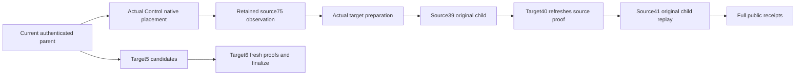

# Native remote graph parent

PRIVATE FUTURE: source-only, unapplied, unbuilt and unrun. Compiler, Linux, actual SDK/MCP, RF3 and TWO-cold gates remain OPEN.

REQ-KL038-PARENT-001: the initial coordinator is the actual configured Control group and source partition is genuinely local there. Current persisted graph authorization and native published placement/directory resolve each destination. Foreign-source coordinated effects remain an explicit OPEN scope, never a fallback.
REQ-KL038-PARENT-002: Upsert/Delete first read actual source75 with the exact immutable public source identity. Deliver uses the closed source75 delivery tag to obtain actual retained source identity/outcome. A current-authorized retained Upsert/Delete still issues the actual same-ID source39 append/apply with freshly re-signed preparations and unchanged logical original identity/result. Only a missing original outcome permits the actual first-run Upsert/Delete; Deliver missing history refuses RecoveryRequired.
REQ-KL038-PARENT-003: sequential target preparation, source39, target40 and source41 execute the original signed child/native client tasks under the original expiry, connection identity and shared work bounds. Target independently refreshes source observations outside its store gate. No source effects are inferred from pending absence.
REQ-KL038-PARENT-004: phase IDs hash bounded native immutable intent plus closed phase kind. Retry and later Deliver share receiver/completion IDs; public Deliver ID, transient cuts and tokens cannot change them.
REQ-KL038-PARENT-005: complete public output contains actual source receipt and each genuine target/completion receipt. After an invoked source phase or accepted retained source effect, nonfatal incomplete proof/authorization/cancellation/cleanup is UnknownWriteOutcome with the initiating cause. Current preeffect refusal remains exact.
REQ-KL038-PARENT-006: target incoming candidates then finalize use native Actions5/6. Target independently refreshes source proofs; it owns omission for genuine source privacy refusal and validates the original complete target inventory. Per-owner cuts remain independent.

AC-KL038-PARENT-001 maps REQ001/002/003 to genuine Control-source/foreign-target six-silo SDK and official MCP operations, exact persisted policies and literal canonical outcomes.
AC-KL038-PARENT-002 maps REQ002/004/005 to same-ID full original receipt replay, later Deliver, failed completion retention, repair and TWO actual cold owner comparisons.
AC-KL038-PARENT-003 maps REQ003/005 to actual held cancellation/effect uncertainty and joined original producer/context/work/peer/storage cleanup, then healthy continuation.
AC-KL038-PARENT-004 maps REQ001/006 to actual incoming source denial, target refusal, deletion/tombstone, complete literal rows and independent cut authority.
AC-KL038-PARENT-005 maps REQ003/004 to generated native codec/closed phase identity regressions. Kernel proof alone is not RF3 qualification.

Canonical map: Server GraphTraversal/Execution RemoteGraphParent, ParentMutation, ParentDelivery, ParentIncoming, ParentRouting, ParentCall and native Dispatch/Child; GraphTraversal/Identity PhaseCommandIdentity. Root owns Core parent routing and fresh incoming observation; Ann owns Core generated/domain factories and reads. Existing Runtime owns work admission/join, and existing native CQRS consumes the original tasks. Frontend/SQL/benchmarks N/A for this transport stage. Metadata logical native-byte charges are not an allocation/RSS or speed claim. All original source proposals remain immutable.

REQ-KL038-PARENT-INVENTORY-001: the public Limit bounds visible output only. Preserve complete target receiver inventory, including tombstones and source-private states, through native freshness/finalize validation. Existing MaxScanRecords/work/native-byte caps still bound inventory; oversized caller work refuses BudgetExceeded, never truncates. AC maps to a genuine two-state inventory with Limit1 and one deleted/private omitted state yielding one visible finalized row. Runtime proof remains OPEN.
