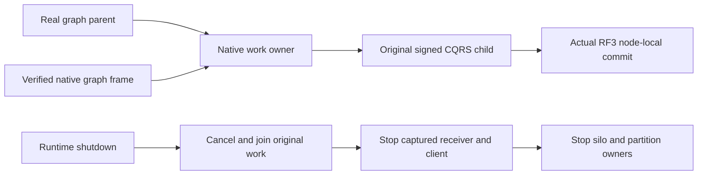

# Remote graph runtime ownership (KL-038)

PRIVATE FUTURE: not applied, compiled, executed or qualified. Requires Root shared22 R2, Ann native contracts/source/receiver methods and the genuine RemoteGraphParent, and Producer RemoteGraphNativeDispatch.

- REQ-KL038-RUNTIME-001: one original node-local NativeRequestWorkOwner admits parent and native action work under the existing validated GrainRoutingOptions frame limits. Every actual operation has its own server request GUID; stable mutation command GUIDs remain separate. No new quota or scheduler is introduced.
- REQ-KL038-RUNTIME-002: construct the runtime before silo Build with resource-free parent composition. Borrow only the original captured client after startup. Runtime owns work admission/cancellation/drain; OrleansNode separately owns receiver/client/host shutdown.
- REQ-KL038-RUNTIME-003: execute genuine native graph reads and receiver apply through existing signed CQRS child requests and the actual node-local database authority. The receiving effect boundary is immediately before the actual native node RPC, after validation. No custom transport or mutable handle migration.
- REQ-KL038-RUNTIME-004: link the original caller and runtime shutdown token; await the actual parent or native-action task directly until terminal. Dispose closes admission, cancels and joins admitted operations before receiver/client/host or partition cleanup. Retain the original creation failure and all cleanup failures in their order.
- AC-KL038-RUNTIME-001 (REQ-001/002): actual configured six-silo Aspire exercise observes native parent and remote child identities, original owners, bounded concurrent admission and cleanup. No fake parent, factory, clock or storage supplies acceptance.
- AC-KL038-RUNTIME-002 (REQ-003): genuine SDK and official MCP flow covers different owners, source/target receipts, current policies and complete same-ID replay under the frozen feature contract. Kernel envelope tests alone do not qualify this.
- AC-KL038-RUNTIME-003 (REQ-004): hold a genuine native operation at an existing observer, cancel/shutdown, observe original producer terminal and joined work before original owner cleanup; retain actual cancellation/lifecycle evidence and a following healthy operation where lifetime remains open.
- AC-KL038-RUNTIME-004 (REQ-002/004): actual failed startup preserves primary and cleanup failures, and owned resources remain fenced until every original admitted operation joins. Creation source review alone does not establish fault behavior.

Canonical source map: Server/Features/GraphTraversal/Lifecycle/RemoteGraphRuntime.cs, Execution/RemoteGraphLifetimeParent.cs and Execution/RemoteGraphNativeDispatch.cs. Existing root shared wiring supplies captured-owner startup and joined shutdown. Ann owns the feature parent and Core methods, Producer owns native action delegation. Every compiler, native process, SDK/MCP, Docker/Aspire and exact-source Linux acceptance gate remains OPEN.

REQ-KL038-LIFE-POST-001: Post-success nonfatal mutation delivery cancellation/budget failures become UnknownWriteOutcome with the original cause. Pre-invocation and read checks retain their ordinary error classification; fatal failures propagate.

AC-KL038-LIFE-POST-001: Runtime SDK/MCP cancellation/replay through Aspire RF3 remains OPEN; private source review does not satisfy this criterion.
