# Persisted shortest-path label use through cluster restart

Canonical slice: GraphTraversal. Parent [ShortestPath](ShortestPath.md), REQ-GRAPH-008/010 and AC-GRAPH-007/009; ADR-098 and current connection lifecycle ADR-125. Authored code; compilation, native census/UID, original-deadline runtime and exact-source Linux cluster qualification remain pending.

## Requirements and measurable mapping

| Requirement | Acceptance |
|---|---|
| REQ-GRAPH-PATH-LABEL-USE-001: preserve the complete existing acceptance flow and its finite initiating deadline | AC-GRAPH-PATH-LABEL-USE-001: existing `GraphPathClusterAuthorizationTests.AcGraph007HiddenVerticesAndFieldUseGrantAreConsistentAcrossSdkAndOfficialMcp` executes every original statement first; a lexical block joins its original HTTP/MCP callers before a separate continuation using the same outer `McpCallerDeadline` token. No new Test, Arguments, timeout or provider. |
| REQ-GRAPH-PATH-LABEL-USE-002: current field-use authorization is distinct from graph, document, query and raw-read grants | AC-GRAPH-PATH-LABEL-USE-002: genuine persisted same-key reader epochs1/2/3/4 has unchanged ScopeGrants, owner and LabelReadGrant. Epoch2 adds LabelUse, epoch3 removes ONLY LabelUse, epoch4 repairs it. Each direct and SQL SDK/MCP labeled read at epoch3 returns PermissionDenied, including fresh callers after the first all-three restart. Each individual response is followed by complete administrator current state and healthy unfiltered direct/SQL public controls. |
| REQ-GRAPH-PATH-LABEL-USE-003: independent ordered paths and projected payloads | AC-GRAPH-PATH-LABEL-USE-003: own three literal documents and two revision1 walk edges produce exactly source/middle/target, Hops2, ordered full edge records and `{"public":"visible"}` projected attributes. Version/Found/Hops/ordered vertices/full edges are independent expected inputs. CutPosition must be positive and remains an opaque actual store-read position; no replica-position, cross-node cut equality or output-derived expected path. Both routes and both SQL/direct profiles are checked separately. |
| REQ-GRAPH-PATH-LABEL-USE-004: preserve original receipt identity and unchanged caller-visible model | AC-GRAPH-PATH-LABEL-USE-004: independently bind CommandId/full mutation vector/partition/durability from the own seed commit. After EACH SDK/MCP original seed replay, immediately verify the full current reader matrix, administrator document/edge payload and retained complete OutboxStatus. Policy writes legitimately persist outcomes; no raw-journal/no-append or atomic cross-read claim. |
| REQ-GRAPH-PATH-LABEL-USE-005: joined restart ownership and fresh policy | AC-GRAPH-PATH-LABEL-USE-005: original native `GraphIncomingPublicCold` joins all three owned containers; all original caller scopes dispose before each restart. First restart is revoked, second repaired. Fresh administrator/reader nested `RunOwnedAsync` scopes retain original initiating plus cleanup errors. Reader authority is never elevated. |

## Frozen native error and projection bindings

Native `DatabaseEngine.ShortestPath(string, GraphShortestPathRequest, ReadExecutionBudget)` validates the original bounded request, enters Store.Read, reloads persisted Principal, requires GraphRead, reads the graph resource, and calls RequireFieldUse BEFORE constructing the reader whenever Labels is nonempty. `AuthorizationPolicy.RequireFieldUse` produces the exact SDK Problem detail `The query requires a protected field-use grant.`. The current native official MCP PermissionDenied codec independently returns `The authenticated principal is not permitted to perform this operation.`; it does not expose the SDK field-use detail. Assert code/status/dispatched identity and this exact safe detail, not a subset or output-derived literal. RawReadGrant remains separate: native Project removes /secret and serializes the independently expected public object while /label remains readable.

No new API, public format, dependency, architecture, synthetic topology, clock or retry is introduced. Required exact-source compilation, native census and Linux qualification remain separate pending gates. Frontend N/A: database public acceptance; benchmarks N/A: literal correctness fixture without performance claim. Rollback removes only these additive roles/subspec and the continuation, preserving every original Case statement.

```mermaid
flowchart LR
  Original[Original full Case and joined callers] --> Seed[Real own documents edges and retained receipt]
  Seed --> Allowed[Epoch2 label use allowed]
  Allowed --> Revoked[Epoch3 only label use revoked]
  Revoked --> Cold1[All three owners joined and restarted]
  Cold1 --> Denied[Fresh SDK MCP direct SQL denied and unfiltered healthy]
  Denied --> Repair[Epoch4 original field-use restored]
  Repair --> Cold2[All three owners joined and restarted]
  Cold2 --> Replay[Full original receipt and exact current model after each response]
```

