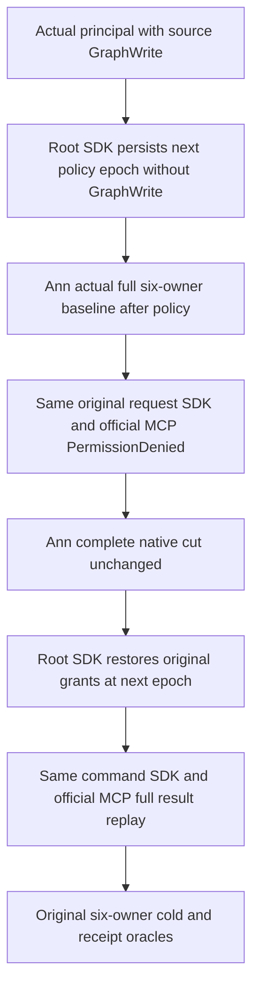

# KL038 current source-write authorization regression

REQ-KL038-AUTH-001: In the genuine existing six-owner remote graph flow, borrow the actually persisted non-administrator source principal and real SDK/official MCP clients. Persist a checked new policy epoch with GraphWrite removed from every actual scope grant, preserving all other principal fields and capabilities. Persist the original grants at a later epoch for healthy exact-command retry. No client-supplied role, replacement credential, clock, synthetic owner or target-local source placement is used.

REQ-KL038-AUTH-002: Submit the identical original UpsertRemoteGraphEdgeRequestV1 through both callers while rights are revoked. Require literal PermissionDenied, no SDK result and genuine MCP dispatched operation identity. This is current authorization rejection, not a claim of retained failed StoredOutcome. The owning Ann RF3 scenario MUST compare full six-owner native canonical cuts taken after policy publication and before/after refusals, then restore rights and verify exact original-command full receipts through both callers plus the original cold/replay flow. These helper phases alone do not qualify that complete scenario.

AC-KL038-AUTH-001 maps REQ001/002 to NativeRemoteGraphAuthorizationPolicy and NativeRemoteGraphAuthorizationCallers, consumed by the existing genuine native six-owner case. The full owner-cut/cleanup/cold orchestration is an explicit pending Ann join. No held midcommit/current-policy race is claimed; no existing hook for this new command is fabricated. Cancellation uses the original caller token, policy commands retain actual canonical receipts, borrowed clients remain owned by the original fixture. The case owner must restore policy in its original failure ledger on every failed intermediate phase.

Compiler/Linux/Aspire RF3/current-policy failure origin/full cuts/cold/resource gates OPEN. No actual source applied.
