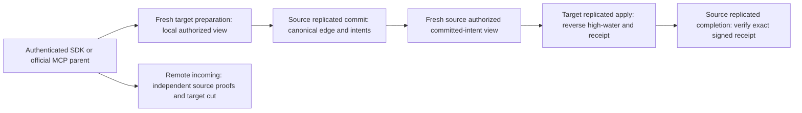

# Remote physical-owner graph delivery

Status: source proposal under KL-038. Compiler, Linux, RF3, cold recovery, fault,
retention and resource gates remain OPEN. This document extends
[CrossPartitionEdges](CrossPartitionEdges.md) and [GraphTraversal](../GraphTraversal.md).
ADR-102 same-owner operations and generated v1 contracts remain unchanged.

## Ownership and public boundary

Canonical slice: GraphTraversal. Explicit new upsert/delete/deliver requests select
source-owned canonical edge/version/intents. Target owns derived reverse state.
No operation owns both stores or transfers open handles. Every effect uses the
existing signed native request/connection context and separately authorized
replicated operation. SDK and official MCP invoke the identical bounded parent.
The new incoming projection exposes independently captured per-owner cuts and
never advertises a cross-owner atomic snapshot. Endpoint status is not cut proof.

## Requirements and acceptance

| Requirement | Acceptance / automated flow |
|---|---|
| REQ-GRAPH-REMOTE-001: source commit validates freshly authorized native target preparation and commits edge/version/coalesced intents/outbox under original atomic ownership | AC-GRAPH-REMOTE-001: distinct registered source3/target3 owners, literal canonical edge and full source receipt; malformed placement, hidden target and current grant denial refuse without model effects. Native source tests plus both SDK/MCP RF3 variants. |
| REQ-GRAPH-REMOTE-002: receiver validates authenticated immutable committed source intent and independently reloads target persisted authority | AC-GRAPH-REMOTE-002: exact duplicate/stale/tombstone ordering, equal-revision contradiction, nonce/MAC/generation/owner refusal and healthy continuation through actual native service and normal target replicated operation. |
| REQ-GRAPH-REMOTE-003: completion retires only current matching intent after genuine signed committed target receipt | AC-GRAPH-REMOTE-003: target commit followed by failed completion retains source intent; repair/retry uses original IDs and complete receipts without a second effect; superseded intent remains. TWO real six-owner stopped cuts and restarts. |
| REQ-GRAPH-REMOTE-004: incoming uses fresh current source privacy proof and target receiver-version verification with explicit independent owner cuts | AC-GRAPH-REMOTE-004: full literal edges/references/projected attributes, source denial omits rows, explicit target refusal, deletion/stale source excludes; genuine SDK and official MCP read routes. |
| REQ-GRAPH-REMOTE-005: unchanged bounded work, cancellation, retained high-water state, uncertainty and joined lifetime | AC-GRAPH-REMOTE-005: actual budget/retention/cancellation/fault refusals preserve complete original errors, no false completion, subsequent healthy request; original tasks, clients, six resources and eighteen locks join before cold readers or cleanup. |

## Frozen schema and semantic rules

New public request contracts carry identities and desired mutations, never trusted
roles, policy epochs or caller-supplied proof. Field IDs are contiguous as declared
in feature-local generated records; aliases are unique versioned identities.
Existing public UpsertEdge and same-owner Apply/Complete and incoming v1 remain.
RemoteGraphOwnerCutV1 contains the actual gated owner identity, placement,
physical position, independently observed applied horizon and persisted policy/schema.
A result row binds a source cut; the page binds a separate target cut. Physical
StorePosition and AppliedPosition are distinct and must not be inferred from status.

Preparation and intent payloads are captured under their actual owner's read gate;
native RPC/publication occurs outside that gate. The target independently checks
fresh current local principal/resource/endpoint/field authority before effects.
Source and destination incarnation/placement/ordered voters are exact; current full
silo generation and signed per-call request GUID/nonce remain native transport guards.
Original intent bytes are immutable. An authenticated channel is not a canonical
source commit receipt, and a possibly invoked effect is not a definitive no-effect
error. Missing/unverified terminal evidence preserves UnknownWriteOutcome.

Source completion follows the existing Messaging signed external receipt pattern,
never a foreign receiver-row lookup. Receiver high-water/tombstones are retained;
capacity is atomically accounted under existing operation/storage bounds. All
fan-out is sequential and bounded by existing scan/result/byte/deadline grants.
No limit increase, new background dispatcher, caller authority flag or fallback.

The public delivery result requires genuine target and completion CommitReceipt
values. Edge result additionally retains the complete original source CommitReceipt.
If repair cannot verify those receipts, it fails visibly and leaves the canonical
source intent pending. No fabricated receipt or synthetic completed state is emitted.

## Slice and integration ownership

Abstractions: GraphTraversal/Contracts public requests/results/cuts.
Core: GraphTraversal/Contracts, Identity, Validation, Commands, Queries and
Serialization for native operation authority and canonical store behavior.
Server: GraphTraversal/GrainServices, Execution, Transport and Hosting for the
bounded native relay and original receiving request-grain calls.
Orleans: GraphTraversal parent/capability adapter through existing CQRS dispatch.
Client/API/MCP: Root-owned narrow public catalog/codec/alias/dispatch joins.
Tests: genuine native Unit and Integration GraphTraversal Cases/Helpers/Assertions;
shared Aspire six-owner fixture is borrowed unchanged. Frontend N/A: no new UI.
SQL N/A for this explicit remote operation stage; future SQL must reuse its authority.

Compiler/DI/SDK/MCP/Linux/RF3/TWO-cold and all resource/fault gates require actual
coherent-source execution. Source contracts alone do not qualify KL-038.

## Retained native phase and current authority refinements

REQ-RGRAPH-SOURCE006 maps to AC-RGRAPH-SOURCE006: source intent observations use
only the current local configured directory and exact full registered target tuple.
The source commit binds its actual local atomic placement. An absent foreign
partition row cannot establish target placement. Target preparation and retained
target receipts provide independent native target authority. Physical-group
baseline epoch and atomic placement epoch remain distinct after movement. The
moved-partition subsequent delivery scenario is required in genuine RF3 tests.

REQ-RGRAPH-DELIVERY001 maps to AC-RGRAPH-DELIVERY001: private read75 admits exactly
one normal immutable source identity or explicit delivery lookup. Deliver resolves
authentic pending/completed intent and scoped source outcome under current source
authority; it never fabricates the earlier command identity or infers fresh effects
from missing history. Snapshot correlation echoes the original tagged request.

REQ-RGRAPH-TERMINAL001 maps to AC-RGRAPH-TERMINAL001: receiver outcome and completion
retain complete admitted native mutations privately. A retained receipt must match
its original intent, target command, native token scope/incarnation/positive epoch
and position, and exact single mutation. Original historical placement is preserved.
Authenticated wrapper success alone is not durable proof; original outcome/cache
validation remains mandatory. Failed outcomes lacking retained original mutation
refuse with RecoveryRequired rather than manufacture a new retry identity.

REQ-RGRAPH-READAUTH001 maps to AC-RGRAPH-READAUTH001: current source endpoint/field
authority precedes protected source metadata and target preparation; active target
visibility precedes scoped receiver outcome selection. Deletion tombstone authority
and original cached policy invalidation remain unchanged. Source and target policy
epochs are independent. A refused pre-effect command may retry after policy repair;
a previously successful old-policy receipt is not automatically admitted as current.

These refinements map to feature-local native proof cases and the distinct-owner
SDK/official MCP flow, full stopped six-owner canonical/journal cuts, policy refusal
and repair, exact replay, deletion/dedupe and TWO cold restarts. Source review does
not close compiler, provider, runtime, Linux, cancellation, retention or RF3 gates.

REQ-RGRAPH-RETAINED001 maps to AC-RGRAPH-RETAINED001: readonly source observation
validates each actual retained intent/current configured owner/source commit and
complete source receipt correlation before replay signing. Retained preparation
claims retain their original MAC/purpose/principal/policy/body and immutable public
request digest. Historical token expiry is not treated as a new effect deadline.
Malformed retained metadata fails closed; newly issued phase tokens remain fresh.
This adds no schema or logical command identity, historical-row reconstruction or
extra source effects. Native integrity and actual RF3 replay gates remain OPEN.
