# Remote graph public API signing

This document specifies the KL-038 public boundary. Its private source packet is unapplied, unbuilt and unrun; it does not qualify SDK, HTTP, MCP, RF3 or Linux behavior.

REQ-KL038-PUBLICSIGN-001: The existing CanonicalOperationGateway uses the current persisted middleware principal, original server connection, fresh operation GUID, native CQRS and response identity. Public commands 42–44 and incoming read 80 use the remote graph parent purpose; private reads 74–79 remain private.

REQ-KL038-PUBLICSIGN-002: The public command ID must match the exact typed command ID before dispatch. The actual server TimeProvider and codec lifetime issue the parent expiry. Native PublicInputElements decoding applies to the public DTOs; the caller supplies neither authority nor trusted roles.

REQ-KL038-PUBLICSIGN-003: A successful command result must carry the original public command identity and actual source, target and completion receipts. An incomplete result, cancellation or other nonfatal failure while encoding a returned remote write is UnknownWriteOutcome. Reconciliation uses the original command identity; no encoding failure proves rollback. Deliver may refer to an earlier source command, so its source receipt ID need not equal its public delivery ID.

REQ-KL038-PUBLICSIGN-004: JSON uses the existing JsonDefaults.Options pipeline and bounded public response encoder. Existing operation signing and error filters preserve their behavior.

AC-KL038-PUBLICSIGN-001 maps REQ-001/002/004 to the actual SDK and official MCP scenarios: all four operations, exact schemas and on-demand authorized discovery; a mismatched command ID and a current-policy refusal produce no model effects, then a healthy command succeeds.

AC-KL038-PUBLICSIGN-002 maps REQ-003 to a genuine original held request or response-ceiling/cancellation failure after owner effects: the caller receives UnknownWriteOutcome and an exact retry resolves the actual complete receipts.

AC-KL038-PUBLICSIGN-003 maps REQ-001/004 to existing graph and unrelated public operation regressions. Compiler, schema-export, process recovery, Aspire-owned genuine RF3 and exact-source Linux evidence remain mandatory and open.

```mermaid
flowchart LR
    Caller[SDK HTTP or official MCP] --> Current[Persisted authentication]
    Current --> Identity[Exact typed command identity]
    Identity --> Parent[Signed graph parent purpose]
    Parent --> CQRS[Original native connection and CQRS]
    CQRS --> Owners[Authorized source and destination owners]
    Owners --> Receipts[Actual complete receipts]
    Receipts --> JSON[Bounded public JSON]
    JSON --> Reconcile[Encoding failure requires original retry]
```

Slice map: Server GraphTraversal/Transport owns signing and GraphTraversal/Validation owns public terminal verification; ClientApi/Execution retains the shared gateway. Queue owns Client GraphTraversal/Transport and the actual Server GraphApi/MCP catalog, schema, hints and descriptions. Root graph enum/codec/scope, actual domain parent, native receiver/runtime/dispatch and the public Source12 R3 packet are prerequisites. Frontend: N/A because these are database transport operations. No benchmark or readiness claim follows from this source packet.
