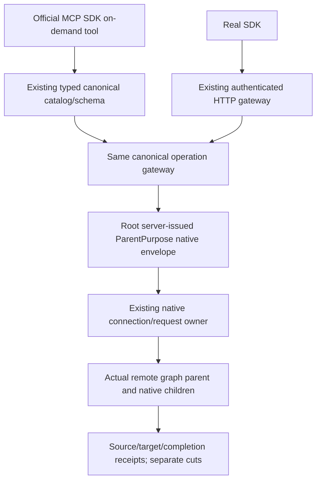

# KL038 remote graph public adapters

REQ-KL038-PUBLIC-001: Add explicit Upsert/Delete/Deliver remote graph writes and remote incoming read, distinct from unchanged same-owner operations. SDK, HTTP and official MCP reuse existing canonical transport, current persisted authentication/authorization, server-issued connection identity and native CQRS stream. Each write preserves request.CommandId; no caller expiry or role is accepted. Root owns ParentPurpose signing. Public typed JSON uses actual JsonDefaults.Options strict System.Text.Json options and converters; no generated JSON context/type-list is introduced.

REQ-KL038-PUBLIC-002: MCP entries use existing typed schema factory and canonical gateway on-demand discovery, three non-readonly/idempotent/destructive write hints and one readonly/idempotent incoming hint. Descriptions disclose separate source/target/completion cuts, partial effects/uncertainty and eventual incoming projection; no global transaction/snapshot claim. Stable command retry always retains original full payload.

AC-KL038-PUBLIC-001: Existing genuine six-owner Ann flow invokes borrowed real SDK and official MCP helper for each write with identical command/payload and requires complete persisted result parity. Incoming reads retain BOTH actual pages, compare original edge content/revision only and independently expose each owner cut; callers must not assert a global or simultaneous snapshot. Negative current rights and all complete source/target/cold oracles remain actual domain/RF3 owner scope.

Frozen ABI: KeyLoad.UpsertRemoteGraphEdgeRequestV1, DeleteRemoteGraphEdgeRequestV1, DeliverRemoteGraphEdgeRequestV1 return RemoteGraphEdgeResultV1; ReadRemoteIncomingGraphEdgesRequestV1 returns RemoteIncomingGraphEdgesPageV1. OperationKind42/43/44 exact UpsertRemoteGraphEdge/DeleteRemoteGraphEdge/DeliverRemoteGraphEdge. Public GrainReadKind.RemoteGraphIncomingParent80; private child74..79 never enter public operation catalog. Four POST routes /v1/graph/remote/{upsert,delete,deliver,incoming}, tools keyload_graph_remote_{upsert,delete,deliver,incoming}. Original public element profile remains required for HTTP/MCP native payload decoding.

Canonical map: Abstractions GraphTraversal/Contracts/RemoteGraphPublicProtocol; Client GraphTraversal/Transport/RemoteGraphClient; Server GraphApi standard Map joins plus ClientApi catalog/hints/descriptions/ApiGrainDispatch/McpArgumentDecoder. Integration GraphTraversal/Scenarios/Remote/NativeRemoteGraphPublicCallers borrows actual clients and owns no fixture/process/network. Root shared CanonicalOperationRequestPreparation and GraphTraversal/Transport/RemoteGraphGatewaySigning, Ann contracts/domain/parent/RF3, Producer native child dispatch are exact prerequisite packets. Schema factory/gateway dispatcher require no parallel implementation or new global setup. Future source only; compiler/Linux/Docker RF3/SDK/MCP/cold/resource gates OPEN.

Descriptions remain in feature-local GraphTraversal/Discovery/RemoteGraphMcpDescriptions, reached by one existing McpToolDescriptions.Find chain. This avoids expanding the existing shared switch responsibility. Gateway index automatically includes typed catalog entries and original official InvokeKeyLoadToolAsync performs on-demand invocation through the existing canonical function; no direct catalog dump or alternate dispatcher.
