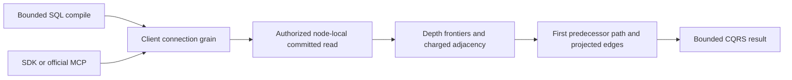

# Bounded unweighted shortest path

Status: accepted implementation contract, 2026-10-05; qualification pending.
Canonical slice: GraphTraversal. Parent: [GraphTraversal](../GraphTraversal.md).
Decision: [ADR-098](../../ADR/ADR-098-bounded-graph-paths.md).

## Public contracts

The exact engine seam is public `DatabaseEngine.ShortestPath(string principalId,
GraphShortestPathRequest request, TimeProvider? timeProvider=null,
CancellationToken cancellationToken=default)` and an internal overload with
`ReadExecutionBudget budget` as the third argument. The public entry starts one
budget using the supplied clock or engine clock; the internal SQL/test join
borrows that original budget without restarting or disposing it.

Find one shortest directed outgoing path between full document EntityRef values
inside one atomic partition and one current persisted-authorized committed
ZoneTree read cut. Explicit breadth-first depth frontiers execute in the
node-local storage owner. Orleans routes the request from the client's connection grain with ManagedCode
CQRS. No per-edge RPC or borrowed storage value escapes the gate.

`GraphShortestPathRequest` version1 generated IDs: 0 Version, 1 Partition,
2 Graph, 3 From, 4 To, 5 MaxDepth=16, 6 MaxVertices=1000, 7 MaxEdges=5000,
8 optional immutable Labels. Bounds: depth0..16, vertices1..10000, examined
edges1..50000, at most64 canonical nonempty labels. Null/empty Labels admits all. A nonempty label filter is field use of graph
`/label`: the persisted principal must hold that field policy's `RawUseGrant`;
a separate `RawReadGrant` does not authorize filtering. Without the use grant,
the operation returns `PermissionDenied` before adjacency traversal.
Version/shape/identifier/label errors are Validation; invalid numeric caps are
BudgetExceeded; a foreign endpoint partition is UnsupportedCapability.
Caller cancellation, explicit expiry and the grain reply ceiling apply; no
KeyLoad request, read or result byte cap applies ([ADR-149](../../ADR/ADR-149-no-operation-limits.md)).
Alias: `keyload.contract.graph-shortest-path-request`.

`GraphShortestPathResult` generated IDs: 0 Version=1, 1 Found, 2 nullable Hops,
3 immutable ordered Vertices, 4 immutable ordered projected Edges, 5 CutPosition.
Found means Vertices.Length=Edges.Length+1 and Hops=Edges.Length. Vertices run
From..To; each edge connects neighboring vertices. Authorized From=To returns
one vertex, no edges, Hops=0. No path returns Found=false, Hops=null, empty arrays.
CutPosition is the actual store position captured inside the same read gate.
Alias: `keyload.contract.graph-shortest-path-result`. Existing IDs stay stable.

SQL profile `Q1.GraphPath.v1`, capability `graph-path`, compiles to the same
typed operator/result:

```sql
SELECT * FROM GRAPH_SHORTEST_PATH(
  'graph', 'fromCollection', 'fromId', 'toCollection', 'toId',
  16, 1000, 5000, 'optionalLabel');
```

Each string/integer argument may use an existing named SQL parameter of its
exact scalar type. Eight initial arguments are mandatory; trailing labels are
optional/bounded. Reject cursor, projection, join, ordering, predicates, extra
statements, expressions and alternate grammar. `SqlGraphPathRequest` carries
Version/QueryRequest at generated IDs0/1 and alias
`keyload.contract.sql-graph-path-request`; Cursor must be null and
AllowFullScan=true. Parsing, validation, reads and exact output share one
ReadExecutionBudget started before parsing. Do not reset its explicit expiry at
the Core join. This explicit bounded profile does not claim full SQL/protocol support.
Both SQL endpoint literals resolve within QueryRequest.Partition; the grammar
has no separate endpoint-partition argument. An unauthorized whole SQL scope
fails persisted authorization. Only the direct typed operation can express a
foreign endpoint, which fails UnsupportedCapability.

## Requirements and acceptance

| Requirement | Measurable acceptance and automated mapping |
|---|---|
| REQ-GRAPH-007: shortest path and explicit depth frontiers | AC-GRAPH-006: independent input-model BFS agrees on ordered full EntityRef vertices and edges for direct/longer/converging paths, shuffled insertion, overlapping IDs across collections, cycles/self-loops, unreachable and depth0/exact/one-short cases. Equal-hop ties follow frontier discovery order then ordinal edge-ID order. GraphShortestPathTests and independent GraphPath reference oracle. |
| REQ-GRAPH-008: one authorized current read cut | AC-GRAPH-007: denied graph/source collection propagates PermissionDenied; missing/hidden/deleted source is NotFound. Hidden/missing/denied/deleted target and hidden intermediate give the same closed no-path result. A nonempty label filter requires the persisted graph `/label` field policy `RawUseGrant`; `RawReadGrant` is distinct and does not authorize filter use. A missing use grant returns `PermissionDenied` before adjacency traversal; null/empty labels do not apply this field-use check. Edge `AttributesJson` is projected by current persisted graph policy. Actual-store revocation/read-cut plus SDK/official MCP Linux cluster failover cases exclude stale/hidden payload. |
| REQ-GRAPH-009: finite node/edge work under caller cancellation and expiry | AC-GRAPH-008: charge every examined candidate before label/visibility filtering. Exact required node/edge cap succeeds; one less throws BudgetExceeded without partial success. Check cancellation and explicit expiry during every frontier, scan, dereference, predecessor walk and output. Real during-work cancellation and healthy follow-up preserve committed position. |
| REQ-GRAPH-010: shared SQL/SDK/MCP execution | AC-GRAPH-009: literal/parameter SQL matches direct result/CutPosition/errors. Reject malformed versions/syntax/parameters, extra statements, foreign partitions and exhausted bounds. Real Aspire replicated-cluster SDK/official MCP preserve the connection-grain and CQRS lifecycle; official discovery verifies both `keyload_graph_shortest_path` and `keyload_query_graph_path`, exact typed request/result schemas, and read-only/idempotent/non-destructive hints against the independent ClientApi oracle. Nested `PartitionRef` has exactly its four identity fields plus computed `atomicPartitionId`; only the four identity fields are required. |

## Execution and bounds

`SqlGraphPathOperationFlowTests.ExtraStatementsRejectWithoutReadsAndHealthySqlRetryMatchesDirectPath`
maps REQ-GRAPH-010 / AC-GRAPH-009 to one complete real-ZoneTree flow: reject an
extra statement, preserve committed position, then retry valid SQL on the same
engine and compare the independently expected ordered path and read cut with
the direct typed operation. normal/scalar execution and compiled-source
coverage binding remain required before this case contributes to coverage.

REQ-GRAPH-010 / AC-GRAPH-009 also replace the existing combined version/cursor/
full-scan rejection-only case with three complete operation flows in
`SqlGraphPathRejectionTests`. Each invalid input must return Validation without
changing committed position, then a valid SQL retry on that same engine must
match the direct typed result, independently expected ordered vertices/edges,
and the original read cut. The alternate-projection and malformed-parameter
cases retain every existing invalid input and require the same unchanged-state
and healthy-retry assertions after each rejection. Keep the two positive parity
cases and the separate extra-statement complete flow. Remove the replaced
rejection-only methods; admit replacements only after normal/scalar runs.

Expand one explicit depth frontier and collect only the next. Visit each execution
adjacency prefix in ordinal order without materializing high-degree pages.
Visited identity is the complete EntityRef. Keep only first predecessor edge
ID/reference/depth, and stop at the first minimum-depth target; later equal-hop
paths cannot replace it. Depth exhaustion returns no-path success; node/edge exhaustion,
cancellation and explicit expiry throw. Validate adjacency/edge ID/from/partition
agreement as Corruption. Re-read only final path edges through charged reads,
then project attributes; retain neither all explored edge payloads nor documents.

Reuse GraphVertexVisibility's policy/boolean caches. Vertex, predecessor,
collection-decision and frontier metadata and the serialized result have no
KeyLoad byte ledger ([ADR-149](../../ADR/ADR-149-no-operation-limits.md)): the
node and edge caps, caller cancellation and explicit expiry bound the traversal,
and the grain reply ceiling (`GrainRoutingOptions.MaximumReplyBytes`) bounds the
delivered result. Use checked arithmetic and cancellation checks. None of this
establishes an aggregate RSS bound.

## Ordered ownership, verification and rollout

1. The spec/ADR is frozen before implementation adds
   Abstractions/GraphTraversal/Contracts/GraphShortest/GraphShortestPathRequest.cs and
   GraphShortestPathResult.cs with feature-local GraphShortestPathContractAliases.cs;
   Core/Features/GraphTraversal/Queries/
   DatabaseEngine.GraphShortestPath.cs, GraphShortestPathReader.cs and cohesive
   local Models/Execution/Validation files. The only existing helper edit is
   Execution/GraphVertexVisibility.cs admission hooks.
2. New UnitTests GraphTraversal/Cases, Assertions and Helpers run against real
   TestDatabase/ZoneTree state, covering the reference, policy, exact/excess
   budgets and actual cancellation matrix.
3. SQL integration adds new QueryExecution contract/parser/value/syntax/executor
   files and independent SQL parity/rejection cases after the Core contract is
   frozen. The exact public method is QueryEngine.ShortestPathSql(string principalId,
   SqlGraphPathRequest request, TimeProvider? timeProvider=null,
   CancellationToken cancellationToken=default), returning GraphShortestPathResult.
   It starts one budget before parse/admission and calls the internal Core
   budget-taking entry. QueryEngine's existing capability list and dispatch
   are the only join points.
4. Orleans read-kind/capability/result dispatch is appended; Server
   POST /graph/shortest-path and POST /query/graph-path; official MCP catalog
   and tools follow the existing naming/schema contract; typed Client calls;
   IntegrationTests real SDK/official MCP graph/SQL revocation/failover cases.
   Frozen tools are keyload_graph_shortest_path and
   keyload_query_graph_path; SDK extensions are ShortestPathAsync and
   ShortestPathSqlAsync, each returning Result<GraphShortestPathResult>. Cases
   use the real shared Aspire ClusterFixture and official MCP client; recover and
   restart every owned stopped node and retain primary/cleanup failures. No
   independent Docker launch or fabricated topology. The typed Client calls use
   the existing KeyLoadClient.Send transport, cancellation and Result contract
   and introduce no other dispatcher.
5. Strict Release build, format, governance and the actual Aspire
   normal/scalar/process/replicated-cluster gates run with exact Linux
   SHA/run/artifacts retained, and the full acceptance chain is updated
   honestly. Focused passes cannot waive complete required suites.

Frontend is N/A: a database read capability. Weighted/cross-partition paths
require separate contracts. No canonical format, data migration or
acknowledgement changes. Rollout adds explicit version1 reads;
unsupported versions fail closed. Rollback removes new read registration; existing
operations and acknowledged ZoneTree data require no rewrite.




## Actual persisted adjacency refusal

REQ-GRAPH-008/009 and AC-GRAPH-007/008 additionally map to shortest-path
corruption flows in `GraphShortestPathCorruptionTests`. Seed genuine documents
and a canonical directed edge, verify the independently expected path, then
inject one fixture-owned missing or inconsistent canonical/adjacency row.
The actual path operation must return Corruption before returning a partial
result and preserve the complete store image and position. Repeat that
operation after joined close/reopen, then restore only the injected row and
verify the full healthy path, edge fields and unchanged read cut/store image.
Cases cover absent edge, changed edge identity/source/foreign target, invalid
stored label/target identifier, malformed adjacency and the wrong root type.
