# Shortest-path endpoint replacement public lifecycle

Canonical slice: GraphTraversal. This SOURCE_N acceptance extension maps existing REQ-GRAPH-001/AC-GRAPH-001 and shortest-path AC-GRAPH-009. Public SDK and official MCP, real Aspire RF3, existing credential/connection/owned cold seams. No product API, library, serializer, deadline, provider or topology change.

## Requirements frozen before implementation

REQ-GRAPH-PATH-REBIND-001: replacing an existing edge with ExpectedRevision must remove the original outgoing and incoming adjacency before storing the new canonical edge and both new adjacency entries. Shortest-path reads consume current canonical edges and select the current first shortest route; an original successful command replay returns its complete original receipt without restoring old adjacency.

AC-GRAPH-PATH-REBIND-001: own S/A/B/T literal documents and four edges 0-sa:S→A, 1-sb:S→B, 2-at:A→T, 3-bt:B→T, all label walk and independently fixed attributes/revision1. Initially S→T is [S,A,T] with [0-sa,2-at], S→A one hop. Replace 0-sa From S→B with To A unchanged, revision2. Require old S outgoing 0-sa absent, B outgoing 0-sa present, A incoming 0-sa now From B; S→T becomes [S,B,T] with [1-sb,3-bt], S→A [S,B,A]. Replace 0-sa To A→T with From B unchanged, revision3. Require A incoming 0-sa absent/T incoming 0-sa present and S→T [S,B,T] with [1-sb,0-sa revision3]. Full paths, edge records, document revisions, graph rows and both adjacency directions use test-owned literal expectations. SDK direct/SQL and official MCP direct/SQL each immediately followed by full administrator current/outbox observation; observer never calls its reader matrix recursively.

REQ-GRAPH-PATH-REBIND-002: stale revision rejection and every original successful receipt replay leave current public model results unchanged; a refused fresh command may persist a legitimate failure outcome/clock. No raw journal/no-write claim follows from public reads.

AC-GRAPH-PATH-REBIND-002: after revision2, actual ExpectedRevision1 fresh update refuses strict RevisionConflict through both clients. Each response is independently followed by current+healthy complete route matrix, before a later response can conceal it. Original full seed/revision2/revision3 receipts replay individually, each immediately followed by current matrix; verify original GUID, complete mutation output, durability and independent pre-publication administrator SDK/MCP placement tuple. Retain original refusal identity/result where existing cached contracts permit; exact native revision and MCP safe-detail contracts require explicit proof before code readiness.

REQ-GRAPH-PATH-REBIND-003: bounded original lifetime and current results survive actual joined RF3 cold ownership changes.

AC-GRAPH-PATH-REBIND-003: strengthen ONLY existing GraphPathRf3LeaderLossTests.AcGraph009CommittedPathMutationSurvivesLeaderLossAndRestoredNodeCatchup. Preserve every original statement/invocation first and original McpCallerDeadline; wrap original node clients in a lexical scope so they join before this continuation. No new Test/Arguments/UID. First all-three cold observes revision2 routing, then legitimate revision3 replacement/healthy matrix, second all-three cold observes revision3 and each original full receipt. Fresh owned admin/reader SDK and official MCP callers after each cold; joined original failure and cleanup ledger. No power-loss/latency/raw cross-store cut claim.

## Independent bounded oracle

Source BFS facts: adjacency candidates charged before labels/visited; canonical edge identity checked; first encountered target ends the level. Initial and revision2 S→T use MaxDepth2/MaxVertices4/MaxEdges3 exact enough; revision2 visit B's 0-sa to A before 3-bt to T. A MaxVertices3 control must refuse before T is admitted at revision2; immediately healthy max4. Revision3 needs two examined candidates S:1-sb and B:0-sa and uses max3 vertices. Exact independently computed counters remain source-stage arithmetic, not exported measured metrics or performance evidence. Incoming complete native rows/SourceCut and SQL request bindings must reuse confirmed typed contracts.

## Coverage exclusion and scope

Existing canonical vertex full flow rebinds/deletes/reinserts edge and checks both adjacency directions, but does not assert shortest tied route changes. Existing path parity is warm static paths; leader loss adds a NEW shortcut, with one stopped owner, without same-ID endpoint replacement. Cycle/label packets qualify BFS visibility/filter/caps, field-use and RawRead packets policy/projection. This continuation preserves all those originals.

New role targets planned under IntegrationTests/Features/GraphTraversal/{Models,Helpers,Assertions}; owning doc docs/Features/GraphTraversal/ShortestPathEndpointReplacementPublic.md. Root approval/source-N peer and native NF/checkOnly remain required before selection. Fresh source body prefix/full existing post UNKNOWN until actual Main native Y.

```mermaid
flowchart LR
  Original[Original leader-loss case joined] --> Seed[Four literal edges]
  Seed --> RebindFrom[Revision2 moves source]
  RebindFrom --> Stale[Stale expected revision refused]
  Stale --> Healthy[Full current route matrix]
  Healthy --> Cold1[All3 joined cold]
  Cold1 --> RebindTo[Revision3 moves target]
  RebindTo --> Replay[Every original full receipt + current]
  Replay --> Cold2[All3 joined cold + full current]
```

SOURCE_N requirements only. SourceY, compiler, runtime, native UID and Linux qualification OPEN. No predicted PASS.
