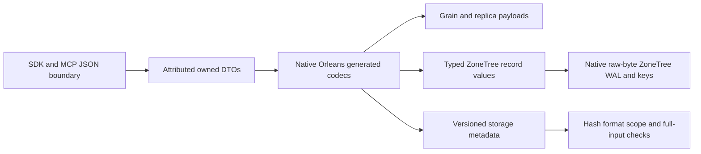

# InternalSerialization

The owner requires generated Orleans10.4.0 binary serialization for all owned internal typed payloads. Public HTTP/MCP JSON, exact user content and frozen canonical identities remain explicit concrete boundaries. This cross-cutting codec is genuinely shared; each model's behavior remains in its existing canonical slice. Frontend is N/A because no UI behavior is introduced; public API JSON stays unchanged.

## Requirements and acceptance

REQ-IS-001 through REQ-IS-009 respectively require the complete attributed DTO closure, pooled strict native codec, typed persistence/accounting, versioned storage metadata, bounded replica write payloads, native grain contracts, versioned native signed claims, strict rejection of unsupported persisted formats and exact-source qualification. They map one-to-one to AC-IS-001..009 and the [test/flow matrix](InternalSerialization/Acceptance.md). Each missing or malformed case must fail before effects; deserialize defaults are not authorization or semantic validation.

## Ownership and verification

[ADR-060](../ADR/ADR-060-native-internal-serialization.md) owns formats and ordered implementation. Abstractions owns Features/InternalSerialization and generated public DTOs; Core owns each model's private records/readers/accounting; Replication owns the replica write payloads and their persistence; Storage.ZoneTree owns StorageRecovery/BackupRestore metadata; Orleans carries every internal grain call and owns its transport. Existing public ClientApi remains its actual JSON protocol boundary.

Tests mirror InternalSerialization and the affected existing slices. Generated codecs and small real-file fixtures cover type/null/default/empty/byte/DOM/enum/polymorphism boundaries. Real process fault cuts and genuine Docker replicated-cluster SDK/MCP prove recovery/runtime behavior only at the qualified SHA. Local TUnit development tests and bounded recovery/performance experiments are allowed; label their actual source and machine. Required Linux GitHub fault/topology and publication qualification remains separate. Compiler, formatter and governance checks are static evidence.

The current implementation includes attributed ChangeFeedClaims and native grain-to-HTTP/MCP principal binding, retaining existing admission/accounting and narrow strict grammar checks. Known ungenerated enum headers follow the official backing integer codec. An internal public-input profile permits only null reference collection elements so existing command/query validators and valid traversal-label behavior remain intact; required roots/members/initialized arrays, dictionaries, persisted records, claims and outputs stay strict. Public HTTP/MCP/CLI JSON, user JSON content, frozen identity material and the explicitly user-selected local-profile.json configuration file retain their concrete external boundaries.

Current scope accepts the current attributed Orleans serialization and storage contracts only. Unsupported persisted format or identity versions fail closed before state mutation; no previous-format reader, converter, reverse conversion or migration workflow is part of the product. The current source and its missing-identity, backup-cut, collection/reference/depth/graph/DOM regression flows still require exact-source Linux qualification.  No measured acceleration, power-loss or production result is claimed.

Native v2 preserves bounded unknown fields and known-schema references. Typed
references to opaque omitted-type unknown fields fail closed before allocation;
deferred schema inference is outside this homogeneous rollout contract. Replica
and authentication projections read the actual generated constructor/body scopes,
including empty constructor scopes for explicitly attributed record properties.

Native preflight supports the owning generated DTO closure and its specified
scalar/array/collection/surrogate shapes. Unmodeled System surrogate and derived
collection codecs are rejected before decode; they cannot bypass count guards
through an object-typed member. General heap amplification remains unqualified.

REQ-IS-010 / AC-IS-010 requires actual diagnostic measurement before selecting
shared hot-path optimizations. It maps to the full [native serialization diagnostic
contract](BenchmarkComparisons/NativeSerialization.md), with source-bound
BenchmarkDotNet results separate from mandatory cluster/full competitor qualification.

## Queue-body corruption and unknown header classification

REQ-IS-002/AC-IS-002 and AC-IS-004/007 distinguish persisted native queue-body corruption from caller validation, preserving bytes, ready state, counters, positions and absent outcome before successful restore with the same request identity. QueueBodyAccountingTests/QueueBodyFailureAssertions own this real-ZoneTree fixture. Unknown well-known header metadata is classified only at the official single-header/span boundary in NativeFieldHeaderReader, using the saved official Reader and registered type table; arbitrary owned/generated/session key failures remain visible. NativeUnknownWellKnownHeader* tests use genuine writer twins, extended field deltas and public/MCP controls. ADR060 owns the accepted implementation and rollback. Normal/scalar/recovery/cluster qualification remains exact-source GitHub-only; source review and a development build cannot satisfy it.

## Terminal admission allocation reduction

REQ-IS-PERF005 / AC-IS-PERF005 requires zero auxiliary allocation for warmed,
normalized terminal types and nullable admission allocation equal to the existing
Normalize loop. REQ-IS-PERF006 / AC-IS-PERF006 preserves the supported domain,
closed generic-owner enum fallback and exact type-depth264/265 boundary. Only
NativeWireSupported's existing primitive/enum/scalar predicate receives a root
shortcut; the complete iterative fallback, generated codecs, persisted bytes,
resource limits and validation remain unchanged. NativeWireSupportedScalar
AllocationTests, Tests, Fixtures and DepthTests own the positive, unsupported,
nullable, byte-ownership and depth controls. ADR060 records rollout and rollback.

REQ-IS-PERF007 / AC-IS-PERF007 uses the prospective allocation/latency budgets,
complete24-cell profile, six exact corpora, twelve JSON cohort controls and
conservative interval decision in ADR060. Pair arithmetic requires retained
originals and independent review; two local command-decode cells cannot satisfy
this full criterion. Internal microbenchmarks follow the latest root policy and
must not be dispatched through the end-to-end database comparison workflow.

AC-IS-PERF005 measurement rules: both original 4,096-call workloads, exact zero/equality
assertions, terminal/nullable domains and unchanged production Normalize/Require APIs
are mandatory. Keep measurement synchronous on its owning thread, join any worker before
disposal and retain every failed native result. No tolerance, minimum/median selection,
retries until green, outlier removal, diagnostic suppression or production workaround is
permitted. These allocation controls contribute no product coverage or public speed claims;
normal/scalar and exact-source Linux qualification remain separate.

## Parent payload boundary

REQ-MSG-007 / AC-MSG-007 and REQ-IS-001/002/005/006 / AC-IS-001/002/005/006 preserve ADR026 multi-lane composition and ADR060 native codecs. ReceiveAcrossLanes is an Orleans parent orchestration capability, intercepted before canonical Core command submission. Its real generated MultiLaneReceiveRequest public/native DTO is decoded by the existing HTTP/MCP/SQL typed descriptor; only each original Receive leaf is a canonical atomic command. Do not add a parent Core payload/identity/normalization mapping or group receipt. The exact enum mapping oracle must explicitly require the parent mapping absent and every other current operation mapping present. Genuine Core native command creation of this parent rejects UnsupportedCapability without storage effects; the real MCP descriptor JSON/native roundtrip preserves literal outer/leaf IDs, lane and ceilings with actual array/stream writer parity. Existing native parent/leaf and SDK/official MCP/SQL whole-operation flows remain mandatory.

## Feature-owned constant aliases

REQ-SERIALIZATION-001 / AC-SERIALIZATION-001 and existing ADR-046 preserve every generated Orleans alias string and field ID. The newly added rollup and purge constants live in their owning TimeSeries/EventStreams Serialization roles so the shared NativeContractAliases type remains within the unchanged200-line limit. This changes compile-time constant ownership only; no persisted format, public schema, alias value, fallback or compatibility reader changes. Native serializer/schema roundtrips and complete build remain required; source movement alone proves no runtime result.

## Generic native refusal controls

The full-operation generic-factory controls include every current Orleans-coordinated parent and the reserved EventFeedControl36/EventFeedSourcePhase37. Each unsupported generic operation must fail with the existing UnsupportedCapability detail, leave the complete committed native store image and position unchanged, and permit a distinct healthy queue command. Actual receiver-owned private phases retain their separate verified factories. This test correction implements the existing EventStreams reservation contract; it does not enable advisory provider registration or create payload types. Original source-bound Linux normal/scalar qualification remains pending.
