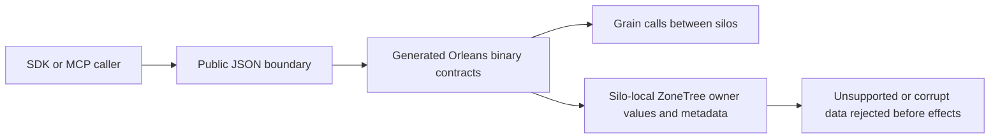

# internal serialization acceptance

Goal: all owned internal typed serialization uses generated Orleans binary contracts, preserving authorized database behavior and real recovery boundaries. Actors are SDK/MCP callers, node-local storage owners and offline operators. Public API shapes and permissions remain unchanged.

## Scope

Include owned DTO closures; persisted model values/scalars; WAL/checkpoint/identity/backup metadata; replica write entries; Orleans request/reply payloads; signed internal typed claims. Exclude actual public HTTP/MCP JSON, JSON document/query DOM materialization, frozen canonical identity hashes, sortable KeyCodec bytes, ZoneTree storage framing/raw values, blob bytes, cryptographic algorithms and Cartograph archives. These are concrete protocols, not alternative internal serializers.

## Criteria and tests

| ID | Pass/fail contract | Automated evidence |
|---|---|---|
| AC-IS-001 | Every owned internal concrete DTO has generated serialization, immutable IDs and stable aliases; inherited fields preserve scope. No runtime JSON record/protocol fallback. | contract/type-closure tests and source inventory; enabled full solution compile. |
| AC-IS-002 | Cached codec uses pooled sessions, exact input consumption and raw byte codecs; malformed/trailing/wrong-version/null-required data fails before effects. | codec round trips, corruption/default/empty/null/tombstone and bounded byte tests. |
| AC-IS-003 | Typed model/scalar values and borrowed readers use the same binary codec, preserving atomicity, authority, exact user JSON/raw numeric lexemes and exact quota accounting. | Real ZoneTree model families, queue/topic/outbox accounting and existing mixed-model/schema regressions. |
| AC-IS-004 | Checkpoint, identity and backup have explicit distinguishable new formats, hashes and full validation before install/publication. Unsupported signatures or versions and corrupt artifacts fail closed without truncating or recreating data. | Actual-file metadata/checkpoint/backup regressions; process-cut recovery. |
| AC-IS-005 | Replica write payloads sent through Orleans preserve malformed no-slot effects, exact size limits and the opaque-payload allocation contract. Authentic generated record frames, including empty constructor scopes, pass inspection. | Replica payload tests, generated codec compatibility, entry batch accounting and replicated-cluster SDK/MCP. |
| AC-IS-006 | Grain requests/replies use attributed types internally; public JSON is converted only at the API boundary. Cancellation, reply budgets, CAS/ETags and errors remain meaningful. | Grain payload/envelope/request tests and actual replicated-cluster SDK/MCP. |
| AC-IS-007 | Signed typed claims use the current binary contract; frozen operation/idempotency digests remain exact. Unsupported purposes/versions and malformed tokens never grant authority. | Signed claims/tamper/scope/version tests and unchanged canonical golden hashes. |
| AC-IS-008 | Only the current persisted format is supported. Unsupported versions, signatures and malformed data fail closed before mutation; migration, conversion, reverse conversion and prior-format readers are outside the product contract. | Real current-format rejection preserves original files and state, then proves a healthy current write/reopen; current unknown-signature/version, checksum and corruption cases remain distinct. |
| AC-IS-009 | All required gates pass for final exact source; evidence distinguishes compile, tests, workflow completion, performance and production. | Full normal/scalar unit, recovery, analyzers and genuine Docker cluster suites in canonical CI. |

Every requirement maps one-to-one to these criteria in InternalSerialization.md. JSON DOM surrogate tests preserve ordered properties/duplicate semantics, numeric lexemes and owned buffers. Semantic validation is required beyond serialization attributes. No large synthetic load tests are added. Performance/power-loss/endurance/production remain unmeasured unless separately evidenced; static review cannot satisfy runtime criteria.

### Current unit source crosswalk (mapping only; not qualification)

This source crosswalk names the current assertion families reviewed against
the acceptance rows. The grouped unit sources below are evidence pointers, not
a claim that an individual test run qualifies a current gate.

| Existing current REQ/AC | Reviewed current unit source and operation | Scope limit |
|---|---|---|
| REQ-IS-001 / AC-IS-001 | `ContractAttributeTests`, `ContractFamilyTests`, and the generated DTO assertions in `ReplicaGeneratedCodecCompatibilityTests` and `ReplicaContractTests` | Attribute/type closure and generated values only; this is not the complete repository source inventory. |
| REQ-IS-002 / AC-IS-002 | `BoundaryTests`, `WireCollectionTests`, `WireBoundaryTests`, `WireShapeTests`, `PairMetadataTests`, `DomTests`, `GraphTests`, `JsonElementTests`, `ValueOperandTests`, `InspectionTests`, `ReaderMalformedTests`, `StreamTests`, `NullableMetadataTests`, `UnknownWellKnownHeaderReaderTests`, `UnknownWellKnownHeaderTests`, `UnknownWellKnownHeaderAuthenticationTests`, and the strict public-input profile cases | codec/DOM structural semantics and failure-before-effects; public HTTP/MCP JSON remains a separate protocol. |
| REQ-IS-003 / AC-IS-003 | `CoreModelPersistenceTests`, `CoreAccountingTests`, `OperationCoordinatorTests`, `OperationResultTests`, selected `ContractFamilyTests` and `NullableMetadataTests` cases | Actual ZoneTree values, typed outcome replay and exact stored-byte accounting. `CoreAccountingTests` assertions map here by behavior even though their method names say AC-IS-006. |
| REQ-IS-004 / AC-IS-004; REQ-IS-008 / AC-IS-008 | `CheckpointBatchTests` and current stored-state assertions in `ReplicaGeneratedCodecCompatibilityTests` | Current checkpoint metadata validation, exact no-mutation/reopen, and unsupported-current-format rejection. Positive round trips do not demonstrate conversion or old-format compatibility. |
| REQ-IS-005 / AC-IS-005 | `ReplicaAdmissionTests`, `ReplicaInspectionTests`, `ReplicaEnumHeaderTests`, `ReplicaContractTests`, `ReplicaInspectionResolutionArrayGuardTests`, `ReplicaInspectionResolutionBytesTests`, `ReplicaInspectionResolutionCollectionsTests`, `ReplicaInspectionResolutionReferencesTests`, and replica-specific methods above | Current typed payload, inspection, byte/entry bound and borrowed-buffer behavior. These unit flows do not substitute for the Docker replicated-cluster SDK/MCP gate. |
| REQ-IS-006 / AC-IS-006 | `PublicCommandTransportTests`, `PublicNormalizationTests`, `PublicReadElementsTests`, `OperationMarkerTests`, and current generated request-reply cases | Public-to-boundary conversion, principal/error precedence and typed request behavior. In-process tests are not official MCP SDK or replicated-cluster qualification. |
| REQ-IS-007 / AC-IS-007 | `CoreSignedClaimsTests`, `SignedClaimsExecutionPolicyTests`, `OperationFingerprintTests`, `OperationSemanticsTests`, and exact identity assertions in `OperationOwnershipTests` / `OperationAuthorityTests` | Current typed claims and unchanged canonical operation/retry identity; does not qualify performance or all authorization paths. |
| REQ-IS-PERF005 / AC-IS-PERF005; REQ-IS-PERF006 / AC-IS-PERF006 | `WireSupportedScalarAllocationTests`, `WireSupportedScalarTests`, and `WireSupportedScalarDepthTests` | Narrow local allocation/domain/depth assertions only; they do not satisfy the comparable BDN criteria. |
| REQ-IS-003/007 / AC-IS-003/007 | `SerializationBufferPolicyTests` and `SerializationExecutionPolicyTests` | Exact canonical bytes, string escaping and operation fingerprints at fixed buffer boundaries; does not qualify allocation or performance. |
| REQ-CQ-013 / AC-CQ-034/035 | `SignedClaimsExecutionPolicyTests` where its source-level AC-CQ comments name the criterion | Central typed operational-option admission and execution-boundary policy; this row is cross-feature CodeQuality evidence, not an additional InternalSerialization AC. |

No case in this slice maps to AC-IS-009 or AC-IS-PERF007: those require complete
workflow/source-matched or comparative performance evidence. Exact-source normal/scalar workflow results remain required for qualification.

## Assumptions and compatibility

Orleans10.4.0 and the existing central package pins are retained. Matching homogeneous cluster versions are required. Unsupported persisted formats are rejected; this acceptance does not authorize rewriting established stores. No direct Azure or production access. Product release remains outside this source task.

### AC-IS-002 resumption negative and edge inventory

Reject incomplete/duplicate/overfilled array/list counts, incomplete dictionary
pairs, invalid references, excessive nesting, wrong dynamic root, semantic
cycles and compressed-reference DOM expansion before database effects. Preserve
positive empty collections, supported polymorphism, repeated legitimate references
and public-input null validator precedence. wire depth264, semantic/DOM
depth64 and DOM UTF8 output32MiB are explicitly owned structural fences in ADR060;
they do not establish a general decoded-heap bound or measured acceleration.
New Writer/scalar fixtures and real-store/replay assertions map to AC002/005.

Known typed references to opaque omitted-type unknown fields and unmodeled
System/derived-collection codec shapes must fail before allocation.
Bounded unknown fields, known-schema references and the actual owned generated
closure retain positive coverage. Full arbitrary codec compatibility is
out of scope and requires a separately accepted bounded shape contract.

## NSP006 criteria

| ID | Pass/fail contract | Automated evidence |
|---|---|---|
| AC-IS-PERF005 | Warm normalized terminal admission allocates0 auxiliary bytes; nullable admission equals independent unchanged Normalize allocation. No caches or changed limits. | WireSupportedScalarAllocationTests use the no-key TUnit NotInParallel constraint. Nullable controls warm the exact same non-inlined synchronous measurement bodies32 times before their4096-iteration measured windows; both exact byte assertions and outside-window data/assertions remain unchanged. No tolerated bytes, retry/min-selection, GC manipulation or production change. |
| AC-IS-PERF006 | Supported closed terminal roots pass; open/unsupported roots and unsupported generic-owner arguments fail with the original corruption error. Fixed263 array wrappers pass;264 fail. Generated nullable values/nulls, ordered collections and independent bytes survive round trips. | WireSupportedScalarTests/Fixtures/DepthTests plus the complete existing normal/scalar suite. |
| AC-IS-PERF007 | All prospective budgets, six exact corpus receipts, full24-cell profile, twelve JSON controls and confidence/cohort conditions in ADR060 hold. Missing/drifted/indeterminate pairs fail qualification. | Actual complete BDN originals and strict report validation; explicit manual arithmetic exception requires source/host/profile-bound originals and independent review. Local two-cell data is insufficient. |

### Original AC-IS-004/008 authentic current-format mixed journal cut

A complete verified original archive at each of two acknowledged SAME-owner cuts must retain its own independent manifest position. Replacing only its original journal with the other complete original journal and recalculating only that file hash does not authorize mixing those cuts: complete header/checksum/codec traversal still rejects the mismatched cut as exact Corruption before publication or actual CLI restore. Preserve full mixed bytes through refusal, the donor archive, the current source/auth/model/outcome cut and original receipt replay. Repair the exact original journal and manifest bytes, reuse the SAME frozen restore mapping/incarnation/signing tuple/path, and retain full selected partition state, paused new authority, genuine healthy mutation and original receipt bytes through two joined cold owners. Literal earlier/later Args do not infer UIDs or qualify Linux/cluster/CLI success; those gates remain exact-source required. No old format reader, format change, product guard or checksum bypass is introduced.

### AC-IS-004/008 authentic container transfer versus cut integrity

A correctly encoded three-file container may transfer original complete journal bytes that disagree with the manifest cut. Pack/Inspect/Unpack success proves transfer integrity only. The and CLI restore boundary must refuse the exact current Corruption without publication, preserve all source/donor/container bytes, then exact original-byte repair at the same owned paths and frozen restore authority must permit healthy writes and two joined cold owners. Both authentic journal directions use genuine same-owner committed cuts; no synthetic frame, compatibility reader or weakened validation is admitted. Source/compiler/CLI/Linux qualification remains separate.

### AC-IS-008 unknown current journal signature: complete restore refusal and exact repair

The original unknown journal signature rejection remains distinct from checksum/cut failures. An additional whole operation uses the current WAL and current compacted checkpoint fixture, replaces only the original first signature with the already-declared unsupported signature, and retains every other original byte. verification and same frozen authority restore plus the real CLI must return exact FormatUnsupported/400/The journal format is unsupported. with the complete Problem, no target or staging publication, and unchanged full source/archive. Only exact original archive-byte repair permits and CLI healthy restore, independently literal healthy records/positions, and two joined cold owners. Original checksum/cut cases and Args are retained; this does not add a prior-format reader, migration or unsupported-to-success behavior. Compiler/runtime/Linux remain separate gates.
