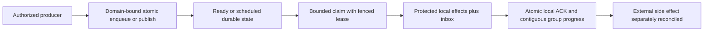
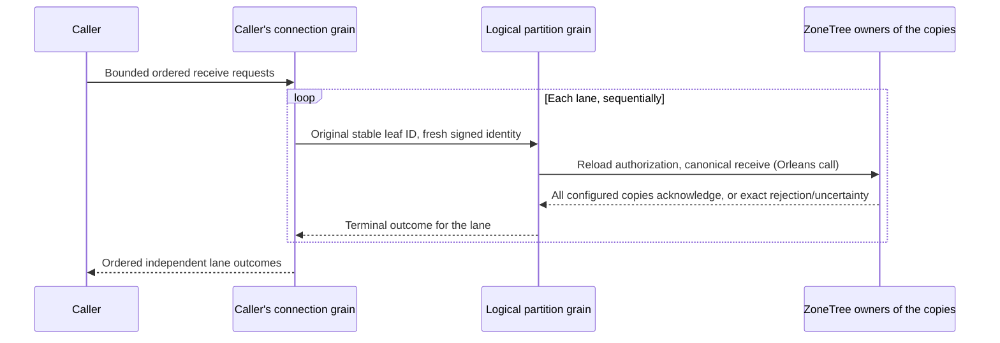
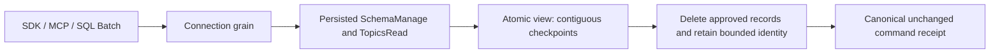
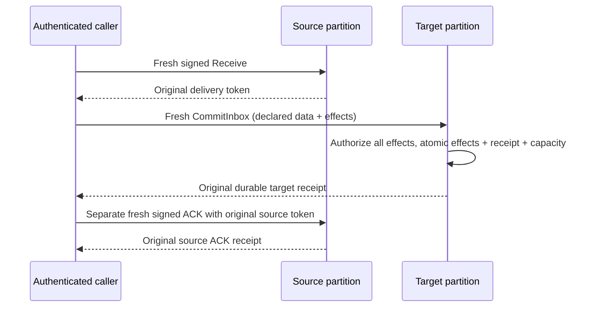

# Messaging

[RemoteTransfers](Messaging/RemoteTransfers.md) and ADR-088 define the current
bounded cross-partition intent/receipt delivery stage, delivered through Orleans
calls. Source implementation does not close recovery, worker, cluster or the original
Messaging acceptance gates. Due, recurring, saga and queue-deadline work follows
[DueCoordination](Messaging/DueCoordination.md) (stateless Orleans workers, no
leadership checks). Cluster concept:
[ADR-136](../ADR/ADR-136-orleans-partition-ownership.md).

Status: queue, topic, subscription-group, and inbox behavior exists in Core source and unit-test cases; full scheduler/worker/deployment capabilities and GitHub qualification remain pending. The accepted target contract is in [product design sections 37–46](../design/product-specification.md).

## Purpose, actors, and entry points

Messaging owns durable work-queue state, topic event sources, persistent subscription groups, delivery leases/checkpoints, and atomic database inbox effects. Actors are producers, consumers, subscription managers, internal command processing, and time-transition workers. Current concrete operations are mutation/operation handling in `src/KeyLoad.Core/DatabaseEngine.cs`, queue behavior in `Messaging.cs`, topic/read-source behavior in `EventSources.cs`, and groups in `SubscriptionGroups.cs`. The public command/request contracts live in `src/KeyLoad.Abstractions/Contracts.cs` and `Subscriptions.cs`. No route or external bus compatibility is defined by this feature.

## Canonical slice map and boundaries

| Surface | Current source | Target owner |
|---|---|---|
| Contracts | `src/KeyLoad.Abstractions/Contracts.cs`, `Subscriptions.cs` | `src/KeyLoad.Abstractions/Messaging/` |
| Backend | `src/KeyLoad.Core/Messaging/Execution/Messaging.cs`, `EventSources.cs`, `SubscriptionGroups.cs`, `DatabaseEngine.cs` dispatch | `src/KeyLoad.Core/Messaging/` |
| Tests | `tests/KeyLoad.UnitTests/Messaging/` message/subscription suites; atomic batch cases in `Features/ResourceExecution/TransactionTests.cs` | Messaging and shared ResourceExecution slices; legacy declarations removed with assertions preserved |
| Durable specification | This file | `docs/Features/Messaging.md` |
| HTTP | `src/KeyLoad/ApiEndpoints.cs`: command submit, queue receive/delivery/process/inspect, event read, and subscription configure/seek/pause/receive/delivery/process/status | Shared HTTP transport belongs to `src/KeyLoad/ClientApi/`; business behavior belongs to this Messaging slice. Publish/enqueue mutations use the shared command endpoint. |
| .NET SDK | `src/KeyLoad.Client/Messaging/Transport/KeyLoadClient.cs`: receive, completion, processing, inspection and subscription methods; `DatabaseComposition/Commands/KeyLoadClient.cs`: atomic writes | Shared transport belongs to ClientApi; Messaging owns queue and subscription behavior, and EventStreams owns event-source reads |
| Official MCP | Not present in current source; official C# SDK MCP integration is planned through ClientApi | Messaging operations must map to this slice after ADR-039 freezes capability/tool mapping; no tool names or routes are asserted |
| UI | No dedicated database messaging UI is specified | N/A: producer/consumer and operations behavior is exposed through API/SDK/MCP, not a separate frontend surface |
| External brokers | No AMQP/Kafka/Redis wire compatibility is implemented here | N/A: adapters are independent, future capabilities with separate contracts and qualification |

Legacy root-level Core and test files are ADR-032 migration debt. Messaging does not own ZoneTree/WAL lifecycle, search indexes, or external side effects. Work-queue state is atomic only within its bound partition/domain; remote transfer is a separate planned protocol.

## Current source behavior and status boundary

- Enqueue validates message identity/payload/headers and queue policy, applies stored-message/byte quotas, and writes body, metadata, counters, plus scheduled or ready index in the same command. Duplicate lane identity and invalid expiry fail explicitly.
- Receive performs bounded lane scans and deterministic time-based sweeps, enforces byte/message/in-flight/lease limits, and issues signed tokens scoped to incarnation, lane, principal, delivery generation, and lease version. ACK/NACK/renew checks ownership, current lease, and expiry. Retry transitions use configured backoff/attempt limits; terminal states include dead-lettered, cancelled/expired/acked as encoded in the current model.
- `CompleteProcessing` applies protected database effects, inbox outcome, and local ACK in one transaction. This protects database effects within the stored identity/horizon; it does not make CPU handler execution exactly once or external calls atomic.
- Topics are retained source records with positions/generation and bounded source reads. Subscription groups have separate delivery state, filters, leases, seek generation, bounded gaps, and contiguous checkpoint advancement. Independent groups retain independent progress.
- Scheduled message due/lease-expiry transitions are evaluated by command processing from logged evaluation time; the complete persisted scheduler service, worker SDK/worker deployment, remote transfer, recurring occurrences, sagas, and paused cluster restore are not established by these files/tests. Do not present them as source-present.

## Requirements and acceptance

| Requirement | Measurable acceptance | Existing TUnit evidence or planned test |
|---|---|---|
| REQ-MSG-001: persist queue state and enforce lease fencing | AC-MSG-001 passes when enqueue is quota-atomic, bounded receive creates a current lease, stale/expired/foreign tokens cannot ACK or renew, and NACK/retry reaches a visible terminal policy state. | `QueueQuotaFailureRollsBackProducerDocument`, `ExpiredWorkerCannotAckAfterReclaimAndAttemptsReachDeadLetter`; malformed token, lease renewal race and expiry/cancel matrix. |
| REQ-MSG-002: protect database effects with inbox plus ACK | AC-MSG-002 passes when effects and ACK commit or roll back together, same handler input/fingerprint reuses its receipt, changed effects conflict, and stale delivery cannot commit. External calls remain outside the transaction. | `InboxEffectsAndAckAreAtomicAndReplayCannotApplyDifferentEffects`, `ProcessingReleasesInputQuotaAtomicallyAndFailureRestoresItsLease`, `ProcessingEffectsAndAcknowledgementRollBackTogetherAndInboxSurvivesReplay`, `InboxCanAcknowledgeAHandlerWithNoAdditionalMutations`. |
| REQ-MSG-003: isolate topic/group delivery and advance only contiguous prefixes | AC-MSG-003 passes when groups keep independent progress, filters/seek generations do not skip retained inputs, later ACK cannot advance beyond a gap, and quota failure rolls back the publishing producer batch. | `IndependentGroupsRetainOnePayloadAndAckOnlyAContiguousPrefix`, `GapWindowStopsNewClaimsUntilTheMissingPrefixIsAcknowledged`, `CursorStartAndDeterministicFilterDoNotSkipPendingEvents`, `SeekFencesOldTokensAndRequiresExplicitResume`, `TopicQuotaFailureRollsBackTheProducerDocumentAndEventCounter`. |
| REQ-MSG-004: apply scheduled and retry time transitions from recorded command time | AC-MSG-004 passes when not-yet-due work is not delivered, due work is discoverable on a later receive, retry delay/expiry and lease races produce deterministic visible states, and no worker-local timer is treated as authority. | `ExpiredWorkerCannotAckAfterReclaimAndAttemptsReachDeadLetter`; logged-time boundary, restart, skew, renew-vs-expiry and late-delivery tests. |
| REQ-MSG-005: atomically batch local document/event/queue effects | AC-MSG-005 passes when a same-domain producer failure leaves no partial document/event/message and command retry does not repeat the effects; unrelated domains are rejected. | `DocumentEventAndQueueCommitTogetherAndCommandRetryDoesNotRepeatEffects`, `UniqueConflictRollsBackDocumentIndexEventAndEnqueue`, `SameLiteralPartitionKeyCannotCrossTransactionDomains`. |
| REQ-MSG-006: deliver remote outputs and recurring occurrences under frozen contracts | AC-MSG-006 passes when a remote output intent remains pending until the destination dedup receipt is committed, and retry after crash, timeout, or unknown ACK creates one destination effect and a visible source outcome; recurring scheduling produces a stable occurrence identity under the approved timezone/misfire rules and survives restart without silently skipping or duplicating an occurrence. | `RemoteTransferRetryCrashAndUnknownAckHasOneDestinationEffect`, `RecurringOccurrenceIdentityTimezoneMisfireAndRestartAreStable`; see [RemoteTransfers](Messaging/RemoteTransfers.md), [RecurringSaga](Messaging/RecurringSaga.md) and [DueCoordination](Messaging/DueCoordination.md). |
| REQ-MSG-007: bounded read work and multi-lane receive | AC-MSG-007 and AC-MP-006/012: enqueue/sweep/receive reuse real stored body lengths and validated leases; one bounded multi-lane receive composes ordered, independent lane claims and truthfully reports partial claims. | Queue body accounting and multi-lane whole-operation tests below. |
| REQ-MSG-008 / REQ-MSG-009: topic publication and source reads | AC-MSG-003/005 and AC-MP-005/006/012: publish reads one topic head; source reads charge every lookup and decode records without owned copies. | Topic publication and source-read tests below. |

## Flows and failure behavior

Positive: producer commits a local message; consumer claims a bounded batch, executes permitted work, and commits inbox effects with ACK. Negative: quota, permission, validation, stale token, exhausted retry, or required-input failure rejects or parks without silently advancing a checkpoint. Edge: lost response is resolved by stable request/command identity; expired worker cannot complete a newer lease; out-of-order group completion retains a gap; a topic/group cursor is scoped by generation. Errors must not leak delivery tokens or protected payload. Cancellation is an input to the caller operation; it is not evidence that an already committed command was undone.

A write is sent through Orleans from the logical partition grain to the ZoneTree owners of the `KeyLoad:ReplicaCount` copies and is acknowledged after every configured copy confirms durable local apply; every public operation runs in the caller's connection grain with fresh persisted authorization.

## Decisions and verification

Related: [ADR-002](../ADR/ADR-002-command-idempotency.md), [ADR-003](../ADR/ADR-003-durability-ack-barrier.md), [ADR-008](../ADR/ADR-008-backup-log-retention.md), [ADR-010](../ADR/ADR-010-query-budgets-security.md), [ADR-014](../ADR/ADR-014-principals-rbac-row-policy.md), [ADR-015](../ADR/ADR-015-sensitive-data-lineage.md). Cross-resource and delivery decisions: [ADR-024](../ADR/ADR-024-transaction-domain-binding.md), [ADR-026](../ADR/ADR-026-fenced-delivery-inbox.md), [ADR-027](../ADR/ADR-027-contiguous-subscription-checkpoints.md), [ADR-028](../ADR/ADR-028-persisted-scheduling-time.md), [ADR-029](../ADR/ADR-029-event-message-classification.md), [ADR-030](../ADR/ADR-030-retention-paused-restore.md), and [ADR-031](../ADR/ADR-031-modular-all-in-one-resource-isolation.md). Cluster concept: [ADR-136](../ADR/ADR-136-orleans-partition-ownership.md).

Test names are source references. Qualification runs through TUnit, process recovery, and the Aspire-owned replicated cluster using the .NET SDK and official MCP clients. No exactly-once handler or external action claim is made. AMQP/Kafka/Redis compatibility is not provided; remote partition transfers, recurring schedules and sagas are specified in their child documents.

## Read-work contract

REQ-MSG-007 (read work) maps AC-MSG-001/002/004/005 and AC-MP-006/012 to reuse of real stored body lengths, counters and validated leases. Enqueue serializes its MessageBody once, checks quotas against those exact bytes and stages that same payload. Sweep, Receive and delivery completion decode borrowed body bytes once and carry their observed stored length; they keep the absent/corrupt-body checks and do not reserialize for byte subtraction. Counters are carried through each bounded Sweep/Receive loop and staged once before return; an empty sweep needs no counters read. Processing verifies token scope before inbox replay, validates the lease once and passes it to the same private delivery transition; the ACK counters/body transition is staged before effects so released input quota can fund an atomic output. FIFO/ready sequence, recorded command time, expiry/backoff/attempts, generation, token fencing, field projection, receipts and rollback are preserved.

Ready receive visits borrowed ready-index records and stops as soon as it has staged the requested number of deliverable messages. Expired entries count toward the fixed 256-record examination ceiling and are expired in FIFO order. A range visitor may not mutate its transaction, so it records only bounded transition inputs during traversal and applies them afterward. A real-store regression with more than 256 ready messages requires a single-message receive to examine only its first index entry; a stored expired-before-live case and the fixed 256-entry case are retained. An absent body surfaces as KeyLoadException(Corruption) with unchanged ready index, counters, body, position and apply state; malformed-body Validation, restoration and a successful following receive remain required.

REQ-MSG-008 maps AC-MSG-003/005 and AC-MP-006/012 to a single SourceResource and TopicHead read during Publish. The retained raw head's tail, first available position, generation and stored bytes carry through publication via a shared topic-head helper that supplies the absent-head defaults and generation error. Event bytes are serialized once and reused for staging. Tests cover exact and one-byte-short retained byte quota, absent/stale head, multiple events, duplicate IDs, paused/invalid input and producer rollback with unchanged source tail and partition event sequence.

REQ-MSG-009 maps AC-MP-005/006/012 to unified retained topic/stream reads and one shared private SourceRecord decoder. ReadEventSource takes optional caller cancellation, uses the DatabaseEngine business clock and starts one budget before entering the store gate. A gate-scoped read-view adapter charges principal, catalog, head and every event lookup before copy/decode while reusing the persisted authorization helpers. SourceRecord decodes directly from borrowed bytes; missing history keeps its typed failure and a source/stream identity or position mismatch is Corruption. The read loop increments only below the tail, so an empty long.MaxValue tail does not wrap. Incremental projected-event measurement rejects excess before adding it, and full EventSourcePage measurement includes source/head/cursor/cut/HasMore even for an empty page. Tests use real ZoneTree and persisted policies: page/order/cursor/redaction, absent/stale source, wrong-scope/expired/tampered cursors, missing or corrupt records, exact and one-byte-short raw work, complete-envelope rejection, pre- and mid-cancellation, and a healthy following read. The exact raw read budget of AC-MP-005 is computed from one real persisted store: the exact budget succeeds, a one-byte-short budget fails BudgetExceeded and a following exact read still succeeds; no tolerance is accepted.

## Multi-lane receive

REQ-MSG-007 / AC-MSG-007 refine REQ-MSG-001 / AC-MSG-001 under [ADR-026](../ADR/ADR-026-fenced-delivery-inbox.md#multi-lane-receive-composition). One bounded public multi-lane receive composes ordered, independent canonical lane claims. `MultiLaneReceiveRequest.RequestId` identifies the outer request; each `Requests` entry keeps its own nonempty stable ReceiveRequestId, canonical lane, message/byte ceiling and lease duration. The group has no persisted receipt or group-wide deduplication identity. Lost responses are reconciled by retrying the exact original per-lane requests; a new outer ID does not change a lane claim identity, and changing an existing lane payload under its stable ID follows the existing conflict contract. There is no global FIFO, common read cut, cross-lane rollback or cross-partition atomicity.

Before the first lane, validate nonempty unique lane references and request IDs, no outer/leaf ID overlap, a centrally bounded lane count (default and ceiling eight), and sums of positive message and byte ceilings against the maximum receive-message policy and DatabaseLimits.MaxBatchBytes. Each lane's lease and persisted quota are validated by the unchanged canonical receive. There is one outstanding child stream, no detached work, and the outer execution token/deadline bounds every child. Every child runs on the connection owner with a fresh signed request identity, subject-only identity scope with exact restoration, current persisted authorization and its own canonical atomic commit; no parent principal or grant authorizes a child mutation. Later policy changes or revocation are evaluated by each child and yield independent lane failures rather than replacing earlier committed outcomes.

Every normally completed response has exactly one outcome per original entry, in order. `Committed` contains the exact ReceiveResult (durable token, possibly an empty page); `Rejected` contains only the bounded safe error/detail returned by that lane; `Unknown` preserves the reported uncertainty and stops dispatch, and the following lanes are `NotAttempted`. OwnershipLost, Cancelled and UnknownWriteOutcome classify an attempt as Unknown, as does a malformed successful child value (with a fixed safe detail after logging the closed failure category). If the parent expires between lanes after any completed outcome, earlier outcomes are kept and every remaining lane is NotAttempted with the actual parent TokenInvalidated StopError. Other post-attempt parent identity/scope failures fail the outer operation as UnknownWriteOutcome; before any lane they keep the original definitive error. Cancellation before first dispatch has no lane effect; after a submitted lane it can leave committed leases and may prevent any response, and it stops later dispatch and joins stream cleanup. Once a child stream is created, a typed KeyLoad transport or stream-validation exception is an uncertain child outcome, not a whole-group rejection. Each signed leaf runs on the same connection activation as its parent by borrowing that owner's `ExecuteStreamAsync` (no self-RPC).

SDK `ReceiveAcrossLanesAsync`, POST `/queues/receive-across-lanes`, the on-demand tool `keyload_messages_receive_across_lanes` and `CALL keyload_messages_receive_across_lanes(@args)` share the same operation; the initial discovery catalog does not grow. ReceiveAcrossLanes is a parent orchestration capability intercepted before canonical Core command submission, so no parent Core payload, identity mapping or group receipt exists and a Core command for it is rejected UnsupportedCapability without storage effects; only each Receive leaf is a canonical atomic command. Hints are mutating, destructive and non-idempotent for the group (unchanged leaf requests are idempotent).

AC-MSG-007: with real ZoneTree, two committed lanes and exact stable replay add no store changes; one committed, one denied and a later healthy committed lane leave no effect on the denied lane; whole-group structural/budget rejection and pre-cancel preserve full store bytes and position; the healthy next request returns the complete literal payload, headers, lease metadata and token. SDK, official MCP and SQL CALL return equal complete ordered partial outcomes from unchanged leaf IDs. Cancellation after submission is observed on the Aspire-owned replicated cluster: the first leaf's claim commits while the caller is pending, cancellation yields UnknownWriteOutcome without a success payload, the following lane keeps its complete original message state and no receipt, and retrying the unchanged first leaf (then the whole group) through both clients returns the durable receipt. A parent whose lease expired during a long operation replays as exact Rejected/LeaseExpired with the original persisted ReceiveResult bytes unchanged. A persisted policy epoch change is submitted as the literal next epoch (the strict policy update fence rejects a replacement at the same epoch).

## Topic retention

REQ-EVENT-RETENTION-001: `PurgeTopic(Topic, ThroughPosition, Generation)` is an inclusive same-partition Batch mutation through SDK CommitAsync, the official MCP `documents_commit` and SQL `CALL documents_commit`. Persisted SchemaManage and TopicsRead are required before cached outcome replay.

REQ-EVENT-RETENTION-002: delete only retained positions FirstAvailablePosition..ThroughPosition inclusive; reject nonpositive, beyond-tail or already-retained-away cuts, stale generation and scan/byte exhaustion. Every persisted same-source/generation group's contiguous Checkpoint pins all positions greater than it, including paused/parked groups; IssuedPosition/ACK gaps do not release pins, so the cut must be at most every Checkpoint. Refusal is ResourceExhausted and cannot alter topic/group/inbox/queue state. Every observer charges one examined record plus bytes before decoding (range lookahead and missing point lookups included); all PurgeTopic effects in one ApplyMutations batch share one monotonically charged MaxScanRecords/MaxBatchBytes ledger.

REQ-EVENT-RETENTION-003: atomically advance FirstAvailablePosition to cut+1 and subtract the exact serialized source bytes; preserve TailPosition, partition event sequence, generation, group/inbox/queue state, incarnation and backup identity. Retain only the generated typed event-ID digest, original position and generation in the topic-event-id family. A fresh identical event reuses DuplicateEventId, conflicting content stays Conflict, and the same immutable command ID returns a byte-identical receipt after purge.

AC-EVENT-RETENTION-001: a seeded three-event/two-group operation refuses unread and paused pins, releases only by exact ACK or explicit seek; the approved purge leaves literal event3 at its original position and sequence 3 with unchanged other model bytes; an old read yields exact HistoryUnavailable; same-ID purge replay returns the complete receipt at a stable store cut. AC-EVENT-RETENTION-002: post-purge publish replay returns the original receipt, fresh identical/conflicting commands keep their distinct errors, a denied caller cannot purge or replay a privileged receipt, stale generation/cut/budget failures keep complete logical state and stable same-ID rejections, and the healthy next publish is position/sequence 4. AC-EVENT-RETENTION-003: store reopen retains head, digest identities, group/checkpoint/inbox/queue state and receipts; the SQL compiler admits the same Batch mutation. Owning cases: `TopicRetentionOperationTests`, `TopicRetentionBoundaryTests`.

## Queue lifecycle: park, redrive, cancel, ordering and jitter

* REQ-MSG-RETRY-PARK / AC-MSG-RETRY-PARK: max-attempt NACK or due lease exhaustion atomically retains body/header/fingerprint; it admits a same-lane parked reference only inside the configured DLQ sublimits, otherwise it persists PendingDeadLetter with no deliverable index and no discarded payload. Both stay charged to the original queue stored grant. Bounded explicit pending promotion, cancellation and redrive are same-partition Batch effects with full receipts; a later failing document/event/message effect rolls back every preceding lifecycle/index/counter mutation.
* REQ-MSG-RETRY-REDRIVE / AC-MSG-RETRY-REDRIVE: a persisted administrator plus explicit scoped `DeadLettersRedrive` authorizes exact-state/generation redrive; current source raw-use and queue field/header write admission are required. A stable CommandId returns the original complete receipt without incrementing twice and changed content conflicts. A fresh delivery generation fences every old receive/ACK/NACK/renew/processing token; inbox/execution history stays immutable and business re-execution needs a new explicit handler ExecutionGeneration.
* REQ-MSG-RETRY-CANCEL / AC-MSG-RETRY-CANCEL: explicit scoped administrative cancellation from a nonterminal state removes only the current indexes/body and adjusts stored/in-flight/DLQ usage in the same commit. Caller cancellation is distinct: before admission it has no effects; after a committed or unknown outcome it neither proves rollback nor frees ownership. ACK/Cancelled/Expired cannot be resurrected.
* REQ-MSG-RETRY-ORDER / AC-MSG-RETRY-ORDER: an explicitly configured StrictPerKey admits at most the oldest unresolved ordering head. Its scheduled retry blocks later same-key delivery while unrelated keys progress within the bounded scan. Parked-head Continue/Block is explicit; terminal ACK/cancel/expiry releases the head. No order of external side-effect completion, global order, wait-until-work, starvation freedom or cross-lane serialization is promised.
* REQ-MSG-RETRY-JITTER / AC-MSG-RETRY-JITTER: bounded retry uses the configured exponential factor and None/Full jitter, with the selected absolute retry instant recorded in the command prepared by the logical partition grain. Replay, the other copies and cold restart apply that instant exactly; no replica or caller clock or random generator supplies it.

Remote DLQ never becomes a local destructive shortcut: it uses the source CreateQueueTransfer, destination AcceptQueueTransfer and source CompleteQueueTransfer authority of [RemoteTransfers](Messaging/RemoteTransfers.md), retaining the source body until an authentic destination receipt exists.

Stable reservations (existing IDs and values do not change). QueuePolicy keeps Id0..7 and appends Id8 nullable MaxDeadLetterMessages and Id9 nullable MaxDeadLetterBytes (null inherits the same configured MaxStoredMessages/MaxStoredBytes grant; a supplied value is positive and no larger than that grant, a sublimit of the same grant, never extra quota), Id10 QueueOrderingProfile (CompetingConsumers 0, StrictPerKey 1), Id11 ParkedHeadPolicy (Continue 0, Block 1), Id12 RetryJitter (None 0, Full 1) and Id13 RetryExponentialFactor (default 2). Unknown enums, nonpositive factors and Block with CompetingConsumers are rejected, never ignored. MessageState keeps Scheduled 0..Expired 6 and appends PendingDeadLetter 7; DeadLettered 4 is the admitted parked state. MessageMetadata keeps Id0..11 and appends Id12 ParkedSequence, Id13 EnqueueSequence (immutable admission order) and Id14 ActiveOrderSequence (default 0 outside StrictPerKey). QueueCounters keeps Id0..4 and appends Id5 DeadLetterMessages, Id6 DeadLetterBytes, Id7 NextParkedSequence, Id8 NextEnqueueSequence and a NextOrderSequence; sequence arithmetic is checked and overflow refuses without partial effects. StoredBytes continues to count the serialized MessageBody bytes.

Three typed Batch mutations derive from Mutation(Queue): `RedriveQueueMessage` (Queue, MessageId, ExpectedStateVersion, ExpectedDeliveryGeneration, nullable NotBefore; discriminator `redriveQueueMessage`, alias `keyload.contract.redrive-queue-message`), `CancelQueueMessage` (discriminator `cancelQueueMessage`, alias `keyload.contract.cancel-queue-message`) and `ParkPendingQueueMessage` (discriminator `parkPendingQueueMessage`, alias `keyload.contract.park-pending-queue-message`), each with mandatory conditional fields; nonpositive expected state/generation refuses Validation. `Capability.QueueCancel` is bit 38. Cancel requires a persisted administrator and the explicit QueueCancel scope; park and redrive require a persisted administrator and the explicit DeadLettersRedrive scope. The administrator is not a substitute for scoped data grants (a copy with ClusterAdministrator=false is used for scope, raw-use and write checks). SDK CommitAsync, the official MCP `keyload_documents_commit` and SQL `documents.commit` use the same typed CommandRequest.

families: `queue-pending-dead-letter` (queue/messageId, no payload, closed sanitized reason; alias `keyload.core.queue-pending-dead-letter-reference`), `queue-dead-letter-order` (queue/parkedSequence/messageId; `keyload.core.queue-dead-letter-reference` with MessageId, Sequence, DeliveryGeneration, SafeFailureCode) and `queue-order` (queue/orderingKey/activeOrderSequence/messageId; `keyload.core.queue-order-reference`). Every family joins the canonical partition family inventory used by backup, restore and deletion, and no index scan becomes authority.

Canonical transaction: the signed Batch reaches the connection grain with its command ID/fingerprint and current principal policy, and all typed mutations, resource kind/domain, scope, field/header policies and the exact metadata stateVersion and deliveryGeneration are validated before writes. Max-attempt NACK or an expired lease retires the lease index and in-flight reservation; if DLQ count/bytes fit, it inserts the dead-letter marker and ordered parked reference, increments DLQ counters and persists DeadLettered at stateVersion+1; otherwise it inserts a bounded pending reference, persists PendingDeadLetter, keeps the body and stored usage and removes ready/scheduled/lease references. ParkPendingQueueMessage is an explicit single-message transaction that returns ResourceExhausted without effects if admission still fails, and appends a monotonic parked sequence on success. Redrive accepts PendingDeadLetter/DeadLettered with the body present and the original ExpiresAt unexpired (past expiry or invalid NotBefore refuses without deleting the protected body), removes the exact marker and DLQ usage, preserves body/fingerprint/ordering key, increments stateVersion, deliveryGeneration and leaseVersion, resets Attempts and lease fields, and schedules a fresh ready or future-scheduled reference. Cancel accepts Ready/Scheduled/Leased/PendingDeadLetter/DeadLettered under exact conditions, removes every current reference and the body, decrements counters once, writes Cancelled minimal metadata, and a terminal state refuses Conflict. A stale due key or version after a renew can never delete a renewed lease or decrement twice. Success exposes the original CommitReceipt, token and ordered MutationReceipt only after the acknowledgement from every configured copy; replay reauthorizes against current persisted policy and never rewrites receipt history.

StrictPerKey needs an explicit nonempty bounded OrderingKey. A resource cannot switch OrderingProfile or ParkedHeadPolicy while it holds stored input (including pending/DLQ): the change is Conflict, never a reindex; a bounded current metadata scan under the same transaction decides, and incomplete absence evidence refuses ResourceExhausted. Under StrictPerKey the first key of the ordering prefix is the only eligible message; its order reference must equal the current metadata/generation, scheduled retry and a live lease keep their entry, and missing or corrupt authority refuses rather than falling back to ready order. ACK, explicit cancel and deliverable expiry delete the order entry atomically. For Block, pending/DLQ messages keep their order entry and block successors; for Continue the entry is removed at parking. Redrive joins the current strict tail with a fresh ActiveOrderSequence and keeps the immutable EnqueueSequence.

Jitter: public callers never supply the selected retry instant. The database grain prepares bounded retry choices once before copying the command through Orleans. `DatabaseCommand.RetryDecisions` uses stable Id3 and retains the execution `QueueRetryDecisions` bytes with the original command in the atomic `StoredOutcome`; replay and other copies reuse those exact prepared choices. Each decision binds the lane, message, current state/lease versions, delivery generation, attempts, due key, policy digest, delay and RetryAt. Full-range jitter derives one bounded draw from the preparing node's private retry seed, with delay = 1 + (draw modulo the saturated cap), positive and at most the configured cap. This is bounded pseudorandom spreading, not statistically uniform. `RetryJitter.None` retains the configured exponential delay. Apply checks the current lease, reference, state, policy, expiry and configured delay bounds before effects; changed state refuses Conflict, malformed or missing required choices refuse Corruption, and missing or corrupt index authority requires recovery. The original UTC command timestamp and prepared choices are persisted together; replicas never resample them.

Acceptance of the lifecycle contract: full-DLQ pending; quota refusal and mixed-batch rollback; explicit park after a capacity-freeing cancel; redrive then a new claim, stale old-token and inbox protection, healthy processing; cancel/expiry/renew ordering in both serializations with original counters, index, body and receipt; denied operator/raw-use/write scope then repaired grant then healthy; before-admission cancellation; same-root cold reopen at pending, parked and redriven cuts; process kill at the five canonical commit boundaries; public SDK/MCP/Q1 flows on the replicated cluster with scoped denial, same-ID receipt lookup and cold restarts; StrictPerKey with two same-key messages plus an unrelated key under Continue and Block; and backup/restore, where the restored incarnation refuses the prior incarnation's operation outcomes and tokens, dispatch is paused by default, and the restored owner (with a persisted scoped administrator) resumes dispatch, cancels, redrives and acknowledges under the original version/generation fences. A restore keeps the complete queue image of every family, including queue-order. The dead-letter byte sublimit is checked independently of the message sublimit (public ResourceExhausted with the original sublimit detail), an expired parked or pending message cannot be redriven or promoted and is released only by explicit cancel, and a leased or scheduled target can be cancelled with the original deadline hint refused as RevisionConflict afterwards.

## Subscription filter generation CAS

REQ-MSG-003 / AC-MSG-003 and ADR-027 add an explicit paused filter-generation update. ConfigureSubscriptionRequest keeps Id0 CommandId, Id1 Subscription, Id2 Definition, Id3 Start, Id4 Cursor and appends nullable Id5 ExpectedGeneration (public JSON omits null). A null value keeps the create/identical-definition behavior and changed-definition Conflict. A positive expected value requires an existing group (an absent group refuses), permits only Start.FromBeginning with Cursor=null and cannot seek a caller offset.

With an expected generation the group's generation must match exactly (RevisionConflict otherwise), it must be paused (Conflict otherwise) and its Checkpoint must lie in [head.FirstAvailablePosition-1, head.TailPosition] (HistoryUnavailable otherwise). An identical definition returns the unchanged state. Otherwise the bounded current-generation window (Policy.MaxWindow+1) is scanned and validated before any mutation, only old-generation window rows are deleted in the same transaction, and the new Definition, Generation+1, OwnershipEpoch+1 and IssuedPosition=Checkpoint are stored with Paused=true; the Checkpoint is retained. An explicit resume is still required; old tokens fail TokenInvalidated and the new filter deterministically evaluates retained pending positions from Checkpoint+1. The Core owner is `Messaging/Commands/Subscriptions/SubscriptionDefinitionUpdates.cs`, reached only from the validated ConfigureSubscription branch.

Acceptance: a unit flow with a real topic, two independent groups and an out-of-order ACK shows that an active update, stale CAS, offset, cursor, absent group, malformed definition or denied manager rejects with the group, window, source and receipts unchanged apart from the failed outcome; a correct CAS changes only the bounded window and group, resume replays all still-pending matching positions, and same-directory cold reopen keeps receipts and group state. The public flow on the Aspire replicated cluster uses two persisted competing principals through the .NET SDK and official MCP, including bounded window/backpressure, genuine out-of-order ACK, refusals, a first cold restart before the update, the paused update, resume, and a second cold restart with full literal source, document processing, no repeat and healthy receipt. A malformed window row throws the closed Corruption refusal and aborts before deletion; the flow repeats the same operation, repairs only its injected references and completes. Process recovery covers the seven canonical commit boundaries: only the old generation with the whole window or the new generation without it may recover.

## Target inbox atomic operation

REQ-MSG-002 / AC-MSG-002 add a target-only application-dedup operation. `CommitInbox` is operation kind 38 and `InboxWrite` capability bit 39. ResourceDefinition has a nullable `InboxPolicy` (Id14) with a positive explicit receipt count and retained key+record byte bound no larger than the WorkQueue's stored-message/byte limits; null is UnsupportedCapability, not a default, and the policy cannot be raised through the policy-only CAS. The request (alias `keyload.contract.commit-inbox-request`) carries CommandId, Target, Source, MessageId, DeliveryGeneration, HandlerScope, ExecutionGeneration and Effects; the result (`keyload.contract.commit-inbox-result`) carries the original CommitReceipt, AlreadyProcessed and the original CommitToken. The record (`keyload.core.target-inbox-record`) and capacity record (`keyload.core.target-inbox-capacity`) live in the `processing-inbox` and `processing-inbox-capacity` families.

The operation runs on the connection grain and the target partition. Fresh target InboxWrite and every mutation permission precede the cached command and inbox lookup and are repeated in the atomic apply. Failed effects or quota keep their failed outcome but roll back all business effects, inbox and capacity writes. Another authorized worker can reconcile the same target input and changed effects are Conflict. Target results neither validate source existence nor authorize the source ACK, and a new ExecutionGeneration begins a new processing lifetime. Capacity is authoritative: absent or empty authority that contradicts live records, positive authority with no records, bytes that cannot cover the first record, or a count of one contradicted by a second record refuse with the existing Corruption detail; this is a bounded consistency witness, not a recount. Inbox identities are not pruned by time.

Acceptance: genuine source claim, failed target CAS, literal document/event/output and exact inbox byte accounting, an unchanged source lease, current other-worker reuse, epoch 2/3 denials, changed-effects refusal, a separate real source ACK, quota refusal without effects and two cold opens; a cancelled coordinator admission commits nothing and the same command later completes byte-identically; an unconfigured policy refuses and a configured one completes; process kill at the seven boundaries recovers all target effects, receipt and capacity or none; the public flow on the replicated cluster covers SDK source claim, response-header cancellation, MCP reconciliation, two cold restarts and Q1 replays.

## Local processing and subscription processing

REQ-MSG-002 / AC-MSG-002: the local ProcessingRequest / CompleteProcessing contract keeps token scope, exact handler/input/generation/effect/principal fingerprint, the original inbox receipt, ACK-before-effects quota release and all-or-nothing apply, with fresh persisted queue and effect authorization before inbox replay. A failed document CAS preserves the input lease/body and absent effects; changed effects conflict; a policy epoch change refuses with no changes and restoring grants at a later epoch still fences the original epoch's command receipts while a new command with the same inbox identity returns the original effects receipt. Local processing is also recovered at the seven canonical cuts (document, event/head, output, local inbox, outcome, source ACK/body deletion and every outbox entry all absent or all present). Subscription processing keeps ordered document effects, rollback of ACK/checkpoint/window on failure, reuse of the original inbox token, and a generation fence after seek (TokenInvalidated while the stored original results stay immutable).

## Producer atomicity

REQ-MSG-005 / AC-MSG-005, REQ-DSTORE-004/006 and REQ-EVENT-004: a mixed batch stages a document, an event and queue messages in one CommandRequest; a late queue quota/duplicate/document-CAS/outbox failure leaves the document, event head/records/sequence, unique index, queue and outbox unchanged; an existing-stream NoStream precondition refuses and a foreign transaction-domain stream refuses before effects. Replays through SDK, MCP and both Q1 paths keep every CommitReceipt field; the original RecordedAt is retained verbatim. A document CAS (`ExpectedRevision`) failure after a staged event returns RevisionConflict with the same safe five-field Problem before and after a cold restart. Rolling back each model as the final effect is verified for the outbox, and capacity repair does not revive the failed GUID (a fresh GUID commits all models with one shared commit token). A unique work index configured before the producer is maintained synchronously and leaks no occupancy after refusals. A real ACK of the ready item releases exactly one stored-message slot, a fresh mixed command then succeeds, and the original receipts replay exactly across cold restarts of the same volumes.

## authority invariants

The following invariants are enforced inside the atomic operation, fail closed with the existing closed error details, leave the store image, identity and position unchanged on refusal, and are exercised by whole-operation tests that damage exactly one row, repeat the refusal (also after a cold reopen), repair only the saved bytes, and then complete the same original operation and a healthy follow-up. Refusal is Corruption unless stated; none introduces a new error, format or authority.

* Counter debit: lifecycle paths use the `ReleaseQueueInFlight` / `ReleaseQueueStored` checks for ACK, NACK, processing, receive-driven reclaim and ready/scheduled expiry; undercounted retained usage is Corruption, and internally contradictory counters (zero in-flight messages with nonzero bytes, or stored below in-flight) are RecoveryRequired (InvalidCounter).
* Lease authority: a current fenced lease requires the signed message identity to equal the metadata and body identity and the lease key at its current deadline to hold that identity; the scope/stale/expiry error ordering is unchanged.
* Selected dead-letter rows: the bounded selected DLQ key, its metadata and the retained body must match the decoded index ID; lifecycle metadata must match the requested MessageId; DLQ inspection requires a matching retained body. A missing or contradictory counter, a negative counter, DeadLetterBytes above StoredBytes or a witness without usage is RecoveryRequired (InvalidCounter or MissingMetadata).
* Lifecycle conditions: nonpositive conditions, a terminal source message and a foreign decoded body identity fail the whole batch; a foreign metadata or body identity is Corruption.
* Pending marker: explicit park requires the selected pending reference to match message ID, delivery generation and the AttemptsExhausted reason; otherwise RecoveryRequired.
* Retained inbox: a processing replay reads the InboxRecord, whose generated envelope rejects trailing bytes with Corruption; a fresh execution identity still needs a current fenced delivery (StaleLease otherwise).
* Scheduled authority: the scheduled due entry must match the metadata NotBefore (RecoveryRequired / StaleDecision before any deletion).
* Ready authority: a ready row with a body or metadata identity mismatch is Corruption; a scheduled state or mismatched ready sequence is RecoveryRequired; a committed but unapplied operation has no StoredOutcome and ResolveOutcome is RecoveryRequired. After exact repair the same retained Receive replays its complete ReceiveResult without another lease, expiry or journal effect.
* Due body authority: `ApplyDueEntry` requires the stored MessageBody.Id to equal the selected scheduled/lease index identifier (Corruption / MissingIndexedBody).
* Inspection: `InspectMessage` requires the retained body for Ready/Scheduled/Leased/DeadLettered/PendingDeadLetter and a body identity equal to the message; for Acked/Cancelled/Expired a retained body is Corruption ("The queue lifecycle body is unavailable."); it accepts only the eight defined MessageState values (an undefined persisted value is Corruption, "The queue lifecycle metadata state is invalid."); a missing metadata row with a retained body is Corruption ("The queue lifecycle metadata is unavailable.") while a truly absent message returns null. Inspect never takes a lease action, reclaims expiry or mutates.
* Strict earlier head: a StrictPerKey receive validates the body identity of both the selected candidate and the separately loaded earlier ordering head (RecoveryRequired, "The strict queue order authority does not match its message.").
* Subscription window slots: every persisted window row loaded by FillSubscriptionWindow, SubscriptionLease and contiguous checkpoint advancement must carry the exact position of the slot selected by source/group/generation; a foreign position is Corruption ("The subscription delivery window is inconsistent.") and aborts the atomic command. A legitimate missing slot initializes its exact position; an earlier live leased gap stops checkpoint advancement before a foreign later row.
* Delivery replay: a cached Receive result is revalidated against the current lease and persisted authorization; a settled nonempty delivery replays exact StaleLease (null value) while the stored success bytes stay immutable, an empty Receive replays its immutable empty result even when later enqueues make the queue ready, and a changed lease duration or action under the same ID is Conflict with no effect.
* Lease boundary: at the exact persisted LeaseUntil under RetryJitter.None an old lease expires directly to Ready and the same bounded Receive may claim it (no Scheduled interval is inferred); the transition ledger Ready v1, Leased v2, renew v3/v4, Ready v5, Leased v6, Acked v7 is exact.

## Queue deadline and remote work

REQ-MSG-004 / AC-MSG-004 / AC-MSG-DEADLINE-ADVANCE queue deadline advancement, due, recurring and saga work are delivered by Orleans `[StatelessWorker]` grains on a timer without any leadership check: see [DueCoordination](Messaging/DueCoordination.md#queue-deadline-advancement) and [RecurringSaga](Messaging/RecurringSaga.md). Remote queue intent/receipt delivery through Orleans calls is specified in [RemoteTransfers](Messaging/RemoteTransfers.md). Deterministic unit coverage of the discovery algorithms (fixed tail, admitted-byte caps, deadline refusal after range bytes, queue deadline discovery, transfer coordination) uses an explicit logical TimeProvider owned by the fixture. REQ-DUE-UNIT-001, REQ-DUE-BYTE-UNIT-001, REQ-QUEUE-DEADLINE-UNIT-001 and REQ-MSG-COLD-CLOCK-001 require this deterministic coverage; production clocks, deadlines and caps are unchanged.

## Successful typed absence

REQ-CLIENT-RESULT-001 / AC-CLIENT-RESULT-001 preserve successful absence with fresh persisted authorization, original cancellation, unchanged storage state and exact positive document/message/schedule/transfer/saga values. GrainCoreReadCapabilities has exactly six nullable domain branches: Document, Message, QueueTransfer, QueueTransferReceipt, RecurringSchedule and Saga. The SDK (`GetAsync`, `InspectAsync`, the queue-transfer and recurring/saga client extensions) and the six official MCP output schemas treat these as successful nonnull outer responses with a nullable domain field.

| Response | Nullable field | Alias |
|---|---|---|
| DocumentReadResult | DocumentResult? Document | keyload.document-read-result |
| MessageInspectionResult | MessageInspection? Message | keyload.message-inspection-result |
| QueueTransferReadResult | QueueTransferInspection? Transfer | keyload.queue-transfer-read-result |
| QueueTransferReceiptReadResult | QueueTransferReceiptInspection? Receipt | keyload.queue-transfer-receipt-read-result |
| RecurringScheduleReadResult | RecurringScheduleInspection? Schedule | keyload.recurring-schedule-read-result |
| SagaReadResult | SagaInspection? Saga | keyload.saga-read-result |

The CanonicalOperationGateway, after the successful GrainValue decode and before its bounded JSON serialization, produces the named response for these six read kinds (the same gateway shapes SDK HTTP, official MCP and SQL CALL replies). The outer wrapper counts toward MaximumDataReplyBytes; a null value yields the nullable field, the expected type yields its unchanged record and any other type fails closed with RecoveryRequired/InvalidRequest. Original error paths never fabricate a success; status-only operations use the non-generic Result.
