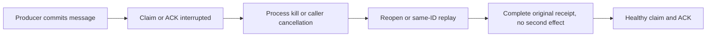

# Claim/ACK failure recovery
This implementation adds the missing failure-injection operation coverage under original REQ-MSG-001 / AC-MSG-001, REQ-MSG-007 / AC-MSG-007 and ADR-002/003/026. No new API, persisted format, authority, limit, timer or product dispatcher is added.

| Original criterion | Actual operation owner | Independent oracle |
|---|---|---|
| Commit before delivery; claim/ACK process failure recovers a complete cut | `QueueClaimAckProcessRecoveryTests.ClaimAndAckProcessKillRecoversOneCompleteCutThenOriginalOutcomeReplayAndHealthyColdWork` | Receive and ACK each at HeaderWritten, PayloadWritten, JournalFlushed, MutationApplied and ApplyCompleted. A real child is killed at its marker and joined before reopen. Before the durability barrier either complete cut is permitted; from JournalFlushed onward the original outcome must exist. Literal complete body/metadata/counters/ready/lease rows match that cut. Exact original operation replay and outcome lookup agree without additional changes; joined same-root cold preserves bytes, identity and commit position; fresh healthy enqueue/claim/ACK follows. |
| Lost ACK response recovery after actual committed effect | `QueueAckResponseLossClusterTests.CommittedAckCallerInterruptionReconcilesOriginalReceiptWithoutSecondEffectThenHealthyDelivery` | SDK and official MCP arguments each use the actual Aspire replicated cluster, persisted non-admin credentials, a SubmitReturned Hold and an independently literal Acked body/metadata cut while the original caller is pending. Caller cancellation starts only after that observation. Cancelled and producer-disposal markers plus original call settlement precede receipt reconciliation. The caller sees conservative unknown/cancellation transport semantics. The unchanged operation ID recovers equal complete SDK/MCP receipts; changed content conflicts; exact complete two-lane inspection is invariant. The original untouched second message then completes healthy claim/ACK and empty follow-up. |
| Stable claim identity, lease fencing and renew/NACK preconditions | Existing `QueueLostResponseWholeFlowTests`, `QueueLeaseAuthorityWholeFlowTests`, `QueueRetryLeaseRaceWholeTests`, `QueueLeaseFencingClusterTests` | Keep all original complete flows, exact expiry equality, foreign/stale lease refusals, current persisted authorization, cold reclaim and healthy continuation. |
| Truthful multi-lane partial outcomes and caller uncertainty | Existing `MultiLaneReceiveWholeFlowTests`, `MultiLaneReceiveBoundaryWholeFlowTests`, `MultiLaneReceiveClusterTests`, `MultiLaneReceiveCancellationClusterTests` | Keep structural admission/no-effects, ordered committed/rejected/unknown/not-attempted outcomes and exact stable leaf recovery through SDK, official MCP and SQL. |

The new process scope is ten authored arguments, the new cluster scope two authored arguments. Process termination proves process recovery, not power-loss durability. At-least-once delivery does not make arbitrary worker CPU execution or external side effects exactly once.

The same coverage includes three claim/settlement boundaries: impossible retained lease numeric metadata refuses Corruption, exhausted claim counters refuse ResourceExhausted before staging a lease, and a valid maximum settlement state version refuses ResourceExhausted before staging ACK/NACK/renew. Their complete authority, replay, cold recovery, fixture-only repair and healthy-continuation contracts are recorded in LeaseMetadataAuthority.md. Existing canonical claim/lease/multi-lane mechanisms remain the operation owners.

The MutationApplied argument uses mutation index zero intentionally. ZoneTreeJournalPublication.Publish invokes that observer immediately after runtime.Apply(changes[0]), before later changes and SetPosition. Claim stages metadata, ready-reference deletion, lease-reference insertion and queue counters; ACK stages body/reference removal, terminal metadata and counters, plus canonical clock/outcome. Thus this cut interrupts a multi-row publication after its first applied row; replay must restore a complete original cut. The observer position is armed only after seeded state, and recovery reads the actual original operation/outcome rather than choosing the expected result from the fault stage. The stage requires a persisted outcome only at/after JournalFlushed; before that barrier, either independently complete cut is accepted without presuming flush.

NotInParallel applies only to this heavy test class because each argument owns an exclusive signed probe wave with existing fixture admission and joined cleanup. It adds no product scheduling or broader test-global lock. The marker is bound to the persisted queue subject and the original ACK command ID; its actual operation request identity is verified and used to join producer disposal.

Each successful or denied SDK/MCP mutation/replay is followed by the complete independent two-lane inspection, rather than checking only after a pair of callers. The original and healthy ACK receipts are complete literal JSON records using a fresh actual root-SDK witness for the store incarnation. Only the original actual receipt position is retained as its positive opaque commit-cut witness; it is not guessed from an unrelated read.

The process-cut cohort independently retains the complete pre-arm baseline and an exact target CommitToken calculated from the original source partition and next commit position. Direct original scoped outcome inspection chooses target or target minus one after recovery; JournalFlushed and later cuts require the outcome. An absent outcome requires the complete pre-arm image. Full metadata/body/counters and entire ready/lease prefixes are independent literal controls; retries and cold owners retain complete original results, token/claims, bytes and position. Fresh healthy operations use their actual unchanged system time. The original claim is replayed while its real lease remains current, before ACK. MessagingCrashTrial joins original exit and both bounded pipe readers through the existing process owner; see ClaimAckProcessOwnership.md.

