# Claim and ACK public response-loss acceptance — KL-087

REQ-MSG-001 / AC-MSG-001 and REQ-MSG-007 / AC-MSG-007 under ADR-002/003/026 retain commit-before-delivery, signed current lease authority, fresh persisted permission and stable operation identity. This test-only supporting strand adds no public/persistence format, transport, provider, timer, quota or dispatcher.

QueueAckResponseLossRf3Tests.CommittedAckCallerInterruptionReconcilesOriginalReceiptWithoutSecondEffectThenHealthyDelivery has two original arguments: actual .NET SDK or official MCP as interrupted ACK caller. Each owns the current-source Aspire RF3 wave, original bounded probe resources, verified signed three-voter discoveries and non-admin persisted identity. An independent literal first leased image and untouched second ready image precede the ACK. Native SubmitReturned Hold identifies the original persisted subject and command. Only after observing the actual full Acked state while that original call remains pending does the fixture cancel its original caller. Signed Cancelled and original producer-disposed markers and original caller settlement preserve conservative unknown/transport outcomes; the test does not fabricate a lost-server result.

Unchanged ACK identity recovers the complete original receipt through SDK and official MCP, bound to actual public placement incarnation/epoch and quorum-process durability. Changed content under the same ID refuses Conflict independently through both callers. After each separate mutation/replay/refusal, independent public inspection requires exact complete images for both lanes.

Persisted QueueAck revocation advances the real subject to policy epoch3 while preserving QueueConsume. Both transports reject the original receipt and a fresh ACK attempt without message effects. Restoring the scoped QueueAck/Consume grants at epoch4 does not relabel historic policy2/3 outcomes: original receipt and original denied attempt stay PermissionDenied. A genuinely fresh operation with the retired original token is StaleLease because the original message is already Acked; queue tokens do not claim an additional policy-epoch field. The untouched second lane then performs current-authority real MCP claim, SDK claim replay, real MCP ACK, SDK receipt replay and an empty healthy receive. Original historic ACK replay remains refused and cannot mutate either Acked message.

The original RequestCqrsPhaseFaultCleanup owns admission retirement, caller/producer settlement, disposal, all Aspire resources and test roots. Each argument owns an exclusive heavy probed RF3 wave; native ordinary50 execution and other gates remain unchanged. Native filter: */QueueAckResponseLossRf3Tests/* selects both actual arguments. SourceN is not a native census, PASS, power-loss, endurance, performance or complete KL-087 qualification. Root owns current-source native build/discovery and the complete Linux normal/unit/process/Aspire RF3 operation matrix.

```mermaid
flowchart LR
    Claim[Real leased input and untouched lane] --> Hold[Original ACK committed and response held]
    Hold --> Observe[Independent full Acked image]
    Observe --> Cancel[Original caller cancel and producer join]
    Cancel --> Recover[SDK MCP exact receipt reconciliation]
    Recover --> Policy[Persisted revoke restore and historic refusal]
    Policy --> Healthy[Current authority second lane claim ACK empty]
```

