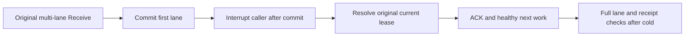

# Lost claim response and partial lanes

The existing two `MultiLaneReceiveCancellationClusterTests` cases retain their actual SubmitReturned hold, signed observed/cancelled/settled markers, original caller interruption and joined owned cluster cleanup. No duplicate case or timeout profile is introduced. Original first lane remains leased while the second remains untouched.

Reconciliation now verifies the complete original delivery against literal body, headers, attempt/version and the independently inspected committed lease; its token is checked against the actual authorized partition. The public opaque commit position must be positive and byte-stable across SDK/official MCP replay; it is not presented as an independently predicted commit position. Both lane images are checked after every claim/replay caller, before any following effect. Original bounded multi-lane outcomes, ACK mutation/durability/token, literal terminal images and a fresh healthy enqueue/claim/ACK continuation remain in the same whole flow.

No power-loss, speed, endurance or production claim follows.

