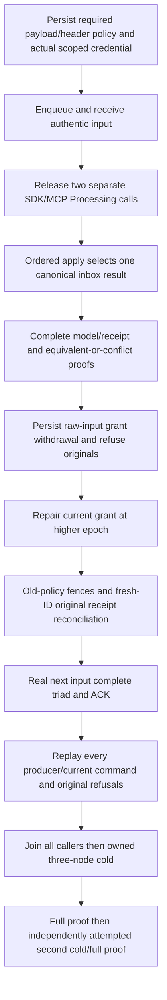

# Public competing local inbox operation

This scope covers Messaging REQ/AC-MSG-002, ADR-002/026. This additive scope exercises two real separately-ID public Processing requests on the same authentic delivery, authenticated principal, handler and execution generation, using SDK and official MCP on different nodes. A bounded client release barrier starts both calls; server overlap or a particular winner is NOT claimed. ordered apply decides the winner.

Equivalent effects must both return the complete original winning receipt. Different complete document/event/output-queue effects must produce exactly one success and one exact Conflict (safe MCP generic detail). Every effect field, input ACK, source body/header, full public receipt/token and absence of other effects is independently verified; frozen original complete statuses and producer receipts cannot be recaptured after replay.

Withdraw the persisted required raw-input grant for BOTH payload and header while keeping ordinary scoped capabilities; original successful GUID must refuse before receipt release. Repair the legitimate principal at a higher epoch, preserve the original old-policy fences, and use fresh IDs to reconcile the same canonical inbox receipt. Execute a genuine next input/full document-event-queue-ACK processing under repaired permissions. Replay original producers and fresh current receipts, original safe refusals, both whole model images and complete frozen outboxes after EACH call and both uniquely owned actual three-node cold cycles. Retain partial original restart artifacts before cleanup errors and verify them after later waves. No hidden outcome field is claimed through public JSON; original inbox/outcome bytes remain covered by existing original Unit cases.

No new product defect, endpoint, provider, dispatcher, deadline, external side effect, protocol, role trust, library or storage format is selected. Stale tokens under a different execution generation must fail local lease validation before any effects. Dedup identity remains input/message + handler + execution generation + principal/effect fingerprint under the current existing contract; no exactly-once external action or infinite dedup horizon is claimed.

## Acceptance map

| Requirement | Measurable criterion | Complete source owner |
|---|---|---|
| REQ-COMPETING-PUBLIC-001 | AC-COMPETING-PUBLIC-001: two separately issued actual SDK/MCP tasks settle; equivalent requests return the one complete receipt, changed requests have exactly one success and exact safe conflict | CompetingInboxPublicRace; both original tasks always observed before caller disposal |
| REQ-COMPETING-PUBLIC-002 | AC-COMPETING-PUBLIC-002: exact full document and queue point DTOs, complete bounded document/input/output query pages, full single-event stream pages and known event sequence1/2, complete public receipts/token and independent outbox counts1/4/8 | CompetingInboxPublicModels, Inventory, Values |
| REQ-COMPETING-PUBLIC-003 | AC-COMPETING-PUBLIC-003: persisted epoch2 withdrawal of both required payload/header raw grants rejects every original GUID before receipt release; epoch3 repair preserves old-policy fences, fresh ID reconciles original inbox result without repeating effects | CompetingInboxPublicPolicy; full SDK and safe MCP Problems plus no secret/credential exposure |
| REQ-COMPETING-PUBLIC-004 | AC-COMPETING-PUBLIC-004: actual next source input produces the complete new document/event/output/ACK under repaired authority; new execution-generation old delivery refuses StaleLease with otherwise valid new-ID effects | CompetingInboxPublicHealthy; RefuseAsync validates full current state after EACH transport call |
| REQ-COMPETING-PUBLIC-005 | AC-COMPETING-PUBLIC-005: all owned callers/tasks join before actual three-node cold; both cold waves always attempted; all original producer and current-processing replays conserve full public image after EACH SDK/MCP call; all partial original unique restart receipt bytes retained and reread after later waves | CompetingInboxPublicFlow, Replay, Cold |

The winner is selected only from the two original command IDs. Every candidate's full effect recipe is independently fixed; selection of one of those recipes is not a fabricated fixed ordering guarantee. Event RecordedAt is a genuine nondefault UTC server-created original, frozen before later assertions and compared exactly thereafter; no independent precomputed timestamp or cross-node clock bound is claimed. Every other event field is independently specified. Source and effect local read cuts are opaque positive values; initial stream SnapshotCutPosition equals its own page cut, with no comparison against logical receipt positions or another node's local counter.

The reused actual ASP.NET-authenticated callers carry only the verified principal; each Processing call rechecks current persisted capabilities and both required-input grants. Public MutationReceipt exposes four fields and full token; CompositionReferences is JsonIgnore and remains an existing Unit/store proof. This public suite does not claim raw-store byte visibility or a server overlap/timing measurement. Existing CompetingInboxStateMachineTests, RequiredProcessingPolicyTests, LocalInboxProcessingProcessRecoveryTests, InboxProcessingPublicColdTests and target-inbox/redrive/retention suites remain required; they are not replaced.

The case passes its composition-bound TimeProvider to the state. Receive lease times and first original event RecordedAt are additionally bounded by the exact surrounding caller UTC intervals under the genuine same-host Docker/System clock profile; the original full timestamps are then frozen for later replay/cold comparisons. This is correctness evidence, not a timing/performance result or a general distributed-clock guarantee. Every fresh wave independently checks the status of every replica copy, stable owned node IDs, current incarnation, ProcessDurable and the configured persisted copy count and logical Applied floors from known acknowledged receipts. No local read cut is used as a logical replication index.

Every successful persisted write requires all configured copies to apply before acknowledgement. The local administrative Status operation is a separate diagnostic snapshot and cannot identify the owner or cut used by an earlier routed query. Status observation uses the existing shared polling cadence under the unchanged original parent token/deadline until that actual node reaches every original acknowledged Applied floor (including its previously retained floor). It then checks the complete original identity, generation and durability assertions; it adds no timeout or reset and weakens no floor. Both SDK and official MCP inventory routes additionally compare the complete QueryPage with independently fixed bounded-full-scan document and model-scan:queue-messages queue access paths, retaining every original row and positive opaque local cut.
