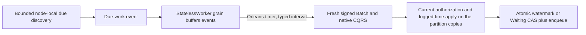

# DueCoordination within Messaging

Accepted S2 contract for KL-100, REQ/AC-JOBS-005 and
[ADR-094](../../ADR/ADR-094-orleans-due-coordination.md). S1 canonical records,
UTC due arithmetic, caller/creator checks, occurrence identities, queue limits
and atomic transitions remain the authority. No separate durable due index or
storage-format transition is introduced. Due work is delivered by Orleans
`[StatelessWorker]` grains that buffer due-work events and write them in batches on
an Orleans timer; no component checks leadership. Cluster concept:
[ADR-136](../../ADR/ADR-136-native-orleans-partition-ownership.md).

| Requirement | Measurable acceptance and automated mapping |
|---|---|
| REQ-DUE-001: finite fair discovery | AC-DUE-001: real ZoneTree schedules/sagas spanning more than a page, canceled/not-due/terminal records, mixed full partitions and concurrent lower/higher-key insertions preserve a fixed sweep upper bound; every readable preexisting key is visited, page count is at most 32, actual examined bytes include lookahead and differ explicitly from admitted bytes, cancellation rejects executable work, no payload or open view escapes. Unreadable provider frames fail explicitly. `DueJobDiscoveryTests` |
| REQ-DUE-002: native isolated Orleans execution | AC-DUE-002: a bounded pool of Orleans `[StatelessWorker]` grains accepts due-work hints, buffers them in memory and, on an Orleans timer whose interval is a typed option (for example 5 seconds), writes the batch through the normal grain to ZoneTree-owner path; each Batch is signed with a fresh request GUID, consumes native ManagedCode CQRS to settlement, scopes the creator ID through ManagedCode identity/RequestContext, and reloads persisted authority. No leadership check gates any step. Production DI/graph joins and autonomous emissions pass on the Aspire replicated cluster. `DueCoordinationRf3Tests` |
| REQ-DUE-003: canonical retries and lifecycle | AC-DUE-003: duplicate hints/timers (every silo may run workers and emit the same hint), lost ACK, cancel/completion, creator revocation, silo restart and silo loss preserve one occurrence identity or one saga timeout; an unavailable majority does not change canonical state; stop cancels and joins all started work, flushing or discarding its buffer, before storage shutdown. Native process and cluster tests |
| REQ-DUE-004: bounded admission and visible failures | AC-DUE-004: one page and one dispatched job per service at a time; fixed tick and total job deadline, at most one retry with the same command ID for uncertain transport, failed jobs cannot monopolize the page, safe structured failure diagnostics contain no templates/credentials/IDs; healthy subsequent jobs still run. Unit and cluster failure/cancellation cases |

## Discovery

Discovery is a trusted node-local internal API, never an SDK/MCP operation. It
reads unchanged `recurring-schedule` and `saga-state` native prefixes. Each prefix
has its own disposable owned cursor: incarnation, ReadGeneration, fixed encoded
upper key and last visited key. Capture the tail with bounded reverse VisitRange;
scan forward up to that captured tail, then begin a new sweep. Alternate prefixes
after completing each page. New keys behind the cursor are found on the next
sweep; new keys beyond the captured tail cannot indefinitely delay older keys.
Reset cursors after incarnation/ReadGeneration change and restart. They are hints
and never claim a cross-page snapshot or authoritative due ordering.

Use borrowed VisitRange bytes, charge examined bytes (including lookahead) before
native decoding, cap a page at 32 records and admitted/decoded value bytes at
DatabaseLimits.MaxBatchBytes, and check a 100 ms discovery deadline before and
after work. A single corrupt or oversized record within the readable provider range
yields a safe rejected-record marker and advances its bounded key rather than
executing it or indefinitely starving the following key. Actual examined bytes
include the borrowed lookahead/rejected row and remain bounded by the native
ZoneTree 64 MiB range-work ceiling; they must never be reported as admitted bytes.
If a valid next value would cross the admitted page budget, stop before
decoding/copying it and retain the preceding key so the value is revisited. A
single value above MaxBatchBytes is not decoded/copied: reject it, advance only its
canonical bounded key and stop that page. A physically unreadable frame or range
exceeding the native ceiling fails explicitly; no unknown key is invented. The
cursor key ceiling is 4,096 bytes. A raw key above that ceiling, including
captured-tail discovery, fails the page/prefix with Corruption before copying; it
cannot be skipped using an incomplete key or a lossy cursor. The service defers
this prefix and permits the alternate prefix to progress on later ticks. Such
rejection must remain observable; it is not a successful complete index. Decode
and check the entire canonical key, full lane, identity,
revision/generation/ordinal, supported UTC definition and checked due arithmetic.
Return only owned metadata (kind, full lane, ID, creator ID,
generation/revision/ordinal and due instant), never templates/state JSON or
retained views. Local time only selects wake hints; the command-logged EvaluatedAt
is the sole due decision at apply.

## Stateless workers

Silo-local discovery (above) only produces hints. Hints go to Orleans
`[StatelessWorker]` grains: a bounded pool per silo of interchangeable activations
that accept due-work events (recurring schedule due, saga timeout, queue deadline),
buffer them in memory and, on an Orleans timer, write the buffered batch to the
database through the normal grain to ZoneTree-owner path. The flush interval, the
buffer size and the per-flush job count are typed options (for example a 5 second
interval). No worker checks leadership, reads a leader hint or elects a
coordinator; any silo may flush the same due hint and the canonical watermark and
Waiting CAS admit each effect exactly once. The buffer is disposable memory, never an
authority: after a restart discovery rebuilds the hints from canonical records, and
activation movement never moves native storage handles. Workers are not a new
write authority and do not call DatabaseEngine.Apply directly.

Each flushed job becomes one Batch containing EmitRecurringOccurrences(max 1) or
ExpireSaga(expected revision), preserving full identity and current creator. Each
newly admitted dispatch owns a fresh nonempty command GUID, chosen once after
persisted creator reload. Keep that GUID and payload unchanged across its one
uncertainty retry; each native request still uses a fresh request GUID. Later flushes
and post-restart dispatches are new attempts and use new command GUIDs, including
after a definite denied or not-yet-due result, so a durable PermissionDenied is not
reused forever after authority is restored. The canonical schedule generation,
logged due time, monotonically advanced ordinal and occurrence message identity, and
saga Waiting/revision CAS remain the durable effect authority. No public
deterministic command-ID derivation from a hint is promised.

For each attempt the worker creates a fresh request context, sets the existing
bounded native request state and subject-only claims, signs via GrainRequestCodec,
and drains the existing native CQRS stream. One 5 second dispatch deadline includes
both attempts; an uncertain result may retry once using the SAME command ID and
payload but a new request GUID. After a definite failure or exhausted uncertainty,
release the job and continue the batch. Creator reload, hint validation and handled
transport failures are isolated per job; a rejected creator cannot repeatedly abort
the flush before healthy following jobs. The flush deadline includes routing and
activation as well as native stream settlement. Stop cancellation still escapes the
per-job error boundary and joins all started work. A definite NotDue caused by clock
skew is deferred, never treated as an emitted occurrence.

The identity scope/admission helpers live in ClusterRouting/Identity in the Orleans
assembly and are shared by Server and these workers, preserving exact native limits,
claims, context restoration and request/command correlation. Core grants internal
visibility only to Orleans/Server for this trusted node-local discovery join.

Frontend N/A: scheduling is exposed through existing Batch SDK/MCP operations and
current inspection. New SDK/MCP syntax N/A. Rollback stops the workers and retains
all canonical data.

## Queue deadline advancement

REQ-MSG-004 / AC-MSG-004 and ADR-028/094: the additive `AdvanceQueueDeadline` Batch
mutation uses QueueConsume, fresh persisted worker input permissions, the existing
native signed EvaluatedAt and exact state/version/lease/deadline/index CAS. Fields
Id0..6 and alias `keyload.mutation.advance-queue-deadline.v1` are frozen; the JSON
discriminator `kind` is `advanceQueueDeadline`; the `Kind` value uses the distinct
JSON property `deadlineKind`, preserving Orleans Id6 and the enum contract (kinds
PromoteScheduled 0 / ExpireLease 1 / ExpireMessage 2) and avoiding a collision with
the Mutation discriminator. This mutation is direct Batch only; nested
processing/inbox/projection effects cannot use it. It never creates a lease, trusts
a business timestamp as current time, or creates a scheduler principal.

The nullable host-selected QueueDeadlinePrincipalId names an EXISTING persisted
principal; null makes the queue branch unavailable (a null selection yields no
autonomous queue success), a malformed or empty selection is invalid, and a revoked,
expired or missing-permission subject is refused. Authorization ties the grants to
the full actual partition and queue, including tenant/database scope. Every
dispatch and cached-result replay uses current permissions. Resource/dispatch pause
prevents transitions. Phase2 signed retry decisions and StrictPerKey order
authority are preserved; a lease expiry uses the same actual operation, not a
generated retry time.

Discovery remains read-only over canonical scheduled/lease/message-meta records
with central record/byte/deadline budgets, fixed upper tails and
incarnation/read-generation resets. It retains only bounded metadata hints and
charges all native visited bytes, point reads and lookahead; no queue bodies,
credentials or second registry. Discovery alternates its ordinary
recurring/saga branch with the queue branch, and the queue hints flow through the same
stateless workers and joined task/token/deadline. When the admitted MaximumRecordsPerPage is two, an indexed hint
plus its metadata point read and lookahead cannot fit, so the scanner selects due
schedule/lease/lifetime hints from the same canonical metadata prefix, charging
each record/value/lookahead. Selection is only a hint: the signed Batch effect
independently requires its original scheduled/lease index and the exact
state/version/deadline CAS. An already cancelled discovery rejects without touching
message state, even when the indexed prefix cannot fit its original page.

AC-MSG-092-DEADLINE requires the actual not-due Conflict, stale RevisionConflict,
paused DispatchPaused and revoked/current-policy refusal to retain complete message
bodies/metadata/index/counters; exact original successful receipt replay must
survive two cold reopens and fresh healthy work. Full-jitter lease expiry retains
the signed native retry choice, cold receipt, stale original token refusal,
inclusive scheduled promotion and healthy work. Process cuts use the existing
MessagingCrashTrial ninety-second lifetime and thirty-second cleanup, with the
operation evaluated at or after the exact persisted business ExpiresAt. The public
autonomous test creates the persisted scoped principal through the administrator
SDK, pauses before the due instant, refuses the original condition through
SDK/MCP/both Q1 routes, revokes the subject before unpause, restores it, and
requires canonical Ready BEFORE any Receive that could otherwise advance due state.
A null-selected service leaves the due and future messages, their receipts and
counters unchanged across two cold restarts, while an ordinary recurring schedule
in the same partition still emits, proving a real scheduler operation without
granting success to the disabled queue branch. A control schedule needs its own
persisted principal holding SchedulerManage, QueuePublish and QueueInspect; the
bootstrap administrator is not a data-authority substitute.

Mapped tests: `QueueDeadlineNativeWholeFlowTests` (typed PromoteScheduled /
ExpireLease / ExpireMessage, signed lease retry deadline),
`QueueDeadlineProcessRecoveryTests` (five original CommitStage arguments),
`QueueDeadlineAutonomousRf3Tests` (selected-principal revoke/cold, null-selected
service) and the canonical schema / typed native decode / public JSON roundtrip of
one independently authored AdvanceQueueDeadline input. Qualification stays OPEN
until the current-source native build, normal/scalar Unit, real process recovery and
the Linux Aspire replicated-cluster runs execute.
