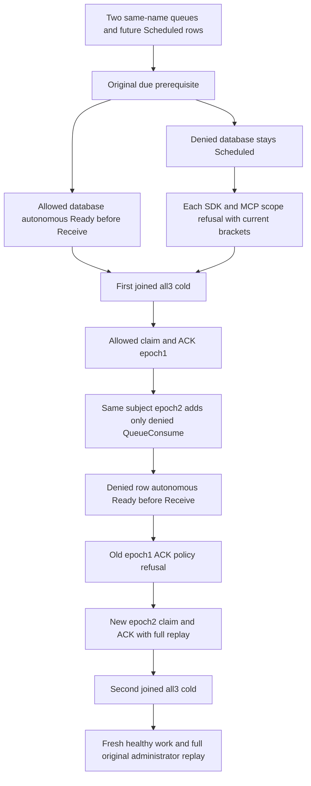

# Messaging — current database scope and autonomous due fairness

This acceptance refines REQ/AC-DUE-002/004 and REQ/AC-MSG-004 and REQ/AC-MSG-DEADLINE-ADVANCE. One actual selected persisted principal, one tenant, two distinct databases and atomic partitions, identical queue and message names, and independent literal payloads establish database scope. No Pause/Resume, alternative scheduler, private quota observer, direct store mutation or fake clock is used.

| Requirement | Measurable acceptance |
|---|---|
| REQ-DUE-DATABASE-SCOPE-001: queue permission is database-scoped | AC-DUE-DATABASE-SCOPE-001: configure independent WorkQueue resources and a single selected subject whose first grant has QueueConsume/Inspect/Ack on allowed database and whose other grant has only Inspect/Ack on denied database. Publish original immutable commands with the SAME future NotBefore, require full literal Scheduled inspections and no early Ready. The service must autonomously produce exact allowed Ready/version2/sequence1 before any Receive while denied state/body/headers remain Scheduled/version1/sequence0. A direct denied hint through SDK and official MCP requires null SDK value, exact full PermissionDenied Problem and closed official error, each followed by complete two-database public controls. |
| REQ-DUE-DATABASE-SCOPE-002: failed scope cannot starve current eligible work | AC-DUE-DATABASE-SCOPE-002: source-backed per-job bounded dispatch and the actual original progress window qualify eligible Ready without changing denied state. First joined all3 cold, with new callers, must retain the distinct ready/scheduled states and original enqueue receipts. Receive happens only after Ready. Full independent delivery payload/header/attempt/generation/lease metadata and full ACK receipt are observed after each response and original replay. Public observations do not prove a specific private dispatch count or attempt order. |
| REQ-DUE-DATABASE-SCOPE-003: persisted repair and cold recovery preserve authority | AC-DUE-DATABASE-SCOPE-003: add only QueueConsume to the denied database grant at epoch2, retaining the same credential and allowed grant. Its original due timestamp is unchanged; observe exact autonomous Ready before Receive, then claim/ACK. Original epoch1 successful worker ACK remains policy-fenced at current epoch2, with full public controls after each SDK/MCP refusal. Original administrator seed receipts remain byte-exact on each replay, and new epoch2 ACK replays succeed. Second joined all3 cold preserves both terminal rows and original results, then fresh same-lane healthy enqueue/claim/ACK uses sequence2. |

Test: `QueueDueDatabaseScopeClusterTests.SameNamedQueuesUseCurrentDatabaseScopeWithoutStarvingEligibleDueWorkAcrossTwoColdOwners`. Frontend, SQL and benchmarks are N/A for this SDK/official-MCP acceptance.

Queue deadline discovery advances its cursor and hands due hints to the `[StatelessWorker]` due-work grains of [DueCoordination](DueCoordination.md) under the existing bounded lifetime; the worker reloads the selected persisted principal and uses the actual signed command. Original NotBefore is a business prerequisite; local waits/polls cannot authorize an effect. Read-only inspections must establish actual Ready before Receive, which could otherwise advance the queue. Setup resource/identity operations establish the baseline; each subsequent seed, refusal, receive, ACK and replay has an immediate complete public bracket. Full resource summaries, messages, partition and outbox are public controls, not raw storage or journal equality; failed outcomes may persist.

Database-scoped authorization and the outcome policy fence apply to every dispatch. All cold operations use the original owned ClusterFixture/QueueLeaseClusterCold, fresh callers, linked parent cancellation and unchanged McpCallerDeadline. No new library, format, API or provider is introduced.
