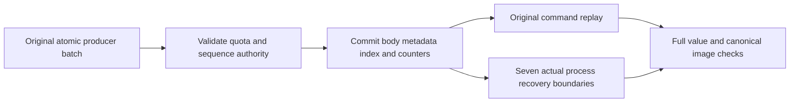

# Durable enqueue and queue-lane authority

REQ-MSG-001/005 and AC-MSG-001/005 implement the atomic enqueue contract under ADR-002, ADR-024, ADR-026 and ADR-028. A producer command persists immutable message bodies (QB), metadata (QM), exactly the ready or scheduled reference, and lane accounting in its original same-partition transaction. Original CommandId and fingerprint replay one complete result. A different payload under that command identity, or an already retained MessageId in a fresh producer command, refuses without partial document/event/message effects. Terminal metadata remains retained after ACK and does not permit a duplicate enqueue to resurrect the ID.

StoredMessages and StoredBytes must agree on emptiness, and a bounded native message-body presence witness must agree with that emptiness before admission. Zero usage alongside a body, a mixed zero/nonzero accounting pair, or positive usage without a body returns existing RecoveryRequired with the fixed lifecycle accounting detail. The witness includes the native transaction's staged changes; it neither sums positive usage nor reconstructs, resets, or repairs authority. Earlier native missing-body Corruption refusals retain their precedence.

A new ready message requires room to increment NextReadySequence. A scheduled message does not increment that sequence and remains valid at its ceiling. StrictPerKey enqueue requires room to increment NextOrderSequence for either ready or scheduled input; existing native ordering-key validation remains earlier than the bounded ResourceExhausted sequence refusal. Exact long.MaxValue returns `The queue enqueue sequence is exhausted.` before queue staging. Quotas retain their earlier refusal order. No wrap, saturation, reconstructed sequence or broad exception catch is permitted. Its old ID remains failed after exact fixture repair; successful work uses a fresh ID.

| Criterion | Actual test and operation flow | Evidence boundary |
|---|---|---|
| QB/QM/index/accounting and stable identity survive cold replay | `QueueEnqueueColdWholeFlowTests.OriginalEnqueueImageAndReceiptSurviveColdReplayRefusalsThenAuthorizedHealthyContinuation` | Real ready/scheduled producer, complete bodies/fingerprints/metadata/accounting, duplicate and quota rollback, persisted permission refusal, genuine claim/ACK slot release, fresh publisher and two cold opens. |
| Damaged retained usage cannot admit new producer effects | `QueueStoredCapacityWholeFlowTests.AcMsgStoredCapacity001CorruptUsageCannotAdmitProducerOrDeliveryThenColdRepairAndQuotaAtomicContinuation` (four arguments) | Real fixture-owned zero/positive accounting or missing bodies, repeated original apply, no outcome/effect/position change, joined same-root cold refusal, exact row repair, retained quota failure Apply/Resolve, independent partition/position receipts, claim/ACK, fresh producer and second cold image. |
| Enqueue counters cannot wrap, and nonincrementing scheduled path remains valid | `QueueEnqueueSequenceExhaustionTests.AcMsgEnqueueSequenceCeilingRetainsFailureAndColdImageThenExactRepairAndFreshProducer` (four arguments) | Native ready/order maximum rows, original producer rollback or scheduled success, missing/empty/control-character strict key Validation precedence, literal ProcessDurable receipt from independently read partition and next position, body fingerprint/state/reference/accounting, failed outcome Apply/Resolve/cold retention, exact counter-field repair, new identity and healthy work. |
| Crash cannot separate ready/scheduled payload from producer state | `QueueEnqueueProcessRecoveryTests.AcMsg001005ReadyScheduledProducerRecoversWholeAtomicCutThenOriginalReplayAndColdHealthyWork` (seven arguments) | Actual RecoveryHost HeaderWritten/PayloadWritten/JournalFlushed/MutationApplied0/3/6/ApplyCompleted cuts, original serialized command/baseline/target from child, complete rollback or committed literal body/metadata/index/counter/document, original Apply/Resolve, two cold images, terminal-ID/different-payload producer refusal with retained failure replay and absent staged document, and healthy claim/ACK. Process kill is not power-loss proof. |
| Public SDK and official MCP preserve producer identity, atomic refusals and cold continuation | `QueueProducerAtomicClusterTests.ActualMixedProducerBatchRefusalsAndOriginalResponseCancellationSurviveColdHealthyContinuation` (two arguments) | Aspire-owned replicated cluster and discovered clients, literal original/healthy public message metadata and receipt mutation list with independent current partition witness, actual SDK/MCP duplicate/quota refusal images, persisted policy refusal/restore, original response cancellation, whole cold continuation and cleanup. Cancellation after response is not a lost-response fault label. |

The single additional RecoveryHost mode is private owned process infrastructure.

Coverage, endurance, power-loss, performance and production readiness are separate gates.

