# Eventing state-machine restoration and competing processing

This scope extends the existing Messaging failure suite with genuine native operation flows. It does not change product behavior, limits, storage format, authorization, dispatch, retry, SQL syntax or protocol. ADR-026/088/089/091/117/125 and the canonical Messaging and BackupRestore contracts remain authoritative.

```mermaid
flowchart LR
  A[Publish three retained events] --> B[Lease all inputs]
  B --> C[ACK3 and process2 while checkpoint stays0]
  C --> D[Back up exact gap cut]
  D --> E[Source ACK1 advances checkpoint3]
  D --> F[Restore older cut with fresh signing identity]
  F --> G[Original command fenced]
  G --> H[Explicit seek and resume]
  H --> I[Persisted write denial and exact failure ledger]
  I --> J[Persisted grant repair and genuine lease reclaim]
  J --> K[Retained inbox ACK2 without repeating effect]
  K --> L[ACK3 then ACK1 closes contiguous prefix]
  L --> M[Publish and process event4]
  M --> N[Two joined same-root cold owners]
```

| Requirement | Operation and independent oracle |
| --- | --- |
| REQ/AC-EVENTING-OLD-CUT-001 | Real native backup captures checkpoint0/issued3 with first input leased, second completed with one document effect/inbox, third ACKed. Source then reaches checkpoint3. Restore remains at the older genuine gap, changes node/incarnation/signing key, preserves original source records, effect revision1 and paused dispatch. Original completed command refuses TokenInvalidated with no byte/cut/identity effect. |
| REQ/AC-EVENTING-RESET-INBOX-001 | Explicit authorized seek increments group generation/ownership to2 and pauses; resume and real worker receive issue all original inputs. Current persisted worker epoch2 lacks DocumentsWrite: Processing refuses with the complete original scoped PermissionDenied. Exact full expected store image adds only canonical failure outcome/locator and clock, with one real position increment and an unchanged replay. Grant epoch3 and genuine31second controlled clock advancement reclaim the same inputs at attempt/version2. Retained inbox prevents another document mutation: AlreadyProcessed=true, original historical effects token unchanged, new ACK-only receipt independently complete. ACK3 cannot skip input1; ACK1 alone advances checkpoint3. Fresh event4 processes normally. Four complete literal outbox entries preserve the two original historical commit tokens and the two new effects, with no extra publication for inbox reuse. |
| REQ/AC-EVENTING-COMPETING-INBOX-001 | Two real Task producers first reach a shared readiness boundary, then submit distinct command IDs against the same genuine queue delivery/handler/execution generation through the actual ZoneTree ordered apply gate. Equivalent full document/event/queue effects return the same complete original protected receipt; differing effects yield exactly one full receipt and one Conflict. Winner is selected from the genuine successful receipt's CommandId, then every expected field/body/revision/head/token/metadata/receipt/native hidden reference field is independently constructed from that caller's literal recipe. All four native outbox entries are independently checked in sequence, including complete mutations, before/after documents, receipt fields and native hidden references. The exact head and byte accounting exclude duplicate publications. Both original tasks join. No scheduler winner is promised. |
| REQ/AC-EVENTING-COLD-001 | Every successful race command and the conflict command retain original complete outcome bytes and replay without any ordered-image/cut/identity change. Subscription protected receipts likewise replay completely. Two actual same-root reopened owners are attempted through retained error ledgers; original store handles close before the next owner. Original source store and every backup file remain byte-for-byte unchanged by restored continuation. |

No mock storage, handler injection, raw online corruption endpoint or trusted client role is introduced.

The receipt oracle checks all four CommitToken fields, all four public MutationReceipt fields and the actual native fifth CompositionReferences field. Public JSON omits that fifth field; an empty getter after SDK/MCP deserialization cannot prove it. Native query cuts are store-local and are never ordered against public logical replication receipt positions. Original native outcome bytes and whole-store images remain exact; structural JSON comparisons of independently authored immutable-array-bearing records avoid treating .NET collection reference identity as value equality.

The old-cut test's clock is an explicitly test-owned TimeProvider, not a timing race or production-clock replacement. The competing case uses actual parallel tasks and native serialization/storage, with two ready producers before release. It establishes permitted results for a competing admission; it does not claim a particular thread schedule, kernel overlap, external exactly-once effects or a distributed-agreement guarantee.

The following whole public operations remain required: ClusterRestoreClusterTests, ClusterRestoreClusterResumeTests, ClusterRestoreMixedRetentionClusterTests, SubscriptionPhasePublicColdTests, SubscriptionFilterGenerationClusterTests, QueueLeaseFencingClusterTests, QueueLifecyclePublicClusterTests, QueueWorkerSdkClusterTests, QueueWorkerProcessClusterTests, RemoteTransfersClusterTests and RemoteTransferThreeStageColdTests. Their actual SDK, official MCP and existing SQL adapters remain unchanged.

Native value boundary correction: cold and refusal identity checks reuse the complete existing nine-field NativeReadCutStoreStateAssertions with a copied signing-key value. Replayed native results compare every value and nested receipt hidden composition references without assuming independently encoded Orleans reference graphs are byte-equal. The new persisted failure outcome is independently checked across every native StoredOutcome field/authority and every OperationResult field; its originally recorded native bytes then remain exact, as do all other full ordered store rows, locator, clock and cut. No on-disk byte oracle is replaced by a re-encoding.

Retained failure authority: the exact epoch2 denied Processing operation, native outcome bytes and locator bytes are retained BEFORE grant repair. Immediately after epoch3 repair, after complete fresh event4 processing, and independently in each cold owner, both original byte rows are checked before and after old-GUID replay. Actual current-incarnation ReplayCommand/ValidateCachedResult fences the epoch2 outcome with PermissionDenied and the fixed changed-policy detail, not the original missing-capability detail. The failed outcome never becomes a successful claim/effect and is never rewritten; each check preserves the complete current store image/cut/nine-field identity.

## Restore authority repair for the old-cut operation

The first executed old-cut operation exposed a test setup error: raw storage restore rotates the store incarnation. Opening that raw copy directly as a database then compares a fresh ACK against the wrong owner incarnation. The source fixture now uses the node-local ZoneTree owner admission and a genuine positive applied index; no applied metadata is manufactured. The operation uses the existing native backup capture and verified restore APIs, including authority reset and paused dispatch. It independently checks the returned restore position and that the current store incarnation matches the new store. Historical effects tokens, inbox/outbox receipts, old-operation rejection, all full state checks, archive invariance, healthy progression and both cold owners remain unchanged. No product token rewrite, compatibility path or migration is introduced.
