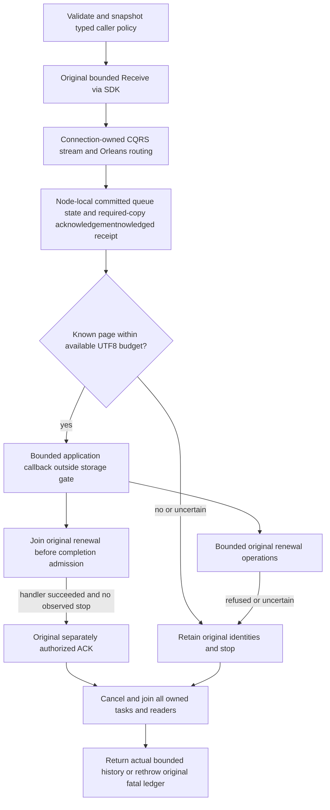

# External queue workers

This Messaging child contract defines the finite .NET SDK ACK worker. The canonical queue state and delivery authority remain [Messaging](../Messaging.md) and [ADR-026](../../ADR/ADR-026-fenced-delivery-inbox.md). Connection ownership follows [ADR-125](../../ADR/ADR-125-connection-owned-execution.md); existing server scheduling follows [ADR-094](../../ADR/ADR-094-orleans-due-coordination.md) and [ADR-110](../../ADR/ADR-110-orleans-execution-primitives.md).

## Ownership and operation flow

`RunQueueAckWorkerAsync` borrows an authenticated `KeyLoadClient`, one queue lane, the caller's first Receive GUID, a cooperative application callback, typed options, a `TimeProvider`, and cancellation. One invocation owns a finite receive loop, active callback tasks, one renewal owner, and their original completion tasks. It does not dispose the caller's client, HTTP transport, or clock.

The helper uses the existing `ReceiveAsync` and `CompleteAsync` operations. Every operation still crosses the authenticated connection stream, Orleans routing, fresh persisted authorization and the node-local ZoneTree owner. It adds no coordinator, server dispatcher, storage gate, wire enum, trusted caller role, or handler loader. The application chooses and owns any external effects and their idempotency. There is no exactly-once external side-effect guarantee.

## Requirements and acceptance

| Requirement / criterion | Resulting contract | Actual test source mapping |
| --- | --- | --- |
| REQ-WORKER-001 / AC-WORKER-001 | Existing canonical Receive/Renew/ACK and persisted authority; SDK worker plus independent official MCP state/receipt observations. | `QueueWorkerSdkClusterTests.ActualExternalWorkerRefillsWhileSiblingHeldAndJoinsCancellationWithoutAck` (both arguments), `ActualFreshPersistedRenewalRevocationJoinsHandlerWithoutAckThenColdHealthyWorker`. |
| REQ-WORKER-002 / AC-WORKER-002 | Bounded active handlers and UTF8 payload/header accounting; completed work releases its slot only after its tasks join; another callback can progress while a sibling remains held. | Both `ActualExternalWorkerRefillsWhileSiblingHeldAndJoinsCancellationWithoutAck` arguments assert exact independent literal UTF8 peak at two held callbacks, refill and cancellation. `ActualProjectedUtf8ExcessRetainsLeaseWithoutHandlerOrAckThenColdCorrectBudgetWorker` checks genuine projected-body excess without handler/ACK and preserves its known lease. |
| REQ-WORKER-003 / AC-WORKER-003 | Validated caller policy is copied before the first await, with finite receive/delivery/renewal budgets and cross-field bounds; cancellation joins and does not dispose borrowed HTTP. | `QueueWorkerOptionsTests.InvalidCallerPolicyRefusesBeforeSendOrHandler` (eight policy arguments), `PreCancelledValidInvocationJoinsWithoutSendOrHandlerAndPreservesSharedClientOwnership`; real empty-page `QueueWorkerClusterEmptyBudget.RunAsync` is invoked from the normal/cancellation cluster continuation; normal successful ACK controls assert `DeliveryBudget`. |
| REQ-WORKER-004 / AC-WORKER-004 | Original operation GUID and actual result/exception survive uncertainty; no handler replay for uncertain completion and no automatic ACK after refused/uncertain renewal or failed callback. | `QueueWorkerOriginalUnknownClusterTests.ActualCommittedWorkerAckInterruptionRetainsOriginalAndReconcilesWithoutHandlerRerun`, `ActualCommittedReceiveInterruptionStopsWithoutHandlerOrNewGuidAndReconcilesOriginal`, and `ActualFirstRenewalSignedProbeMustCaptureUnknownBeforeWorkerCanAcknowledge` cover actual signed-probe ACK, Receive and first-renewal interruption. `ActualSingleRenewalBudgetStopsAndJoinsHeldHandlerWithoutAckThenColdFreshWorker`; `ActualCallerHandlerFailureJoinsWithoutAckThenColdFreshWorker`; `QueueWorkerInvocationLifetimeTests.ActualDisposedCallerTransportRetainsOriginalPreparedIdentityAndExceptionWithoutResult`. |
| REQ-WORKER-005 / AC-WORKER-005 | Cancel then join actual callback, renewal, completion, receive and reader lifetimes before returning; preserve original failure identities. Persisted queue state is independent of worker memory. | The cancellation, renewal refusal/budget, callback-failure and byte-refusal cluster cases above include complete state checks and same-root cold continuations. `QueueWorkerProcessClusterTests.ActualKilledReadOnlyExternalWorkerPreservesLeaseUntilExplicitParentAckThenColdFreshWorker` joins actual child exit and both readers, checks retained lease/body/no child ACK, explicitly completes from the parent, then runs a fresh worker and cold/healthy controls. |

The signature oracle uses existing execution `CoreClaims.Sign/Verify` with the actual bounded private fixture profile and independently expected lane, message, principal, lease version, delivery generation and current incarnation. Private keys and tokens are not diagnostic evidence. Public commit positions are opaque: tests assert positive positions and exact stable replay, with the independently read store incarnation and literal mutation/durability fields.

## Policy and accounting

`QueueWorkerOptions` is caller policy, not a server configuration replacement. The binding method clones every validated field into a private immutable record and returns the execution `IOptions` wrapper; the session captures `.Value` once. Later configuration replacement cannot enlarge the invocation.

| Caller option | Default | Hard bound / relationship |
| --- | --- | --- |
| Concurrent handlers | 4 | 1..100, matching the receive message ceiling |
| Deliveries | 64 | 1..4096 |
| Receive calls | 128 | 1..4096 |
| Renewal calls | 128 | 1..4096 |
| Active payload/header UTF8 bytes | 1 MiB | 1..16 MiB |
| Receive byte request | 1 MiB | 1..16 MiB and no greater than active-byte allowance |
| Requested lease | 30 seconds | 1..300 seconds; stricter persisted queue policy can refuse |
| Renewal interval | 10 seconds | Positive and strictly less than requested lease |
| Empty-page polling delay | 100 ms | Positive and no more than one second |
| Same-ID unknown retries | 1 | 0..1 |

Each Receive requests no more messages than currently available callback slots and remaining delivery budget. Its bytes are additionally capped by the current active UTF8 allowance and configured receive cap; transport/server limits remain additional authority. Returned active strings are counted again before any callback. If projected payload/header UTF8 exceeds the remaining local allowance, known received identities are retained and no callback or ACK runs for that page.

Execution `ReceiveRequest.MaxBytes` counts serialized `MessageBody`, including its framing and identity/fingerprint. The local quota counts UTF8 payload/header strings. They are different contracts: neither projected JSON nor CLR object size is a substitute for the serialized-body bound. A request with a positive remaining byte allowance too small for the next body can genuinely return execution `ResourceExhausted`; the helper retains that actual refusal. It does not promise a byte-pressure wait/refill policy or claim measured RAM use.

Returned history omits completed payload/header strings. It retains finite original requests, delivery identities/tokens, complete typed completion receipts, errors and original exceptions. `Received` includes known page deliveries rejected by the local byte check. `Unacknowledged` means no ACK was confirmed, including an ACK that may already have committed after an unknown response. Original exception fields/Data and arbitrary caller-owned graphs are outside UTF8 accounting; this is not a total CLR heap or wire-size measurement.

## Failure, reconciliation and shutdown

Every invocation records `Prepared` before launch, then `Returned` with the actual result or `Threw` with the original exception. Prepared does not assert submission or commitment. Only actual `UnknownWriteOutcome` selects the configured bounded exact-ID retry. An unresolved Receive stops: creating a new receive might otherwise hide an existing committed lease. `ReconcileQueueWorkerOperationAsync` submits only the retained original Receive or delivery command, without invoking the callback or creating another GUID.

After callback success the helper joins that delivery's renewal before ACK admission. A failed/cancelled callback, a refused/uncertain renewal, renewal-budget exhaustion, or an observed session stop prevents new automatic ACK admission. Cancellation cannot undo an already admitted ACK; its actual terminal or unknown result remains in history. Server expiry, fresh authorization and token fencing remain authoritative for every attempted settlement.

The first observed caller/execution/handler/lifecycle cause remains the stop reason; natural receive/delivery-budget fallback is selected after owned cleanup. Real cleanup failure can therefore replace natural fallback, while all original failures remain available. Nonfatal failures return after joined settlement. Fatal classification uses execution `CqrsRuntimeFailures.FindFatal` only as classification: after joining, the helper rethrows the sole original exception with its dispatch identity or an aggregate of all distinct originals, preserving wrapper exceptions. The exception carries only bounded GUID/action/stage evidence, not payloads, tokens or credentials. Cooperative callbacks must actually finish; an unjoined callback cannot count as cleaned up or release its slot.

The process-kill case is deliberately read-only before its checkpoint: Inspect has completed, and the callback blocks before returning or admitting ACK. The parent joins the killed process and both readers, verifies unchanged leased state, then explicitly completes with the retained preallocated ACK GUID. This is parent completion followed by a new worker invocation, not automatic SDK resume, unknown external-effect recovery or power-loss proof.

A first-renewal signed probe must actually capture the preallocated original GUID. If renewal passed before the arm, the test fails or rejects the miss; a normal retry cannot be relabelled an unknown response. The three unknown-response probes still require actual runtime capture and their declared operation/state controls.

## Server coordination

The stable `ConnectionGrain` owns bounded CQRS streams and close joins their lifetimes. admission permits eight concurrent operations per connection; long application callbacks happen after Receive's own stream has settled. The connection routes through `CommandPartitionGrain` to the node-local ZoneTree owner. The `[StatelessWorker]` due-work grains described in [DueCoordination](DueCoordination.md) and the subscription paths own scheduler, queue and group effects; they are not cluster singletons and check no leadership.

Queue `ReceiveRequest` currently has fields 0..4 and no wait/resume policy. Its API dispatches a single Receive command. The existing EventFeed advisory subscription has bounded recheck and joined unsubscribe, but is not queue long polling. Finite client `EmptyPollDelay` does not satisfy server bounded long polling. Server-side long-poll/resume remains a separate reviewed connection-lifetime contract. This helper does not add server-side long polling.

Applicable backend, SDK, tests and documentation live in the Messaging slice. Frontend is N/A: this is a caller library/server operation contract, with no UI. Processing/inbox effects remain the separate Processing contract, explicitly chosen by an application; this helper adds no transactional external-effect API.

TUnit fixtures own the Aspire replicated-cluster resources under [ADR-117](../../ADR/ADR-117-tunit-ci-entry.md).
