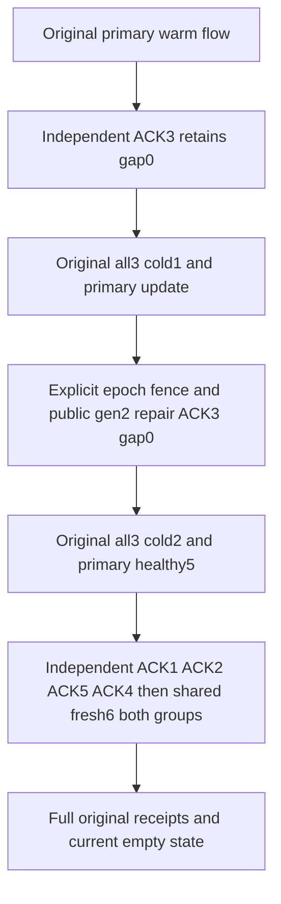

# Independent durable subscription checkpoint lifecycle

Canonical slice: Messaging. Parent [Messaging requirements](../Messaging.md), [ADR-117 native test entry](../../ADR/ADR-117-native-tunit-ci-entry.md), and [ADR-125 connection-owned execution](../../ADR/ADR-125-connection-owned-execution.md). Extends REQ-MSG-003 / AC-MSG-003 (KL089), not a confirmed product defect.

REQ-INDEPENDENT-CHECKPOINT-001 / AC-INDEPENDENT-CHECKPOINT-001: retain every original statement in CompetingWorkersPausedFilterCasAndContiguousGapsSurviveTwoColdCutsWithOriginalReceipts and its native Trial. At its existing phases, genuinely receive the original four events through Independent group, ACK position3 while position1/2 remain outstanding, and assert Independent generation1/checkpoint0 versus the original primary group's generation1/checkpoint1/paused state. An authentic Independent delivery token must not authorize ACK of the primary group. Require exact existing native refusal, each SDK/MCP response immediately followed by complete publicly observable status/source/outbox/placement state. Never forge/resign a token or compare local storage cut with logical receipt position.

REQ-INDEPENDENT-CHECKPOINT-002 / AC-INDEPENDENT-CHECKPOINT-002: reuse the ORIGINAL two joined all-three same-root RF3 cold boundaries with fresh lexical caller scopes. Original primary Update changes the SAME manager/data principal epoch1→2→3. After first cold, old successful/failed command IDs must return exact PermissionDenied/changed-outcome detail; a NEW command with the authentic old Independent token refuses PermissionDenied/data-policy-changed detail. Retain full original snapshots without normalizing them. Genuinely pause Independent generation1 and configure only the equivalent EventTypes [Created,Changed] with ExpectedGeneration1, preserving every policy/lease bound. Native changed-definition repair advances generation/owner2, resets issued tocheckpoint0 and clears old window whilepaused. Resume2; a fresh command carrying old generation1 token now refuses TokenInvalidated, while an original failed epoch3 command retains its original PermissionDenied. Fresh epoch3 generation2 receive returns1/2/3; ACK3 retains gap0 through the second ORIGINAL cold cut. Compare complete original ACK receipts independently of current status; settlement must retain actual old-token/Receive stale outcomes. Replay every saved success/refusal with full current observation after EACH route.

REQ-INDEPENDENT-CHECKPOINT-003 / AC-INDEPENDENT-CHECKPOINT-003: after second original cold and the ORIGINAL healthy primary event5 processing, Independent must be generation2/checkpoint0/issued3 with ACK3 completed. Genuine ACK1 advances only it to1, ACK2 closes its prefix to3; fresh claim4/5 and ACK5 stillleave gap3 until ACK4 advances it to5. A fresh literal Changed event6 is then independently consumed/ACKed by BOTH current groups, each advancing only its own prefix to6. Retain all five original event IDs/types/JSON and independent full position6 literal, complete per-group returned deliveries/receipt mutations, fixed native safe failures, and final empty Receive on both groups. Current source retention and complete outbox are observed public contracts, not raw journal/counter invariance.

REQ-INDEPENDENT-CHECKPOINT-004 / AC-INDEPENDENT-CHECKPOINT-004: original Case/Test/noArgs/UID and original McpCallerDeadline remain unchanged. No additional cold cycle, sleep, principal/grant/lease ceiling/policy-limit change, library, API, serializer, format, retry or topology is introduced. The explicit independently owned public paused-definition generation repair uses existing native operations and identical effective event corpus. Existing joined caller fixture owner is reused; every action/replay/cleanup preserves the failure ledger. Physical full post of existing native type is unknown until Main adoption. Native admission, compiler/analyzers, original-deadline fit and Linux RF3/runtime remain OPEN.

Source-backed nonduplicate: current OriginalFlow only asserts Independent checkpoint0 and never receives/ACKs it; current Update and Healthy mutate primary group exclusively. Native Unit IndependentGroupsRetainOnePayloadAndAckOnlyAContiguousPrefix covers warm prefix authority but not this complete dual-public/two-cold lifecycle. Original Nack/concurrent/empty-policy public continuations exercise one working group. New Test declarations:0. Backend/UI/API/storage/benchmark changes:N/A; regression owns IntegrationTests Messaging Helpers/Assertions/Models and this child spec.

R2 exact producer/empty oracles: first publication6 requires the entire independent one-element MutationReceipt vector (publishTopic, originaltopic, independent-checkpoint-six,6) before saving. First successful final empty Receive independently checks RequestId, complete nine-field expected current SubscriptionInfo, empty deliveries and original placement-bound token with positive logical position before any replay. No StoreCut/logical-position order is inferred.
