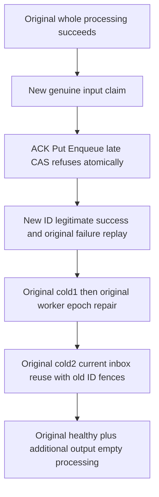

# Local CommitProcessing late-effect rollback and durable inbox replay

Canonical slice Messaging. Extends [REQ-MSG-002 / AC-MSG-002](../Messaging.md), [ADR-117](../../ADR/ADR-117-native-tunit-ci-entry.md) and [ADR-125](../../ADR/ADR-125-connection-owned-execution.md). KL090 is Inbox / CommitProcessing, not retained-history shorthand. Candidate is a missing complete public acceptance flow, not a confirmed product defect.

REQ-PROCESSING-LATE-001 / AC-PROCESSING-LATE-001: preserve the complete original InboxProcessingPublicColdTests.FailedEffectsOriginalInboxReceiptsAndRestoredPolicySurviveTwoRf3ColdCutsThenHealthyProcessing, all original statements and same Case/UID/deadline. After its original successful input processing, genuinely enqueue one additional input in the SAME lane using original administrator authority. Original nonadministrator worker genuinely claims it. Attempt local ProcessingRequest effects Put(new result), Enqueue(new output), then conflicting Put(ExpectedRevision9). Native CompleteProcessing stages ACK before ApplyMutations, and native Put uses staged revision1, so the final mutation returns exactly RevisionConflict / The expected revision does not match. Neither earlier document/output/outbox nor ACK/inbox success may survive. Compare entire original input lease/body and absent new result/output through SDK and official MCP immediately after EACH failure/replay. Preserve raw native outcomes/journal-clock semantics; public observations do not establish raw-store invariance.

REQ-PROCESSING-LATE-002 / AC-PROCESSING-LATE-002: a NEW command with the genuine SAME delivery, handler and generation and only legitimate Put+Enqueue must succeed with independent full ordered mutation vector putDocument(result,1), enqueue(output,1), Ack(input,3). Retain its entire original receipt and complete literal input Acked/output Ready/document revision1 state. Original failed GUID still returns its original RevisionConflict even after genuine settlement; a NEW GUID carrying that failed mixed effect body returns the native inbox changed-effects Conflict before stale lease lookup. No token is forged, no fingerprint/private row is synthesized.

REQ-PROCESSING-LATE-003 / AC-PROCESSING-LATE-003: reuse ORIGINAL two Aspire-owned all-three same-volume cold cuts, with every new worker/admin SDK/MCP caller scope joined before restart. First cold BEFORE original policy changes retains the original failed/successful command results and NEW-ID inbox reuse. Original owner then advances SAME worker epoch1→2→3. After restoration and second cold, old epoch1 command IDs must return exact changed-outcome PermissionDenied, while a NEW command carrying the same existing inbox identity returns the original successful effects receipt under current authorization. NEW changed effect body continues Conflict; failed original snapshots remain immutable. Every result/refusal/replay has immediate complete current business/outbox/placement observation before any later effect can conceal it.

REQ-PROCESSING-LATE-004 / AC-PROCESSING-LATE-004: after the original healthy output processing finishes, genuinely claim the additional output and process empty effects under the original worker/handler/generation. Require independent Ack-only mutation and full original receipt replay, terminal source/output metadata and exact retained document bytes. Zero new Case/Test/Args, cold cycles, policy/grant/clock/timeout/resource cap, API, library, transport/provider or architecture changes. UI/benchmark/product/storage format changes:N/A. Integration ownership is Messaging Helpers/Models/Assertions/Contracts and this sub-spec; Main alone adopts source and qualifies native UID/compiler/runtime/Linux/original deadline fit.

Existing native source proof: CompleteProcessing ACK-before-effects-before-inbox, ApplyMutations ordered staging plus outbox records, Put reads staged before-revision and CheckRevision exact literal. Existing public Original has only a FIRST-effect failing CAS, so does not observe rollback of earlier successful effects/ACK prefix. B's target CommitInbox mixed flow does not own source ACK. Qualification remains OPEN.

The added producer seed first establishes independently Ready input metadata (attempt0/state1/readySequence2), absent output/document and the legitimate committed outbox baseline; EACH SDK seed result and same-ID official replay immediately checks the entire current public matrix before Receive. Each input/output Receive retains its exact original request/result; independently checks RequestId, full delivery payload/header/attempt1/leaseVersion1/generation1 and the logical token partition/incarnation/ownership/positive position against pre-read placement, then replays the SAME request through official MCP and immediately observes full current state. Delivery token/lease expiry and logical position remain authenticated server-authored opaque fields, not guessed values. The full returned producer is retained unchanged.
