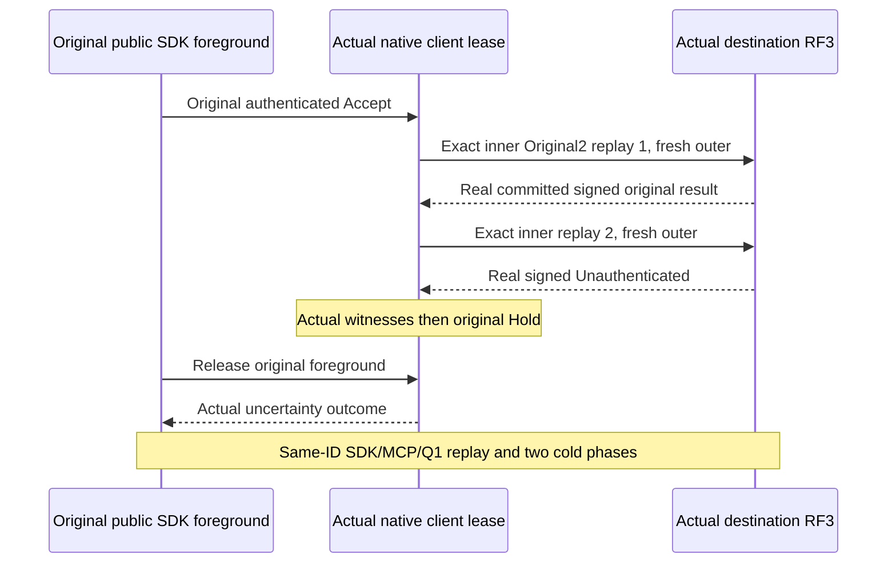

# Genuine native original nonce and wire fault whole flows

REQ-NATIVE-XFER-NONCE-001 maps to AC-NATIVE-XFER-NONCE-001: preserve OriginalSignedPacketCommitsThenDuplicateNonceRefusesAndSameIdReconcilesTwoColdOwners. Use the original six-silo two-RF3 Aspire native-cut wave, exact public eight-byte blob/document/moved-parent/queue seeding and persisted logical/technical identities. Arm the original authenticated command before its SDK foreground begins, freeze Original2 plan and await actual replay witnesses from the original callback lease.

REQ-NATIVE-XFER-NONCE-002 maps to AC-NATIVE-XFER-NONCE-002: first actual replay retains exact original inner body/signature/expiry and fresh current outer nonce/generations, commits the original native outcome and receipt; second actual replay retains same original inner nonce and must return signed Unauthenticated with full canonical images unchanged. Original released foreground remains UnknownWriteOutcome when its actual first effects occurred; exact authorized same-ID SDK/MCP/Q1 replay reconciles. Never substitute synthetic exception/reply or known pre-effect refusal for unknown effects.

REQ-NATIVE-XFER-NONCE-003 maps to AC-NATIVE-XFER-NONCE-003: retain full six live and stopped native cuts, all original target outcome/receipt/counter/source intent/counter/authority oracles, exactly two joined same-volume cold restarts with current full generation change, SDK/MCP/Q1 Create/Accept/Complete replay and healthy independent transfer. Original Create remains authorized in this non-revoked case. All original producer/task/callback/client/Aspire owners join with bounded cancellation and error aggregation before deleting roots.

REQ-NATIVE-XFER-WIRE-001 maps to AC-NATIVE-XFER-WIRE-001: all SIX original typed body faults preserve the original inner MAC and must return actual signed Unauthenticated without any canonical effect. Original operations then run healthy SDK/MCP/Q1 and two-cold full oracles. Use the frozen plan-only AllWireFaults6 catalog with exactly six actual sends in original order: MissingQueueTransfer, ReceiptStage, MissingIntentToken, EmptyNonce, EmptyCommandId, EmptyDestinationIncarnation. Each witness retains its individual variation and ordinal1..6; the immutable Original2 and single-mode limits remain unchanged; no new dispatch delegate, arbitrary bytes, peer HTTP, fake network or fabricated receiver may close it.

Source packets do not qualify compiler, discovery or runtime gates. Root owns route/lifecycle and runtime error classification; Producer owns actual replay capability plus byte/MAC assertions. Messaging owns these whole callers/seed/flow/gate/cold oracles. Preserve old case UIDs and immutable failures until complete guarded successors join.
