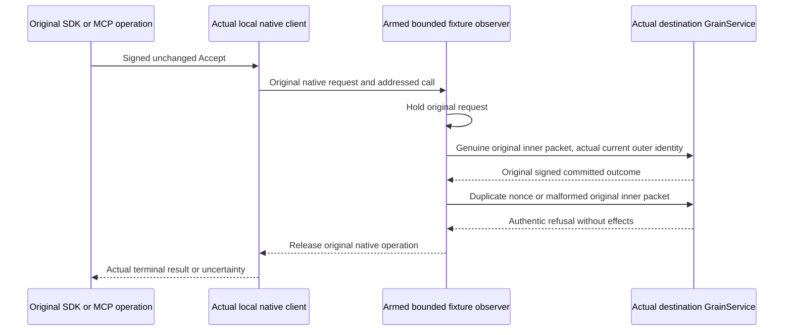

# Native original transfer faults

Source scope before implementation. This extends REQ/AC-XFER-002/003/005 and NativeRemoteModelTransport AC-NATIVE-MODEL-002..005. Compiler and actual Linux Aspire RF3 SDK/official MCP execution remain open. Historical peer HTTP and manual-loopback failures remain evidence, not active acceptance topology.

REQ-XFER-NATIVE-FAULT-001 → AC-XFER-NATIVE-FAULT-001: capture and hold the actual original Accept packet inside the existing local native client lifetime. Preserve exact generated inner bytes, inner MAC, original expiry, physical source/destination tuples and actual current full silo generations. Use the original addressed GrainService ExchangeAsync. A direct resend is fixture-armed, bounded and joined; it must not mint a business command, grant, credential, target outcome or receipt.

REQ-XFER-NATIVE-FAULT-002 → AC-XFER-NATIVE-FAULT-002: genuine first original Accept commits the target once; duplicate original inner nonce refuses Unauthenticated with unchanged six-owner canonical queue/transfer image and native target outcome/receipt/capacity. Releasing the held original foreground operation preserves its authentic UnknownWriteOutcome. Same business ID reconciles through SDK and official MCP without effects; two cold restarts retain exact receipts, full literal message/state, completion and a fresh healthy transfer.

REQ-XFER-NATIVE-FAULT-003 → AC-XFER-NATIVE-FAULT-003: six malformed original variants retain the original inner MAC and cannot apply: absent QueueTransfer, changed stage, empty intent, empty nonce, empty original command, empty destination incarnation. The authentic receiver refusal and full unchanged canonical images are asserted after each real native call. Fresh current outer identity cannot authorize invalid historical inner bytes. Normal original operation is then released and must complete with its actual receipt.

REQ-XFER-NATIVE-FAULT-004 → AC-XFER-NATIVE-FAULT-004: hold the actual signed successful reply only after its target durable operation. Compare original full outcome and reply identities; release or tamper happens before original client verification. Cancellation/disposal joins the original addressed RPC, observer and public producer; preserve primary and cleanup failures and retain roots on incomplete join. No HTTP middleware, synthetic reply, inferred address, test oracle, alternate cluster, retry-to-pass or skip may substitute.

Owned Integration Messaging roles: Cases/RemoteTransferOriginalNonceTests and RemoteTransferNativeWireTests; Helpers/RemoteTransferOriginalNonceTrial, RemoteTransferNativeWireTrial, RemoteTransferOriginalNonceSend, RemoteTransferOriginalNonceSettlement, RemoteTransferOriginalRequestGate, RemoteTransferOriginalResponseGate, RemoteTransferWireFaultSend, RemoteTransferWireFaultShapes; Models/RemoteTransferHeldWire; Assertions/RemoteTransferOriginalNonceReply. An obsolete HTTP response buffer is removed only after every caller is mapped to a genuine successor. Current canonical snapshot/continuation dependencies must be ported against Root's real Aspire six-owner fixture rather than replaced by reduced public-only assertions.

Producer owns the shared native client observer and authentic on-silo resend boundary. Root owns the manual fixture replacement, common six-owner snapshot/cold lifecycle and Blob fault flow. Ann owns product native client/runtime/service. Messaging code consumes frozen APIs only. Missing contracts: actual callback phase/type and direct original addressed RPC delegate; same inner packet with fresh outer identity for inner-nonce isolation; actual current active silo-generation witness; bounded six-owner canonical snapshot/outcome/capacity capability; owned same-volume stop/start and original task join. The feature must not fabricate these APIs while their owners freeze them.

No public/persisted schema, original nonce format, native MAC, deadline, maximum reply, grant, resource limit or default changes. SDK/official MCP remain genuine public callers. Fixture observer absent in ordinary product execution. Readiness and cleanup are Aspire-owned. Every original substantive oracle remains required; source packets do not qualify the gate.
